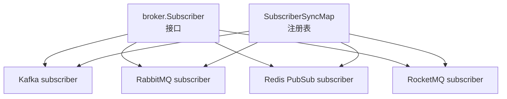
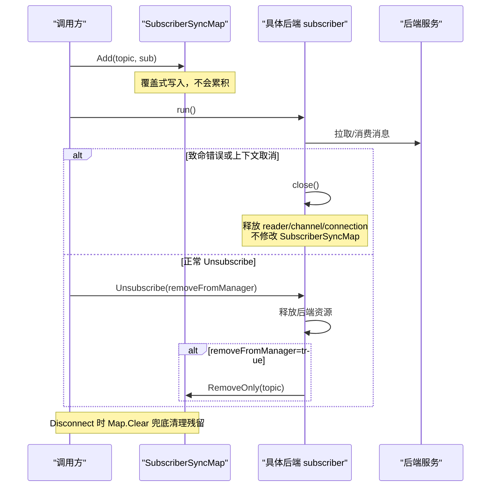
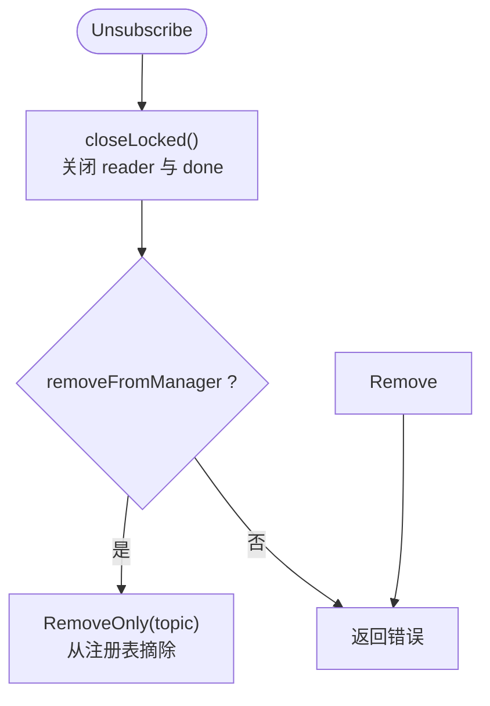
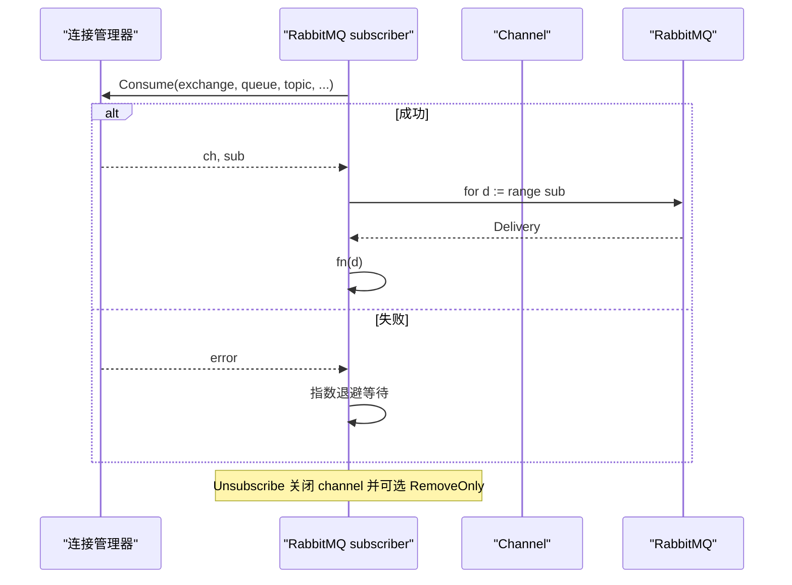
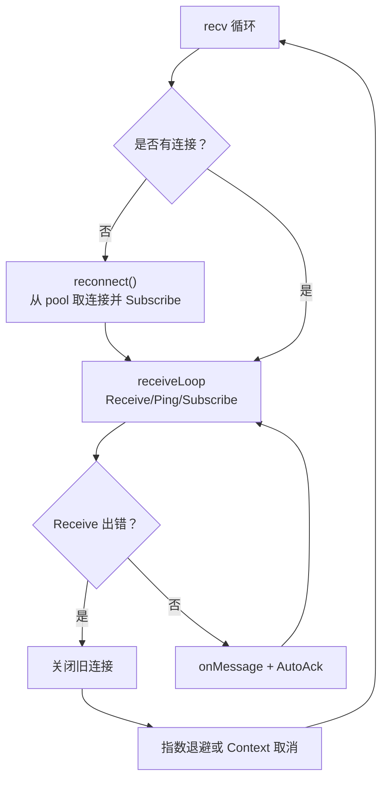
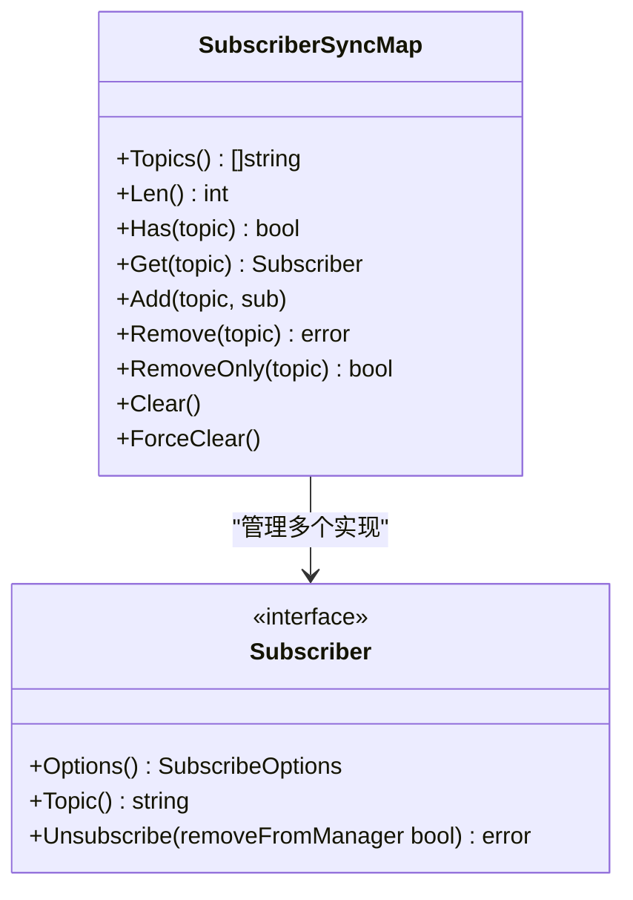
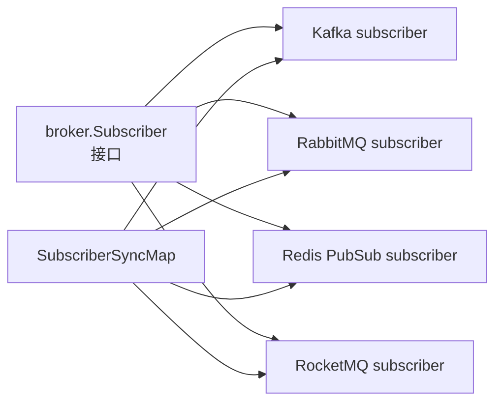

# 订阅者生命周期管理

<cite>
**本文引用的文件**   
- [broker/subscriber.go](file://broker/subscriber.go)
- [broker/kafka/subscriber.go](file://broker/kafka/subscriber.go)
- [broker/kafka/subscriber_test.go](file://broker/kafka/subscriber_test.go)
- [broker/rabbitmq/subscriber.go](file://broker/rabbitmq/subscriber.go)
- [broker/redis/pubsub/subscriber.go](file://broker/redis/pubsub/subscriber.go)
- [broker/rocketmq/v2/subscriber.go](file://broker/rocketmq/v2/subscriber.go)
</cite>

## 目录
1. [引言](#引言)
2. [项目结构](#项目结构)
3. [核心组件](#核心组件)
4. [架构总览](#架构总览)
5. [详细组件分析](#详细组件分析)
6. [依赖关系分析](#依赖关系分析)
7. [性能与并发特性](#性能与并发特性)
8. [故障排查指南](#故障排查指南)
9. [结论](#结论)

## 引言
本文聚焦 Broker 订阅者生命周期，尤其是 `SubscriberSyncMap` 的线程安全语义、致命退出后的资源清理责任归属、各后端 Unsubscribe 行为差异，以及 Topics/Len/Has 高报死订阅者的已知限制。文档同时覆盖连接池、自动重连、退避算法、批量处理、上下文取消等高级机制，并给出可操作的排障建议。

## 项目结构
Broker 订阅能力由抽象接口与多后端实现组成：
- 抽象层：`broker.Subscriber` 接口与 `SubscriberSyncMap` 注册表。
- Kafka：基于 segmentio/kafka-go Reader 的单条与批量拉取循环。
- RabbitMQ：基于 amqp091-go Channel 的 Consume 循环与 resubscribe。
- Redis PubSub：基于 redigo PubSubConn 的重连与接收循环。
- RocketMQ：基于 PushConsumer 的订阅封装。

**图示来源**
- [broker/subscriber.go:12-200](file://broker/subscriber.go#L12-L200)
- [broker/kafka/subscriber.go:20-110](file://broker/kafka/subscriber.go#L20-L110)
- [broker/rabbitmq/subscriber.go:14-126](file://broker/rabbitmq/subscriber.go#L14-L126)
- [broker/redis/pubsub/subscriber.go:15-247](file://broker/redis/pubsub/subscriber.go#L15-L247)
- [broker/rocketmq/v2/subscriber.go:12-55](file://broker/rocketmq/v2/subscriber.go#L12-L55)

**章节来源**
- [broker/subscriber.go:12-200](file://broker/subscriber.go#L12-L200)

## 核心组件
### Subscriber 接口
所有后端统一暴露：
- Options：返回订阅选项，含 Context、AutoAck、Codec、Binder 等。
- Topic：返回主题名。
- Unsubscribe(removeFromManager bool)：释放后端资源；当 removeFromManager 为真时，调用方希望从 broker 的注册表中摘除该 topic。

**章节来源**
- [broker/subscriber.go:12-20](file://broker/subscriber.go#L12-L20)

### SubscriberSyncMap
线程安全的 topic → Subscriber 映射，提供以下方法：
- Topics()：只读遍历键集合。
- Len()：只读长度。
- Has(topic)：只读存在性。
- Get(topic)：只读取值。
- GetAll()：返回整个 map 副本。
- Add(topic, sub)：写锁写入，按 topic 覆盖式替换。
- Remove(topic)：先删除条目，再调用 sub.Unsubscribe(true)。
- RemoveOnly(topic)：仅删条目，不调用 Unsubscribe。
- Clear()：快照全部订阅者后清空 map，并逐个调用 Unsubscribe(false)。
- ForceClear()：直接重建空 map，不调用 Unsubscribe。
- RemoveWithTimeout / ClearWithTimeout：带超时的异步卸载变体。

并发要点：
- 所有读操作使用 RWMutex 读锁。
- Add/Remove/RemoveOnly/Clear/ForceClear 使用写锁。
- Clear 会先拷贝订阅者列表再解锁，避免持有写锁时执行可能阻塞的后端 Unsubscribe。
- Remove 和 RemoveWithTimeout 在删除条目后再调 Unsubscribe(true)；Clear/ClearWithTimeout 调 Unsubscribe(false)，因为 map 已清空，不再需要“从管理器摘除”。

**章节来源**
- [broker/subscriber.go:24-200](file://broker/subscriber.go#L24-L200)

## 架构总览
订阅者生命周期关键阶段：
1. Subscribe：创建具体后端 subscriber，并通过 Add 注册到 SubscriberSyncMap。
2. Run：启动消息拉取或消费循环，监听 Context.Done 与内部 done 信号。
3. 致命错误：立即 close 自身资源（reader/channel/connection），但**不主动从 SubscriberSyncMap 摘除**。
4. 显式 Unsubscribe：释放后端资源；若 removeFromManager 为真，则通过 RemoveOnly 摘除注册表条目。
5. Disconnect：调用 Clear，把残留的死订阅也收尾。

**图示来源**
- [broker/subscriber.go:120-200](file://broker/subscriber.go#L120-L200)
- [broker/kafka/subscriber.go:70-110](file://broker/kafka/subscriber.go#L70-L110)
- [broker/rabbitmq/subscriber.go:42-72](file://broker/rabbitmq/subscriber.go#L42-L72)
- [broker/redis/pubsub/subscriber.go:224-247](file://broker/redis/pubsub/subscriber.go#L224-L247)
- [broker/rocketmq/v2/subscriber.go:35-50](file://broker/rocketmq/v2/subscriber.go#L35-L50)

## 详细组件分析

### Kafka 订阅者
#### 生命周期与关闭
- closeLocked 是幂等关闭入口：设置 closed、关闭 reader、关闭 done channel；done 保持关闭状态，供 run 的 select 不加锁读取。
- Unsubscribe 会先 close，再根据 removeFromManager 调用 brokers.subscribers.RemoveOnly。
- run 有两个分支：processBatchMessage 与 processSingleMessage，均监听 options.Context.Done 与 done。

**图示来源**
- [broker/kafka/subscriber.go:70-110](file://broker/kafka/subscriber.go#L70-L110)

#### 致命错误判定与退出
isFatalError 将下列情况视为致命并立即退出：
- err == nil：非致命。
- context.Canceled 或被包装。
- 外部订阅上下文已失效。
- 订阅者已关闭。
- net.Error 且 Timeout() 为假（如连接拒绝）。
- io.EOF 不是致命：kafka-go Reader 内部会重连，交给退避重试。

测试用例 TestSubscriberRun_ExitsOnFatalFetchError 断言：当指向无人监听的地址时，run 应退出并释放资源；TestSubscriberClose_Idempotent 断言 close 幂等；TestSubscriberExitKeepsRegistryEntry 断言致命退出**不摘除注册表条目**。

**章节来源**
- [broker/kafka/subscriber.go:201-362](file://broker/kafka/subscriber.go#L201-L362)
- [broker/kafka/subscriber_test.go:143-199](file://broker/kafka/subscriber_test.go#L143-L199)
- [broker/kafka/subscriber_test.go:228-266](file://broker/kafka/subscriber_test.go#L228-L266)
- [broker/kafka/subscriber_test.go:276-342](file://broker/kafka/subscriber_test.go#L276-L342)
- [broker/kafka/subscriber_test.go:344-422](file://broker/kafka/subscriber_test.go#L344-L422)

#### 退避与抖动
backoffDuration 对 attempt 做指数增长，截断到 max，再叠加 [0, d/2] 随机抖动，结果落在 [d/2, d]；backoffSleep 使用 math/rand 全局函数保证并发安全。测试覆盖了边界、溢出、min/max 非法自兜底、抖动区间不变性等。

**章节来源**
- [broker/kafka/subscriber.go:300-362](file://broker/kafka/subscriber.go#L300-L362)
- [broker/kafka/subscriber_test.go:1-142](file://broker/kafka/subscriber_test.go#L1-L142)

#### 批量处理模式
当 batchSize > 0 或 batchInterval > 0 时进入批量模式：缓冲消息，达到阈值或定时触发 handleBatchMessage；单条模式直接 FetchMessage 并 handleMessage。两者都通过 handleMessage 构造 broker.Message，支持 Binder 反序列化、Handler 处理、AutoAck 提交 offset。

**章节来源**
- [broker/kafka/subscriber.go:110-200](file://broker/kafka/subscriber.go#L110-L200)
- [broker/kafka/subscriber.go:201-300](file://broker/kafka/subscriber.go#L201-L300)

### RabbitMQ 订阅者
- Unsubscribe 关闭 channel，并在 removeFromManager 为真时 RemoveOnly 摘除注册表。
- resubscribe 是一个独立循环：等待连接恢复后重新 Consume，成功后重置延迟；失败则指数增长重连延迟。
- IsClosed 暴露 closed 标志，resubscribe 循环据此退出。

**图示来源**
- [broker/rabbitmq/subscriber.go:42-126](file://broker/rabbitmq/subscriber.go#L42-L126)

**章节来源**
- [broker/rabbitmq/subscriber.go:14-126](file://broker/rabbitmq/subscriber.go#L14-L126)

### Redis PubSub 订阅者
- recv 循环负责重连：初始 1s，最大 30s，每次失败翻倍；成功则重置回 1s。
- receiveLoop 维护健康检查 ticker，Ping 失败即中断 receiveLoop，外层 reconnect 重建连接。
- Unsubscribe 关闭当前 conn 并调用 Unsubscribe；注意本实现中 removeFromManager 未用于 RemoveOnly，因此它不负责从 broker 注册表摘除。
- 连接获取来自 broker 的连接池；pool 为 nil 时 reconnect 返回失败。

**图示来源**
- [broker/redis/pubsub/subscriber.go:56-247](file://broker/redis/pubsub/subscriber.go#L56-L247)

**章节来源**
- [broker/redis/pubsub/subscriber.go:15-247](file://broker/redis/pubsub/subscriber.go#L15-L247)

### RocketMQ 订阅者
- Unsubscribe 调用 PushConsumer.Unsubscribe(topic)，标记 closed，并按 removeFromManager 调用 RemoveOnly。
- 与 Kafka/RabbitMQ 一致：Unsubscribe(true) 会从注册表摘除；致命退出本身不摘除。

**章节来源**
- [broker/rocketmq/v2/subscriber.go:12-55](file://broker/rocketmq/v2/subscriber.go#L12-L55)

### 注册表语义与“死订阅者”问题
- Add 是覆盖式写入：同一 topic 重订阅会替换旧 subscriber，而不是累积。
- 致命退出路径（例如 Kafka 因 net.Error 非超时退出）只 close 自身资源，不 Remove 注册表。
- 因此 Topics()/Len()/Has() 会把仍驻留在 map 中的“死订阅者”计入——这是公开 API 的已知口径。
- 测试依据：
  - TestSubscriberExitKeepsRegistryEntry：断言致命退出后 Has 仍为真，Len 仍为 1。
  - 同文件后续断言重订阅后 Len=1 且 Get 返回新 subscriber，证明覆盖而非累积。
  - Disconnect 后要求 Len=0，说明 Clear 能兜底清理这些残留。

**图示来源**
- [broker/subscriber.go:12-200](file://broker/subscriber.go#L12-L200)

**章节来源**
- [broker/subscriber.go:40-200](file://broker/subscriber.go#L40-L200)
- [broker/kafka/subscriber_test.go:344-422](file://broker/kafka/subscriber_test.go#L344-L422)

## 依赖关系分析
- 抽象接口与注册表位于 broker 包，不依赖具体后端。
- 各后端 subscriber 通过 broker.SubscribeOptions 获取 Context、Codec、Binder、AutoAck 等配置。
- Kafka 依赖 kafka-go Reader；RabbitMQ 依赖 amqp091-go Channel；Redis 依赖 redigo PubSubConn；RocketMQ 依赖 PushConsumer。
- 注册表对后端无直接依赖，仅以 interface 形式持有 subscriber。

**图示来源**
- [broker/subscriber.go:12-200](file://broker/subscriber.go#L12-L200)
- [broker/kafka/subscriber.go:20-110](file://broker/kafka/subscriber.go#L20-L110)
- [broker/rabbitmq/subscriber.go:14-126](file://broker/rabbitmq/subscriber.go#L14-L126)
- [broker/redis/pubsub/subscriber.go:15-247](file://broker/redis/pubsub/subscriber.go#L15-L247)
- [broker/rocketmq/v2/subscriber.go:12-55](file://broker/rocketmq/v2/subscriber.go#L12-L55)

**章节来源**
- [broker/subscriber.go:12-200](file://broker/subscriber.go#L12-L200)

## 性能与并发特性
- SubscriberSyncMap 读写分离：读操作 O(1) 加读锁；写操作 O(1) 加写锁；Clear 先拷贝订阅者列表再解锁，降低写锁持有时间。
- Kafka 退避：指数增长 + 抖动，上限受 max 约束，避免风暴；attempt 计数在 run 中封顶为 6，但 backoffDuration 自身也有 min 自兜底与溢出保护。
- Kafka 批量模式：减少 Handler 调用次数，提高吞吐；批内每个消息独立处理，单个失败不影响批内其他消息。
- Redis PubSub：指数退避重连，健康检查 Ping 提前发现坏连接；连接取自 broker 连接池。
- RabbitMQ：resubscribe 指数退避，连接恢复后自动重建 Channel 与消费循环。
- 上下文传播：Kafka/Redis/RabbitMQ 均在循环中监听 Context.Done；Kafka handleMessage 使用 context.Background 作为基础，隔离每条消息的处理上下文。

**章节来源**
- [broker/kafka/subscriber.go:110-362](file://broker/kafka/subscriber.go#L110-L362)
- [broker/redis/pubsub/subscriber.go:56-247](file://broker/redis/pubsub/subscriber.go#L56-L247)
- [broker/rabbitmq/subscriber.go:42-126](file://broker/rabbitmq/subscriber.go#L42-L126)
- [broker/subscriber.go:40-200](file://broker/subscriber.go#L40-L200)

## 故障排查指南

### 如何诊断“死订阅者”
现象：Topics()/Len()/Has() 显示仍有订阅，但实际消息不再消费。
原因：订阅者因致命错误退出后，没有从 SubscriberSyncMap 摘除；重订阅会覆盖同名条目，但旧条目仍存在。
排查步骤：
1. 查看对应 topic 的 Has 是否仍为真。
2. 通过 Get(topic) 拿到具体 subscriber 实例，判断其 IsClosed（Kafka/RabbitMQ/RocketMQ 暴露 IsClosed）。
3. 如果 IsClosed 为真，说明是死订阅者；应调用 Disconnect 让 Clear 兜底清理。
依据：
- [broker/kafka/subscriber_test.go:344-422](file://broker/kafka/subscriber_test.go#L344-L422)
- [broker/subscriber.go:40-200](file://broker/subscriber.go#L40-L200)

### 连接泄漏
症状：进程内存持续增长，连接数不降。
常见原因：
- Redis：reconnect 失败时未建立连接；conn 为 nil 时 receiveLoop 直接报错并尝试重连。需检查 broker 连接池是否可用。
- RabbitMQ：resubscribe 循环在连接恢复前一直等待；确保连接管理器能发出 waitConnection 信号。
- Kafka：Reader.Close 未调用；确认 Unsubscribe(true) 被调用，或在 Shutdown 流程中调用 Disconnect。
定位要点：
- Redis：检查 pool 是否为 nil、Get 是否返回 nil、Subscribe 是否成功。
- RabbitMQ：检查 conn.connected 与 Consume 返回值。
- Kafka：检查 reader.Close 与 done 是否被关闭。

**章节来源**
- [broker/redis/pubsub/subscriber.go:160-247](file://broker/redis/pubsub/subscriber.go#L160-L247)
- [broker/rabbitmq/subscriber.go:72-126](file://broker/rabbitmq/subscriber.go#L72-L126)
- [broker/kafka/subscriber.go:70-110](file://broker/kafka/subscriber.go#L70-L110)

### 内存增长与 goroutine 泄漏
- Kafka：run 退出条件必须命中 Context.Done 或 done；若 done 未关闭，goroutine 会永久阻塞。close 幂等保证二次 close 不 panic。
- Redis：recv 循环会在收到 nil conn 或 Context 取消时退出；reconnect 失败也会退避等待。
- RabbitMQ：resubscribe 循环在 IsClosed 或连接关闭时退出。
验证手段：
- Kafka：TestSubscriberClose_Idempotent、TestSubscriberRun_ExitsOnContextCancel。
- Redis：观察 receiveLoop 是否因 Ping 错误或 Context 取消返回。
- RabbitMQ：观察 resubscribe 是否在 closed 后 return。

**章节来源**
- [broker/kafka/subscriber_test.go:276-342](file://broker/kafka/subscriber_test.go#L276-L342)
- [broker/redis/pubsub/subscriber.go:56-160](file://broker/redis/pubsub/subscriber.go#L56-L160)
- [broker/rabbitmq/subscriber.go:72-126](file://broker/rabbitmq/subscriber.go#L72-L126)

### Unsubscribe 行为差异速查
| 后端 | Unsubscribe(removeFromManager) 行为 | 是否 RemoveOnly |
|---|---|---|
| Kafka | 关闭 reader、关闭 done；若 removeFromManager 为真，RemoveOnly | 是 |
| RabbitMQ | 关闭 channel；若 removeFromManager 为真，RemoveOnly | 是 |
| Redis PubSub | 关闭 conn 并调用 Unsubscribe；未调用 RemoveOnly | 否 |
| RocketMQ | 调用 PushConsumer.Unsubscribe；若 removeFromManager 为真，RemoveOnly | 是 |

**章节来源**
- [broker/kafka/subscriber.go:70-110](file://broker/kafka/subscriber.go#L70-L110)
- [broker/rabbitmq/subscriber.go:42-72](file://broker/rabbitmq/subscriber.go#L42-L72)
- [broker/redis/pubsub/subscriber.go:224-247](file://broker/redis/pubsub/subscriber.go#L224-L247)
- [broker/rocketmq/v2/subscriber.go:35-50](file://broker/rocketmq/v2/subscriber.go#L35-L50)

## 结论
- SubscriberSyncMap 提供线程安全的注册表，但“死订阅者”不会被自动摘除；Topics/Len/Has 的高报是已知设计口径，应由调用方或 Disconnect 兜底。
- 重订阅是覆盖式语义，不会累积多条 subscriber。
- Kafka 的致命错误判定、退避抖动与批量处理共同构成高鲁棒性的拉取模型；Redis 的健康检查与指数退避重连保障连接可用性；RabbitMQ 的 resubscribe 循环简化了连接恢复后的消费重建；RocketMQ 则通过 PushConsumer.Unsubscribe 完成卸载。
- 运维侧应在应用退出时调用 Disconnect，以确保残留条目被 Clear 清理，避免注册表与外部观测指标失真。