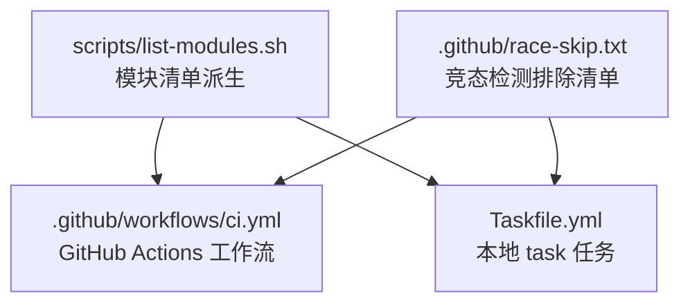
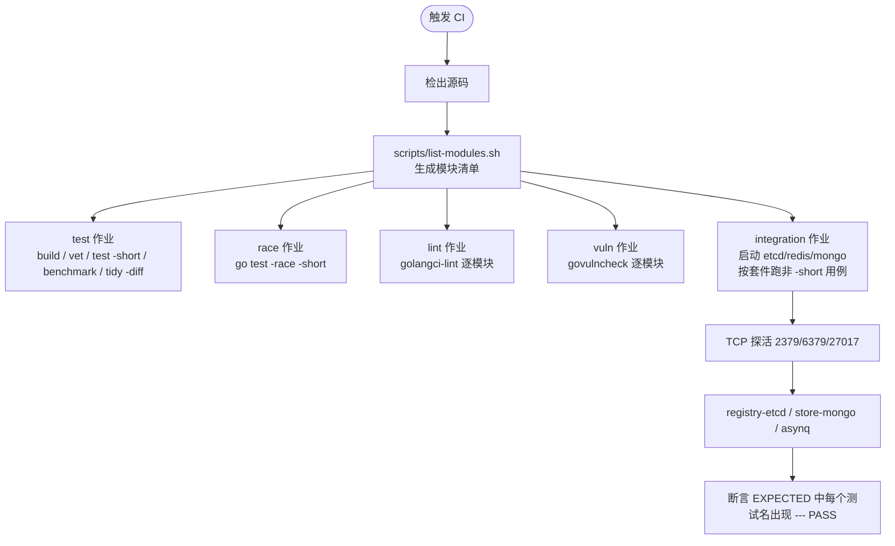
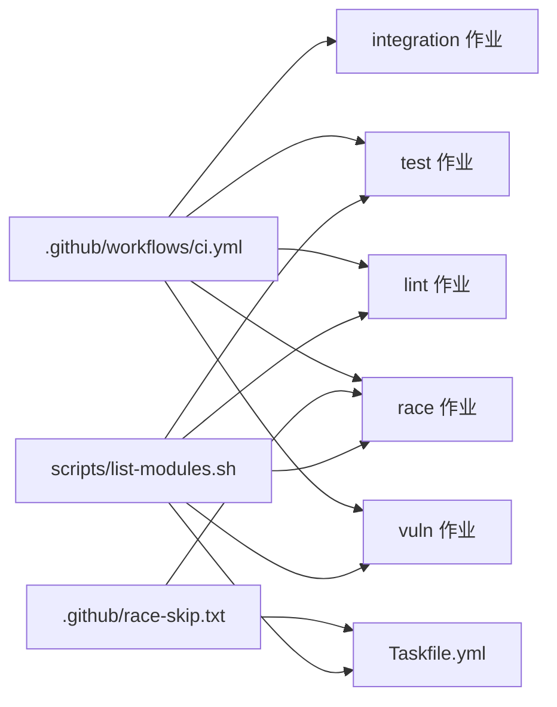

# CI 质量闸门

<cite>
**本文引用的文件**   
- [scripts/list-modules.sh](file://scripts/list-modules.sh)
- [.github/workflows/ci.yml](file://.github/workflows/ci.yml)
- [.github/race-skip.txt](file://.github/race-skip.txt)
- [Taskfile.yml](file://Taskfile.yml)
</cite>

## 目录
1. [引言](#引言)
2. [项目结构](#项目结构)
3. [核心组件](#核心组件)
4. [架构总览](#架构总览)
5. [详细组件分析](#详细组件分析)
6. [依赖关系分析](#依赖关系分析)
7. [性能与稳定性考量](#性能与稳定性考量)
8. [故障排查指南](#故障排查指南)
9. [结论](#结论)

## 引言
本仓库是 93 个 Go module 的多模块仓库，没有 `go.work`，子模块通过相对 replace 组合成可编译闭包。CI 不维护手写模块清单，而是以 `scripts/list-modules.sh` 为唯一派生来源；GitHub Actions 的 `ci.yml` 与本地的 `Taskfile.yml` 都消费同一份脚本输出，从而保证本地与 CI 的覆盖范围不会漂移。

CI 由五个作业组成：
- **test**：每个模块的构建、vet、单元测试、基准冒烟与依赖面校验。
- **race**：启用竞态检测器的单测扫描，排除 `.github/race-skip.txt` 中的模块。
- **integration**：注入真实 etcd/redis/mongo，按套件运行非 `-short` 集成用例，并通过“日志中必须出现 PASS”兜底。
- **lint**：按模块循环执行 golangci-lint。
- **vuln**：按模块执行 govulncheck 代码可达漏洞扫描。

## 项目结构
CI 相关的关键文件只有四份：



**图表来源**
- [scripts/list-modules.sh:1-24](file://scripts/list-modules.sh#L1-L24)
- [.github/workflows/ci.yml:1-298](file://.github/workflows/ci.yml#L1-L298)
- [Taskfile.yml:1-452](file://Taskfile.yml#L1-L452)
- [.github/race-skip.txt:1-15](file://.github/race-skip.txt#L1-L15)

**章节来源**
- [scripts/list-modules.sh:1-24](file://scripts/list-modules.sh#L1-L24)
- [.github/workflows/ci.yml:1-298](file://.github/workflows/ci.yml#L1-L298)
- [Taskfile.yml:1-452](file://Taskfile.yml#L1-L452)

## 核心组件

### 模块清单派生机制
`scripts/list-modules.sh` 是唯一模块清单派生脚本，职责如下：
- 进入仓库根目录。
- 递归查找所有 `go.mod`。
- 排除 `.git/*`（避免 worktree/stash 残留）。
- 排除 `_example*`（示例是独立验证模块，由 Taskfile 的 `example-*` 任务单独处理）。
- 对目录去重并排序。
- 如果结果为空，打印错误并返回非零退出码，防止 CI 静默失效。
- 标准输出每行一个模块路径，根模块为 `.`，其余带 `./` 前缀。

本地 `Taskfile.yml` 通过 `sh scripts/list-modules.sh | tr '\n' ' '` 把清单转成空格分隔变量，供 `for` 循环逐项执行；CI 则在 shell 中直接 `$(sh scripts/list-modules.sh)` 迭代。

**章节来源**
- [scripts/list-modules.sh:1-24](file://scripts/list-modules.sh#L1-L24)
- [Taskfile.yml:28-37](file://Taskfile.yml#L28-L37)
- [.github/workflows/ci.yml:60-87](file://.github/workflows/ci.yml#L60-L87)

### -short 标志的使用场景
主 test 作业对每个模块执行：
```text
go test -short -timeout 5m ./...
```
同时追加基准冒烟：
```text
go test -bench . -benchtime=1x -run '^$' ./...
```

`-short` 跳过各模块中调用 `testing.Short()` 的集成测试，原因是以下包的 `TestServer`/`TestClient` 是等信号的手动用例，非 `-short` 会挂到超时：
- `transport/redis`
- `transport/kafka`
- `transport/rabbitmq`
- `transport/rocketmq`
- `transport/tcp`
- `transport/webrtc`

这些不是被忽略的“普通单测”，而是需要真实外部服务或复杂握手流程的端到端式用例，因此放在 integration 作业里按套件点名运行。

**章节来源**
- [.github/workflows/ci.yml:14-20](file://.github/workflows/ci.yml#L14-L20)
- [.github/workflows/ci.yml:60-87](file://.github/workflows/ci.yml#L60-L87)
- [.github/workflows/ci.yml:120-133](file://.github/workflows/ci.yml#L120-L133)

### 模块清单与本地/CI 一致性
| 位置 | 如何消费清单 | 一致性保障 |
|---|---|---|
| GitHub Actions `ci.yml` | `for mod in $(sh scripts/list-modules.sh)` | 脚本为空则整条命令失败 |
| `Taskfile.yml` | `MODULES: sh: sh scripts/list-modules.sh \| tr '\n' ' '` | Windows 下显式报错，不静默跳过 |
| `verify-scope` | `sh scripts/list-modules.sh \| grep -E '^\\./{{.PREFIX}}(/|$)'` | 前缀为空或无匹配时显式失败 |
| `race` | `sh scripts/list-modules.sh \| grep -vxF -f .github/race-skip.txt` | 排除后为空也报错 |
| `lint/vuln` | 同样使用 `MODULES` | 与 test 同口径 |

**章节来源**
- [Taskfile.yml:28-37](file://Taskfile.yml#L28-L37)
- [Taskfile.yml:209-231](file://Taskfile.yml#L209-L231)
- [Taskfile.yml:271-331](file://Taskfile.yml#L271-L331)
- [Taskfile.yml:349-387](file://Taskfile.yml#L349-L387)
- [.github/workflows/ci.yml:60-87](file://.github/workflows/ci.yml#L60-L87)
- [.github/workflows/ci.yml:120-133](file://.github/workflows/ci.yml#L120-L133)

## 架构总览



**图表来源**
- [.github/workflows/ci.yml:1-298](file://.github/workflows/ci.yml#L1-L298)
- [scripts/list-modules.sh:1-24](file://scripts/list-modules.sh#L1-L24)

## 详细组件分析

### test 作业：构建、静态检查、单测与依赖面门禁
test 作业是主循环，负责每个模块的常规质量门禁：

1. 设置 Go 1.27.3。
2. 预下载依赖，最多重试 3 次，缓解 proxy.golang.org 偶发 HTTP/2 中流错误。
3. 执行 `go mod tidy -diff`：只报告差异，不落盘，用于拦截 go.mod/go.sum 与 import 的漂移。
4. 根模块执行：
   - `go build ./...`
   - `go vet -copylocks=false ./...`
   - `go test -short -timeout 5m ./...`
   - `go test -bench . -benchtime=1x -run '^$' ./...`
5. 其他模块执行相同流程，但去掉 `-copylocks=false`。
6. 最后再跑 `internal/codegen` 的两个端到端计时用例，它们内部判断 `testing.Short()`，所以不在主 `-short` 循环内。

根模块的 `vet -copylocks=false` 是为了兼容 appkit 热重载中对 proto 配置顶层浅拷贝的既定设计，该区域属于 vet 误报区。

**章节来源**
- [.github/workflows/ci.yml:14-20](file://.github/workflows/ci.yml#L14-L20)
- [.github/workflows/ci.yml:60-87](file://.github/workflows/ci.yml#L60-L87)
- [.github/workflows/ci.yml:89-99](file://.github/workflows/ci.yml#L89-L99)

### race 作业：竞态检测
race 作业的范围是全部模块减去 `.github/race-skip.txt`：
```text
mods=$(sh scripts/list-modules.sh | grep -vxF -f .github/race-skip.txt)
```
当前排除项是 `./log/aliyun`，因为上游 `aliyun-log-go-sdk` 的 producer 生命周期存在数据竞争，bald 只是透传 Close，无法在不删能力的前提下修复。

每个模块执行：
```text
go test -short -race -timeout 10m ./...
```

注意：
- 仍带 `-short`，避免 transport 后端手动用例挂起。
- 默认值是“跑”，新增模块无需改这里。
- 清单派生为空时显式报错，防止闸门静默失效。

**章节来源**
- [.github/workflows/ci.yml:101-133](file://.github/workflows/ci.yml#L101-L133)
- [.github/race-skip.txt:1-15](file://.github/race-skip.txt#L1-L15)
- [Taskfile.yml:349-387](file://Taskfile.yml#L349-L387)

### integration 作业：真实后端集成测试
integration 作业的目标是覆盖非 `-short` 的集成测试，包括注册中心、存储和异步队列三条接缝。它不改动主 test 作业，原因正是 `transport/{redis,kafka,rabbitmq,rocketmq,tcp,webrtc}` 的 `TestServer`/`TestClient` 是等信号用例，不能放进主循环。

#### 服务启动与健康检查
作业声明三个服务：
| 服务 | 镜像 | 端口 | 关键配置 |
|---|---|---|---|
| etcd | `quay.io/coreos/etcd:v3.5.14` | 2379 | `ETCD_LISTEN_CLIENT_URLS=http://0.0.0.0:2379`、`ETCD_ADVERTISE_CLIENT_URLS=http://127.0.0.1:2379` |
| redis | `redis:7-alpine` | 6379 | 无额外参数 |
| mongo | `mongo:7` | 27017 | 无额外参数 |

环境变量还显式传入：
- `BALD_E2E_ETCD_ADDR=127.0.0.1:2379`
- `BALD_TEST_REDIS_URI=redis://127.0.0.1:6379`
- `BALD_MONGO_URI=mongodb://127.0.0.1:27017`

健康检查步骤用 Bash 的 `/dev/tcp` 对三个端口轮询，最多 60 次、每次间隔 2 秒，任一未就绪则作业失败。

**章节来源**
- [.github/workflows/ci.yml:135-178](file://.github/workflows/ci.yml#L135-L178)
- [.github/workflows/ci.yml:180-198](file://.github/workflows/ci.yml#L180-L198)

#### 套件与断言
集成测试分三个套件写入独立日志：
- `registry/etcd`
- `contrib/store-mongo`
- `transport/asynq`

随后在第二个 step 中，通过 `EXPECTED` 列表逐条检查日志是否包含对应测试名的 `--- PASS`：
- `TestRegisterDiscoverDeregister`
- `TestWatch_ReceivesChanges`
- `TestProvider_BuildsUsableRegistrar`
- `TestMongoCRUD`
- `TestTaskSubscribe`

这种设计的目的是防止用例被改名、被 Skip、被删除后“静默绿”。注释明确说明：这些被测用例采用“不可达即 `t.Skip`”，所以先做 TCP 探活，再断言 PASS 记录出现。

**章节来源**
- [.github/workflows/ci.yml:135-178](file://.github/workflows/ci.yml#L135-L178)
- [.github/workflows/ci.yml:180-238](file://.github/workflows/ci.yml#L180-L238)

### lint 作业：逐模块代码检查
lint 作业安装 pin 版本的 golangci-lint，并按 `scripts/list-modules.sh` 派生的全部模块循环执行：
```text
golangci-lint run ./...
```
配置位于根 `.golangci.yml`，子模块目录会自动向上发现。变更规则集必须升级 Taskfile 中的版本常量，否则上游新检查可能静默引入。

**章节来源**
- [.github/workflows/ci.yml:240-272](file://.github/workflows/ci.yml#L240-L272)
- [Taskfile.yml:41-49](file://Taskfile.yml#L41-L49)
- [Taskfile.yml:231-254](file://Taskfile.yml#L231-L254)

### vuln 作业：代码可达漏洞扫描
vuln 作业安装 pin 版本的 govulncheck，并对每个模块执行：
```text
govulncheck ./...
```
它只报告“代码真正可达”的漏洞，而不是整个模块依赖树；标准库漏洞则由 `setup-go` 的补丁版本修复。

**章节来源**
- [.github/workflows/ci.yml:274-298](file://.github/workflows/ci.yml#L274-L298)
- [Taskfile.yml:254-270](file://Taskfile.yml#L254-L270)
- [Taskfile.yml:387-403](file://Taskfile.yml#L387-L403)

### _example/bald 与 CI 覆盖边界
_example/bald 是一个独立 module，且其 `go.mod` 把两个 kratos contrib 模块 replace 到仓库外的同级检出路径。因此在干净检出的 CI 环境中无法装载该示例模块的完整依赖图。文档不得宣称“_example 已在 CI 可装载性上被验证”。

Taskfile 提供了 `example-tidy`、`example-bald-vet`、`example-bald-vet-grpcgw`、`example-e2e` 等任务，但这些属于本地回归和手动验证入口，不应被描述为 CI 的默认集成覆盖。

**章节来源**
- [.github/workflows/ci.yml:135-178](file://.github/workflows/ci.yml#L135-L178)
- [Taskfile.yml:114-171](file://Taskfile.yml#L114-L171)

## 依赖关系分析



**图表来源**
- [scripts/list-modules.sh:1-24](file://scripts/list-modules.sh#L1-L24)
- [.github/workflows/ci.yml:1-298](file://.github/workflows/ci.yml#L1-L298)
- [.github/race-skip.txt:1-15](file://.github/race-skip.txt#L1-L15)
- [Taskfile.yml:1-452](file://Taskfile.yml#L1-L452)

**章节来源**
- [scripts/list-modules.sh:1-24](file://scripts/list-modules.sh#L1-L24)
- [.github/workflows/ci.yml:1-298](file://.github/workflows/ci.yml#L1-L298)
- [Taskfile.yml:1-452](file://Taskfile.yml#L1-L452)

## 性能与稳定性考量

| 关注点 | 实现方式 | 影响 |
|---|---|---|
| 依赖下载不稳定 | 每个 job 的 `go mod download` 最多重试 3 次，间隔 15 秒 | 降低代理网络瞬断导致的假失败 |
| GOPROXY | `https://goproxy.io\|https://proxy.golang.org,direct` | 主源 + 备源 + 直连，兼顾国内速度与回退 |
| 测试超时 | test 作业 `go test -timeout 5m`，race 作业 `-timeout 10m` | 防止手动用例挂死整条流水线 |
| 端到端用例隔离 | `internal/codegen` 的 EndToEndTimed/AuthzClosedLoop 在主循环外单独执行，超时 15 分钟 | 避免分钟级墙钟用例污染主循环节奏 |
| 基准冒烟 | `-bench . -benchtime=1x -run '^$'` | 编译并跑一轮基准，拦截基准编译和 panic 回归 |
| 竞态检测成本 | race 作业独立于 test，默认值“跑”但不混入 verify | 全仓 -race 需 cgo 且慢，避免阻塞常规开发流 |
| 工具链版本 | Taskfile vars 中 pin golangci-lint、govulncheck、actionlint | 避免上游升级静默改变检查行为 |

**章节来源**
- [.github/workflows/ci.yml:60-87](file://.github/workflows/ci.yml#L60-L87)
- [.github/workflows/ci.yml:101-133](file://.github/workflows/ci.yml#L101-L133)
- [.github/workflows/ci.yml:89-99](file://.github/workflows/ci.yml#L89-L99)
- [Taskfile.yml:41-49](file://Taskfile.yml#L41-L49)

## 故障排查指南

### 1. CI 显示“workflow file issue”且 0 个 job
**现象**：修改 `.github/workflows/*.yml` 后，GitHub 拒绝整个文件，本地 YAML 解析器看不出问题。  
**原因**：GitHub 在编译期解析作业文件，`services` 下写了不支持的键（例如 `args`），会导致整个文件被拒。  
**修复**：容器参数改用同名环境变量；修改作业文件前先执行 `task ci-workflow-lint`。

**章节来源**
- [.github/workflows/ci.yml:154-167](file://.github/workflows/ci.yml#L154-L167)
- [Taskfile.yml:254-270](file://Taskfile.yml#L254-L270)

### 2. integration 作业静默绿，实际没跑任何测试
**现象**：作业成功，但日志全是 SKIP，或者 EXPECTED 断言失败。  
**原因**：被测用例是“不可达即 `t.Skip`”；如果服务未就绪，跳过不会被视作失败。  
**修复**：
- 确认 etcd/redis/mongo 已启动且端口可连通。
- 检查 `BALD_E2E_ETCD_ADDR`、`BALD_TEST_REDIS_URI`、`BALD_MONGO_URI`。
- 查看 `/tmp/int/*.log` 中是否出现对应的 `--- PASS`。

**章节来源**
- [.github/workflows/ci.yml:135-178](file://.github/workflows/ci.yml#L135-L178)
- [.github/workflows/ci.yml:180-238](file://.github/workflows/ci.yml#L180-L238)

### 3. 主循环挂死在 transport 测试
**现象**：`go test` 长时间等待，最终超时。  
**原因**：`transport/{redis,kafka,rabbitmq,rocketmq,tcp,webrtc}` 的 `TestServer`/`TestClient` 是等信号用例，非 `-short` 会挂。  
**修复**：不要从主循环去掉 `-short`；如需复现，只在 integration 作业中按套件运行。

**章节来源**
- [.github/workflows/ci.yml:14-20](file://.github/workflows/ci.yml#L14-L20)
- [.github/workflows/ci.yml:120-133](file://.github/workflows/ci.yml#L120-L133)

### 4. 本地 verify 与 CI 覆盖不一致
**现象**：本地 `task verify` 通过，CI 却对某个模块失败。  
**原因**：模块清单不再手写；如果 `scripts/list-modules.sh` 谓词变化，或某模块目录移动，两侧会立刻一致地反映出来。  
**修复**：
- 检查模块目录是否仍在 find 结果中。
- 检查是否被 `_example*` 或 `.git/*` 意外排除。
- 对单个模块用 `task verify-module MOD=<dir>` 快速定位。

**章节来源**
- [scripts/list-modules.sh:1-24](file://scripts/list-modules.sh#L1-L24)
- [Taskfile.yml:303-331](file://Taskfile.yml#L303-L331)

### 5. race 作业漏掉模块
**现象**：race 作业没有扫描某个模块。  
**原因**：该模块可能被 `.github/race-skip.txt` 排除。  
**修复**：
- 检查排除理由是否仍成立。
- 若问题是 bald 自身竞争，应修复代码而非加入排除清单。
- 仅当确属上游竞争或平台限制时才保留排除。

**章节来源**
- [.github/race-skip.txt:1-15](file://.github/race-skip.txt#L1-L15)
- [.github/workflows/ci.yml:101-133](file://.github/workflows/ci.yml#L101-L133)

### 6. lint 或 vuln 突然变严
**现象**：原本通过的模块在新版工具链下失败。  
**原因**：golangci-lint 和 govulncheck 的版本由 Taskfile 的 `vars` 固定；升级是显式动作。  
**修复**：
- 先确认是否为上游规则集或漏洞数据库变更。
- 按需升级 `GOLANGCI_LINT_VERSION` 或 `GOVULNCHECK_VERSION`。
- 对风格类问题交给 gofmt，不要扩大 lint 范围。

**章节来源**
- [Taskfile.yml:41-49](file://Taskfile.yml#L41-L49)
- [Taskfile.yml:231-270](file://Taskfile.yml#L231-L270)

### 7. 示例模块在 CI 装载失败
**现象**：尝试在 CI 运行 `_example/bald` 时依赖解析失败。  
**原因**：它的 go.mod 把 kratos contrib 的 config/registry/nacos replace 到仓库外同级检出路径，干净 CI 环境不存在该路径。  
**修复**：这是独立于仓库 CI 的问题；要支持 CI 示例，需要为 replace 目标提供已发布版本，不属于当前 CI 默认覆盖范围。

**章节来源**
- [.github/workflows/ci.yml:135-178](file://.github/workflows/ci.yml#L135-L178)
- [Taskfile.yml:114-171](file://Taskfile.yml#L114-L171)

## 结论
Bald 的 CI 质量闸门围绕一条模块清单派生展开：`scripts/list-modules.sh` 是单一真相源，`ci.yml` 与 `Taskfile.yml` 共享同一份模块集合，避免本地与 CI 的覆盖漂移。五个作业各司其职：
- test 守护构建、静态检查、短测试和基准冒烟；
- race 守护并发安全；
- integration 守护真实后端；
- lint 守护代码正确性与死代码；
- vuln 守护代码可达漏洞。

关键设计原则是：**清单自动发现、超时防护、服务探活、PASS 断言、工具链 pin、排除清单显式化**。遵循这些原则，可以避免最常见的 CI 静默失效——尤其是“服务不可达导致全量 SKIP”和“新增模块未被覆盖”。