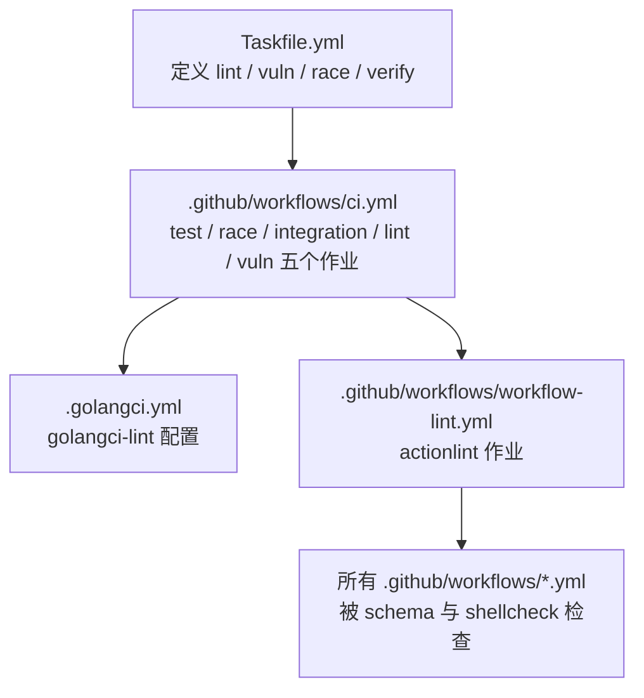
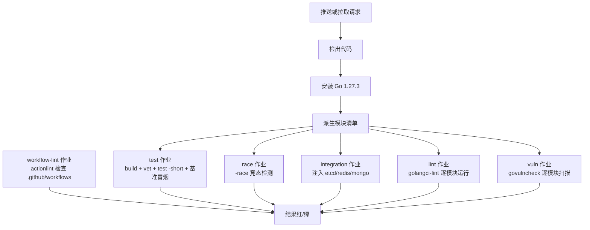
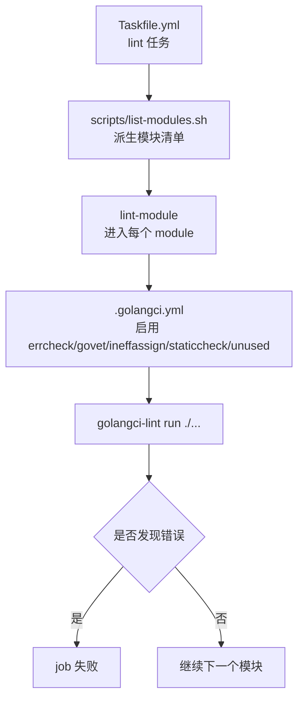
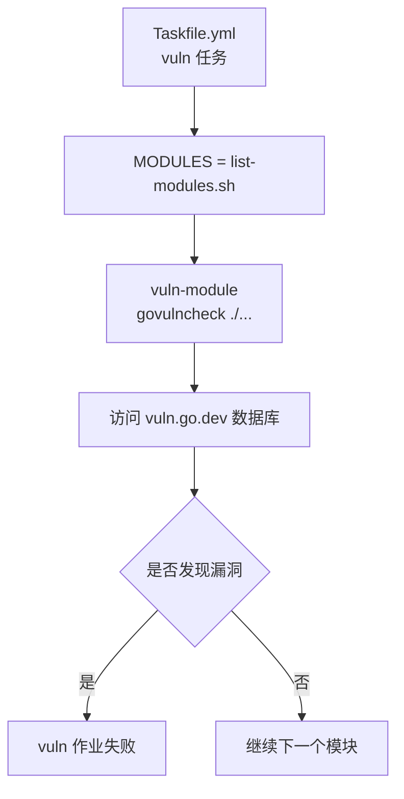
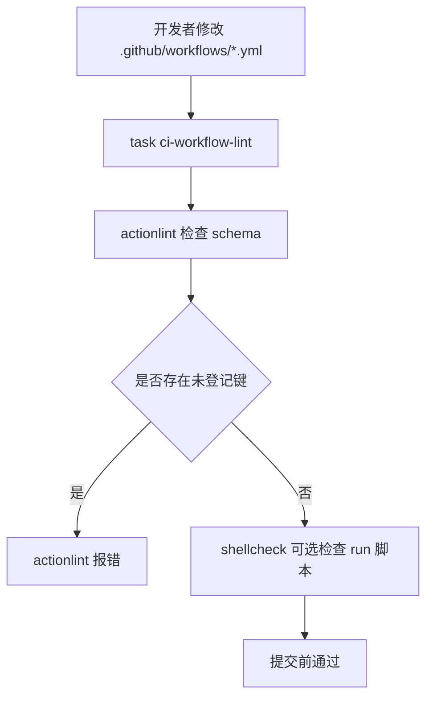
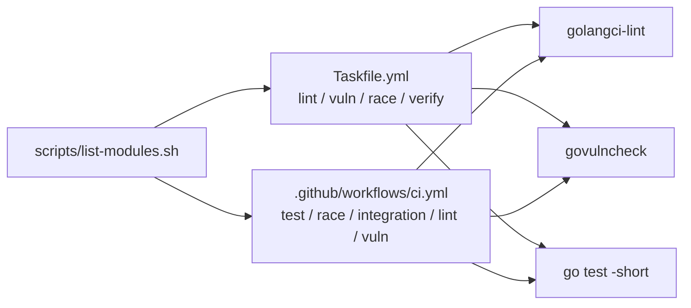

# 代码质量检查

<cite>
**本文引用的文件**   
- [.golangci.yml](file://.golangci.yml)
- [Taskfile.yml](file://Taskfile.yml)
- [.github/workflows/ci.yml](file://.github/workflows/ci.yml)
- [.github/workflows/workflow-lint.yml](file://.github/workflows/workflow-lint.yml)
</cite>

## 目录
1. [简介](#简介)
2. [项目结构](#项目结构)
3. [核心组件](#核心组件)
4. [架构总览](#架构总览)
5. [详细组件分析](#详细组件分析)
6. [依赖关系分析](#依赖关系分析)
7. [性能与成本](#性能与成本)
8. [故障排查指南](#故障排查指南)
9. [结论](#结论)

## 简介
本文面向仓库的“代码质量检查”主题，覆盖三个层面：
- **lint 作业**：`golangci-lint` 规则集选择、模块循环检查、死代码检测策略。
- **vuln 作业**：`govulncheck` 的依赖漏洞扫描范围、标准库漏洞检测方式及修复建议。
- **workflow lint**：`actionlint` 对 GitHub Actions 文件的校验重点，尤其是 `services` 键限制和 `args` 参数禁用。

同时给出代码风格规范、安全扫描规则、依赖管理最佳实践，以及质量闸门绕过方法与临时解决方案审批流程。

## 项目结构
本仓是 93 个 Go module 的多模块仓库（无 `go.work`），CI 和本地构建都通过 `scripts/list-modules.sh` 派生模块清单，确保 CI 与本地任务口径一致。质量检查相关入口如下：



**图示来源**
- [Taskfile.yml:201-360](file://Taskfile.yml#L201-L360)
- [.github/workflows/ci.yml:1-120](file://.github/workflows/ci.yml#L1-L120)
- [.github/workflows/workflow-lint.yml:1-46](file://.github/workflows/workflow-lint.yml#L1-L46)

**章节来源**
- [Taskfile.yml:1-120](file://Taskfile.yml#L1-L120)
- [.github/workflows/ci.yml:1-60](file://.github/workflows/ci.yml#L1-L60)

## 核心组件
| 组件 | 职责 | 关键约束 |
|---|---|---|
| `.golangci.yml` | 定义 golangci-lint 规则集、超时、排除项 | 默认关闭全部 linter，只启用 errcheck、govet、ineffassign、staticcheck、unused；静态检查只拦正确性与死代码，风格交给 gofmt |
| `Taskfile.yml` | 本地工具链安装、lint/vuln/race/verify 任务 | 版本 pin 在 `vars` 中集中维护；模块清单复用 `scripts/list-modules.sh` |
| `.github/workflows/ci.yml` | CI 主流水线 | test / race / integration / lint / vuln 五个作业；根模块 vet 降级 `-copylocks=false` |
| `.github/workflows/workflow-lint.yml` | GitHub Actions 自身校验 | actionlint 对 workflow schema 与 shellcheck 做检查；改作业文件前先跑 `task ci-workflow-lint` |

**章节来源**
- [.golangci.yml:1-47](file://.golangci.yml#L1-L47)
- [Taskfile.yml:1-120](file://Taskfile.yml#L1-L120)
- [.github/workflows/ci.yml:1-120](file://.github/workflows/ci.yml#L1-L120)
- [.github/workflows/workflow-lint.yml:1-46](file://.github/workflows/workflow-lint.yml#L1-L46)

## 架构总览
质量检查的 CI 流程可概括为：检出源码 → 按模块下载依赖 → tidy 校验依赖面 → build / vet / test → lint → govulncheck。其中 workflow lint 由独立 job 承担，避免“工作流文件坏了时，工作流里的检查也失效”。



**图示来源**
- [.github/workflows/ci.yml:1-120](file://.github/workflows/ci.yml#L1-L120)
- [.github/workflows/workflow-lint.yml:1-46](file://.github/workflows/workflow-lint.yml#L1-L46)

## 详细组件分析

### golangci-lint 配置与 lint 作业
`.golangci.yml` 明确采用“默认全关、仅启五类”的策略：

| 类别 | 是否启用 | 说明 |
|---|---:|---|
| errcheck | 是 | 强制显式处理 error；CLI 输出给 stdout/stderr，错误靠进程退出码传递 |
| govet | 是 | 编译期静态检查 |
| ineffassign | 是 | 检测无效赋值 |
| staticcheck | 是 | 开启 `all`，但排除 ST*、QF*，并单独排除 S1005、SA1012 |
| unused | 是 | 检测未使用符号 |
| 其他规则 | 否 | 风格问题交给 gofmt，避免意见型 linter 制造噪音 |

#### 规则细节
- **errcheck**：排除 `fmt.Fprint`、`fmt.Fprintf`、`fmt.Fprintln`；测试文件整体排除 errcheck，因为资源清理与临时文件写入不属于被测行为，而生产代码仍受强制约束。
- **staticcheck**：保留 SA*（正确性）与 S1*（可简化），排除 ST*（风格）与 QF*（quickfix）。S1005 与 errcheck 对 channel 接收丢弃存在冲突，故显式排除；SA1012 对 `log.Logger` 的 nil context 用法放行，因为实现已处理 nil 且调用方可能确实不关联请求上下文。
- **exclusions**：按路径匹配 `_test\\.go`，仅对测试禁用 errcheck。

#### 模块循环检查与死代码
- 模块循环由 golangci-lint 的模块级运行机制配合 Go toolchain 发现；根 `.golangci.yml` 会被子模块自动向上发现，因此不需要在每个子模块重复配置。
- `unused` 负责检测未使用的包、变量、函数等，是死代码检测的主要入口；`ineffassign` 补充“赋值后未被读取”的情形。
- 由于本仓是多模块仓库，lint 不是只对根模块执行，而是通过 Taskfile 的 `lint` / `lint-module` 任务，对 `scripts/list-modules.sh` 派生的每个 module 分别运行 `golangci-lint run ./...`。



**图示来源**
- [Taskfile.yml:201-360](file://Taskfile.yml#L201-L360)
- [.golangci.yml:1-47](file://.golangci.yml#L1-L47)

**章节来源**
- [.golangci.yml:1-47](file://.golangci.yml#L1-L47)
- [Taskfile.yml:201-360](file://Taskfile.yml#L201-L360)

### govulncheck 配置与 vuln 作业
vuln 作业的职责是扫描“代码可达”的依赖漏洞。它不直接维护规则集，而是通过 `Taskfile.yml` 安装固定版本的 `govulncheck`，并按模块逐包执行 `govulncheck ./...`。

#### 扫描范围
- **依赖漏洞**：对每个 module 下所有可达包进行扫描，命中 `golang.org/x/vuln` 数据库中的已知漏洞。
- **标准库漏洞**：随 `setup-go@v5` 安装的 Go 补丁版本修复标准库漏洞；依赖升级则通过把有漏洞的依赖升级到 `fixed` 版本解决。
- **修复建议**：通常包括升级依赖到 fixed 版本、替换不可用依赖、调整导入路径，或在无法升级时添加版本屏蔽。具体修复条目由 govulncheck 输出决定。

#### 执行方式
- `Taskfile.yml` 的 `vuln` 任务遍历 `MODULES`，对每个模块调用 `vuln-module`。
- `vuln-module` 在对应 module 目录下执行 `govulncheck ./...`。
- 如果派生模块为空，任务会主动失败，避免“闸门静默通过”。



**图示来源**
- [Taskfile.yml:201-360](file://Taskfile.yml#L201-L360)

**章节来源**
- [Taskfile.yml:201-360](file://Taskfile.yml#L201-L360)

### actionlint 对 GitHub Actions 文件的校验
`.github/workflows/workflow-lint.yml` 是一个专门针对工作流文件自身的 lint 作业。它的必要性在于：GitHub 在工作流 YAML 上执行的是“编译期解析”，而非普通 YAML 解析器。因此，未登记的键不会像普通语法错误那样给出清晰信息，而是表现为整个文件被拒绝、只留下一个 workflow file issue，甚至显示 0 个 job。

#### services 键的限制
在 `ci.yml` 的 `integration` 作业中，`services` 下的每个服务只允许以下键：
- credentials
- env
- image
- options
- ports
- volumes

任何额外键都会导致整份文件在 GitHub 编译期被拒。例如，若给 etcd 写 `args`，本地通用 YAML 解析器可能看不出问题，但 GitHub 会直接拒绝该 workflow 文件。

#### args 参数的禁用模式
文档明确要求：容器参数改用同名环境变量。以 etcd 为例，应通过 `ETCD_LISTEN_CLIENT_URLS`、`ETCD_ADVERTISE_CLIENT_URLS` 传入，而不是在 `services.etcd.args` 中写命令行参数。

#### 本地校验命令
修改任何 `.github/workflows/*.yml` 后，应先执行：
```
task ci-workflow-lint
```
该任务调用 `actionlint`，对 `.github/workflows` 下所有 yml/yaml 文件做 schema 校验；本机有 shellcheck 时还会检查 run 脚本。



**图示来源**
- [.github/workflows/workflow-lint.yml:1-46](file://.github/workflows/workflow-lint.yml#L1-L46)
- [.github/workflows/ci.yml:120-200](file://.github/workflows/ci.yml#L120-L200)

**章节来源**
- [.github/workflows/workflow-lint.yml:1-46](file://.github/workflows/workflow-lint.yml#L1-L46)
- [.github/workflows/ci.yml:120-200](file://.github/workflows/ci.yml#L120-L200)

## 依赖关系分析
lint、vuln、race、verify 四个维度共享同一个模块派生源，避免本地与 CI 出现覆盖漂移。



**图示来源**
- [Taskfile.yml:1-120](file://Taskfile.yml#L1-L120)
- [.github/workflows/ci.yml:1-120](file://.github/workflows/ci.yml#L1-L120)

**章节来源**
- [Taskfile.yml:1-120](file://Taskfile.yml#L1-L120)
- [.github/workflows/ci.yml:1-120](file://.github/workflows/ci.yml#L1-L120)

## 性能与成本
- **lint 超时**：`.golangci.yml` 设置 `run.timeout: 5m`，防止单个模块卡住整个 job。
- **测试超时**：CI 的 test 作业对每个模块加 `-timeout 5m`，race 作业加 `-timeout 10m`，避免集成或并发测试拖垮 runner。
- **短测优先**：主循环使用 `go test -short`，跳过需要真实后端的手动用例；真正非 short 的用例由 `integration` 作业点名注入 etcd/redis/mongo。
- **基准冒烟**：每模块追加 `go test -bench . -benchtime=1x -run '^$'`，只编译并单迭代跑一轮基准，用于拦截基准编译回归，不做统计断言。
- **依赖预下载**：每个模块先 `go mod download`，最多重试 3 次，之后 build/vet/test 全程离线稳定，降低 proxy 抖动影响。
- **GOPROXY**：主源 `https://goproxy.io`，备源 `https://proxy.golang.org,direct`，缓解 GitHub runner 上的 HTTP/2 中流错误。

**章节来源**
- [.golangci.yml:1-47](file://.golangci.yml#L1-L47)
- [.github/workflows/ci.yml:1-120](file://.github/workflows/ci.yml#L1-L120)
- [Taskfile.yml:201-400](file://Taskfile.yml#L201-L400)

## 故障排查指南

### 常见现象与定位
| 现象 | 可能原因 | 排查步骤 |
|---|---|---|
| lint 报未处理的 error | 生产代码未处理 errcheck 要求返回的 error | 查看报错模块与行号，补上错误处理或显式丢弃 |
| lint 报 unused | 引入但未使用的包/变量/函数 | 删除无用导入或标记用途；注意 `_example` 与生成代码的特殊性 |
| lint 报 staticcheck 误报 | 触发了被排除的规则 | 确认是否属于 S1005 或 SA1012 的已知放行场景 |
| workflow 文件提交后只有 0 个 job | 使用了未登记的 `services` 键或 `args` | 改用 `env`，并执行 `task ci-workflow-lint` |
| vuln 报依赖漏洞 | 依赖版本存在已知漏洞 | 升级至 fixed 版本，或评估风险后记录豁免 |
| 集成测试静默绿 | 后端不可达，测试转为 Skip | 检查 etcd/redis/mongo 是否就绪；不要只看 exit code |
| 本地 verify 比 CI 更严 | 根模块 vet 需要 `-copylocks=false` | 使用 Taskfile 的 `verify-module` 或 `verify-modules` |

### 绕过质量闸门的方法
仓库没有提供通用的 `--skip-lint`、`--skip-vuln` 等注释开关。绕过应遵循以下原则：

1. **优先修复**：lint、vuln、race、test 都是质量闸门，能修则修。
2. **缩小影响范围**：如果是新增模块或新规则导致的假阳性，优先限定到最小变更集，而不是放宽全局规则。
3. **使用临时方案而非永久豁免**：
   - 对 govulncheck：暂时升级依赖到 fixed 版本；若确需延迟修复，应在变更说明中标注风险与计划修复时间。
   - 对 golangci-lint：尽量不改 `.golangci.yml`；若必须调整，应写成针对性 exclusions，并注明理由。
   - 对 workflow 文件：不要硬改 `services.args`，改用环境变量。
4. **审批流程**：
   - 临时方案必须出现在 PR 描述中，写明触发条件、影响范围、预计修复时间。
   - 涉及安全漏洞的豁免应由具备安全决策能力的人员评审。
   - 不得通过修改 CI 本身来“关掉闸门”作为常规手段。

**章节来源**
- [.golangci.yml:1-47](file://.golangci.yml#L1-L47)
- [.github/workflows/ci.yml:1-200](file://.github/workflows/ci.yml#L1-L200)
- [.github/workflows/workflow-lint.yml:1-46](file://.github/workflows/workflow-lint.yml#L1-L46)

## 结论
本仓库的质量检查体系围绕“多模块、可重复、可审计”展开：
- **lint** 只选正确性与死代码规则，风格交由 gofmt，减少噪音。
- **vuln** 通过 govulncheck 按模块扫描代码可达依赖，标准库漏洞随 Go 补丁修复，依赖漏洞通过升级 fixed 版本解决。
- **workflow lint** 用 actionlint 提前捕获 GitHub 编译期才会暴露的 workflow schema 错误，尤其禁止在 `services` 中使用 `args`。
- 所有工具链版本、模块范围、任务入口集中在 `Taskfile.yml` 与 `.github/workflows`，并通过 `scripts/list-modules.sh` 统一派生，降低本地与 CI 的漂移风险。

最佳实践可总结为：
- 代码风格交给 gofmt，静态检查聚焦正确性与安全性。
- 依赖管理通过 `go mod tidy -diff` 拦截 import 与 go.mod/go.sum 漂移。
- 安全扫描持续运行，漏洞优先修复；临时豁免必须有范围、理由和修复计划。
- 修改 GitHub Actions 前先跑 `task ci-workflow-lint`，避免提交后“零 job”的隐蔽失败。