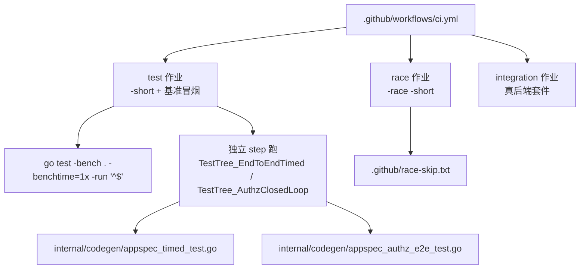
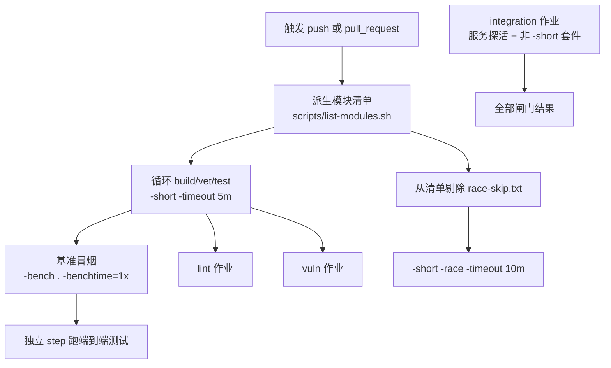
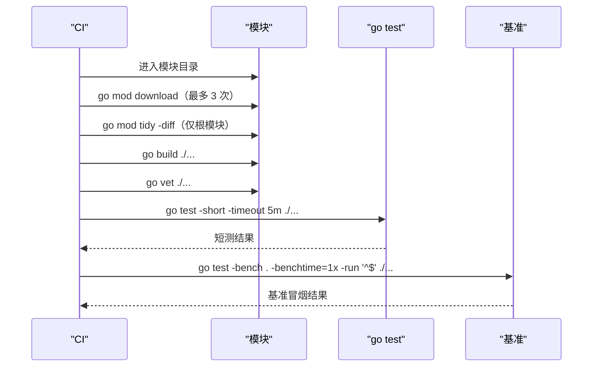
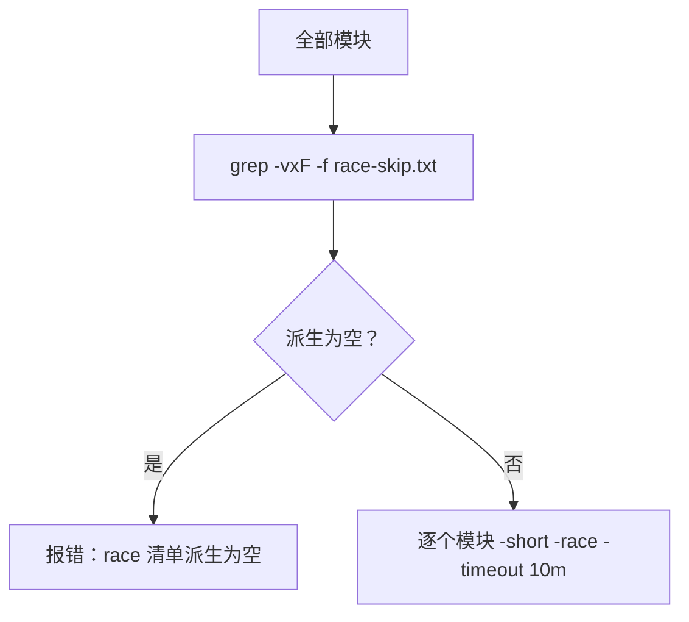
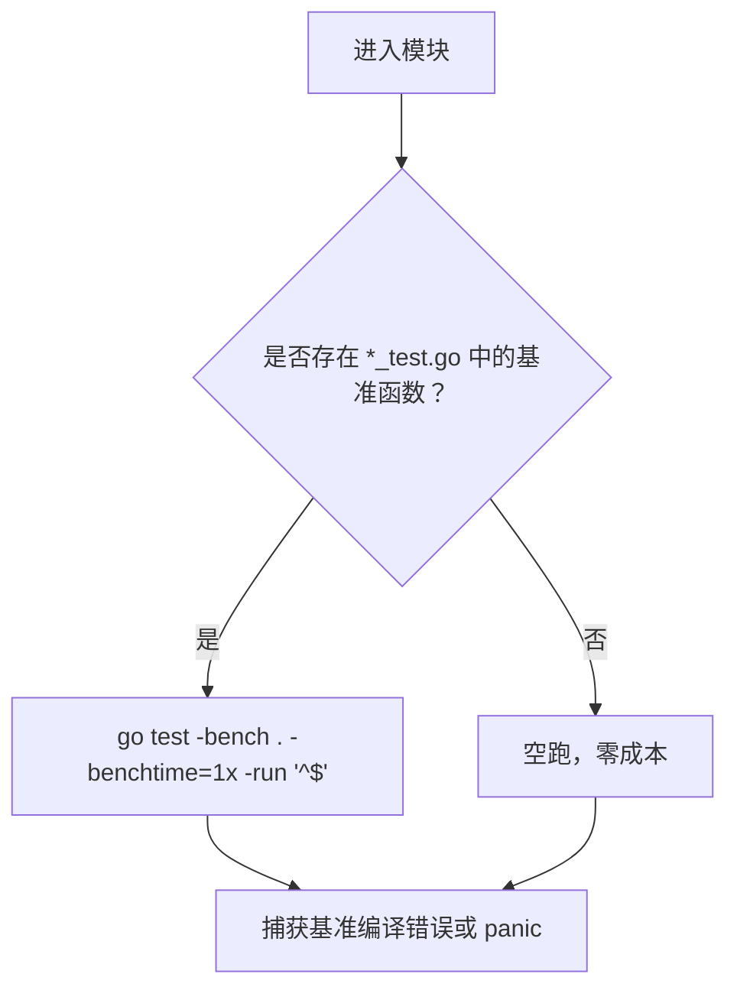
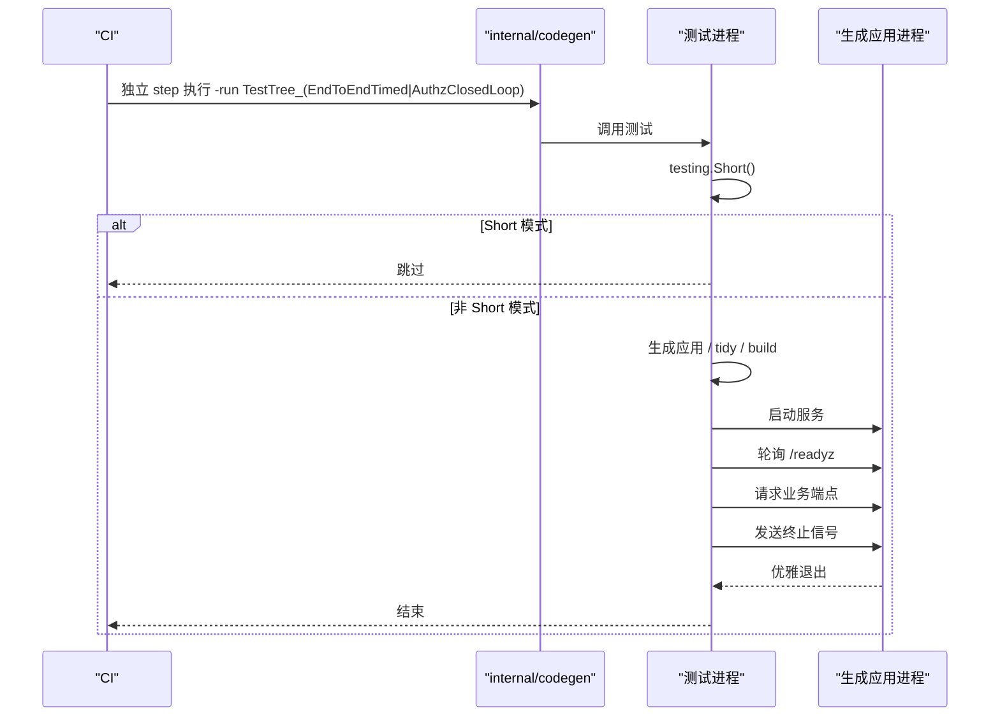
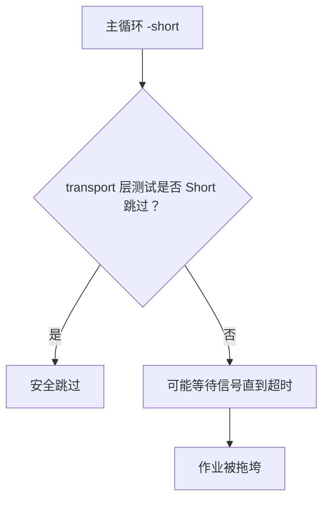
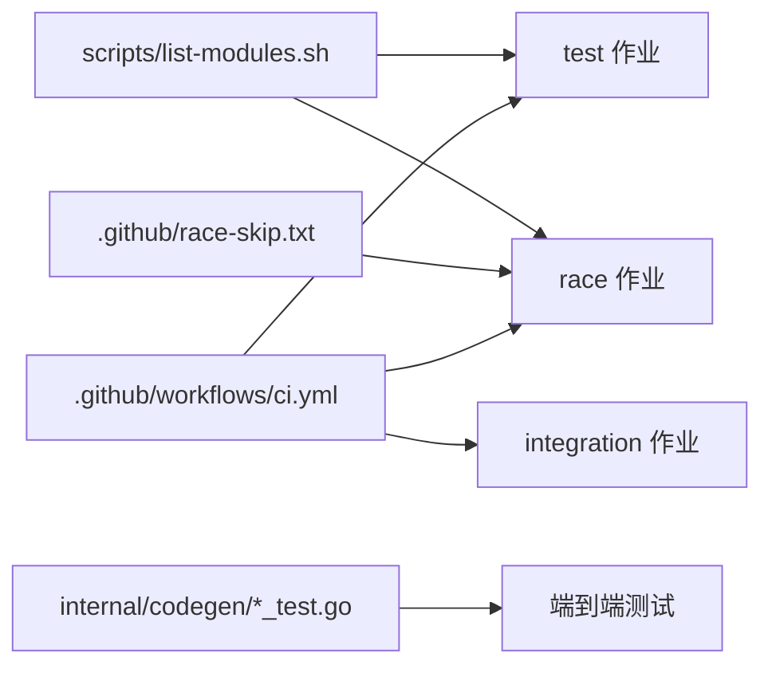

# 测试作业

<cite>
**本文引用的文件**   
- [ci.yml](file://.github/workflows/ci.yml)
- [race-skip.txt](file://.github/race-skip.txt)
- [appspec_timed_test.go](file://internal/codegen/appspec_timed_test.go)
- [appspec_authz_e2e_test.go](file://internal/codegen/appspec_authz_e2e_test.go)
- [server_test.go（transport/kafka）](file://transport/kafka/server_test.go)
- [server_test.go（transport/redis）](file://transport/redis/server_test.go)
- [server_test.go（transport/rabbitmq）](file://transport/rabbitmq/server_test.go)
- [server_test.go（transport/rocketmq）](file://transport/rocketmq/server_test.go)
- [server_test.go（transport/tcp）](file://transport/tcp/server_test.go)
- [server_test.go（transport/webrtc）](file://transport/webrtc/server_test.go)
</cite>

## 目录
1. [引言](#引言)
2. [项目结构](#项目结构)
3. [核心组件](#核心组件)
4. [架构总览](#架构总览)
5. [详细组件分析](#详细组件分析)
6. [依赖关系分析](#依赖关系分析)
7. [性能与并发考量](#性能与并发考量)
8. [故障诊断指南](#故障诊断指南)
9. [结论](#结论)

## 引言
本仓库是一个由 93 个 go.mod 组成的多模块工程，CI 通过 `.github/workflows/ci.yml` 驱动五个质量闸门：单元测试、竞态检测、集成测试、静态检查与漏洞扫描。本文聚焦前三个与测试直接相关的作业，并说明基准测试冒烟策略以及两个端到端用例的特殊执行方式。

## 项目结构
测试相关配置集中在以下位置：
- CI 作业定义：`.github/workflows/ci.yml`
- 竞态排除清单：`.github/race-skip.txt`
- 端到端计时测试：`internal/codegen/appspec_timed_test.go`
- 端到端授权闭环测试：`internal/codegen/appspec_authz_e2e_test.go`
- 需要 `-short` 跳过的传输层手动测试：`transport/{kafka,redis,rabbitmq,rocketmq,tcp,webrtc}/server_test.go`

**图示来源**
- [ci.yml:1-100](file://.github/workflows/ci.yml#L1-L100)
- [appspec_timed_test.go:1-40](file://internal/codegen/appspec_timed_test.go#L1-L40)
- [appspec_authz_e2e_test.go:1-45](file://internal/codegen/appspec_authz_e2e_test.go#L1-L45)

**章节来源**
- [ci.yml:1-100](file://.github/workflows/ci.yml#L1-L100)

## 核心组件
- **test 作业**：按 `scripts/list-modules.sh` 派生的每个模块依次执行构建、vet、单元测试和基准冒烟；根模块额外使用 `-copylocks=false`。
- **race 作业**：用相同模块清单减去 `.github/race-skip.txt` 后执行带竞态检测的单元测试。
- **integration 作业**：启动 etcd、Redis、MongoDB，逐套件运行非 `-short` 集成测试，并通过 TCP 探活与日志断言防止静默跳过。
- **端到端测试**：`TestTree_EndToEndTimed` 与 `TestTree_AuthzClosedLoop` 在 `testing.Short()` 下主动跳过，由 CI 中独立 step 全量执行。
- **基准冒烟**：每模块追加一次 `go test -bench . -benchtime=1x -run '^$'`，仅编译并单迭代执行基准，用于拦截基准回归。

**章节来源**
- [ci.yml:1-100](file://.github/workflows/ci.yml#L1-L100)
- [appspec_timed_test.go:17-40](file://internal/codegen/appspec_timed_test.go#L17-L40)
- [appspec_authz_e2e_test.go:16-42](file://internal/codegen/appspec_authz_e2e_test.go#L16-L42)

## 架构总览
CI 测试流水线不是单一命令，而是分层闸门：

**图示来源**
- [ci.yml:1-100](file://.github/workflows/ci.yml#L1-L100)
- [ci.yml:100-200](file://.github/workflows/ci.yml#L100-L200)

## 详细组件分析

### test 作业：单元测试与基准冒烟
test 作业对每个模块执行固定顺序：
1. 预下载依赖，最多重试三次，之后后续构建与测试离线稳定。
2. 根模块执行 `go mod tidy -diff` 作为依赖面闸门。
3. 根模块执行 `go build ./... && go vet -copylocks=false ./...`。
4. 所有模块执行 `go test -short -timeout 5m ./...`。
5. 所有模块追加 `go test -bench . -benchtime=1x -run '^$' ./...`。
6. 根模块与非根模块共享同一份错误陷阱，失败时打印当前模块路径。

`-short` 的作用：
- Go 测试框架约定：`testing.Short()` 为真时，标记为短测的测试应跳过。
- 本项目中，长耗时、真实网络或真实服务的测试通常以 `if testing.Short() { t.Skip(...) }` 开头，因此 `-short` 主循环只覆盖快速单测。
- 超时参数 `-timeout 5m` 防止某个包挂死拖垮整个 job。

基准冒烟策略：
- 使用 `-bench .` 匹配模块内所有基准函数。
- 使用 `-benchtime=1x` 把每次基准压缩到一轮迭代，目的是“能编译且至少跑一次”，而不是做性能回归。
- 使用 `-run '^$'` 不触发普通测试，避免重复执行主测试逻辑。
- 没有基准函数的模块会空跑，零成本。

**图示来源**
- [ci.yml:60-90](file://.github/workflows/ci.yml#L60-L90)

**章节来源**
- [ci.yml:1-100](file://.github/workflows/ci.yml#L1-L100)

### race 作业：竞态检测与排除清单
race 作业的模块范围是“完整模块清单”减去 `.github/race-skip.txt`，两者都消费同一条派生管线，因此新增模块默认自动纳入竞态检测。

执行流程：
1. 调用 `scripts/list-modules.sh` 生成模块列表。
2. 使用 `grep -vxF -f .github/race-skip.txt` 精确整行剔除排除项。
3. 如果派生结果为空，作业直接报错，避免闸门静默失效。
4. 对每个保留模块执行 `go mod download && go test -short -race -timeout 10m ./...`。

`-race` 标志说明：
- 启用 Go 运行时数据竞争检测，代价比正常测试高，因此默认只在 race 作业运行。
- 仍保留 `-short`，因为竞态检测本身已经足够重，不应再引入集成测试的真实服务等待。
- 超时设为 10 分钟，防止慢测试阻塞 job。

排除清单管理规则：
- 文件格式是一行一个模块路径，必须与 `find` 派生的路径完全一致，包括前导 `./`。
- 注释行和空行不会被匹配，但只能用于解释，不能作为过滤依据。
- 允许排除的理由必须是“race detector 之外无法解决”的问题，例如上游库自带竞争或平台缺少 cgo。
- 当前唯一排除项是 `log/aliyun`，原因是其底层 SDK 的 producer 生命周期存在竞争。
- 若未来 bald 自身出现竞争，应修复而非加入排除清单。

**图示来源**
- [ci.yml:100-170](file://.github/workflows/ci.yml#L100-L170)
- [race-skip.txt:1-15](file://.github/race-skip.txt#L1-L15)

**章节来源**
- [ci.yml:100-170](file://.github/workflows/ci.yml#L100-L170)
- [race-skip.txt:1-15](file://.github/race-skip.txt#L1-L15)

### 基准测试执行策略
基准测试在本项目中不是性能回归主通道，而是“编译与基础可运行性”冒烟：
- 目的：拦截新增或修改的基准函数出现编译失败、导入缺失、panic 等回归。
- 策略：每模块追加一次 `go test -bench . -benchtime=1x -run '^$'`。
- 特点：
  - `-benchtime=1x` 让基准最小化执行。
  - `-run '^$'` 阻止普通测试重复执行。
  - 无基准模块零开销。
  - 分配剖面回归由各包的 `alloc_guard_test.go` 随 `-short` 主循环守卫，不依赖基准输出解析。

**图示来源**
- [ci.yml:1-100](file://.github/workflows/ci.yml#L1-L100)

**章节来源**
- [ci.yml:1-100](file://.github/workflows/ci.yml#L1-L100)

### 端到端测试的执行条件
`TestTree_EndToEndTimed` 与 `TestTree_AuthzClosedLoop` 的共同特征：
- 都会调用 `testing.Short()`，并在短测模式下主动跳过。
- 会在 PATH 中找不到 `go` 工具链时跳过。
- 会拉起真实生成的应用进程，执行 gen、tidy、build、serve、健康探针、业务端点验证和优雅停机。
- 不适合放在 `-short` 主循环，因为它们是分钟级墙钟测试。

CI 中的特殊处理：
- 主循环结束后单独增加一步，直接运行 `go test ./internal/codegen/ -run 'TestTree_(EndToEndTimed|AuthzClosedLoop)' -count=1 -timeout 15m`。
- 该 step 不使用 `-short`，因此两个测试都会实际执行。
- 包级超时为 15 分钟，避免端到端测试无限挂起。

两个测试的差异：
- `TestTree_EndToEndTimed` 侧重端到端计时口径，要求 T1-T0 ≤ 1800 秒，并验证 `/readyz` 与 `/v1/demo`。
- `TestTree_AuthzClosedLoop` 侧重授权链路闭环，验证无 token、viewer、admin 三种状态码，并走别名反查路径。

**图示来源**
- [ci.yml:80-90](file://.github/workflows/ci.yml#L80-L90)
- [appspec_timed_test.go:29-40](file://internal/codegen/appspec_timed_test.go#L29-L40)
- [appspec_authz_e2e_test.go:33-42](file://internal/codegen/appspec_authz_e2e_test.go#L33-L42)

**章节来源**
- [ci.yml:80-90](file://.github/workflows/ci.yml#L80-L90)
- [appspec_timed_test.go:29-40](file://internal/codegen/appspec_timed_test.go#L29-L40)
- [appspec_authz_e2e_test.go:33-42](file://internal/codegen/appspec_authz_e2e_test.go#L33-L42)

### 为什么 transport 层的 TestServer/TestClient 不在 -short 主循环
`transport/{redis,kafka,rabbitmq,rocketmq,tcp,webrtc}` 下的 `TestServer` 与 `TestClient` 是“等信号的手动用例”。它们内部通过 `testing.Short()` 跳过，原因如下：
- 它们依赖真实或模拟的网络服务、消息队列或浏览器/WebRTC 环境。
- 非 `-short` 情况下可能长时间等待连接、握手或事件。
- 如果主循环去掉 `-short`，这些测试会挂到 timeout，导致整个 test 作业失败。
- 因此集成作业采用“按套件点名注入真后端”的方式，而不是扩大主循环范围。

**图示来源**
- [server_test.go（transport/kafka）:54-55](file://transport/kafka/server_test.go#L54-L55)
- [server_test.go（transport/redis）:31-32](file://transport/redis/server_test.go#L31-L32)
- [server_test.go（transport/rabbitmq）:36-37](file://transport/rabbitmq/server_test.go#L36-L37)
- [server_test.go（transport/rocketmq）:36-37](file://transport/rocketmq/server_test.go#L36-L37)
- [server_test.go（transport/tcp）:40-41](file://transport/tcp/server_test.go#L40-L41)
- [server_test.go（transport/webrtc）:50-51](file://transport/webrtc/server_test.go#L50-L51)

**章节来源**
- [server_test.go（transport/kafka）:54-55](file://transport/kafka/server_test.go#L54-L55)
- [server_test.go（transport/redis）:31-32](file://transport/redis/server_test.go#L31-L32)
- [server_test.go（transport/rabbitmq）:36-37](file://transport/rabbitmq/server_test.go#L36-L37)
- [server_test.go（transport/rocketmq）:36-37](file://transport/rocketmq/server_test.go#L36-L37)
- [server_test.go（transport/tcp）:40-41](file://transport/tcp/server_test.go#L40-L41)
- [server_test.go（transport/webrtc）:50-51](file://transport/webrtc/server_test.go#L50-L51)

## 依赖关系分析
测试作业的依赖边界如下：

- 模块清单是 test、race、lint、vuln 作业共享的唯一真相源。
- race 作业额外依赖 `.github/race-skip.txt`。
- 端到端测试代码位于 `internal/codegen`，由 CI 中独立的 step 执行，不混入 `-short` 主循环。

**图示来源**
- [ci.yml:1-100](file://.github/workflows/ci.yml#L1-L100)
- [ci.yml:100-170](file://.github/workflows/ci.yml#L100-L170)
- [race-skip.txt:1-15](file://.github/race-skip.txt#L1-L15)

**章节来源**
- [ci.yml:1-100](file://.github/workflows/ci.yml#L1-L100)
- [ci.yml:100-170](file://.github/workflows/ci.yml#L100-L170)
- [race-skip.txt:1-15](file://.github/race-skip.txt#L1-L15)

## 性能与并发考量
- **并行执行**：CI 未显式设置 `GOFLAGS=-parallel`，Go 测试默认按测试函数并发执行，但模块循环是串行遍历脚本派生出的模块。若需跨模块并行，应修改 CI 或使用 Taskfile 任务调度，不能简单给 `go test` 加全局并行而不考虑外部服务资源争用。
- **超时隔离**：test 作业包级超时 5 分钟，race 作业 10 分钟，端到端独立 step 15 分钟，避免单个慢测试拖垮整个 job。
- **依赖缓存**：GitHub Actions 的 `actions/setup-go@v5` 会缓存 Go 工具链；依赖下载阶段已实现本地重试机制，缓解 proxy.golang.org 偶发 HTTP/2 中流错误。GOPROXY 优先 `goproxy.io`，回退 `proxy.golang.org`，最后直连。
- **基准性能定位**：如需真正性能回归，应建立长期基准输出对比；当前 `-benchtime=1x` 仅保证基准可编译、可运行，不比较耗时。
- **竞态检测成本**：`-race` 会增加内存与 CPU 开销，因此仅在 race 作业启用，并与 `-short` 配合，避免同时加载集成测试。

[本节为通用指导，不直接分析具体文件]

## 故障诊断指南

### 单元测试失败
排查步骤：
1. 确认失败发生在哪个模块：CI 已在循环中使用错误陷阱打印 `FAILED AT MODULE`。
2. 复现命令：进入对应模块目录，执行 `go test -short -timeout 5m ./...`。
3. 若属于 transport 层且本地没有依赖服务，确认是否因 `-short` 正确跳过；若无 `-short`，可能被 `TestServer`/`TestClient` 的等待逻辑卡住。
4. 若涉及外部后端，改用 integration 作业对应的真后端命令，或先确认服务可达。

**章节来源**
- [ci.yml:60-90](file://.github/workflows/ci.yml#L60-L90)

### 竞态检测失败
排查步骤：
1. 确认失败模块是否在 `.github/race-skip.txt` 中被排除。
2. 若在排除清单外，优先修复代码竞争；不要随意加入排除清单。
3. 若失败来自上游库，检查排除理由是否满足“race detector 之外无法解决”。
4. 本地复现命令：`go test -short -race -timeout 10m ./...`。
5. 如果 race 清单派生为空，说明排除规则或模块发现逻辑被破坏，必须先修 CI 派生逻辑。

**章节来源**
- [ci.yml:100-170](file://.github/workflows/ci.yml#L100-L170)
- [race-skip.txt:1-15](file://.github/race-skip.txt#L1-L15)

### 基准测试失败
排查步骤：
1. 基准失败通常是编译失败、import 缺失或基准函数 panic。
2. 复现命令：`go test -bench . -benchtime=1x -run '^$' ./...`。
3. 如需观察基准行为，临时去掉 `-benchtime=1x`，但不要把它当作性能回归依据。
4. 若只是想验证分配稳定性，应查看对应包的 `alloc_guard_test.go`，它随 `-short` 主循环运行。

**章节来源**
- [ci.yml:1-100](file://.github/workflows/ci.yml#L1-L100)

### 端到端测试失败
排查步骤：
1. 本地运行前先确认 PATH 中有 `go` 工具链。
2. 复现命令：`go test ./internal/codegen/ -run 'TestTree_(EndToEndTimed|AuthzClosedLoop)' -count=1 -timeout 15m`。
3. 若 `/readyz` 迟迟不返回 200，检查端口冲突、生成应用配置、依赖服务是否可用。
4. 若授权闭环返回非预期状态码，检查认证 token、策略行和对象别名是否匹配。
5. 优雅停机超过 30 秒会被强制 kill，应关注应用日志中 SIGTERM 处理分支。

**章节来源**
- [appspec_timed_test.go:29-40](file://internal/codegen/appspec_timed_test.go#L29-L40)
- [appspec_authz_e2e_test.go:33-42](file://internal/codegen/appspec_authz_e2e_test.go#L33-L42)

### 集成测试静默绿
常见问题：
- 服务未就绪但测试全部 Skip，导致作业绿色但无实际断言。
- 解决方案：
  1. 先执行 TCP 探活，etcd、Redis、MongoDB 任一不可达即失败。
  2. 集成套件使用 `-v` 全量输出，末尾按 EXPECTED 逐条断言确实出现 `--- PASS`。
  3. 新增套件时必须同步更新 EXPECTED，否则肉眼可见漏判据。

**章节来源**
- [ci.yml:170-298](file://.github/workflows/ci.yml#L170-L298)

## 结论
本仓库的测试作业采用分层设计：
- test 作业负责快速、稳定的短测和基准冒烟。
- race 作业负责覆盖并发路径的数据竞争。
- integration 作业负责真实后端集成。
- 端到端计时与授权闭环测试被明确移出 `-short` 主循环，避免污染日常短测体验。
- 模块清单、排除清单和执行参数共同构成可审计的测试边界，新增模块默认纳入所有闸门，除非有充分理由放入 race 排除清单。

维护建议：
- 新增长耗时测试时优先写 `testing.Short()` 跳过逻辑，并由独立 step 或 integration 作业覆盖。
- 新增基准函数后，确保 `-benchtime=1x` 能通过；真正性能回归应另建长期基准方案。
- 新增模块无需手动改 race 作业，但若有上游竞争问题，需在 `.github/race-skip.txt` 中写明理由。
- 修改 CI 作业文件后应先运行 `task ci-workflow-lint`，避免 GitHub 编译期拒绝整个 workflow。

[本节为总结性内容，不直接分析具体文件]