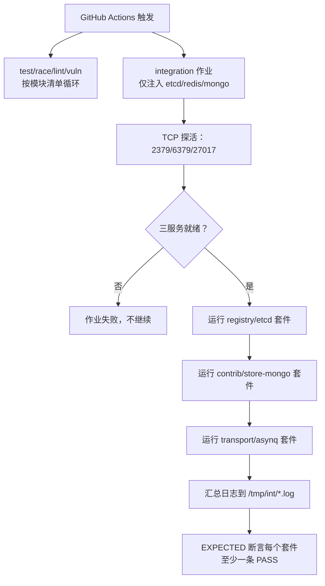
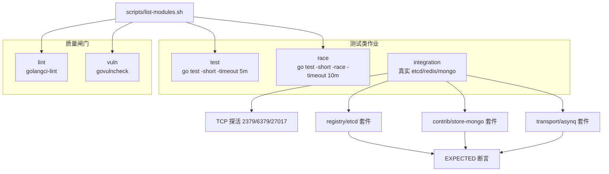
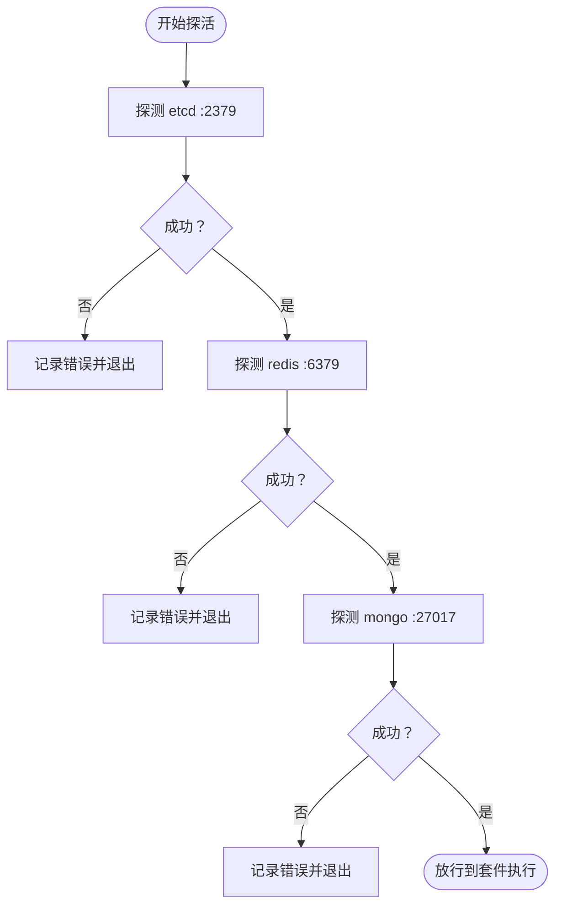
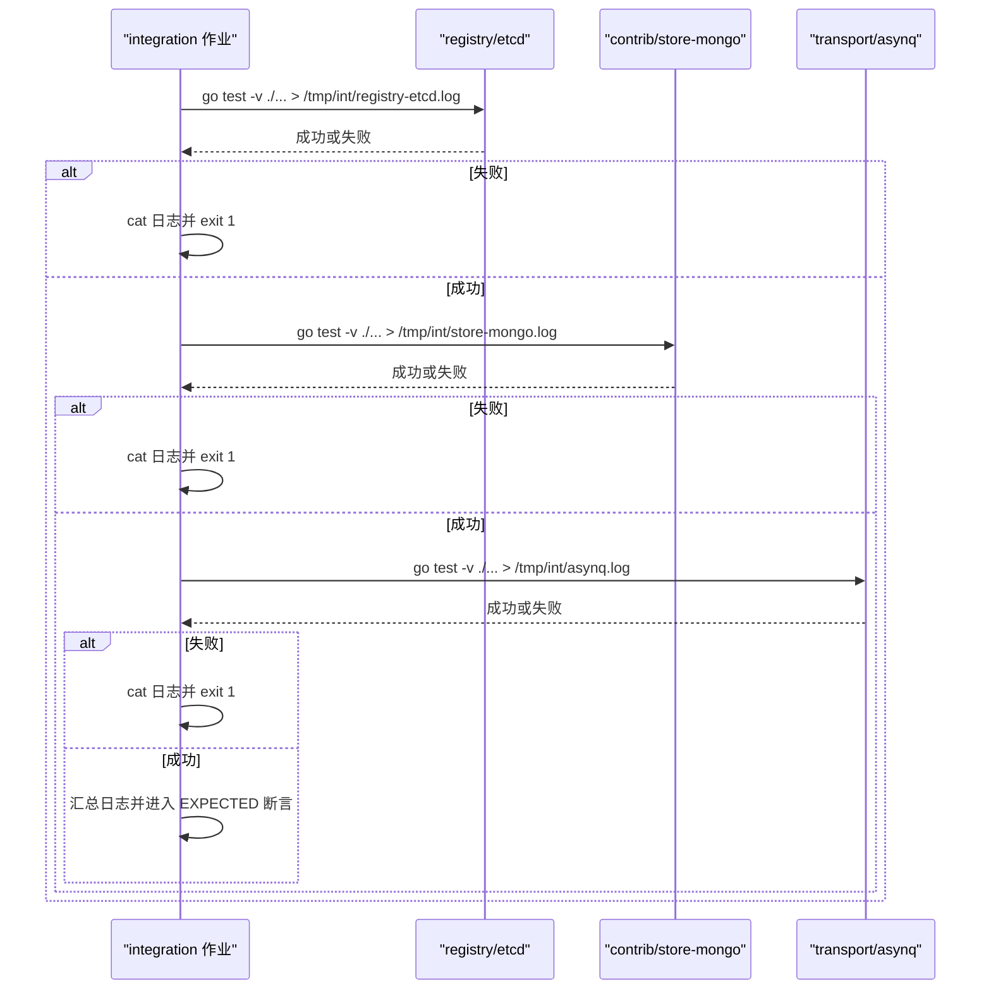
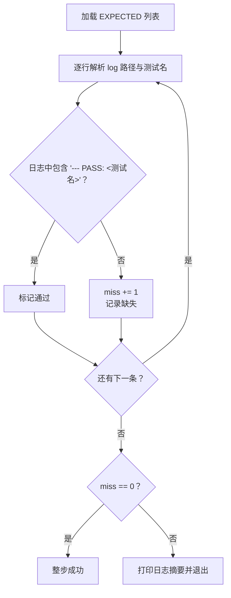
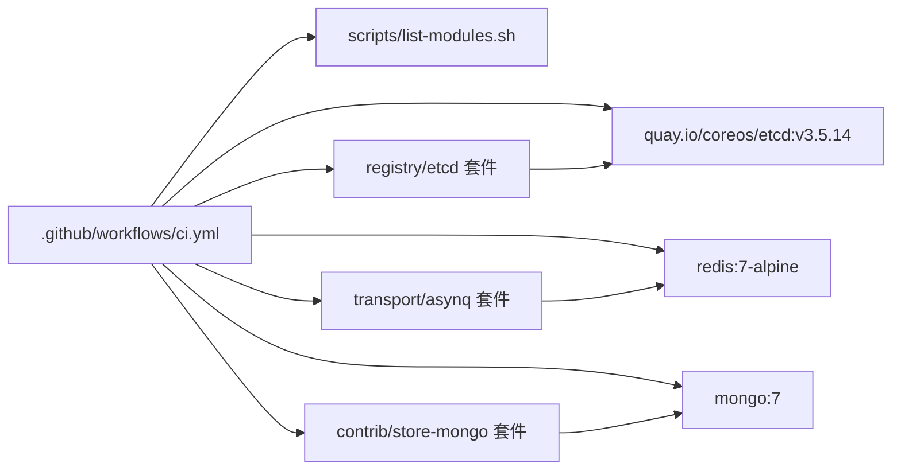
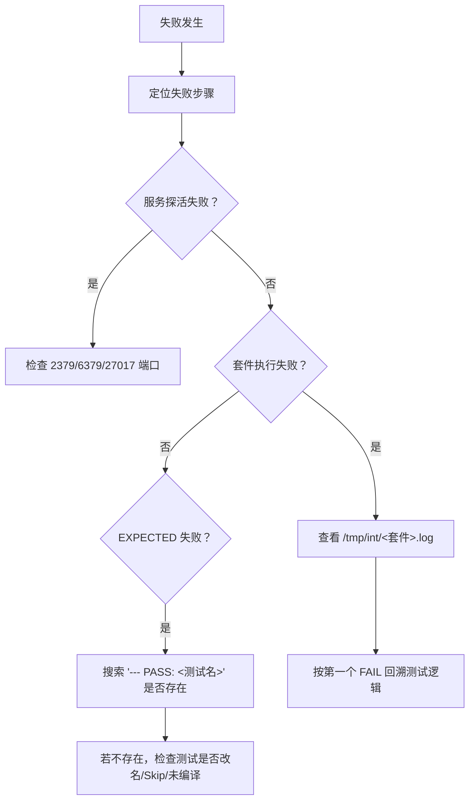

# 集成测试

<cite>
**本文引用的文件**   
- [ci.yml](file://.github/workflows/ci.yml)
- [Taskfile.yml](file://Taskfile.yml)
- [list-modules.sh](file://scripts/list-modules.sh)
- [registry_test.go](file://registry/etcd/registry_test.go)
- [mongo_test.go](file://contrib/store-mongo/mongo_test.go)
- [server_test.go（asynq）](file://transport/asynq/server_test.go)
</cite>

## 目录
1. [简介](#简介)
2. [项目结构](#项目结构)
3. [核心组件](#核心组件)
4. [架构总览](#架构总览)
5. [详细组件分析](#详细组件分析)
6. [依赖关系分析](#依赖关系分析)
7. [性能与可靠性考虑](#性能与可靠性考虑)
8. [故障排查指南](#故障排查指南)
9. [结论](#结论)

## 简介
本文面向本仓库的集成测试体系，重点说明 GitHub Actions `integration` 作业如何启动 etcd v3.5.14、Redis 7、MongoDB 7，如何通过 TCP 端口探活防止“服务未就绪但作业绿”的静默失效，以及按套件点名注入真实后端并校验 EXPECTED PASS 判据的执行策略。读者可据此在本地复现、诊断失败、扩展新的集成套件。

## 项目结构
仓库是多模块 Go 工程，CI 使用 `scripts/list-modules.sh` 派生全部模块清单，`test`、`race`、`lint`、`vuln` 等作业消费该清单；而 `integration` 作业不跑全仓，而是显式点名 `registry/etcd`、`contrib/store-mongo`、`transport/asynq` 三个套件，分别覆盖注册中心、存储、任务队列三条后端接缝。



**图表来源**
- [ci.yml:104-298](file://.github/workflows/ci.yml#L104-L298)

**章节来源**
- [ci.yml:1-103](file://.github/workflows/ci.yml#L1-L103)
- [Taskfile.yml:1-40](file://Taskfile.yml#L1-L40)

## 核心组件
- **服务准备**：通过 GitHub Actions `services` 拉起 etcd、Redis、MongoDB，并把地址写入环境变量。
- **服务探活**：shell 函数 `wait_tcp` 对三个端口最多重试 60 次，每次间隔 2 秒，任一失败直接让作业退出。
- **套件执行**：依次进入 `registry/etcd`、`contrib/store-mongo`、`transport/asynq` 子目录执行 `go test -count=1 -timeout 10m -v ./...`，输出重定向到 `/tmp/int/<name>.log`。
- **EXPECTED 断言**：遍历期望的“测试名 | 日志路径”，用 `grep -q --- PASS: <测试名>` 确认真 PASS，否则报错并打印末尾日志摘要。

**章节来源**
- [ci.yml:104-298](file://.github/workflows/ci.yml#L104-L298)

## 架构总览
下图把 CI 中五个作业的关系与数据流串起来：主循环 `test` 只跑 `-short`，竞态检测 `race` 也 `-short`；真正的后端能力由 `integration` 承担，最后由 `lint` 和 `vuln` 做静态与漏洞检查。



**图表来源**
- [ci.yml:58-298](file://.github/workflows/ci.yml#L58-L298)
- [Taskfile.yml:18-40](file://Taskfile.yml#L18-L40)

## 详细组件分析

### 1. integration 作业的服务准备流程

#### 1.1 容器镜像与端口映射
| 服务 | 镜像 | 容器端口 | 宿主机端口 | 关键配置 |
|---|---|---:|---:|---|
| etcd | `quay.io/coreos/etcd:v3.5.14` | 2379 | 2379 | `ETCD_LISTEN_CLIENT_URLS=http://0.0.0.0:2379`、`ETCD_ADVERTISE_CLIENT_URLS=http://127.0.0.1:2379` |
| Redis | `redis:7-alpine` | 6379 | 6379 | 无额外参数 |
| MongoDB | `mongo:7` | 27017 | 27017 | 无额外参数 |

这些配置位于 `integration` 作业的 `services` 块。注意 GitHub 的 `services` 只接受 `credentials/env/image/options/ports/volumes`，不能写 `args`；etcd 通过同名 `ETCD_*` 环境变量传参，由镜像入口程序解析。

**章节来源**
- [ci.yml:132-165](file://.github/workflows/ci.yml#L132-L165)

#### 1.2 环境变量约定
| 变量 | 值 | 用途 |
|---|---|---|
| `BALD_E2E_ETCD_ADDR` | `127.0.0.1:2379` | etcd 客户端端点，被 `registry/etcd` 测试读取 |
| `BALD_TEST_REDIS_URI` | `redis://127.0.0.1:6379` | asynq 测试使用的 Redis URI |
| `BALD_MONGO_URI` | `mongodb://127.0.0.1:27017` | store-mongo 测试使用的 MongoDB URI |

这些变量由作业显式声明，避免测试依赖实现默认值；测试侧也有回退逻辑，例如 etcd 测试从 `BALD_E2E_ETCD_ADDR` 取地址，缺省为 `127.0.0.1:2379`。

**章节来源**
- [ci.yml:121-131](file://.github/workflows/ci.yml#L121-L131)
- [registry_test.go:24-32](file://registry/etcd/registry_test.go#L24-L32)
- [server_test.go（asynq）:24-47](file://transport/asynq/server_test.go#L24-L47)

### 2. 服务探活机制

#### 2.1 实现要点
- 使用 shell 函数 `wait_tcp(host port name)`。
- 最大重试次数：60。
- 每次等待：2 秒。
- 探测方式：Linux `/dev/tcp/$host/$port` 写空字节建立 TCP 连接。
- 成功输出：`READY <名称> (<host>:<port>)`。
- 失败输出：GitHub Action error 注解，并返回非零使作业失败。
- 探测顺序：etcd(2379) → redis(6379) → mongo(27017)。



**图表来源**
- [ci.yml:166-181](file://.github/workflows/ci.yml#L166-L181)

#### 2.2 重试与超时
- 单次探活最长耗时：60 × 2 = 120 秒。
- 三个服务串行探测，总上限约 360 秒；但作业级 `timeout-minutes: 30` 会兜住异常卡死场景。
- 若某个服务迟迟未就绪，日志会明确标注哪个 host:port 未就绪，便于定位镜像拉取、端口冲突或健康延迟。

**章节来源**
- [ci.yml:104-105](file://.github/workflows/ci.yml#L104-L105)
- [ci.yml:166-181](file://.github/workflows/ci.yml#L166-L181)

### 3. 套件测试执行方法

#### 3.1 为什么只点名三个套件
`transport/{redis,kafka,rabbitmq,rocketmq,tcp,webrtc}` 中的 `TestServer`/`TestClient` 是“等信号”的手动用例，非 `-short` 时会挂到 timeout。因此主循环必须保留 `go test -short`，真正后端能力由 `integration` 作业以“按套件点名”的方式注入真实 etcd/redis/mongo 后执行。

#### 3.2 执行顺序与隔离
1. `registry/etcd`：依赖 etcd，验证 Register/Discover/Deregister、Watch、命名空间等语义。
2. `contrib/store-mongo`：依赖 MongoDB，验证 CRUD、过滤排序分页、OR 表达式、更新/删除幂等。
3. `transport/asynq`：依赖 Redis，验证任务订阅。
4. 每个套件单独 `go mod download`，避免依赖下载阻塞或污染后续套件。
5. 所有日志输出到 `/tmp/int/<套件名>.log`，并在失败时立即 `cat` 并退出当前步骤。



**图表来源**
- [ci.yml:182-205](file://.github/workflows/ci.yml#L182-L205)

**章节来源**
- [ci.yml:106-131](file://.github/workflows/ci.yml#L106-L131)
- [ci.yml:182-205](file://.github/workflows/ci.yml#L182-L205)

### 4. EXPECTED 断言机制

#### 4.1 设计动机
集成测试用例遵循“不可达即 `t.Skip`”的惯例：如果 etcd/redis/mongo 不可达，测试不会失败，而是跳过。因此仅看作业绿色不足以证明测试真被执行。EXPECTED 列表就是第二道防线——它只列出“没有真实后端就无法证明”的关键测试名，普通单元测试不在其中。

#### 4.2 匹配规则
- 每行格式：`日志路径|测试名`。
- 判断条件：日志中存在 `--- PASS: <测试名>`。
- 缺失处理：逐条报错，统计 miss 数，并打印末尾日志摘要，帮助区分 Skip、改名、未编译等不同原因。



**图表来源**
- [ci.yml:206-238](file://.github/workflows/ci.yml#L206-L238)

#### 4.3 当前 EXPECTED 覆盖
| 套件 | 期望 PASS 的测试 |
|---|---|
| `registry/etcd` | `TestRegisterDiscoverDeregister`、`TestWatch_ReceivesChanges`、`TestProvider_BuildsUsableRegistrar` |
| `contrib/store-mongo` | `TestMongoCRUD` |
| `transport/asynq` | `TestTaskSubscribe` |

新增套件时必须同步追加 EXPECTED 条目，否则即使套件运行成功，也会因缺少判据而被 EXPECTED 阶段发现。

**章节来源**
- [ci.yml:206-238](file://.github/workflows/ci.yml#L206-L238)

### 5. 各套件与真实后端的对接细节

#### 5.1 etcd 注册中心套件
- 测试构造 Registry 时先检查 `testing.Short()`，短模式下跳过。
- 连接超时 3 秒，首次 `GetService` 探针用于触发真实网络连接。
- 不可达时调用 `t.Skipf("etcd 不可达，跳过")`，而非失败。
- 典型用例覆盖 Register→GetService→Deregister 全链路、Watch 变更、命名空间前缀。

**章节来源**
- [registry_test.go:1-53](file://registry/etcd/registry_test.go#L1-L53)
- [registry_test.go:82-136](file://registry/etcd/registry_test.go#L82-L136)
- [registry_test.go:214-254](file://registry/etcd/registry_test.go#L214-L254)

#### 5.2 MongoDB 存储套件
- `contrib/store-mongo` 在 `integration` 作业中通过 `BALD_MONGO_URI` 接入真实 MongoDB。
- 典型用例 `TestMongoCRUD` 验证创建、查询、更新、计数、删除、唯一冲突与 NotFound。
- 其他用例覆盖过滤排序分页、OR 表达式、更新/删除幂等。

**章节来源**
- [mongo_test.go:1-189](file://contrib/store-mongo/mongo_test.go#L1-L189)

#### 5.3 Redis 任务队列套件（asynq）
- asynq 测试使用 `BALD_TEST_REDIS_URI`，缺省为 `redis://:*Abcd123456@127.0.0.1:6379`。
- `requireRedis` 先判断 `-short`，再从 URI 解析 host，用 `net.DialTimeout` 做 TCP 连通性检查，失败则 `t.Skip`。
- 作业中通过 `transport/asynq/server_test.go` 的 `TestTaskSubscribe` 作为 EXPECTED 判据，保证任务订阅这条后端接缝有真实 Redis 参与。

**章节来源**
- [server_test.go（asynq）:1-60](file://transport/asynq/server_test.go#L1-L60)
- [ci.yml:206-238](file://.github/workflows/ci.yml#L206-L238)

## 依赖关系分析



**图表来源**
- [ci.yml:104-238](file://.github/workflows/ci.yml#L104-L238)
- [Taskfile.yml:18-40](file://Taskfile.yml#L18-L40)

**章节来源**
- [ci.yml:104-238](file://.github/workflows/ci.yml#L104-L238)
- [Taskfile.yml:18-40](file://Taskfile.yml#L18-L40)

## 性能与可靠性考虑
- **主循环 `-short` 保护**：`transport/{redis,kafka,rabbitmq,rocketmq,tcp,webrtc}` 的手动测试不会被主循环触发，避免 CI 被等信号用例拖垮。
- **超时防护**：主循环 `go test -timeout 5m`，race 作业 `-timeout 10m`，integration 套件每个套件 `-timeout 10m`，作业整体 `timeout-minutes: 30`。
- **依赖下载重试**：所有作业在 `go mod download` 外包裹最多 3 次重试，缓解 proxy.golang.org HTTP/2 中流错误。
- **GOPROXY 双源**：主源 `goproxy.io`，备源 `proxy.golang.org,direct`，降低单一代理故障面。
- **日志留档**：每个套件输出独立日志，失败时立即 `cat`，EXPECTED 阶段失败时再打印最近 60 行摘要。

**章节来源**
- [ci.yml:1-57](file://.github/workflows/ci.yml#L1-L57)
- [ci.yml:58-103](file://.github/workflows/ci.yml#L58-L103)
- [ci.yml:182-238](file://.github/workflows/ci.yml#L182-L238)

## 故障排查指南

### 1. 本地复现 integration 作业
1. 确保本机已安装 Docker，并能拉取 `quay.io/coreos/etcd:v3.5.14`、`redis:7-alpine`、`mongo:7`。
2. 设置环境变量：
   - `BALD_E2E_ETCD_ADDR=127.0.0.1:2379`
   - `BALD_TEST_REDIS_URI=redis://127.0.0.1:6379`
   - `BALD_MONGO_URI=mongodb://127.0.0.1:27017`
3. 手动启动三个容器（或使用 GitHub Actions 的 services 等价命令）。
4. 先执行 TCP 探活逻辑：
   ```bash
   echo > /dev/tcp/127.0.0.1/2379 && echo "etcd ready"
   echo > /dev/tcp/127.0.0.1/6379 && echo "redis ready"
   echo > /dev/tcp/127.0.0.1/27017 && echo "mongo ready"
   ```
5. 逐个运行套件：
   ```bash
   cd registry/etcd && go test -count=1 -timeout 10m -v ./...
   cd contrib/store-mongo && go test -count=1 -timeout 10m -v ./...
   cd transport/asynq && go test -count=1 -timeout 10m -v ./...
   ```

**章节来源**
- [ci.yml:121-181](file://.github/workflows/ci.yml#L121-L181)

### 2. 常见失败场景与诊断

| 现象 | 可能原因 | 诊断步骤 | 处理建议 |
|---|---|---|---|
| 作业在“服务探活”阶段失败 | etcd/redis/mongo 未启动、端口被占用、镜像未拉取完成 | 查看 `::error::<服务> 未就绪` 日志，确认对应端口是否监听 | 清理端口冲突，等待容器健康，或调整探活重试窗口 |
| 套件执行阶段失败 | 真实后端不可达、测试数据竞争、实现回归 | 查看 `/tmp/int/<套件>.log`，关注第一个 `FAIL` | 优先确认探活是否通过；若是测试内部断言失败，按单测定位 |
| 作业绿色但 EXPECTED 失败 | 测试被改名、被 Skip、被删除、或未编译进目标包 | 查看 EXPECTED 报错中的日志摘要，搜索 `--- SKIP` 或 `ok` | 修正测试名、恢复 EXPECTED 列表、或修复导致 Skip 的环境判断 |
| 只有部分套件日志 | 前面套件失败提前退出 | 查看上一个失败的套件日志 | 先修复上游套件，再逐步放开 |
| 本地 `-short` 下看不到集成测试 | 符合预期 | 不要加 `-short`，或注释掉测试内的 `testing.Short()` 守卫 | 仅在调试目的临时关闭，提交时恢复 |

**章节来源**
- [ci.yml:166-238](file://.github/workflows/ci.yml#L166-L238)
- [registry_test.go:35-53](file://registry/etcd/registry_test.go#L35-L53)
- [server_test.go（asynq）:24-60](file://transport/asynq/server_test.go#L24-L60)

### 3. 日志收集与定位
- 作业中每个套件输出都重定向到 `/tmp/int/<name>.log`。
- 单个套件失败时，步骤会立即 `cat` 对应日志。
- EXPECTED 失败时，会打印 `/tmp/int/*.log` 末尾 60 行，包含 `--- SKIP`、`--- FAIL`、`ok`、`FAIL` 等关键行。
- 建议在本地复现时也采用相同模式：先保存日志，再 grep 目标测试名，确认是否存在 `--- PASS`。



**图表来源**
- [ci.yml:166-238](file://.github/workflows/ci.yml#L166-L238)

### 4. 注意事项
- 不要给 `services.args` 写 etcd 参数，GitHub 会在编译期拒绝整个工作流文件。
- 不要在集成测试里对概率式组件的统计阈值做硬断言；应构造前置状态后再断言。
- 新增集成套件时，必须同时更新 EXPECTED 列表，否则会出现“套件跑了但 EXPECTED 找不到 PASS”的告警。
- `_example/bald` 不在 `integration` 作业中，因为它的 go.mod 把 kratos contrib 模块 replace 到仓库外同级检出，干净检出无法装载。

**章节来源**
- [ci.yml:132-165](file://.github/workflows/ci.yml#L132-L165)
- [ci.yml:106-131](file://.github/workflows/ci.yml#L106-L131)

## 结论
本仓库的集成测试体系通过三层防护保证真实后端能力不被“静默跳过”：
1. **服务层**：`services` 启动 etcd v3.5.14、Redis 7、MongoDB 7。
2. **探活层**：TCP 端口探测失败即终止作业，不让不可达环境伪装成绿色。
3. **断言层**：EXPECTED 列表要求关键测试名必须在日志中出现 `--- PASS`，从而覆盖改名、Skip、删除、未编译等退化。

日常维护时应遵循“新增套件必改 EXPECTED”“修改作业文件先跑 `task ci-workflow-lint`”“优先通过环境变量与 TCP 探活定位环境问题”的原则，使集成测试保持可观测、可复现、可回归。