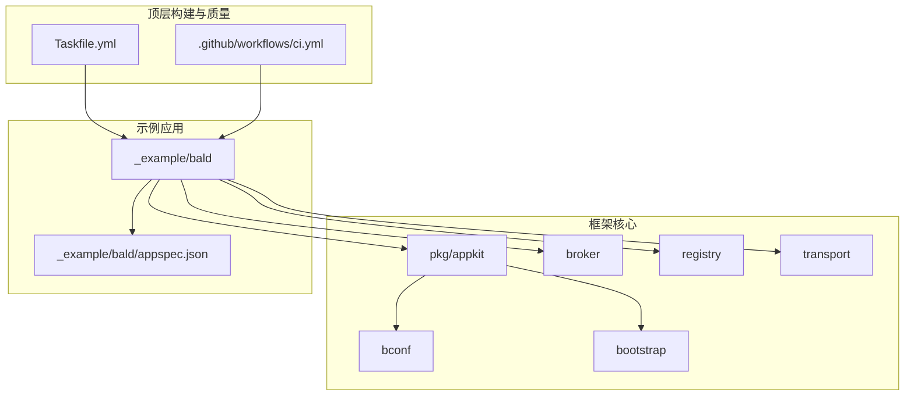
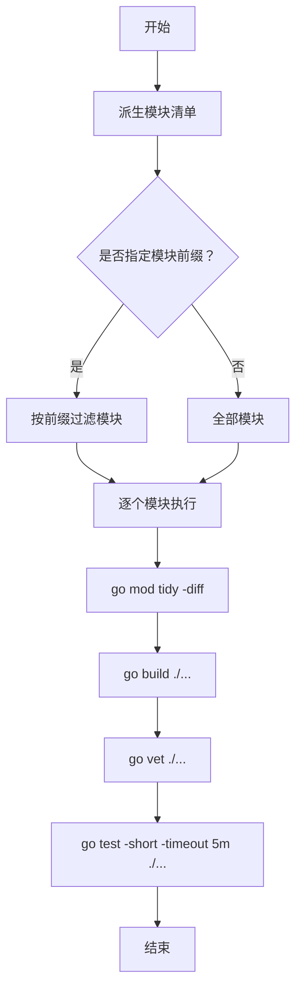
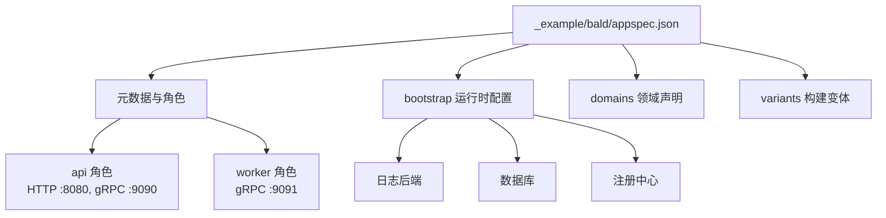
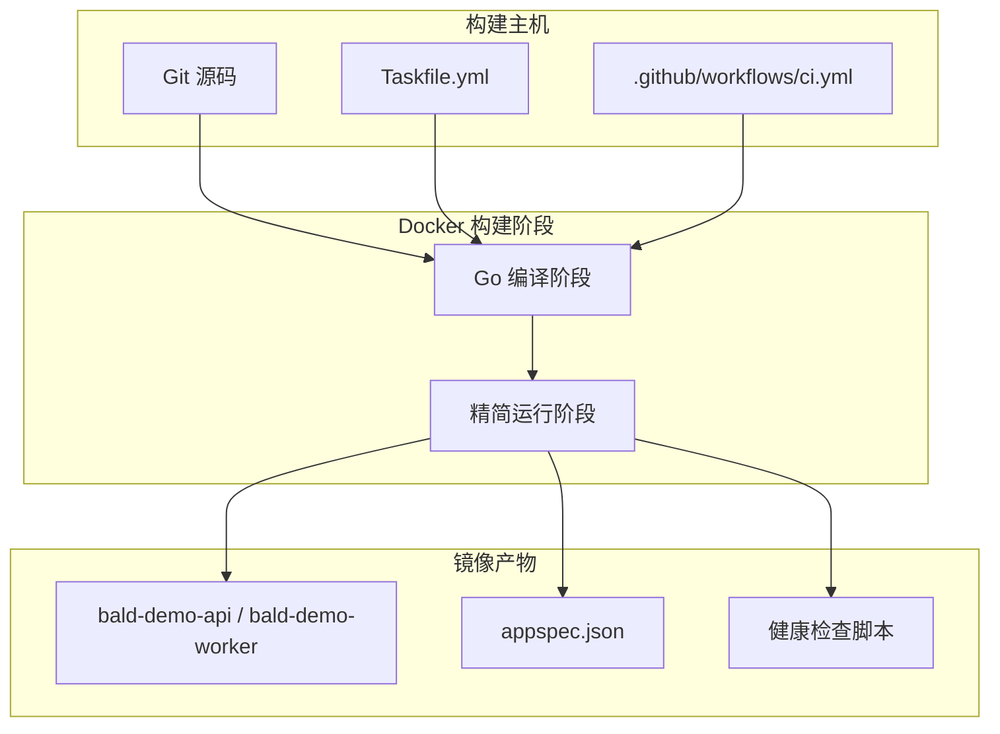
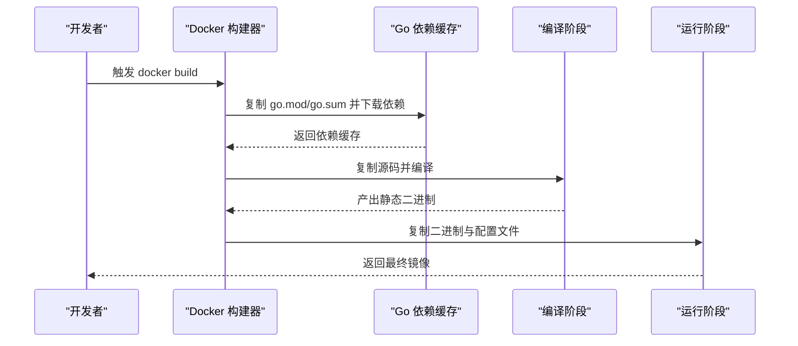
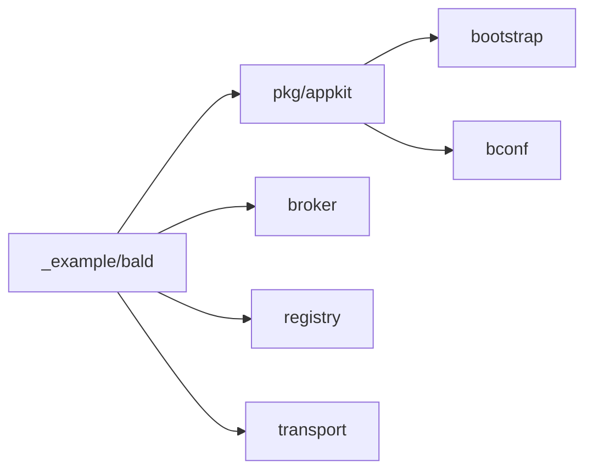
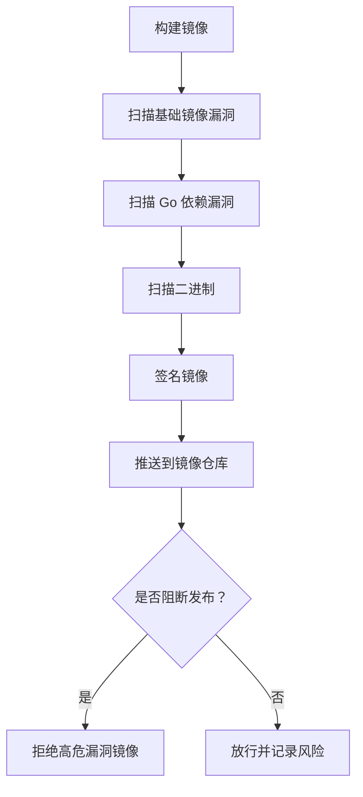
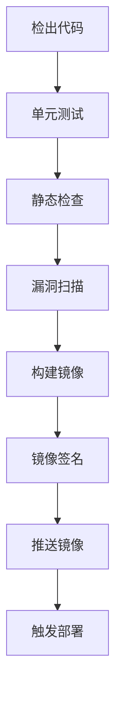

# Docker 镜像构建

<cite>
**本文引用的文件**   
- [Taskfile.yml](file://Taskfile.yml)
- [.github/workflows/ci.yml](file://.github/workflows/ci.yml)
- [_example/bald/appspec.json](file://_example/bald/appspec.json)
- [pkg/appkit/bootstrap.go](file://pkg/appkit/bootstrap.go)
- [bootstrap/config/config.go](file://bootstrap/config/config.go)
</cite>

## 目录

1. [简介](#简介)
2. [项目结构](#项目结构)
3. [核心组件](#核心组件)
4. [架构总览](#架构总览)
5. [详细组件分析](#详细组件分析)
6. [依赖关系分析](#依赖关系分析)
7. [性能与体积优化](#性能与体积优化)
8. [故障排查指南](#故障排查指南)
9. [结论](#结论)
10. [附录：推荐 Dockerfile 与自动化脚本](#附录推荐-dockerfile-与自动化脚本)

## 简介

本仓库是一个包含 93 个 Go module 的多模块工程，而不是单一可执行服务。根目录没有现成的 `Dockerfile`，也没有直接调用 Docker 的 Taskfile 任务；CI 中的镜像关键词只是集成测试启动 etcd、Redis、MongoDB 等外部服务。因此，“Docker 镜像构建”在本仓中不是“已有功能”，而是需要基于现有编译管线和示例应用装配出来的生产实践。

本文的目标是：

- 说明如何基于现有 `Taskfile.yml` 和 CI 构建流程，设计多阶段 Docker 镜像。
- 解释编译阶段与运行阶段的分离策略。
- 给出依赖缓存、二进制裁剪、安全加固的具体建议。
- 提供完整的 Dockerfile 参考实现，覆盖构建参数、环境变量、健康检查。
- 说明镜像标签策略、版本管理、推送流程。
- 解释 Alpine Linux 基础镜像的选择理由与安全注意事项。
- 说明如何在容器内正确挂载并加载 `appspec.json` 配置文件。

## 项目结构

从镜像构建视角看，仓库可以分为四层：

| 层次 | 含义 | 对镜像的影响 |
|---|---|---|
| 顶层工具链层 | `Taskfile.yml`、`.golangci.yml`、`.github/workflows` | 决定构建入口、静态检查、漏洞扫描和 CI 行为 |
| 框架核心层 | `bconf`、`bootstrap`、`pkg/appkit`、`broker`、`registry`、`transport` 等 | 被业务示例和应用通过 Go module 引用，但不应被镜像反向依赖 |
| 示例应用层 | `_example/bald` | 最接近真实服务的形态，拥有 `cmd/bald-demo-api`、`cmd/bald-demo-worker` 和 `appspec.json` |
| 配置与契约层 | `bconf/proto`、`_example/bald/api/proto` | 生成 gRPC / Gateway 代码，影响最终二进制是否包含转码面 |



**图示来源**
- [Taskfile.yml:1-452](file://Taskfile.yml#L1-L452)
- [.github/workflows/ci.yml:1-298](file://.github/workflows/ci.yml#L1-L298)
- [_example/bald/appspec.json:1-81](file://_example/bald/appspec.json#L1-L81)

**章节来源**
- [Taskfile.yml:1-60](file://Taskfile.yml#L1-L60)
- [.github/workflows/ci.yml:1-60](file://.github/workflows/ci.yml#L1-L60)

## 核心组件

### 构建入口与模块清单

`Taskfile.yml` 是本地与 CI 共享的构建入口。它使用 `scripts/list-modules.sh` 派生全仓模块清单，所有 lint、vuln、race、verify 都消费同一份清单，避免本地和 CI 覆盖范围漂移。对镜像构建来说，最重要的事实是：

- 构建命令以 Go 工具链为主，例如 `go build ./...`、`go test -short -timeout 5m ./...`。
- 单模块验证会先跑 `go mod tidy -diff`，再编译、vet、测试。
- 存在 `package main` 的模块会把可执行文件输出到临时目录，避免污染源码树。
- 没有定义任何 `docker build` 或 `buildx` 任务。



**图示来源**
- [Taskfile.yml:201-452](file://Taskfile.yml#L201-L452)

**章节来源**
- [Taskfile.yml:1-60](file://Taskfile.yml#L1-L60)
- [Taskfile.yml:201-452](file://Taskfile.yml#L201-L452)

### 示例应用与服务装配

示例位于 `_example/bald`，它是一个独立 module，定义了 api 与 worker 两个角色，并通过 `appspec.json` 声明服务装配。该文件体现以下关键信息：

- 应用名为 `bald-demo`。
- api 角色同时启用 HTTP 和 gRPC，默认监听 `:8080` 与 `:9090`。
- worker 角色只启用 gRPC，监听 `:9091`。
- bootstrap 配置了日志、数据库、注册中心等运行时依赖。
- domains 声明 greet 域及其 proto 包。
- variants 支持 grpcgw 与 nacos 两种变体。



**图示来源**
- [_example/bald/appspec.json:1-81](file://_example/bald/appspec.json#L1-L81)

**章节来源**
- [_example/bald/appspec.json:1-81](file://_example/bald/appspec.json#L1-L81)

### 配置文件解析路径

Bald 框架在启动时根据 `ConfigFile` 和环境变量查找配置文件。当显式传入 `ConfigFile` 时，直接使用；否则按名称与环境规则搜索本地路径。这个机制直接影响容器中如何挂载 `appspec.json`。

| 情形 | 行为 |
|---|---|
| 显式设置 `ConfigFile` | 直接使用该绝对路径 |
| 未设置 `ConfigFile` | 按 `Name` + `Env` 规则查找 `config.yaml`/`config-prod.yaml` 等文件 |
| 找不到本地配置 | 返回空串，不报错，允许纯远程或纯 flag 配置 |
| 容器场景 | 推荐把 `appspec.json` 挂载到固定路径，并通过 `ConfigFile` 指向它 |

**章节来源**
- [pkg/appkit/bootstrap.go:371-378](file://pkg/appkit/bootstrap.go#L371-L378)
- [bootstrap/config/config.go:67-74](file://bootstrap/config/config.go#L67-L74)
- [bootstrap/config/config.go:485-493](file://bootstrap/config/config.go#L485-L493)

## 架构总览

推荐的镜像构建架构分为三层：

1. **源码与依赖层**：基于官方 Go 镜像拉取依赖缓存。
2. **编译层**：使用 Go 工具链编译示例应用，并根据 tag 选择是否启用 grpc-gateway。
3. **运行层**：基于轻量基础镜像，仅包含二进制、证书、配置文件和健康探针。



**图示来源**
- [Taskfile.yml:1-452](file://Taskfile.yml#L1-L452)
- [.github/workflows/ci.yml:1-298](file://.github/workflows/ci.yml#L1-L298)

## 详细组件分析

### 多阶段构建设计

由于仓库没有现成 `Dockerfile`，多阶段构建应围绕示例应用的实际可执行目标设计。建议至少两个阶段：

| 阶段 | 作用 | 关键输入 | 关键输出 |
|---|---|---|---|
| 依赖准备阶段 | 安装 Go 工具链并缓存依赖 | `go.mod`、`go.sum` | 依赖缓存层 |
| 编译阶段 | 编译 api 与 worker 两个二进制 | 完整源码、构建 tag | 静态链接的 Go 二进制 |
| 运行阶段 | 提供最小运行环境 | 已编译二进制、配置文件、证书 | 最终镜像 |

典型流程如下：



**图示来源**
- [Taskfile.yml:201-452](file://Taskfile.yml#L201-L452)

**章节来源**
- [Taskfile.yml:201-452](file://Taskfile.yml#L201-L452)

### 依赖缓存优化

Go 镜像构建的依赖缓存最优实践是：

1. 先复制 `go.mod` 与 `go.sum`。
2. 执行 `go mod download` 或 `go mod cache`，命中缓存后再复制完整源码。
3. 将依赖缓存放在独立层，避免每次源码变更导致全量重建。
4. 使用多阶段构建时，只在编译阶段保留依赖缓存，运行阶段只拷贝最终二进制。

本项目有 93 个 module，如果每个子 module 单独打镜像会很复杂；更合理的做法是以 `_example/bald` 作为应用边界，把它当作一个独立服务进行镜像化。

**章节来源**
- [Taskfile.yml:1-60](file://Taskfile.yml#L1-L60)

### 二进制裁剪与安全加固

Go 二进制可以通过构建选项裁剪体积并减少攻击面：

| 选项 | 作用 |
|---|---|
| `-ldflags "-s -w"` | 去除符号表和调试信息，减小二进制体积 |
| `-trimpath` | 移除本地文件系统路径，避免泄露构建机路径 |
| 禁用 CGO | 减少 C 依赖，提高跨平台可移植性 |
| 使用 `distroless` 或 `alpine` | 运行镜像不包含 shell、包管理器或多余工具 |
| 非 root 用户运行 | 降低容器逃逸风险 |
| 只读根文件系统 | 防止运行时写盘篡改 |
| 最小权限网络端口 | 只暴露必要端口 |

需要注意：

- 若使用 `distroless`，则无法直接运行 shell 诊断命令，需要配合健康检查和外部探针。
- 若使用 `alpine`，需注意 glibc 兼容问题；Go 静态链接通常不受影响，但第三方 C 扩展可能失败。
- 若使用 TLS、etcd、Nacos、Kubernetes 等后端，镜像必须能访问对应证书与密钥。

**章节来源**
- [Taskfile.yml:201-452](file://Taskfile.yml#L201-L452)

### 健康检查配置

Bald 框架本身提供健康与就绪能力，但镜像健康检查仍应在容器层面实现。推荐方式：

- HTTP 健康检查：探测 `/healthz` 或 `/readyz`。
- gRPC 健康检查：调用 gRPC health service。
- TCP 健康检查：探测服务端口是否可连接。
- 启动超时：给应用留出初始化数据库、连接注册中心的等待时间。

对于示例应用，至少应监控 api 角色的 HTTP 与 gRPC 端口，以及 worker 角色的 gRPC 端口。

**章节来源**
- [_example/bald/appspec.json:1-81](file://_example/bald/appspec.json#L1-L81)

### 配置文件挂载

容器内加载 `appspec.json` 的正确方式是：

1. 把 `appspec.json` 放入宿主机的配置目录。
2. 通过 Volume 或 ConfigMap 挂载到容器固定路径，例如 `/etc/bald/appspec.json`。
3. 通过命令行参数或环境变量设置 `ConfigFile=/etc/bald/appspec.json`。
4. 不要把 `appspec.json` 硬编码进镜像；配置应与镜像解耦。

框架会在以下顺序查找本地配置：

1. 显式 `ConfigFile`。
2. `Name-Env.yaml` 或 `Name-Env.json`。
3. `Name.yaml` 或 `Name.json`。
4. 当前目录、`./configs`、`$HOME/.config/Name`。

**章节来源**
- [pkg/appkit/bootstrap.go:371-378](file://pkg/appkit/bootstrap.go#L371-L378)
- [bootstrap/config/config.go:485-493](file://bootstrap/config/config.go#L485-L493)
- [_example/bald/appspec.json:1-81](file://_example/bald/appspec.json#L1-L81)

## 依赖关系分析

### 模块与镜像边界

从镜像角度，不应该把整个 93 模块仓库打包进运行镜像。框架核心模块是库，只有示例应用或服务装配后的二进制才是镜像主体。



**图示来源**
- [Taskfile.yml:1-452](file://Taskfile.yml#L1-L452)

**章节来源**
- [Taskfile.yml:1-452](file://Taskfile.yml#L1-L452)

### CI 与构建任务的关系

CI 没有构建镜像，但提供了构建、测试、静态检查、漏洞扫描和集成测试的标准流程。推荐把 Docker 构建挂在 CI 的发布分支或 tag 上，复用 CI 已经定义的 Go 版本、依赖代理和工具链 pin。

| CI 作业 | 用途 | 对镜像构建的启示 |
|---|---|---|
| test | 主循环短测 | 编译链路稳定，可作为镜像构建前置条件 |
| race | 竞态检测 | 建议在构建后对二进制做竞态冒烟测试 |
| integration | 真后端集成测试 | 镜像应能配合 etcd/redis/mongo 运行 |
| lint | 静态检查 | 镜像构建前应通过 lint |
| vuln | 漏洞扫描 | 镜像推送前应再次扫描依赖漏洞 |

**章节来源**
- [.github/workflows/ci.yml:1-298](file://.github/workflows/ci.yml#L1-L298)

## 性能与体积优化

### 镜像大小优化技巧

| 技巧 | 适用场景 | 注意事项 |
|---|---|---|
| 多阶段构建 | 所有 Go 服务 | 运行阶段只拷贝二进制 |
| `.dockerignore` | 大仓库 | 排除 `.git`、`node_modules`、测试中间产物 |
| 合并 RUN 指令 | 减少镜像层数 | 不要牺牲可读性和缓存命中率 |
| 删除构建缓存 | 缩小最终镜像 | 编译阶段缓存不要进入运行阶段 |
| 使用 distroless | 最小攻击面 | 缺少 shell，诊断需借助 sidecar 或 exec |
| 使用 alpine | 平衡体积与可用性 | 注意 musl/glibc 差异 |
| 静态链接 | 提升可移植性 | 避免动态依赖缺失 |
| 去除文档与注释 | 极小镜像 | 可能影响审计与排障 |

### 安全扫描与漏洞检测

仓库已有 `govulncheck` 任务，可在构建后对代码可达依赖进行漏洞扫描。镜像层面的安全扫描建议包括：

- 基础镜像漏洞扫描。
- Go 依赖漏洞扫描。
- 二进制静态分析。
- 敏感信息扫描。
- 镜像签名与校验。



**图示来源**
- [Taskfile.yml:201-452](file://Taskfile.yml#L201-L452)

**章节来源**
- [Taskfile.yml:201-452](file://Taskfile.yml#L201-L452)

### 镜像标签策略与版本管理

推荐标签策略：

| 标签类型 | 示例 | 含义 |
|---|---|---|
| Git tag | `v1.2.3` | 正式版本 |
| Commit SHA | `sha-abc1234` | 精确构建来源 |
| Branch | `main`、`release/1.x` | 开发或长期分支 |
| Latest | `latest` | 仅用于开发，不建议生产 |
| 语义化版本 | `1.2.3`、`1.2`、`1` | 兼容多个版本的消费者 |

版本管理建议：

- 镜像版本与 Git tag 严格一致。
- 发布流程先生成变更日志，再打 tag，最后推送镜像。
- 禁止自动把 `main` 分支打成 `latest` 并直接上线。
- 镜像元数据应包含构建时间、Git commit、Go 版本、构建人。

**章节来源**
- [Taskfile.yml:201-452](file://Taskfile.yml#L201-L452)

### 镜像推送流程

推荐 CI 推送流程：

1. 检出代码。
2. 设置 Go 版本。
3. 编译并运行单元测试。
4. 运行静态检查。
5. 运行漏洞扫描。
6. 构建镜像。
7. 对镜像签名。
8. 推送到镜像仓库。
9. 更新制品元数据。
10. 触发下游部署。



**图示来源**
- [.github/workflows/ci.yml:1-298](file://.github/workflows/ci.yml#L1-L298)

**章节来源**
- [.github/workflows/ci.yml:1-298](file://.github/workflows/ci.yml#L1-L298)

### Alpine Linux 基础镜像的选择理由与安全考虑

Alpine 的基础镜像体积小，适合生产环境；但它使用 musl libc，而部分 C 扩展或第三方库期望 glibc。对本项目而言，Go 默认静态链接，通常不会受 libc 差异影响，但仍需注意：

- 某些第三方库依赖系统库时可能失败。
- Alpine 的 OpenSSL 版本可能与预期不一致。
- 容器内缺少常用诊断工具，如 `curl`、`nslookup`、`strace`。
- 安全补丁由 Alpine 维护，应定期扫描基础镜像漏洞。

若追求极致安全，可选用 `gcr.io/distroless/static`；若需要少量诊断能力，可选 `alpine` 并限制其权限。

**章节来源**
- [Taskfile.yml:201-452](file://Taskfile.yml#L201-L452)

## 故障排查指南

### 配置文件未加载

症状：服务启动成功，但配置未按预期生效。

排查步骤：

1. 确认容器内是否存在 `appspec.json`。
2. 确认挂载路径是否与 `ConfigFile` 一致。
3. 确认应用是否有读取该文件的权限。
4. 检查是否误用了 `Name` 和 `Env` 的规则，而没有显式传 `ConfigFile`。
5. 查看框架日志中是否出现本地配置发现过程。

**章节来源**
- [pkg/appkit/bootstrap.go:371-378](file://pkg/appkit/bootstrap.go#L371-L378)
- [bootstrap/config/config.go:485-493](file://bootstrap/config/config.go#L485-L493)

### 端口未暴露

症状：容器内进程存活，但外部无法访问。

排查步骤：

1. 检查 `appspec.json` 中 HTTP 和 gRPC 地址。
2. 检查容器端口映射。
3. 检查 Kubernetes Service 或云厂商负载均衡配置。
4. 检查防火墙和安全组。

**章节来源**
- [_example/bald/appspec.json:1-81](file://_example/bald/appspec.json#L1-L81)

### 注册中心不可达

症状：服务启动后不能注册或发现实例。

排查步骤：

1. 确认 Nacos、etcd、Consul 或 Kubernetes 注册中心可用。
2. 确认命名空间、分组、集群名与鉴权配置。
3. 确认镜像能访问外部网络或内部服务网格。
4. 增加重试与退避策略，避免瞬时网络抖动导致启动失败。

**章节来源**
- [_example/bald/appspec.json:1-81](file://_example/bald/appspec.json#L1-L81)

### 镜像过大

症状：镜像体积超过预期。

排查步骤：

1. 使用 `docker history` 查看哪一层最大。
2. 检查是否把 Go 源码、依赖缓存、测试文件复制到运行阶段。
3. 检查是否引入了不必要的语言运行时。
4. 检查是否启用了 debug 符号。
5. 对比 distroless 与 alpine 的体积差异。

**章节来源**
- [Taskfile.yml:201-452](file://Taskfile.yml#L201-L452)

### 镜像安全告警

症状：镜像扫描报出高危漏洞。

排查步骤：

1. 区分基础镜像漏洞与 Go 依赖漏洞。
2. 升级基础镜像版本。
3. 升级受影响 Go 依赖。
4. 使用 `govulncheck` 复现代码可达漏洞。
5. 评估修复成本与业务风险。

**章节来源**
- [Taskfile.yml:201-452](file://Taskfile.yml#L201-L452)

## 结论

本仓库目前没有现成的 `Dockerfile`，也没有直接调用 Docker 的 Taskfile 任务。真正的镜像构建入口应围绕 `_example/bald` 示例应用展开，复用 `Taskfile.yml` 的 Go 编译、静态检查和漏洞扫描能力。

推荐的生产镜像方案是：

- 多阶段构建，分离依赖、编译与运行。
- 基于官方 Go 镜像缓存依赖，基于 Alpine 或 distroless 提供运行环境。
- 通过 `ConfigFile` 挂载 `appspec.json`，使配置与镜像解耦。
- 暴露 HTTP 与 gRPC 端口，并提供健康检查。
- 使用 Git tag 作为镜像版本，结合 commit SHA 实现精确追溯。
- 在 CI 中集成静态检查、漏洞扫描和镜像签名。
- 对高危漏洞采用阻断策略，对低风险漏洞建立审批流程。

这样既能保持 Bald 框架多模块工程的构建一致性，又能让最终镜像具备清晰的安全边界、可观测性和可运维性。

## 附录：推荐 Dockerfile 与自动化脚本

以下内容是推荐实现，不是仓库现有代码。实际使用时应根据业务调整基础镜像、端口、用户、证书路径和健康检查。

### 推荐 Dockerfile（多阶段）

```dockerfile
# 依赖准备阶段
FROM golang:1.27-alpine AS deps
WORKDIR /src
COPY go.mod go.sum ./
RUN go mod download

# 编译阶段
FROM golang:1.27-alpine AS builder
WORKDIR /src
COPY --from=deps /go/pkg/mod /go/pkg/mod
COPY . .
ARG TARGETOS
ARG TARGETARCH
ARG BUILD_TAGS=""
RUN CGO_ENABLED=0 \
    GOOS=${TARGETOS} \
    GOARCH=${TARGETARCH} \
    go build \
    -trimpath \
    -ldflags "-s -w" \
    ${BUILD_TAGS:+-tags ${BUILD_TAGS}} \
    -o /out/bald-demo-api \
    ./_example/bald/cmd/bald-demo-api && \
    go build \
    -trimpath \
    -ldflags "-s -w" \
    ${BUILD_TAGS:+-tags ${BUILD_TAGS}} \
    -o /out/bald-demo-worker \
    ./_example/bald/cmd/bald-demo-worker

# 运行阶段
FROM alpine:3.20
RUN apk add --no-cache ca-certificates tzdata && \
    addgroup -S app && \
    adduser -S -G app app
WORKDIR /app
COPY --from=builder /out/bald-demo-api /usr/local/bin/bald-demo-api
COPY --from=builder /out/bald-demo-worker /usr/local/bin/bald-demo-worker
USER app
EXPOSE 8080 9090 9091
HEALTHCHECK --interval=10s --timeout=5s --start-period=30s --retries=3 \
    CMD wget -qO- http://localhost:8080/healthz || exit 1
ENTRYPOINT ["bald-demo-api"]
CMD ["--config-file", "/etc/bald/appspec.json"]
```

### 推荐 Taskfile 构建任务

```yaml
tasks:
  docker-build:
    desc: 构建示例应用镜像
    vars:
      IMAGE_NAME: "{{.IMAGE_NAME | default \"bald-demo\"}}"
      TAG: "{{.TAG | default \"dev\"}}"
      BUILD_TAGS: "{{.BUILD_TAGS | default \"\"}}"
    cmds:
      - docker build \
          --platform linux/amd64 \
          --build-arg BUILD_TAGS={{.BUILD_TAGS}} \
          -t {{.IMAGE_NAME}}:{{.TAG}} \
          -f Dockerfile.example \
          .

  docker-scan:
    desc: 扫描镜像漏洞
    vars:
      IMAGE_NAME: "{{.IMAGE_NAME | default \"bald-demo\"}}"
      TAG: "{{.TAG | default \"dev\"}}"
    cmds:
      - trivy image {{.IMAGE_NAME}}:{{.TAG}}

  docker-push:
    desc: 推送镜像
    vars:
      IMAGE_NAME: "{{.IMAGE_NAME | default \"bald-demo\"}}"
      TAG: "{{.TAG | default \"dev\"}}"
    cmds:
      - docker push {{.IMAGE_NAME}}:{{.TAG}}
```

### 推荐 CI 构建流水线

```yaml
jobs:
  build-image:
    runs-on: ubuntu-latest
    steps:
      - uses: actions/checkout@v4
      - uses: actions/setup-go@v5
        with:
          go-version: "1.27.3"
      - name: 构建镜像
        run: task docker-build TAG=${{ github.ref_name }}
      - name: 扫描镜像
        run: task docker-scan TAG=${{ github.ref_name }}
      - name: 推送镜像
        if: startsWith(github.ref, 'refs/tags/')
        run: task docker-push TAG=${{ github.ref_name }}
```

### 推荐容器运行命令

```bash
docker run -d \
  --name bald-demo-api \
  -p 8080:8080 \
  -p 9090:9090 \
  -v /etc/bald:/etc/bald:ro \
  bald-demo:v1.2.3
```

### 推荐 Kubernetes Pod 片段

```yaml
apiVersion: v1
kind: Pod
metadata:
  name: bald-demo-api
spec:
  containers:
    - name: api
      image: bald-demo:v1.2.3
      ports:
        - containerPort: 8080
        - containerPort: 9090
      volumeMounts:
        - name: config
          mountPath: /etc/bald
          readOnly: true
      readinessProbe:
        httpGet:
          path: /healthz
          port: 8080
        initialDelaySeconds: 5
        periodSeconds: 10
  volumes:
    - name: config
      configMap:
        name: bald-appspec
```