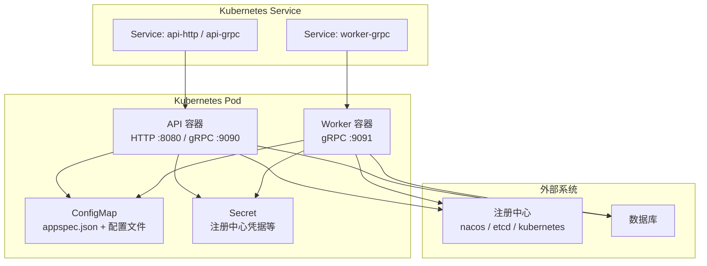
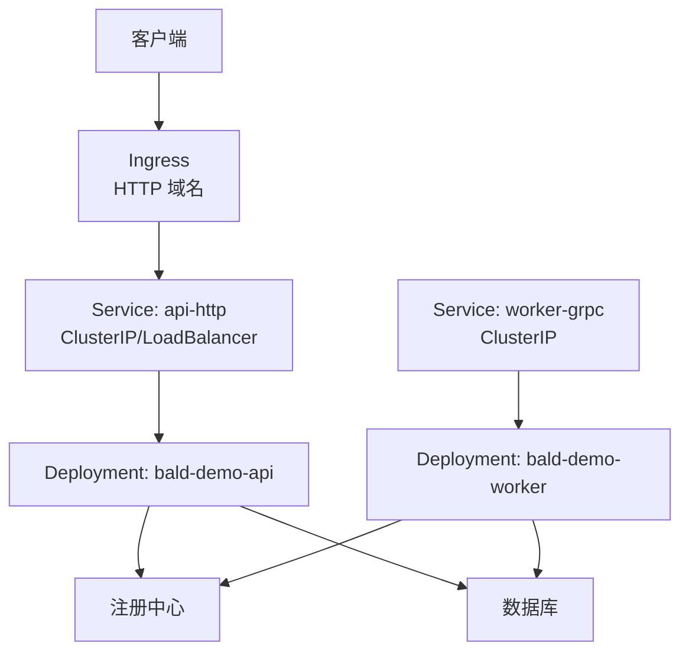
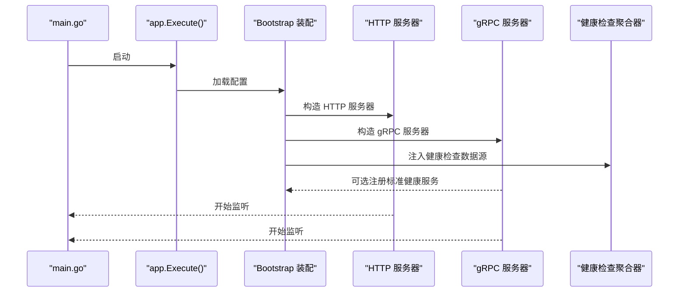
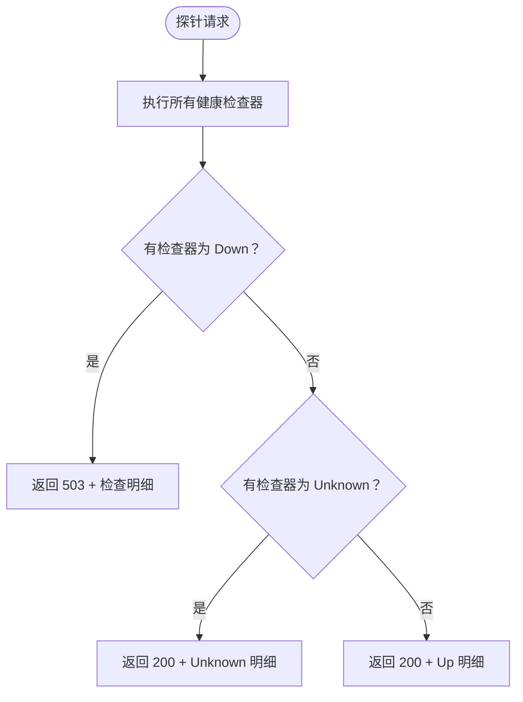
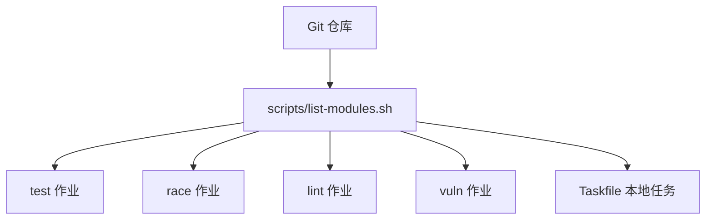

# Kubernetes 部署

<cite>
**本文引用的文件**   
- [appspec.json](file://_example/bald/appspec.json)
- [bald-demo-api.yaml](file://_example/bald/configs/bald-demo-api.yaml)
- [bald-demo-worker.yaml](file://_example/bald/configs/bald-demo-worker.yaml)
- [taskfile.yml](file://_example/bald/taskfile.yml)
- [main.go（api）](file://_example/bald/cmd/bald-demo-api/main.go)
- [main.go（worker）](file://_example/bald/cmd/bald-demo-worker/main.go)
- [bootstrap.go（bconf）](file://bconf/bootstrap.go)
- [config.go（bootstrap/config）](file://bootstrap/config/config.go)
- [server.go（bootstrap）](file://bootstrap/server.go)
- [health.go（health）](file://health/health.go)
- [handler.go（health）](file://health/handler.go)
- [ci.yml](file://.github/workflows/ci.yml)
- [list-modules.sh](file://scripts/list-modules.sh)
</cite>

## 目录
1. [引言](#引言)
2. [项目结构](#项目结构)
3. [核心组件](#核心组件)
4. [架构总览](#架构总览)
5. [详细组件分析](#详细组件分析)
6. [依赖关系分析](#依赖关系分析)
7. [性能与可伸缩性](#性能与可伸缩性)
8. [故障排查指南](#故障排查指南)
9. [结论](#结论)
10. [附录：Kubernetes 部署清单与最佳实践](#附录kubernetes-部署清单与最佳实践)

## 引言
本仓库是一个多 Go module 的应用框架与示例集合，其中 `_example/bald` 提供可运行的 API 与 Worker 双角色应用。该文档聚焦在 Kubernetes 上如何部署这个应用，并覆盖服务发现、负载均衡、弹性伸缩、滚动更新、蓝绿与灰度发布、健康检查探针、资源配额与优先级类、Helm Chart 集成，以及 `appspec.json` 作为 ConfigMap 挂载和环境变量注入的最佳实践。

需要特别强调：仓库自身未包含任何 Kubernetes 部署清单或 Helm Chart；以下部署方案以仓库现有运行模型为依据推导而成，属于面向生产落地的通用实践建议，而非仓库内已验证的部署产物。

## 项目结构
从 Kubernetes 部署视角，应把 `_example/bald` 视作一个“双角色进程”应用：
- **API 角色**：同时暴露 HTTP 与 gRPC 端口，默认监听 `:8080` 与 `:9090`。
- **Worker 角色**：仅暴露 gRPC 端口，默认监听 `:9091`。

两者都由 `cmd/bald-demo-*` 生成入口启动，最终调用 `app.Execute()`，并根据配置加载 bootstrap 配置、日志、数据库、注册中心等能力。

**图表来源**
- [appspec.json:1-81](file://_example/bald/appspec.json#L1-L81)
- [bald-demo-api.yaml:1-29](file://_example/bald/configs/bald-demo-api.yaml#L1-L29)
- [bald-demo-worker.yaml:1-27](file://_example/bald/configs/bald-demo-worker.yaml#L1-L27)
- [main.go（api）:1-14](file://_example/bald/cmd/bald-demo-api/main.go#L1-L14)
- [main.go（worker）:1-14](file://_example/bald/cmd/bald-demo-worker/main.go#L1-L14)

**章节来源**
- [appspec.json:1-81](file://_example/bald/appspec.json#L1-L81)
- [bald-demo-api.yaml:1-29](file://_example/bald/configs/bald-demo-api.yaml#L1-L29)
- [bald-demo-worker.yaml:1-27](file://_example/bald/configs/bald-demo-worker.yaml#L1-L27)
- [taskfile.yml:1-23](file://_example/bald/taskfile.yml#L1-L23)
- [main.go（api）:1-14](file://_example/bald/cmd/bald-demo-api/main.go#L1-L14)
- [main.go（worker）:1-14](file://_example/bald/cmd/bald-demo-worker/main.go#L1-L14)

## 核心组件
从部署角度，关键组件包括：

| 组件 | 职责 | Kubernetes 对应物 |
|---|---|---|
| API 进程 | 启动 HTTP 与 gRPC 服务，注册领域服务，连接注册中心与数据库 | Deployment + Service |
| Worker 进程 | 启动 gRPC 工作进程，消费任务或执行后台逻辑 | Deployment + Service |
| appspec.json | 声明角色、协议端口、版本、停止超时、注册中心类型等 | ConfigMap |
| YAML 配置文件 | 运行时配置，如数据库、日志、注册中心地址 | ConfigMap |
| Secret | 存放敏感信息，如 nacos/etcd/k8s 访问凭据 | Secret |
| Health 端点 | 暴露 `/healthz`、`/readyz`，供 K8s 探针使用 | HTTP 路由或 gRPC 标准健康服务 |
| 注册中心 | 服务发现后端，示例使用 nacos，也支持 etcd/kubernetes | 外部集群或 Sidecar/Operator |

**章节来源**
- [appspec.json:1-81](file://_example/bald/appspec.json#L1-L81)
- [bootstrap.go（bconf）:1-200](file://bconf/bootstrap.go#L1-L200)
- [server.go（bootstrap）:1-149](file://bootstrap/server.go#L1-L149)
- [health.go（health）:1-200](file://health/health.go#L1-L200)
- [handler.go（health）:1-84](file://health/handler.go#L1-L84)

## 架构总览
下图展示 API/Worker 在 Kubernetes 中的典型网络拓扑：Ingress 暴露 HTTP，Service 暴露 gRPC，Pod 通过注册中心完成服务发现。

该图是概念拓扑，不直接映射到仓库中的具体代码文件，因此不包含图表来源。

## 详细组件分析

### 配置装载与优先级
框架的配置装载器采用命名层合并机制，优先级从高到低为：

1. 命令行 flag
2. 环境变量
3. 本地文件
4. 契约源层
5. 远程桥（基准层）

这意味着在 Kubernetes 中，最自然的覆盖顺序是：
- 基础配置放在 ConfigMap；
- 环境差异通过环境变量注入；
- 敏感配置放入 Secret，并通过环境变量或挂载卷注入；
- 业务 flag 可在容器命令参数中传入。

配置装载器还支持热更新：任一动态层变更会触发全量重合并，并发布最新快照给业务回调。对于容器部署，这通常意味着重启更简单可靠；若确实需要热重载，需确保业务回调幂等且能安全切换运行期资源。

**章节来源**
- [config.go（bootstrap/config）:1-200](file://bootstrap/config/config.go#L1-L200)

### 进程启动与服务器装配
API 和 Worker 的入口都是生成的 `main.go`，调用 `app.Execute()`。框架根据 bootstrap 配置创建 HTTP 和 gRPC 服务器。关键要点：

- 若契约中未配置某个协议，对应服务器工厂返回 nil，引擎跳过该协议。
- gRPC 服务器可选择注册反射、业务 service 注册回调，并接入标准健康服务。
- HTTP 服务器由业务 handler 决定路由；框架不内置业务路由。
- 健康检查聚合器支持多个命名检查器，整体结果为 Down、Up 或 Unknown。

**图表来源**
- [main.go（api）:1-14](file://_example/bald/cmd/bald-demo-api/main.go#L1-L14)
- [main.go（worker）:1-14](file://_example/bald/cmd/bald-demo-worker/main.go#L1-L14)
- [server.go（bootstrap）:1-149](file://bootstrap/server.go#L1-L149)
- [health.go（health）:1-200](file://health/health.go#L1-L200)

**章节来源**
- [main.go（api）:1-14](file://_example/bald/cmd/bald-demo-api/main.go#L1-L14)
- [main.go（worker）:1-14](file://_example/bald/cmd/bald-demo-worker/main.go#L1-L14)
- [server.go（bootstrap）:1-149](file://bootstrap/server.go#L1-L149)

### 健康检查探针
框架提供两类健康检查：

| 探针类型 | 行为 | 适用场景 |
|---|---|---|
| Liveness | 始终返回 200，只要 HTTP 进程存活即认为存活 | 检测进程是否挂死 |
| Readiness | 执行所有注册的检查器；任一 Down 返回 503 | 检测依赖就绪 |

健康检查聚合器支持并发执行各检查器，受全局超时控制；任一检查失败时整体状态为 Down。HTTP handler 将结果序列化为 JSON，便于观测与排障。

**图表来源**
- [health.go（health）:1-200](file://health/health.go#L1-L200)
- [handler.go（health）:1-84](file://health/handler.go#L1-L84)

**章节来源**
- [health.go（health）:1-200](file://health/health.go#L1-L200)
- [handler.go（health）:1-84](file://health/handler.go#L1-L84)

### 服务发现与注册中心
示例配置使用 nacos 作为注册中心，包含服务端地址、命名空间、分组、集群名和默认端点种类。框架还抽象了 registry 层，支持多种后端实现；但根据作者约束，consul 与 kubernetes 注册中心后端的实际采用面未被覆盖，不应写成“已支持/已验证”。

部署时应注意：
- 注册中心本身必须作为外部依赖管理，不在应用镜像内硬编码。
- 注册中心地址、命名空间、凭据应来自 ConfigMap 或 Secret。
- 若使用 nacos，应将 `serverAddrs`、`namespace`、`group`、`clusterName` 等配置暴露为可替换值。
- 若切换到 etcd 或 kubernetes 注册中心，应确认后端适配器的连接方式、认证方式与权限边界。

**章节来源**
- [appspec.json:1-81](file://_example/bald/appspec.json#L1-L81)
- [bald-demo-api.yaml:1-29](file://_example/bald/configs/bald-demo-api.yaml#L1-L29)
- [bald-demo-worker.yaml:1-27](file://_example/bald/configs/bald-demo-worker.yaml#L1-L27)

### 数据库与持久化
示例使用 SQLite 内存模式，不适合生产 Kubernetes 部署。生产环境应改为真实数据库驱动，例如 PostgreSQL、MySQL、MongoDB 等，并把连接串、用户名、密码放入 Secret。

如果仍使用 SQLite 文件模式：
- 使用 `PersistentVolumeClaim` 挂载持久存储；
- 注意多副本写入冲突，SQLite 通常只适合单副本；
- 定期备份 PV 中的数据文件。

**章节来源**
- [appspec.json:1-81](file://_example/bald/appspec.json#L1-L81)
- [bald-demo-api.yaml:1-29](file://_example/bald/configs/bald-demo-api.yaml#L1-L29)
- [bald-demo-worker.yaml:1-27](file://_example/bald/configs/bald-demo-worker.yaml#L1-L27)

## 依赖关系分析
从 CI 与模块组织角度，仓库是 93 个 go.mod 的多模块仓库，模块清单由脚本派生，CI 与 Taskfile 都消费同一份清单。这对容器构建的意义是：

- 多阶段 Docker 构建应按 module 缓存依赖。
- `_example/bald` 是独立 module，其 go.mod 会把 kratos contrib 模块 replace 到仓库外同级检出，因此不能假定干净克隆就能直接构建示例。
- CI 主循环使用 `go test -short`，避免等待信号的手动集成用例挂起；真正的 etcd/redis/mongo 集成测试由 `integration` 作业按套件点名注入真实服务。

**图表来源**
- [list-modules.sh:1-24](file://scripts/list-modules.sh#L1-L24)
- [ci.yml:1-200](file://.github/workflows/ci.yml#L1-L200)

**章节来源**
- [list-modules.sh:1-24](file://scripts/list-modules.sh#L1-L24)
- [ci.yml:1-200](file://.github/workflows/ci.yml#L1-L200)

## 性能与可伸缩性
推荐设置如下指标：

| 维度 | 建议 |
|---|---|
| 副本数 | API 横向扩展；Worker 按队列深度自动扩缩容 |
| CPU 请求 | 至少覆盖正常负载下的 CPU 使用率，保留一定余量 |
| CPU 限制 | 防止单 Pod 抢占节点资源 |
| 内存请求 | 覆盖堆、栈、缓冲与外部库开销 |
| 内存限制 | 防止 OOM 影响其他 Pod |
| HPA | 基于 CPU、内存或自定义指标扩容 |
| VPA | 用于观察历史资源使用，辅助调优请求/限制 |
| PodDisruptionBudget | 保障滚动更新期间最小可用副本 |

Worker 更适合配合水平 Pod 自动扩缩容，依据消息队列长度、gRPC 处理延迟或自定义指标调整副本数。API 也可按 QPS、延迟或资源利用率扩缩容。

## 故障排查指南

### 健康检查问题
- 如果 liveness 一直 200 而 readiness 持续 503，通常是依赖未就绪，例如注册中心、数据库或缓存不可达。
- 如果 liveness 被杀掉，说明 HTTP 进程无法响应，可能是 goroutine 泄漏、阻塞初始化或依赖连接池耗尽。
- 查看 health 端点的 JSON 输出，定位具体检查器名称和错误消息。

**章节来源**
- [health.go（health）:1-200](file://health/health.go#L1-L200)
- [handler.go（health）:1-84](file://health/handler.go#L1-L84)

### 配置加载失败
- 检查 bootstrap 配置是否满足校验规则，例如应用 id、name、服务器端口格式、日志后端数量等。
- 检查 ConfigMap 是否挂载成功，环境变量是否被正确注入。
- 若启用远程配置中心，确认远端可达且配置加载超时策略合理。

**章节来源**
- [bootstrap.go（bconf）:1-200](file://bconf/bootstrap.go#L1-L200)
- [config.go（bootstrap/config）:1-200](file://bootstrap/config/config.go#L1-L200)

### 注册中心不可用
- 先确认注册中心 Service 可连通。
- 检查命名空间、分组、集群名是否与注册中心一致。
- 若使用 nacos，确认端口、鉴权、命名空间是否正确。
- 若后端未就绪，应用应快速失败或降级，而不是无限重试导致启动卡住。

**章节来源**
- [appspec.json:1-81](file://_example/bald/appspec.json#L1-L81)
- [bald-demo-api.yaml:1-29](file://_example/bald/configs/bald-demo-api.yaml#L1-L29)

### 数据库不可用
- 检查数据库 Service 或外部地址是否可达。
- 检查 Secret 中用户名、密码、连接串是否正确。
- 对 SQLite 文件模式，检查 PVC 挂载路径与读写权限。
- 对连接池，检查最大连接数、超时、重试策略。

## 结论
该仓库提供了清晰的双角色应用模型、可组合的健康检查、可热更新的配置装载器和多注册中心抽象。Kubernetes 部署的关键在于：
- 把 `appspec.json` 和 YAML 配置放入 ConfigMap；
- 把敏感配置放入 Secret；
- 为 API 和 Worker 分别定义 Deployment 和 Service；
- 配置 liveness 和 readiness 探针；
- 使用 HPA/PDB 保证弹性与可用性；
- 通过注册中心完成服务发现；
- 在生产环境中替换示例内存数据库为真实数据库。

## 附录：Kubernetes 部署清单与最佳实践

以下内容是可复用的部署模板说明，不是仓库内已有清单。

### Deployment 设计
- API Deployment：
  - 副本数初始为 2，HPA 可扩展至更多。
  - 暴露 HTTP 8080 与 gRPC 9090。
  - 读取 `appspec.json` 与 API 配置文件。
  - 注入注册中心与数据库凭据。
- Worker Deployment：
  - 副本数初始为 1，按队列深度自动扩缩容。
  - 暴露 gRPC 9091。
  - 读取 `appspec.json` 与 Worker 配置文件。
  - 注入注册中心与数据库凭据。

### Service 设计
- `api-http`：ClusterIP 或 LoadBalancer，转发 HTTP 8080。
- `api-grpc`：ClusterIP，转发 gRPC 9090。
- `worker-grpc`：ClusterIP，转发 gRPC 9091。

### Ingress 设计
- 对外暴露 API 的 HTTP 域名。
- gRPC 流量可通过 Ingress 的 gRPC 注解或专用 TCP/UDP Service 暴露。
- TLS 终止建议放在 Ingress 控制器或边车代理。

### ConfigMap 设计
- `bald-appspec`：包含 `appspec.json`。
- `bald-api-config`：包含 API 的 YAML 配置。
- `bald-worker-config`：包含 Worker 的 YAML 配置。

### Secret 设计
- `bald-registry-secret`：注册中心凭据。
- `bald-db-secret`：数据库凭据。
- `bald-tls-secret`：TLS 证书与私钥。

### 健康检查探针
- livenessProbe：
  - 使用 HTTP 200 端点。
  - 初始延迟较短，探测间隔短，失败阈值低。
- readinessProbe：
  - 使用健康检查聚合端点。
  - 初始延迟较长，等待依赖就绪。
  - 失败阈值较高，避免抖动。

### 资源配额与优先级类
- 每个 Deployment 设置 requests 和 limits。
- 使用 ResourceQuota 限制 namespace 总资源。
- 使用 LimitRange 设置默认资源范围。
- 使用 PriorityClass 区分线上、测试、批处理 Pod。

### 滚动更新
- 使用 RollingUpdate 策略。
- 设置 `maxUnavailable=0` 或较小值。
- 设置 `maxSurge` 控制临时超发副本。
- 配合 PDB 保证最小可用副本。

### 蓝绿部署
- 新建蓝色 Deployment 和 Service，逐步切流。
- 旧绿色 Deployment 保留一段时间，用于快速回滚。
- 通过 Ingress 或 Service selector 切换流量。

### 灰度发布
- 使用标签区分灰度版本。
- 通过 Ingress 权重或网关规则按比例分流。
- 结合监控和告警，观察错误率和延迟。
- 灰度成功后再全量升级。

### 环境变量注入最佳实践
- 非敏感配置优先使用 ConfigMap 挂载文件。
- 敏感配置使用 Secret 环境变量注入。
- 避免在镜像中硬编码环境地址。
- 使用统一前缀区分应用与环境。
- 使用容器编排平台提供的密钥管理服务时，先做探活再启动业务。

### 将 `appspec.json` 作为 ConfigMap 挂载
- 将 `appspec.json` 放入 ConfigMap。
- 在容器中以只读方式挂载到固定路径。
- 应用启动时读取该路径。
- 修改 ConfigMap 后，根据应用是否支持热更新决定是否重启 Pod。

### 与 Helm Chart 的结合
- 将 Deployment、Service、Ingress、ConfigMap、Secret、HPA、PDB、PriorityClass 封装为 Helm Chart。
- 使用 values.yaml 暴露副本数、端口、资源限制、注册中心地址、数据库地址等。
- 使用 values-prod.yaml、values-staging.yaml 区分环境。
- 使用 Helm hooks 处理初始化、迁移、备份任务。
- 使用 Helm release 名称区分不同环境或租户。

### 故障恢复与灾难恢复
- 故障恢复：
  - 使用 PodRestartPolicy 和 BackoffLimit。
  - 使用 PDB 防止同时驱逐过多 Pod。
  - 使用探针避免把未就绪 Pod 加入 Service。
- 灾难恢复：
  - 定期备份数据库。
  - 定期备份持久卷。
  - 将备份对象上传到异地存储。
  - 制定恢复演练计划，验证恢复时间目标。
- 备份恢复：
  - 使用 VolumeSnapshot 或云厂商快照。
  - 恢复时先恢复数据，再启动应用。
  - 恢复后进行健康检查和冒烟测试。

### 与 CI 的一致性
- 构建镜像时使用与 CI 相同的 Go 版本。
- 多阶段构建缓存依赖。
- 构建产物签名与扫描漏洞。
- 镜像推送到私有镜像仓库。
- 部署清单与 Chart 版本化管理。

**章节来源**
- [appspec.json:1-81](file://_example/bald/appspec.json#L1-L81)
- [bald-demo-api.yaml:1-29](file://_example/bald/configs/bald-demo-api.yaml#L1-L29)
- [bald-demo-worker.yaml:1-27](file://_example/bald/configs/bald-demo-worker.yaml#L1-L27)
- [bootstrap.go（bconf）:1-200](file://bconf/bootstrap.go#L1-L200)
- [config.go（bootstrap/config）:1-200](file://bootstrap/config/config.go#L1-L200)
- [server.go（bootstrap）:1-149](file://bootstrap/server.go#L1-L149)
- [health.go（health）:1-200](file://health/health.go#L1-L200)
- [handler.go（health）:1-84](file://health/handler.go#L1-L84)
- [ci.yml:1-200](file://.github/workflows/ci.yml#L1-L200)
- [list-modules.sh:1-24](file://scripts/list-modules.sh#L1-L24)