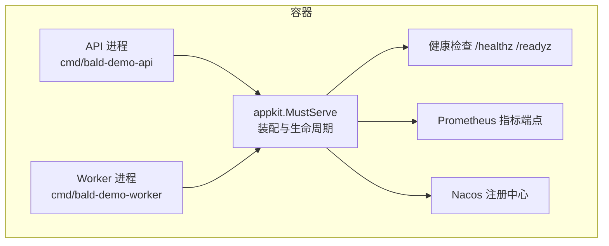
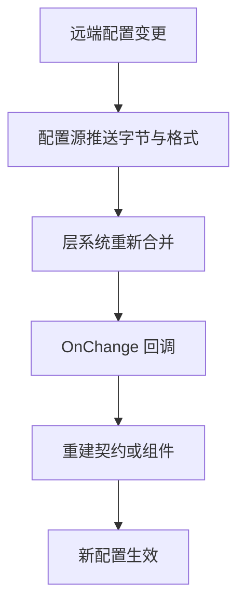
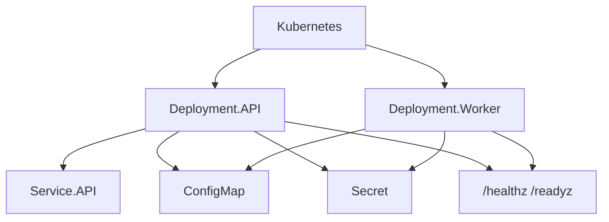
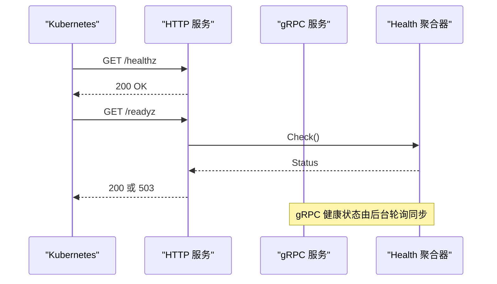
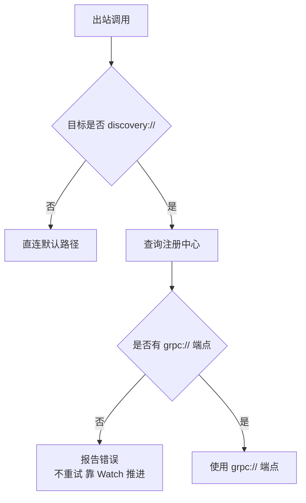
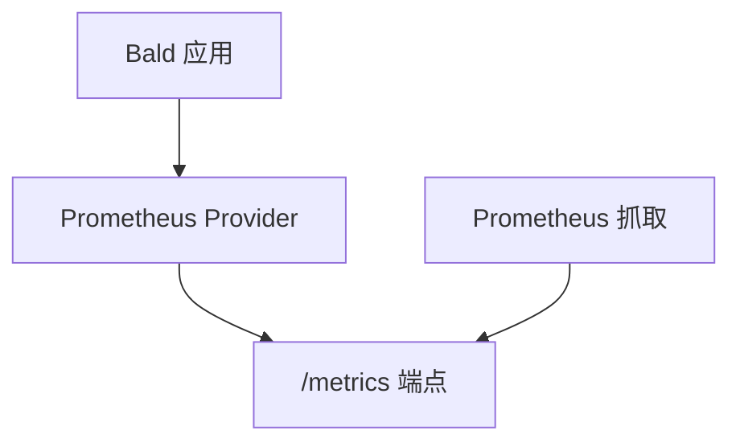

# 容器化部署

<cite>
**本文引用的文件**   
- [appspec.json](file://_example/bald/appspec.json)
- [taskfile.yml](file://_example/bald/taskfile.yml)
- [main.go（API 入口）](file://_example/bald/cmd/bald-demo-api/main.go)
- [main.go（Worker 入口）](file://_example/bald/cmd/bald-demo-worker/main.go)
- [command.go（API 命令装配）](file://_example/bald/cmd/bald-demo-api/app/command.go)
- [bald-demo-api.yaml](file://_example/bald/configs/bald-demo-api.yaml)
- [bald-demo-worker.yaml](file://_example/bald/configs/bald-demo-worker.yaml)
- [providers.go（示例日志 Provider）](file://_example/bald/internal/bootstrap/providers.go)
- [register_nacos.go（Nacos 变体）](file://_example/bald/internal/bootstrap/register_nacos.go)
- [bootstrap.go（MustServe 装配入口）](file://pkg/appkit/bootstrap.go)
- [health.go（健康检查声明与探针挂载）](file://pkg/appkit/health.go)
- [decl.go（Decl 结构，含健康字段）](file://pkg/appkit/decl.go)
- [handler.go（HTTP 健康处理器）](file://health/handler.go)
- [readiness.go（就绪适配）](file://health/readiness.go)
- [prometheus.go（Prometheus 指标提供者）](file://metrics/prometheus/prometheus.go)
</cite>

## 目录
1. [简介](#简介)
2. [项目结构与容器边界](#项目结构与容器边界)
3. [Docker 镜像构建最佳实践](#docker-镜像构建最佳实践)
4. [配置管理：appspec、配置文件与环境变量](#配置管理appspec配置文件和环境变量)
5. [Kubernetes 部署清单](#kubernetes-部署清单)
6. [健康检查与滚动更新](#健康检查与滚动更新)
7. [服务发现与网关出站](#服务发现与网关出站)
8. [日志收集与监控指标](#日志收集与监控指标)
9. [性能调优与资源限制](#性能调优与资源限制)
10. [故障排查](#故障排查)
11. [结论](#结论)

## 简介
本文面向 Bald 框架的容器化部署，覆盖 Docker 多阶段构建、镜像分层与安全扫描，以及 Kubernetes 中的 Deployment、Service、ConfigMap、Secret、健康探针、滚动更新、服务发现、日志与监控。文档以仓库中 `_example/bald` 为可运行样例，结合 `bootstrap`、`health`、`metrics/prometheus` 等核心包的实现事实给出部署约束与建议。

## 项目结构与容器边界
Bald 示例应用按「角色」拆分二进制：
- `cmd/bald-demo-api`：对外暴露 HTTP 与 gRPC 面。
- `cmd/bald-demo-worker`：仅启动 gRPC worker 面。

每个角色的入口都通过生成的 `Execute()` 调用 `appkit.MustServe(...)`，由 AppSpec 驱动装配。这意味着容器内应只运行一个角色进程；若需要 API 与 Worker 同容器，需显式启动两个 `appkit.MustServe`，并避免端口与依赖冲突。

**图示来源**
- [main.go（API 入口）:1-14](file://_example/bald/cmd/bald-demo-api/main.go#L1-L14)
- [main.go（Worker 入口）:1-14](file://_example/bald/cmd/bald-demo-worker/main.go#L1-L14)
- [command.go（API 命令装配）:1-35](file://_example/bald/cmd/bald-demo-api/app/command.go#L1-L35)
- [bootstrap.go:192-196](file://pkg/appkit/bootstrap.go#L192-L196)

**章节来源**
- [appspec.json:1-81](file://_example/bald/appspec.json#L1-L81)
- [taskfile.yml:1-23](file://_example/bald/taskfile.yml#L1-L23)
- [command.go（API 命令装配）:1-35](file://_example/bald/cmd/bald-demo-api/app/command.go#L1-L35)

## Docker 镜像构建最佳实践

### 多阶段构建
推荐至少两阶段：
1. **构建阶段**：安装 Go 工具链、下载依赖、生成 protobuf、编译 API 与 Worker 两个二进制。
2. **运行阶段**：基于最小基础镜像，仅拷贝最终二进制与只读配置。

由于仓库是 93 个 go.mod 的多模块仓库，且 `_example/bald` 依赖仓库外的 contrib 模块，建议把构建上下文限定在 `_example/bald` 子目录，或在构建脚本中先执行仓库根级依赖准备。不要假设单 module 可直接编译。

### 镜像分层策略
- 将 `go.sum`、`go.mod` 及业务代码作为独立层，提升缓存命中率。
- 将运行时不可变的配置放入只读层；动态配置通过 ConfigMap/环境变量注入。
- 避免把敏感信息写入镜像层。

### 安全扫描集成
- 在 CI 中使用 `govulncheck` 对构建产物和依赖进行漏洞扫描。
- 使用轻量基础镜像（如 Alpine）减少攻击面。
- 非 root 用户运行进程。
- 设置 `no-new-privileges`、只读根文件系统、最小能力集。

### Alpine Linux 基础镜像的选择理由
Alpine 体积更小，默认包管理器 apk 与 musl libc 组合减少依赖体积；但需注意：
- 某些 C 扩展或 CGO 依赖可能需要额外安装依赖库。
- 若启用 CGO，需确认目标库与 musl 兼容。
- 日志输出到 stdout/stderr 时，容器编排平台通常接管采集，无需在应用侧写文件。

### 构建与验证流程
参考示例 Taskfile，本地构建、vet、测试流程如下：
- 生成 protobuf：`buf generate`。
- 构建与测试：`go build ./...`、`go vet ./...`、`go test ./...`。
- 容器镜像应在 CI 中复用相同步骤，确保镜像与本地行为一致。

**章节来源**
- [taskfile.yml:1-23](file://_example/bald/taskfile.yml#L1-L23)

## 配置管理：appspec、配置文件和环境变量

### AppSpec 的作用
`appspec.json` 是 Bald 应用的「声明真相源」，定义：
- 元数据：名称、模块路径、描述。
- 角色：api 与 worker，各自启用的 server 面与端口。
- bootstrap 段：应用版本、停止超时、日志后端、数据库、注册中心。
- 域：greet 域的 proto 包与服务名。
- 变体：grpcgw、nacos 等可选装配模式。

在容器中，AppSpec 通常作为只读配置嵌入镜像或通过 ConfigMap 挂载。

### 配置文件挂载
示例提供两份 YAML 配置：
- `configs/bald-demo-api.yaml`
- `configs/bald-demo-worker.yaml`

它们覆盖 `app`、`database.sql`、`logger.backends`、`registry.nacos`、`server.http`、`server.grpc.addr`。容器启动时应根据角色选择对应配置，并通过 `--config` 或环境变量传入。

### 环境变量注入
Bald 的层模型支持环境覆盖。例如测试中通过 `BALD_DEMO_LOG_LEVEL` 覆盖日志级别，说明环境变量优先级高于部分层配置。常见注入项包括：
- 注册中心地址、命名空间、组。
- 数据库连接字符串。
- 日志级别、输出路径。
- 应用版本、实例标识。

### 动态配置更新
远程配置源（如 Nacos、etcd、Consul、HTTP、Vault、Kubernetes）以「层」形式参与合并：
- 层列表首元素优先级最高。
- 支持字段级合并。
- Watch 推送触发重合并与回调。
- 层可声明 `Watch=true`，要求 Reader 实现 `ValueWatcher`。
- 远程桥接器会记录最近一次返回的格式，用于解析。

因此，容器中的动态配置更新流程为：
1. 远端配置变更。
2. 配置源推送新字节与格式。
3. 层系统重新合并。
4. 应用按需重建契约或组件。

**图示来源**
- [bootstrap/config/source.go:32-46](file://bootstrap/config/source.go#L32-L46)
- [bootstrap/config/source.go:64-83](file://bootstrap/config/source.go#L64-L83)

**章节来源**
- [appspec.json:1-81](file://_example/bald/appspec.json#L1-L81)
- [bald-demo-api.yaml:1-29](file://_example/bald/configs/bald-demo-api.yaml#L1-L29)
- [bald-demo-worker.yaml:1-27](file://_example/bald/configs/bald-demo-worker.yaml#L1-L27)
- [bootstrap/config/source.go:32-83](file://bootstrap/config/source.go#L32-L83)

## Kubernetes 部署清单

### Deployment
- 为 API 与 Worker 分别创建 Deployment。
- 指定镜像标签、副本数、资源限制。
- 通过 `args` 传入 `--config` 或环境变量。
- 设置 `terminationGracePeriodSeconds` 与 `app.stopTimeout` 一致。
- 使用 `securityContext` 限制权限。

### Service
- API Service 暴露 HTTP 与 gRPC 端口。
- Worker Service 通常不直接暴露，供集群内其他服务通过服务发现访问。

### ConfigMap
- 挂载 `appspec.json` 与业务 YAML 配置。
- 区分 dev/staging/prod 配置。

### Secret
- 存放注册中心凭据、数据库密码、TLS 证书。
- 通过环境变量或卷挂载注入。

### 健康探针
- Liveness：`/healthz`，始终返回 200。
- Readiness：`/readyz`，任一依赖 Down 返回 503。
- gRPC 健康：标准 `grpc.health.v1.Health` 同步整体状态。

### 滚动更新策略
- 使用 `RollingUpdate`。
- 设置 `maxUnavailable` 与 `maxSurge`。
- 在 readiness 未就绪前不接收流量。

**图示来源**
- [health.go（健康检查声明与探针挂载）:11-14](file://pkg/appkit/health.go#L11-L14)
- [handler.go:1-84](file://health/handler.go#L1-L84)

**章节来源**
- [command.go（API 命令装配）:1-35](file://_example/bald/cmd/bald-demo-api/app/command.go#L1-L35)
- [health.go（健康检查声明与探针挂载）:11-43](file://pkg/appkit/health.go#L11-L43)
- [handler.go:1-84](file://health/handler.go#L1-L84)

## 健康检查与滚动更新

### HTTP 健康端点
- `/healthz`：liveness 探针，进程存活即返回 200。
- `/readyz`：readiness 探针，聚合所有检查器；Down 返回 503，Up/Unknown 返回 200。

### gRPC 健康端点
- gRPC 标准健康服务由 transport/grpc 默认注册。
- Bootstrap 层后台轮询 `health.Health.Readiness`，并将结果同步到 gRPC 健康状态。
- 初始立即同步一次，之后按间隔轮询。

### 就绪语义
- Up/Unknown → 认为就绪。
- Down → 返回错误，错误消息聚合所有失败检查器名称与消息。

**图示来源**
- [handler.go:1-84](file://health/handler.go#L1-L84)
- [readiness.go:1-42](file://health/readiness.go#L1-L42)
- [health.go（健康检查声明与探针挂载）:38-43](file://pkg/appkit/health.go#L38-L43)

**章节来源**
- [handler.go:1-84](file://health/handler.go#L1-L84)
- [readiness.go:1-42](file://health/readiness.go#L1-L42)
- [health.go（健康检查声明与探针挂载）:11-43](file://pkg/appkit/health.go#L11-L43)

## 服务发现与网关出站

### 服务发现
示例使用 Nacos 作为注册中心与远程配置源：
- 注册中心：`registry.type=nacos`，包含 `serverAddrs`、`namespace`、`group`、`clusterName`、`defaultKind=grpc`。
- 远程配置：通过 `nacosBootstrapOptions` 注入 Nacos 配置客户端，DataID 与 Group 固定。

### 网关出站
当目标写成 `discovery:///<服务名>` 时走注册中心；直连仍是默认。解析器有三条既定语义：
1. `Build` 返回错误时，gRPC 不会重试，只调用 `cc.ReportError`，靠 `Watch` 推进。
2. 空快照不推 `UpdateState`。
3. 只取 `grpc://` 端点。

Nacos 会把一个实例的多个端点拆成 `<Name>.<scheme>` 形式的多个服务，目标必须写 `discovery:///<服务名>.grpc`；内存与 etcd 用注册时填的 `ServiceInstance.Name` 原样。缺少 `.grpc` 后缀时，解析到的通常是 HTTP 面或空集。

**图示来源**
- [appspec.json:1-81](file://_example/bald/appspec.json#L1-L81)
- [register_nacos.go:1-101](file://_example/bald/internal/bootstrap/register_nacos.go#L1-L101)

**章节来源**
- [appspec.json:1-81](file://_example/bald/appspec.json#L1-L81)
- [register_nacos.go:1-101](file://_example/bald/internal/bootstrap/register_nacos.go#L1-L101)

## 日志收集与监控指标

### 日志
示例日志后端为 `slog`，输出到 stdout，格式为 console，级别为 info。容器环境中建议将 stdout/stderr 交给 Kubernetes 日志采集（如 DaemonSet、Fluent Bit、Vector）。

示例自定义 logger Provider 会：
- 过滤敏感键（password、token）。
- 附加服务标识。
- 支持多后端合并。

### 监控指标
`metrics/prometheus` 提供 Prometheus 指标提供者：
- 指标惰性注册到默认 registry。
- 可通过 `NewWithDefaultRegistry` 暴露标准 `/metrics`。
- 支持 namespace、subsystem、自定义 registerer。
- 提供 Counter、Histogram、Gauge、GaugeAdd 等接口。

在 Kubernetes 中，应将 `/metrics` 挂载到业务 HTTP 服务，并由 Prometheus ServiceMonitor 抓取。

**图示来源**
- [prometheus.go:3-16](file://metrics/prometheus/prometheus.go#L3-L16)
- [prometheus.go:82-123](file://metrics/prometheus/prometheus.go#L82-L123)

**章节来源**
- [providers.go（示例日志 Provider）:1-73](file://_example/bald/internal/bootstrap/providers.go#L1-L73)
- [prometheus.go:3-16](file://metrics/prometheus/prometheus.go#L3-L16)
- [prometheus.go:82-123](file://metrics/prometheus/prometheus.go#L82-L123)

## 性能调优与资源限制

### 应用层参数
- `app.stopTimeout`：控制优雅停机时间。示例为 15s，应与 Kubernetes `terminationGracePeriodSeconds` 协调。
- 日志级别：生产建议 warn 或 error，调试时可临时提高。
- 注册中心连接：合理设置超时、重试、心跳间隔。

### 资源限制
- CPU：为 API 与 Worker 分别设置 requests 与 limits。
- 内存：根据业务峰值压测确定 limit，预留 GC 空间。
- 副本数：结合 QPS、延迟 SLA 与水平扩缩容策略。

### 并发与连接池
- gRPC 连接池大小应根据下游服务容量限制。
- 数据库连接池根据 RPS 与慢查询比例调整。
- 指标上报与日志落盘应避免阻塞主流程。

### 滚动更新
- 先扩后缩，保证可用副本。
- 利用 readiness 探针防止未就绪 Pod 接收流量。
- 对有状态的下游依赖（数据库、消息队列）提前扩容与预热。

**章节来源**
- [appspec.json:1-81](file://_example/bald/appspec.json#L1-L81)
- [bald-demo-api.yaml:1-29](file://_example/bald/configs/bald-demo-api.yaml#L1-L29)
- [bald-demo-worker.yaml:1-27](file://_example/bald/configs/bald-demo-worker.yaml#L1-L27)

## 故障排查

### 启动失败
- 检查 AppSpec 与 YAML 配置是否匹配。
- 确认角色端口未被占用。
- 查看 bootstrap 装配错误与 Provider 构建错误。

### 健康检查不通过
- `/healthz` 始终 200，若不返回则进程未启动或 HTTP 服务未启动。
- `/readyz` 503 表示依赖检查失败，查看 health 详情。
- gRPC 健康状态与 HTTP 就绪同源，若 gRPC 健康为 NOT_SERVING，检查 readiness 聚合。

### 配置未生效
- 检查层顺序与优先级。
- 确认远端配置源 Watch 正常。
- 确认 OnChange 回调串行执行，避免并发重建。

### 服务发现无端点
- 确认目标写法为 `discovery:///<服务名>.grpc`。
- 检查注册中心连通性与命名空间。
- 确认只有 `grpc://` 端点被取用。

**章节来源**
- [handler.go:1-84](file://health/handler.go#L1-L84)
- [readiness.go:1-42](file://health/readiness.go#L1-L42)
- [bootstrap/config/source.go:32-83](file://bootstrap/config/source.go#L32-L83)

## 结论
Bald 的容器化部署应以 AppSpec 为声明真相源，按角色拆分二进制，结合多阶段构建、最小基础镜像与安全扫描。配置管理采用层模型，支持静态文件、环境变量与远程配置源的热更新。健康检查提供 HTTP 与 gRPC 双通道，便于 Kubernetes 探针集成。服务发现与网关出站遵循既定语义，尤其注意 Nacos 的 `.grpc` 后缀。监控指标通过 Prometheus Provider 暴露，日志通过 stdout 统一采集。性能调优应围绕 stopTimeout、连接池、资源限制与滚动更新策略展开。