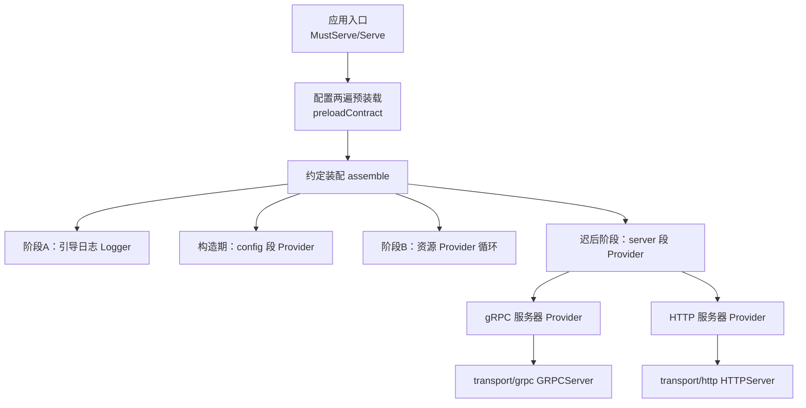
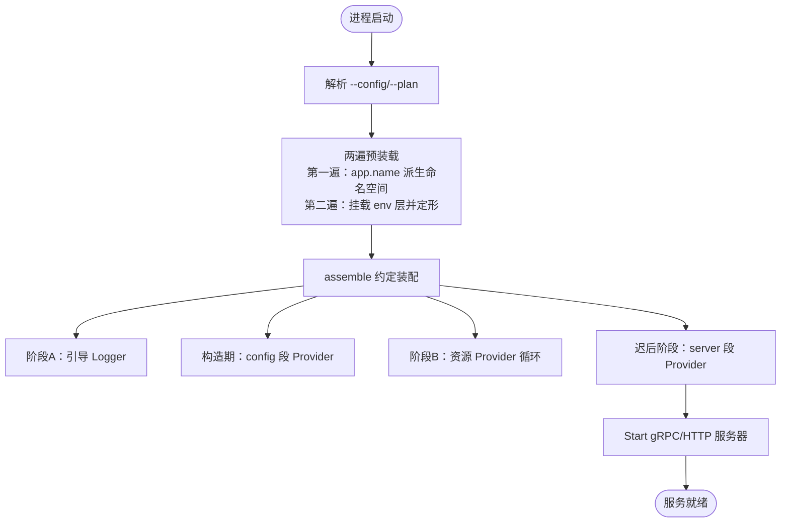
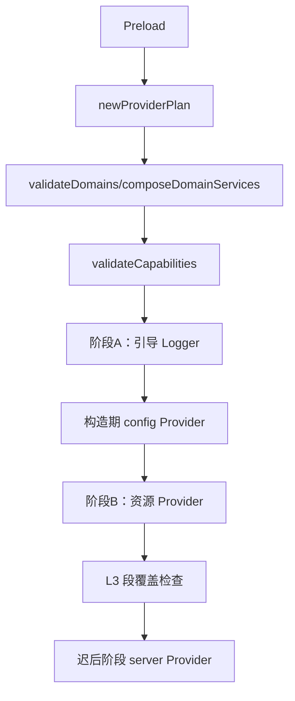
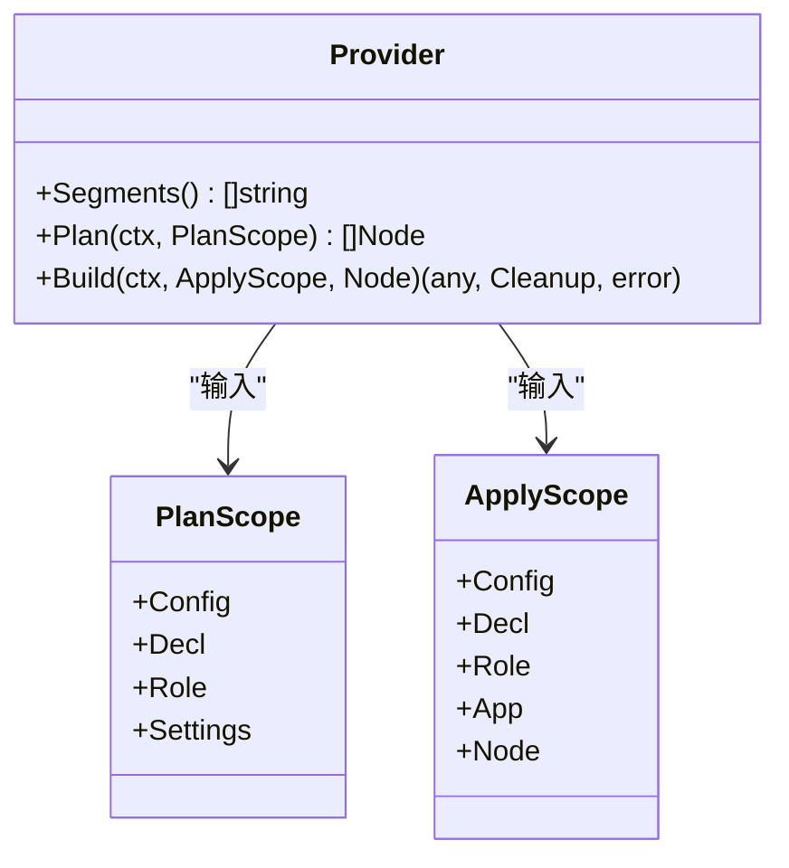
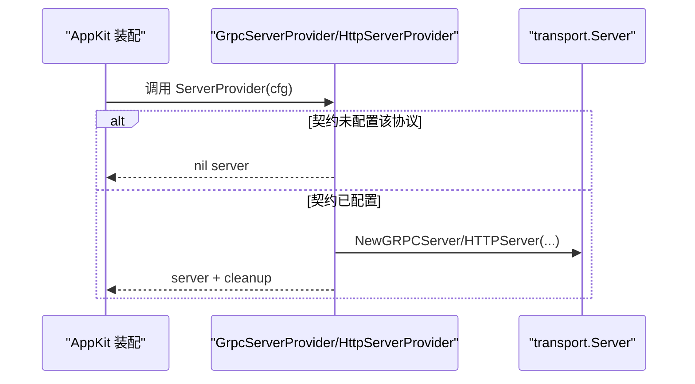
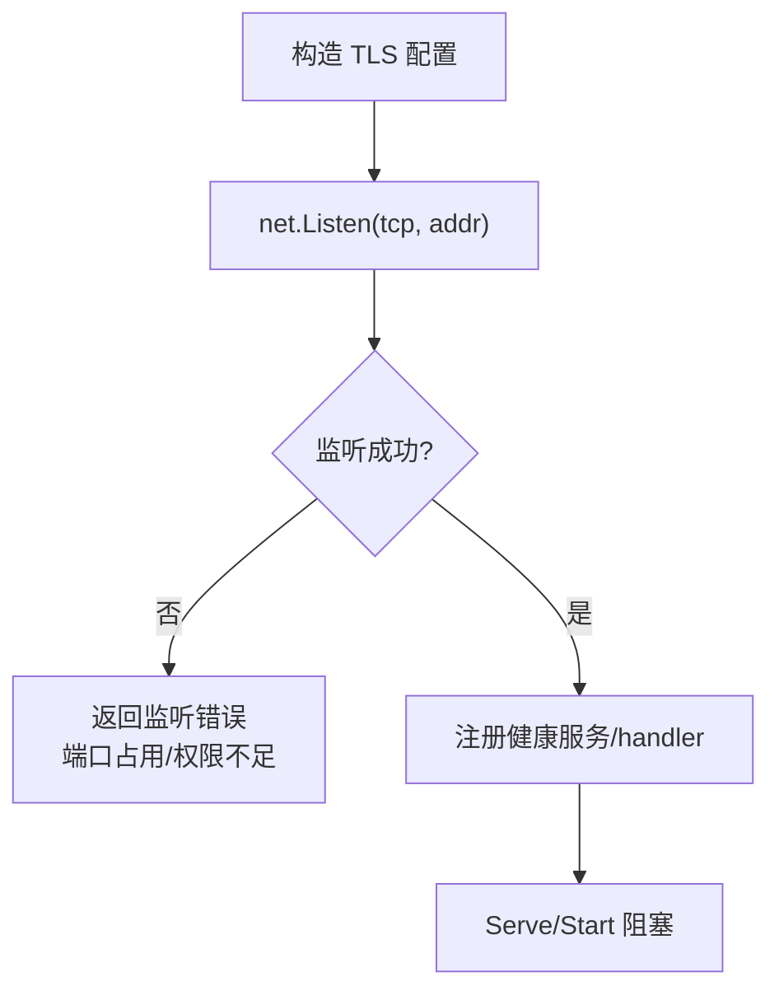
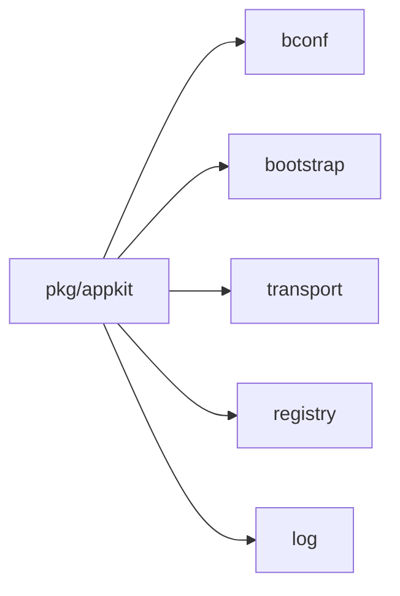

# 启动问题排查

<cite>
**本文引用的文件**   
- [serve.go](file://pkg/appkit/serve.go)
- [bootstrap.go](file://pkg/appkit/bootstrap.go)
- [provider.go](file://pkg/appkit/provider.go)
- [types.go](file://pkg/appkit/types.go)
- [server.go](file://bootstrap/server.go)
- [grpc_server.go](file://transport/grpc/grpc_server.go)
- [http_server.go](file://transport/http/http_server.go)
- [bootstrap.go](file://bconf/bootstrap.go)
- [config.go](file://bootstrap/config.go)
- [serve_failure_test.go](file://pkg/appkit/serve_failure_test.go)
</cite>

## 目录
1. [引言](#引言)
2. [项目结构](#项目结构)
3. [核心组件](#核心组件)
4. [架构总览](#架构总览)
5. [详细组件分析](#详细组件分析)
6. [依赖关系分析](#依赖关系分析)
7. [性能与可观测性](#性能与可观测性)
8. [故障排查指南](#故障排查指南)
9. [结论](#结论)

## 引言
本文面向服务启动失败场景，覆盖配置解析错误、Provider 初始化失败、依赖服务不可用等常见原因；解释 AppKit 装配关键阶段与错误点；说明段驱动 Provider 加载顺序和依赖约束；给出启动日志分析方法、堆栈定位技巧，以及端口占用、配置文件缺失、环境变量未设置等问题的处理建议。重点说明 Bootstrap ServerProvider 工厂的错误处理机制，以及 gRPC/HTTP 服务器启动失败时的诊断方法。

## 项目结构
本仓库是 93 个 go.mod 的多模块仓库，应用启动路径主要分布在：
- `pkg/appkit`：AppKit 装配引擎（配置两遍预装载、Provider 计划/构建、生命周期钩子）。
- `bootstrap`：契约到具体组件的工厂（协议服务器 Provider、配置源工厂）。
- `transport/{grpc,http}`：gRPC/HTTP 传输层实现。
- `bconf`：BootstrapConfig 默认值与顶层校验。

**图表来源**
- [serve.go:1-180](file://pkg/appkit/serve.go#L1-L180)
- [bootstrap.go:201-500](file://pkg/appkit/bootstrap.go#L201-L500)
- [server.go:1-149](file://bootstrap/server.go#L1-L149)
- [grpc_server.go:1-149](file://transport/grpc/grpc_server.go#L1-L149)
- [http_server.go:1-123](file://transport/http/http_server.go#L1-L123)

**章节来源**
- [serve.go:1-180](file://pkg/appkit/serve.go#L1-L180)
- [bootstrap.go:201-500](file://pkg/appkit/bootstrap.go#L201-L500)

## 核心组件
- AppKit 装配入口：`Serve` 负责 `--config` 解析、契约两遍预装载、约定装配、运行；`MustServe` 包装失败输出与退出码。
- Provider 装配引擎：按「精确段路径末者胜」收集 Provider，Plan 产出节点并拓扑排序，Build 执行副作用产物入库，停机逆序回放 Effect。
- Bootstrap ServerProvider：从契约 `Server` 段构造 transport.Server；未配置时返回 nil（跳过）；构造失败短路。
- gRPC/HTTP 服务器：监听前构造 TLS 配置，监听成功再注册健康服务或 handler；Endpoint 支持动态端口与本机可达 IP 解析。
- 顶层配置默认与校验：默认端口 `:8080`/`:9090`、slog 后端；校验 app.id/name、server.addr、logger.backends。

**章节来源**
- [serve.go:1-180](file://pkg/appkit/serve.go#L1-L180)
- [provider.go:1-200](file://pkg/appkit/provider.go#L1-L200)
- [server.go:1-149](file://bootstrap/server.go#L1-L149)
- [grpc_server.go:1-149](file://transport/grpc/grpc_server.go#L1-L149)
- [http_server.go:1-123](file://transport/http/http_server.go#L1-L123)
- [bootstrap.go:1-200](file://bconf/bootstrap.go#L1-L200)

## 架构总览
AppKit 启动流程的关键阶段如下：

**图表来源**
- [serve.go:1-180](file://pkg/appkit/serve.go#L1-L180)
- [bootstrap.go:201-500](file://pkg/appkit/bootstrap.go#L201-L500)

## 详细组件分析

### AppKit 装配阶段与错误点
- 配置解析与计划：`parseConfigFlag` 使用 pflag 容错扫描 `--config`；`parsePlanFlag` 在副作用前打印装配计划并返回 nil（`MustServe` 据此以 0 退出）。
- 配置两遍预装载：
  - 第一遍：本地文件 + 远程层，DeferEnv，Unmarshal 探针契约取 `app.name`；文件缺失且未显式声明路径时静默跳过，但显式路径缺失会 fail-fast。
  - 第二遍：`Store.MountEnv(app.name)` 挂 env 层全量重合并；`app.name` 为空则 fail-fast。
- 约定装配：
  - 变体补丁 → Provider 计划 → 域声明校验 → 能力声明校验（WithHTTP/WithGRPC 与 server.http/server.grpc 对偶）。
  - 阶段 A：引导 Logger（Provider 路径下 Build(Config=nil)），失败回滚。
  - 构造期：config 段 Provider 产出配置层；类型不对齐报错并回滚。
  - 阶段 B：资源 Provider 循环（Kahn 拓扑 + Priority/Key），产物入 App store；失败 fail-fast。
  - L3 段覆盖检查：契约出现的段若无消费者，启动期报错。
  - 迟后阶段：server 段 Provider（含标准 HTTP/gRPC）在业务 BeforeStart 之后执行。
  - 额外服务器：`WithExtraServerFunc` 工厂在业务 BeforeStart 后调用，返回 nil 表示跳过，错误则启动失败。

**图表来源**
- [bootstrap.go:201-500](file://pkg/appkit/bootstrap.go#L201-L500)

**章节来源**
- [serve.go:1-180](file://pkg/appkit/serve.go#L1-L180)
- [bootstrap.go:201-500](file://pkg/appkit/bootstrap.go#L201-L500)

### 段驱动 Provider 加载顺序与依赖
- 段路径精确匹配，末者胜；不同路径并存（如 `server.http` 与 `server.asynq`）。
- 优先级常量定义阶段内排序键（越小越先）：Logger(10)、Registry(20)、Tracer(30)、Metrics(40)、Database(50)、Cache(60)、Storage(70)、Audit(80)、AI(90)、Workflow(100)、Broker(110)。
- 节点冲突通过 I4 裁决（唯一 Override + Reason 胜出）。
- logger 与 app 两段不进入 Provider 构建循环，由专用通道消费。
- 停机序由 Apply 逆序 + TeardownAfter 推导，Effect 按逆序注册，保证审计等收尾任务最后执行。

**图表来源**
- [provider.go:1-200](file://pkg/appkit/provider.go#L1-L200)

**章节来源**
- [provider.go:1-200](file://pkg/appkit/provider.go#L1-L200)

### Bootstrap ServerProvider 工厂与错误处理
- `ServerProvider` 返回值语义：出错短路；nil server 表示该协议未在契约中配置（跳过）；cleanup 释放资源，可为 nil。
- gRPC：
  - 若契约 `server.grpc` 缺失，返回 nil。
  - reflection 由装配层按契约注册，业务不要在 WithGRPCRegister 回调里重复注册。
  - 选项工厂在 server 构造点求值，可读取 beforeStart 建立的运行期资源。
- HTTP：
  - 若契约 `server.http` 缺失，返回 nil。
  - grpc-gateway 转码面不在 bootstrap 包，由 transport/gateway/contract 的 HTTPProvider 接管。

**图表来源**
- [server.go:1-149](file://bootstrap/server.go#L1-L149)

**章节来源**
- [server.go:1-149](file://bootstrap/server.go#L1-L149)

### gRPC/HTTP 服务器启动失败诊断
- gRPC：
  - TLS 配置先于监听器构造，证书/PEM 写错直接返回错误。
  - 监听失败（端口占用/权限不足）直接返回底层错误。
  - Endpoint 在未监听时返回空字符串，避免把未就绪地址注册到服务发现。
- HTTP：
  - TLS 配置先于监听器构造，证书/PEM 写错直接返回错误。
  - 监听失败返回带地址信息的错误。
  - Endpoint 在未监听时返回空字符串。

**图表来源**
- [grpc_server.go:1-149](file://transport/grpc/grpc_server.go#L1-L149)
- [http_server.go:1-123](file://transport/http/http_server.go#L1-L123)

**章节来源**
- [grpc_server.go:1-149](file://transport/grpc/grpc_server.go#L1-L149)
- [http_server.go:1-123](file://transport/http/http_server.go#L1-L123)

## 依赖关系分析
- AppKit 装配依赖：
  - bconf：BootstrapConfig 默认值与 Validate。
  - bootstrap：协议服务器 Provider、配置源工厂。
  - transport：Server 接口、gRPC/HTTP 实现。
  - registry：注册中心（Provider 消费 registry 段）。
  - log：全局日志与 Provider 路径下的 Logger 构建。
- Provider 装配引擎内部依赖：
  - plan/order：Kahn 拓扑 + Priority/Key。
  - segment_coverage：L3 段覆盖检查。
  - domain：域声明校验与 Wire。

**图表来源**
- [bootstrap.go:201-500](file://pkg/appkit/bootstrap.go#L201-L500)
- [provider.go:1-200](file://pkg/appkit/provider.go#L1-L200)

**章节来源**
- [bootstrap.go:201-500](file://pkg/appkit/bootstrap.go#L201-L500)
- [provider.go:1-200](file://pkg/appkit/provider.go#L1-L200)

## 性能与可观测性
- 停止超时预算：默认 `defaultStopTimeout=10s`，由契约 `app.stop_timeout` 覆盖；阶段预算取一半，避免慢监听/慢钩子导致启动无调整入口。
- Endpoint 解析：通配符/仅端口绑定被解析为本机可达 IP，确保服务发现端点可直连。
- 健康检查：gRPC 标准健康服务由 transport/grpc 注册初始状态 SERVING；业务就绪状态由装配层或业务同步推送。

**章节来源**
- [types.go:1-22](file://pkg/appkit/types.go#L1-L22)
- [grpc_server.go:1-149](file://transport/grpc/grpc_server.go#L1-L149)

## 故障排查指南

### 启动失败常见原因与定位
- 配置文件缺失或未生效
  - 现象：`appkit: preload config: open ...` 或 `appkit: bootstrap.app.name is required`。
  - 原因：`--config` 指定路径不存在（显式路径缺失 fail-fast）；契约缺少 `app.name`。
  - 定位：查看 `reportServeFailure` 输出的 stderr 或日志；确认 `--config` 参数与 `Name` Option 是否一致。
  - 参考：[serve.go:1-180](file://pkg/appkit/serve.go#L1-L180)，[serve_failure_test.go:1-88](file://pkg/appkit/serve_failure_test.go#L1-L88)

- 端口占用或权限不足
  - 现象：gRPC/HTTP 监听失败，日志包含 `listen tcp :9090/:8080` 相关错误。
  - 原因：端口被其他进程占用；非 root 用户绑定低端口。
  - 定位：查看 gRPC/HTTP Start 返回错误；必要时先关闭占用进程或更换端口。
  - 参考：[grpc_server.go:1-149](file://transport/grpc/grpc_server.go#L1-L149)，[http_server.go:1-123](file://transport/http/http_server.go#L1-L123)

- TLS 证书配置错误
  - 现象：`build grpc tls config` / `build http tls config` 错误。
  - 原因：证书/PEM 非法或缺失；ALPN 未声明（gRPC ≥1.67 强制 h2）。
  - 定位：检查 `server.http.tls` / `server.grpc.tls` 配置；确认 NextProtos 包含 h2。
  - 参考：[grpc_server.go:1-149](file://transport/grpc/grpc_server.go#L1-L149)，[http_server.go:1-123](file://transport/http/http_server.go#L1-L123)

- 配置字段校验失败
  - 现象：`server.http.addr` / `server.grpc.addr` 非法；`backends must not be empty`；`filter_keys[...]` 空串。
  - 原因：地址格式不合法；日志后端未声明或配置项缺失。
  - 定位：运行 `bconf.Validate` 或在启动前检查 BootstrapConfig。
  - 参考：[bootstrap.go:1-200](file://bconf/bootstrap.go#L1-L200)

- Provider 初始化失败
  - 现象：`appkit: config provider ... returned X, want Y`；阶段 B 或迟后阶段错误。
  - 原因：Provider Build 返回类型不正确；依赖未就绪；配置段存在但无消费者（L3 报错）。
  - 定位：查看装配计划警告（I10）与阶段 B 错误；检查段路径与 Provider Segments 是否匹配。
  - 参考：[bootstrap.go:201-500](file://pkg/appkit/bootstrap.go#L201-L500)，[provider.go:1-200](file://pkg/appkit/provider.go#L1-L200)

- 环境变量未设置
  - 现象：`appkit: bootstrap.app.name is required`。
  - 原因：`app.name` 未通过配置文件或环境变量提供；命名空间由 `app.name` 派生。
  - 定位：确认 `--config` 指向的文件包含 `app.name`，或通过 NAME_* 环境变量注入。
  - 参考：[serve.go:1-180](file://pkg/appkit/serve.go#L1-L180)

### 启动日志分析方法
- 启动失败可见性：当日志后端未启用（仍为 nop）时，`reportServeFailure` 会将错误写入 stderr；启用日志后端后统一走日志 Error 级别。
- 关键日志信息：
  - `appkit: serve failed`：装配入口失败（配置预装载、assemble、Run）。
  - `appkit: bootstrap logger`：阶段 A 引导日志失败。
  - `appkit: config layers`：构造期 config Provider 失败。
  - `appkit: build extra server`：额外服务器工厂失败。
- 堆栈定位技巧：
  - 优先看最外层错误（如 `appkit: serve failed`），再向下追踪具体阶段（preloade/assemble/Run）。
  - 关注 Provider 名称与段路径（Segments），定位是哪个 Provider 的 Plan/Build 失败。
  - 结合 `--plan` 输出，对比期望态与实际装配结果。

**章节来源**
- [serve_failure_test.go:1-88](file://pkg/appkit/serve_failure_test.go#L1-L88)
- [serve.go:1-180](file://pkg/appkit/serve.go#L1-L180)
- [bootstrap.go:201-500](file://pkg/appkit/bootstrap.go#L201-L500)

### 常见启动错误解决方案
- 端口占用
  - 解决：更换 `server.http.addr` / `server.grpc.addr`；或使用 `:0` 动态端口并由服务发现注册实际端点。
  - 验证：观察 Start 返回错误是否消失；Endpoint 输出是否为预期地址。
- 配置文件缺失
  - 解决：传入正确的 `--config` 路径；确保文件存在且包含 `app.name`。
  - 验证：重新运行，确认 `preload config` 错误消失。
- 环境变量未设置
  - 解决：通过 `NAME_*` 环境变量注入 `app.name` 及其他必要配置。
  - 验证：检查装配计划与最终契约快照。
- TLS 证书错误
  - 解决：修正证书/PEM 路径与内容；gRPC 服务端 NextProtos 包含 h2。
  - 验证：Start 不再返回 TLS 配置错误。
- Provider 类型不匹配
  - 解决：检查 Provider Build 返回值类型是否符合段约定（如 config 段需 `[]config.Layer`）。
  - 验证：移除或修复 Provider，确认阶段 B 不再报错。

**章节来源**
- [grpc_server.go:1-149](file://transport/grpc/grpc_server.go#L1-L149)
- [http_server.go:1-123](file://transport/http/http_server.go#L1-L123)
- [serve.go:1-180](file://pkg/appkit/serve.go#L1-L180)
- [bootstrap.go:201-500](file://pkg/appkit/bootstrap.go#L201-L500)

## 结论
AppKit 启动流程通过配置两遍预装载与段驱动 Provider 装配，将配置、日志、资源、协议服务器等组件解耦并按阶段有序构建。启动失败最常见于配置解析、Provider 初始化与服务器监听阶段。排查时应先确认 `--config` 与 `app.name`，再逐步验证 Provider 计划与阶段 B 构建，最后聚焦 gRPC/HTTP 服务器的 TLS 与端口问题。Bootstrap ServerProvider 工厂对未配置协议返回 nil，构造失败则短路，便于快速定位。日志后端未启用时，错误会通过 stderr 兜底输出，确保启动失败可观测。