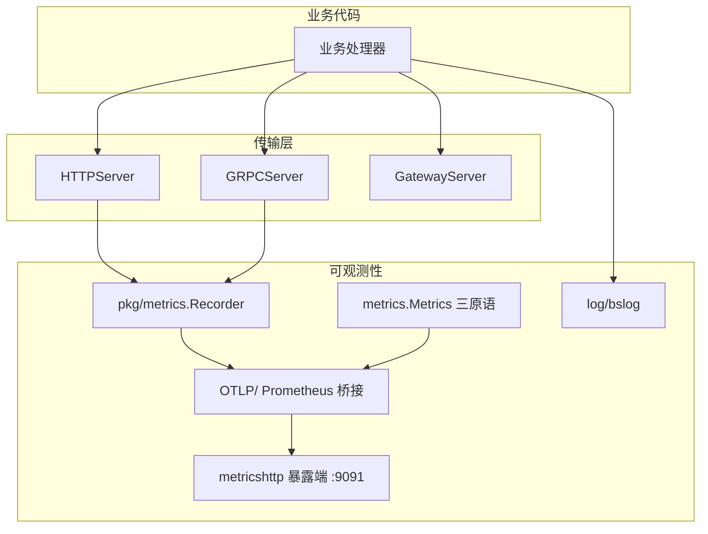
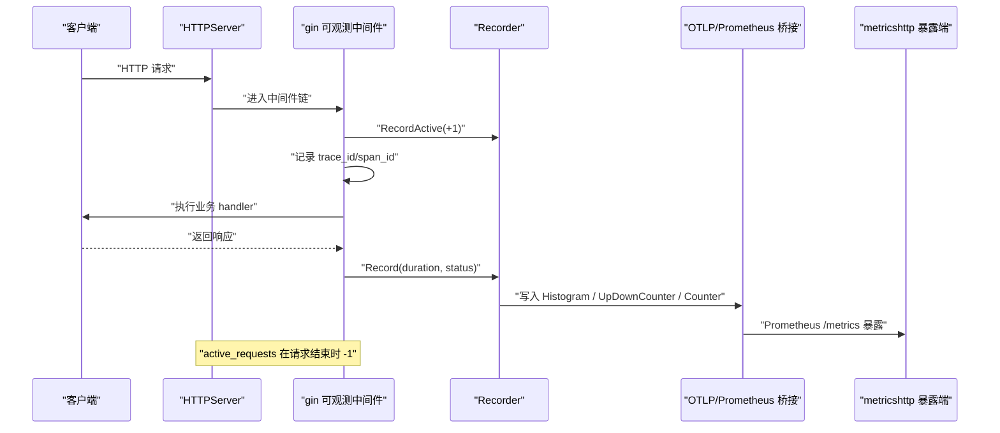
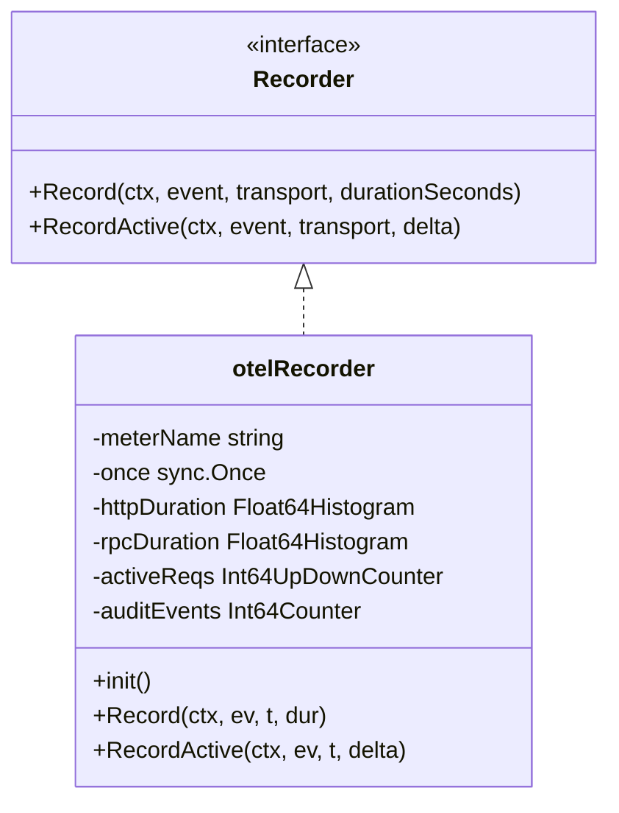
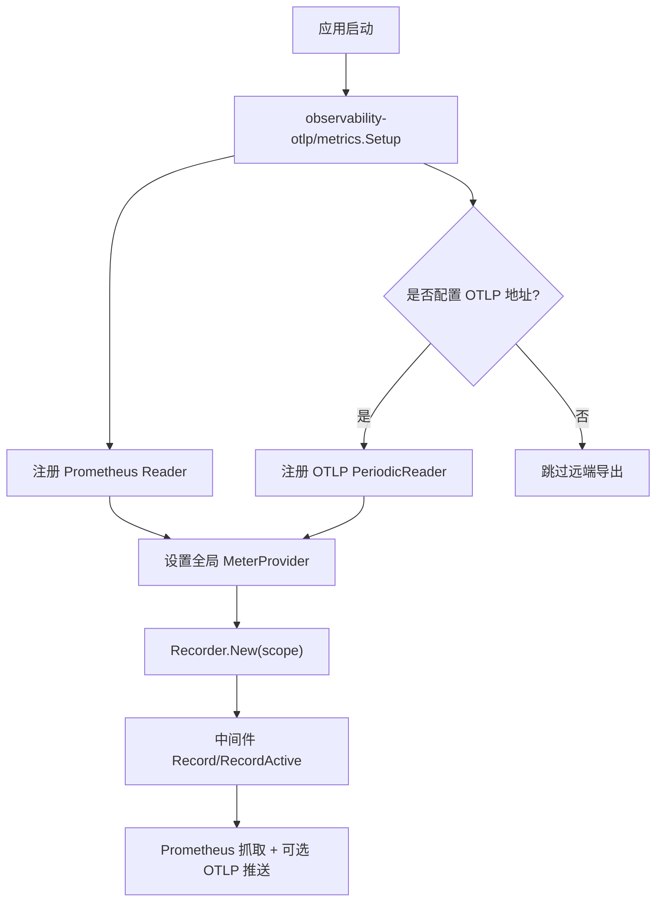
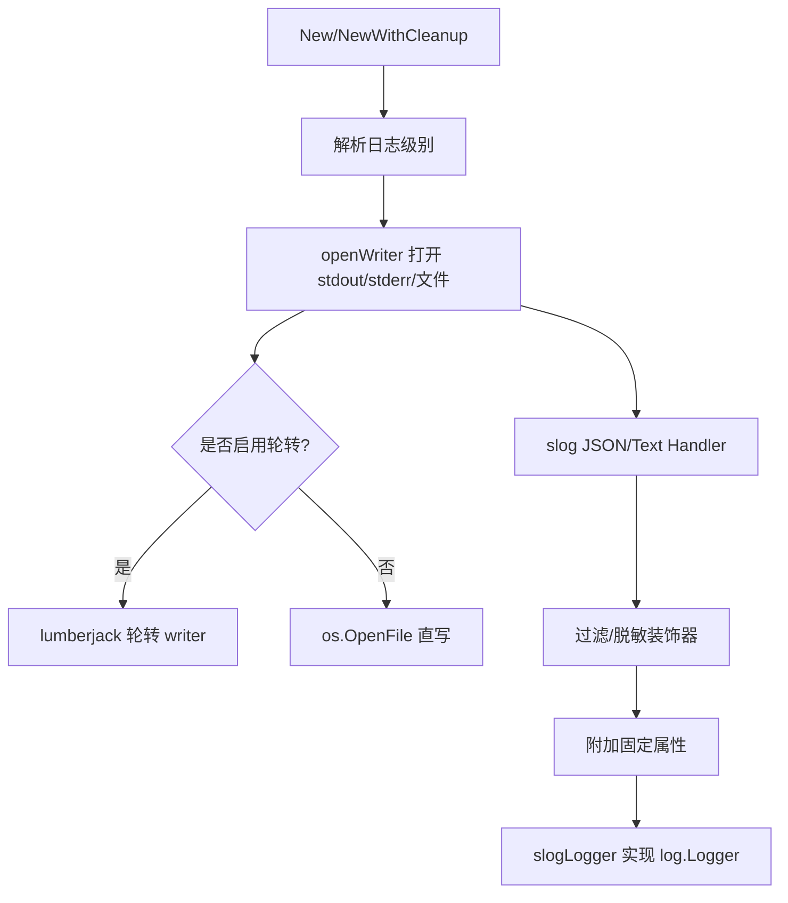
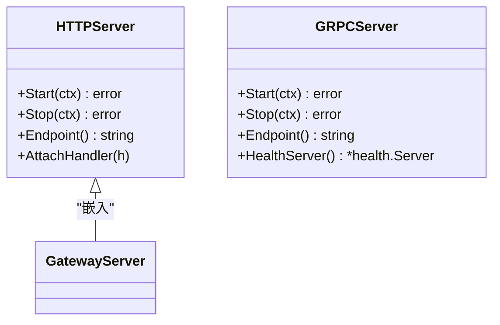
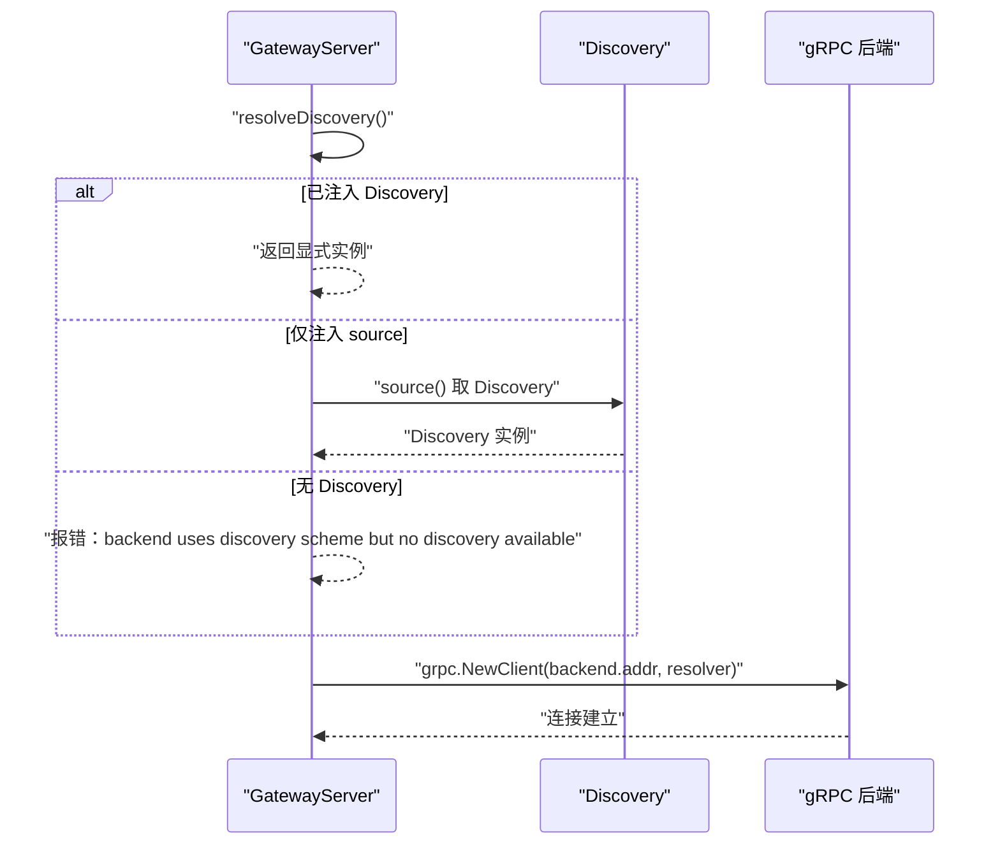
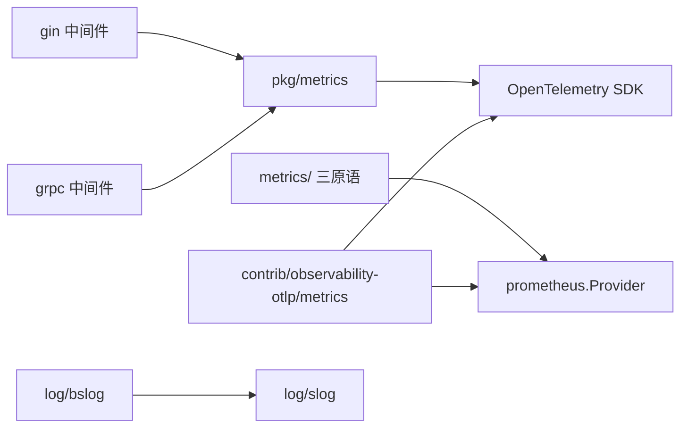

# 性能问题诊断

<cite>
**本文引用的文件**   
- [metrics/metrics.go](file://metrics/metrics.go)
- [pkg/metrics/metrics.go](file://pkg/metrics/metrics.go)
- [observability/metricshttp/metricshttp.go](file://observability/metricshttp/metricshttp.go)
- [contrib/observability-otlp/metrics/metrics.go](file://contrib/observability-otlp/metrics/metrics.go)
- [log/bslog/bslog.go](file://log/bslog/bslog.go)
- [transport/http/http_server.go](file://transport/http/http_server.go)
- [transport/grpc/grpc_server.go](file://transport/grpc/grpc_server.go)
- [transport/gateway/gateway_server.go](file://transport/gateway/gateway_server.go)
- [pkg/middleware/gin/observability.go](file://pkg/middleware/gin/observability.go)
- [pkg/middleware/grpc/observability.go](file://pkg/middleware/grpc/observability.go)
- [scripts/list-modules.sh](file://scripts/list-modules.sh)
</cite>

## 目录
1. [引言](#引言)
2. [项目结构与可观测性边界](#项目结构与可观测性边界)
3. [核心组件与指标体系](#核心组件与指标体系)
4. [架构总览](#架构总览)
5. [详细组件分析](#详细组件分析)
6. [依赖关系分析](#依赖关系分析)
7. [性能问题诊断方法](#性能问题诊断方法)
8. [性能调优建议](#性能调优建议)
9. [故障排查指南](#故障排查指南)
10. [结论](#结论)

## 引言
本文面向 Bald 框架使用者的性能诊断与调优，覆盖三类主题：服务发现与网关出站、CI 质量闸门、Broker 订阅者生命周期。围绕 CPU、内存、延迟、吞吐和错误率，给出从指标到日志再到源码定位的完整路径；同时结合仓库中请求级 Recorder、传输级三原语、日志后端和中间件的实际实现，说明如何正确使用 metrics 与 log 子系统。

需要特别强调：**本仓是 93 个 go.mod 的多模块仓库（无 go.work），子模块靠相对 replace 组成可编译闭包**。`scripts/list-modules.sh` 是全仓唯一模块清单派生（排除 `_example/bald`），CI 与 Taskfile 都消费它——因此不要按「一个 module」叙事，也不要假设本地 `go test` 能直接覆盖所有模块。

## 项目结构与可观测性边界
Bald 的可观测性由三条主线构成：
- **请求级指标**：`pkg/metrics` 定义 Recorder，HTTP/gRPC 中间件自动 emit，协议指标对齐 OTel semconv v1.43.0。
- **传输级指标**：`metrics/` 暴露 Counter/Histogram/Gauge 三原语，供 TCP/MQ/WebRTC 等无「请求」语义的路径手工埋点。
- **日志**：`log` 契约层零三方依赖，具体后端在 `log/bslog`（基于 slog，支持 stdout/stderr/文件轮转）。

**图示来源**
- [pkg/metrics/metrics.go:1-212](file://pkg/metrics/metrics.go#L1-L212)
- [metrics/metrics.go:1-34](file://metrics/metrics.go#L1-L34)
- [log/bslog/bslog.go:1-259](file://log/bslog/bslog.go#L1-L259)
- [observability/metricshttp/metricshttp.go:1-60](file://observability/metricshttp/metricshttp.go#L1-L60)

**章节来源**
- [scripts/list-modules.sh:1-24](file://scripts/list-modules.sh#L1-L24)

## 核心组件与指标体系
### 两套指标体系
仓库存在两套并存但职责不同的指标体系：

| 维度 | 请求级 Recorder（`pkg/metrics`） | 传输级三原语（`metrics/`） |
|---|---|---|
| 适用路径 | HTTP、gRPC、gateway 转码请求 | TCP、Kafka、RabbitMQ、Redis、RocketMQ、WebRTC |
| 埋点方式 | 中间件自动 emit | 业务或传输代码显式调用 |
| 指标命名 | 固定：`http.server.request.duration`、`rpc.server.call.duration`、`http.server.active_requests`、`bald_audit_events_total` | 自由：name + labels 由埋点方决定 |
| 后端装配 | bconf `metrics` 段 → observability-otlp Setup → 全局 MeterProvider | 业务 `New()` 直连，不经契约 |
| 默认行为 | 未配置 MeterProvider 时 no-op | 无默认 exporter，需显式选择 |

判断规则很简单：**有「请求」的走 Recorder；没有「请求」的走 metrics/ 三原语**。

### 关键指标含义
- `http.server.request.duration`：HTTP 请求延迟分布（秒），属性含 method、scheme、template、status_code。
- `http.server.active_requests`：当前在途 HTTP 请求数，用于饱和度分析。
- `rpc.server.call.duration`：gRPC 调用延迟分布（秒），属性含 system.name=grpc、method、response.status_code。
- `bald_audit_events_total`：审计事件计数，按 transport/object/action/result 正交拆分，error 占比即错误率。

**章节来源**
- [pkg/metrics/metrics.go:1-212](file://pkg/metrics/metrics.go#L1-L212)
- [metrics/metrics.go:1-34](file://metrics/metrics.go#L1-L34)
- [docs/devel/zh-CN/Bald 指标设计.md:1-200](file://docs/devel/zh-CN/Bald 指标设计.md#L1-L200)

## 架构总览
下图展示一次 HTTP 请求经过 Baldwin 可观测性栈时的完整路径：

**图示来源**
- [pkg/middleware/gin/observability.go:1-200](file://pkg/middleware/gin/observability.go#L1-L200)
- [pkg/metrics/metrics.go:120-212](file://pkg/metrics/metrics.go#L120-L212)
- [observability/metricshttp/metricshttp.go:20-60](file://observability/metricshttp/metricshttp.go#L20-L60)

## 详细组件分析

### 请求级 Recorder 与中间件
Recorder 是 bald 指标记录器接口，包含 `Record` 与 `RecordActive` 两个方法。其真实实现基于 OpenTelemetry，惰性创建 instrument，避免构造期与 Provider 装配顺序耦合。

**图示来源**
- [pkg/metrics/metrics.go:45-120](file://pkg/metrics/metrics.go#L45-L120)
- [pkg/metrics/metrics.go:120-212](file://pkg/metrics/metrics.go#L120-L212)

关键点：
- gRPC 不维护 `http.server.active_requests`，因为 semconv 只定义 HTTP 侧。
- gRPC 状态码通过 `codes.Code(n).String()` 转为字符串，未知数值不会 panic，符合旁路纪律。
- 审计事件序列与协议指标正交，避免基数爆炸。

**章节来源**
- [pkg/metrics/metrics.go:45-212](file://pkg/metrics/metrics.go#L45-L212)

### 指标暴露端与 OTLP 桥接
`observability/metricshttp` 提供独立的 `/metrics` 监听面，默认地址 `:9091`，与业务端口错峰。`contrib/observability-otlp/metrics` 则把全局 MeterProvider 接到 Prometheus exporter，并可选 OTLP metric exporter 直推远端 APM。

**图示来源**
- [contrib/observability-otlp/metrics/metrics.go:1-158](file://contrib/observability-otlp/metrics/metrics.go#L1-L158)
- [observability/metricshttp/metricshttp.go:20-60](file://observability/metricshttp/metricshttp.go#L20-L60)

注意：
- 暴露端监听失败异步记日志，不 panic，遵循旁路语义。
- Shutdown 先停暴露端再 flush，防止尾批指标丢失。
- 环境变量读取由调用方负责，本包只接受显式参数。

**章节来源**
- [contrib/observability-otlp/metrics/metrics.go:1-158](file://contrib/observability-otlp/metrics/metrics.go#L1-L158)
- [observability/metricshttp/metricshttp.go:1-60](file://observability/metricshttp/metricshttp.go#L1-L60)

### 日志子系统
`log/bslog` 基于标准库 `log/slog`，支持 console/json 输出、多目标写入、lumberjack 文件轮转。它封装了 bald 的 `log.Logger` 契约，使上层对具体后端解耦。

**图示来源**
- [log/bslog/bslog.go:1-259](file://log/bslog/bslog.go#L1-L259)

要点：
- 文件句柄随进程退出由 OS 兜底，确定性释放应使用 `NewWithCleanup`。
- 多目标写入用 errgroup 并发，任一失败不影响其余。
- 上下文属性通过 `log.ContextWithAttrs` 合并进 slog，使 trace_id/span_id 自动携带。

**章节来源**
- [log/bslog/bslog.go:1-259](file://log/bslog/bslog.go#L1-L259)

### 传输服务器与 Endpoint
HTTP 与 gRPC 服务器封装各自协议栈，并实现统一 `Endpoint()` 语义：返回可被服务发现注册的地址。gRPC 还强制 h2 ALPN，避免高版本 grpc-go 握手成功但连接判错。

**图示来源**
- [transport/http/http_server.go:1-123](file://transport/http/http_server.go#L1-L123)
- [transport/grpc/grpc_server.go:1-149](file://transport/grpc/grpc_server.go#L1-L149)

注意：
- Endpoint 在 Start 前返回空字符串，供 appkit 等待真正就绪。
- gRPC Stop 支持 ctx 超时降级为强制 Stop。

**章节来源**
- [transport/http/http_server.go:1-123](file://transport/http/http_server.go#L1-L123)
- [transport/grpc/grpc_server.go:1-149](file://transport/grpc/grpc_server.go#L1-L149)

### 网关与服务发现出站
GatewayServer 把 REST 请求转发到 gRPC 后端，支持直连与 `discovery:///` 两种目标。当目标写成 `discovery:///<服务名>` 时必须提供 Discovery，否则 Start 直接失败。

**图示来源**
- [transport/gateway/gateway_server.go:1-204](file://transport/gateway/gateway_server.go#L1-L204)

关键语义：
- 解析出的多实例由 gRPC 默认 balancer（pick_first）按顺序主备，不是负载均衡。
- 若后端尚未注册实例，resolver 不能推送空快照，必须 ReportError 并保持订阅。
- nacos 会把一个实例的多个端点拆成 `<Name>.<scheme>` 形式的多个服务，目标必须写 `discovery:///<服务名>.grpc`；内存与 etcd 用注册时填的 ServiceInstance.Name 原样。

**章节来源**
- [transport/gateway/gateway_server.go:1-204](file://transport/gateway/gateway_server.go#L1-L204)
- [transport/gateway/discovery_test.go:1-200](file://transport/gateway/discovery_test.go#L1-L200)

## 依赖关系分析

**图示来源**
- [pkg/metrics/metrics.go:1-212](file://pkg/metrics/metrics.go#L1-L212)
- [metrics/prometheus/prometheus.go:1-200](file://metrics/prometheus/prometheus.go#L1-L200)
- [contrib/observability-otlp/metrics/metrics.go:1-158](file://contrib/observability-otlp/metrics/metrics.go#L1-L158)

**章节来源**
- [pkg/metrics/metrics.go:1-212](file://pkg/metrics/metrics.go#L1-L212)
- [metrics/metrics.go:1-34](file://metrics/metrics.go#L1-L34)
- [contrib/observability-otlp/metrics/metrics.go:1-158](file://contrib/observability-otlp/metrics/metrics.go#L1-L158)

## 性能问题诊断方法

### CPU 使用率异常
CPU 异常通常表现为 goroutine 暴涨、热点函数持续占用、锁竞争导致串行化。结合 Bald 框架，可从以下入口切入：

1. **热点函数分析**
   - 使用 `pprof` 采集 CPU profile，定位高频函数。
   - 检查中间件链路：gin/grpc 可观测中间件会记录 trace_id/span_id，若开启 body 日志且为 Debug 级别，可能放大 CPU 消耗。
   - 关注 `pkg/middleware/gin/observability.go` 与 `pkg/middleware/grpc/observability.go` 中的 body 捕获逻辑，避免在生产开启 Debug 日志。

2. **goroutine 泄漏检测**
   - 使用 `pprof goroutine` 查看常驻 goroutine。
   - 重点检查 gateway 后端连接、gRPC 流、broker 订阅者循环、metricshttp 暴露端 goroutine。
   - broker 订阅者致命退出后不自行摘除 `SubscriberSyncMap` 条目，重订阅是覆盖而非累积，但 `Topics()/Len()/Has()` 会高报死订阅者。

3. **锁竞争分析**
   - 使用 `pprof mutex` 观察阻塞热点。
   - HTTPServer 与 GRPCServer 的 Endpoint 与 Start 之间存在读写保护，race detector 可复现竞态场景。
   - gateway 的 conn 建立阶段持锁，Stop 也需同锁，文档明确避免「Stop 等 Start 释放锁、Start 等 Stop 调 Shutdown」的死锁。

**章节来源**
- [pkg/middleware/gin/observability.go:1-200](file://pkg/middleware/gin/observability.go#L1-L200)
- [pkg/middleware/grpc/observability.go:1-200](file://pkg/middleware/grpc/observability.go#L1-L200)
- [transport/http/http_server.go:1-123](file://transport/http/http_server.go#L1-L123)
- [transport/grpc/grpc_server.go:1-149](file://transport/grpc/grpc_server.go#L1-L149)
- [transport/gateway/gateway_server.go:1-204](file://transport/gateway/gateway_server.go#L1-L204)

### 内存问题排查
内存问题包括泄漏、GC 压力过大、频繁分配。

1. **内存泄漏检测**
   - 使用 `pprof heap` 对比不同时间点快照，定位增长对象。
   - 检查 logger 的 lumberjack writer 是否 Close，未关闭会导致缓冲不落盘、句柄泄漏。
   - 检查 metricshttp 暴露端 goroutine 是否随 Stop 正常退出。

2. **GC 压力分析**
   - 观察 GC pause 与 allocation rate。
   - 避免在 hot path 构造大对象，例如 gin 中间件中读取整个 request/response body。
   - 关注 `pkg/metrics` 的 otelRecorder 惰性初始化，避免构造期重复创建 instrument。

3. **heap profile 分析**
   - 使用 `go tool pprof -heap` 分析 top allocators。
   - 结合日志 trace_id 关联具体请求，缩小泄漏范围。

**章节来源**
- [log/bslog/bslog.go:1-259](file://log/bslog/bslog.go#L1-L259)
- [observability/metricshttp/metricshttp.go:20-60](file://observability/metricshttp/metricshttp.go#L20-L60)
- [pkg/metrics/metrics.go:120-212](file://pkg/metrics/metrics.go#L120-L212)

### 性能监控指标趋势分析
Bald 提供两类可观测指标：

| 指标类别 | 指标名称 | 用途 |
|---|---|---|
| 请求延迟 | `http.server.request.duration`、`rpc.server.call.duration` | 分析慢请求、P95/P99 延迟 |
| 饱和度 | `http.server.active_requests` | 识别请求堆积、线程池饱和 |
| 错误率 | `bald_audit_events_total{result="error"}` | 统计拒绝/错误比例 |
| 传输指标 | 自定义 Counter/Histogram/Gauge | MQ/TCP/WebRTC 会话级指标 |

趋势分析建议：
- 延迟突增时，结合 `http.server.active_requests` 判断是否因负载过高。
- 错误率上升时，按 object/action/result 维度下钻，定位具体业务操作。
- 传输路径指标异常时，检查对应 broker 连接池与订阅者状态。

**章节来源**
- [pkg/metrics/metrics.go:1-212](file://pkg/metrics/metrics.go#L1-L212)
- [metrics/metrics.go:1-34](file://metrics/metrics.go#L1-L34)

## 性能调优建议

### goroutine 池配置
- 对于自起的 worker 或任务队列，应限制 goroutine 数量，避免无限增长。
- 结合 `http.server.active_requests` 判断是否达到处理瓶颈。
- 对 broker 订阅者，注意致命退出后不自动摘除条目，需由调用方管理生命周期。

### 连接池调优
- gRPC 后端连接由 gateway 管理，连接复用由 grpc.NewClient 负责。
- 若使用 round_robin 负载均衡，需在拨号侧配置，而非依赖 pick_first。
- 数据库连接池（如 gorm/mongo）应根据 QPS 与延迟调整 MaxOpenConns。

### 缓存策略优化
- 本地缓存应设置 TTL 与容量上限，避免内存膨胀。
- 分布式缓存（redis）需考虑网络延迟与序列化成本。
- 使用 `cache/loadable` 或 `cache/local` 时，注意并发加载时的去重与降级策略。

### 指标与日志调优
- 生产环境关闭 Debug 级别的 body 日志，避免 CPU 与内存放大。
- 合理配置 OTLP 上报间隔，避免频繁网络 IO。
- 使用 metricshttp 独立端口暴露 /metrics，与业务端口隔离。

**章节来源**
- [transport/gateway/gateway_server.go:1-204](file://transport/gateway/gateway_server.go#L1-L204)
- [pkg/middleware/gin/observability.go:1-200](file://pkg/middleware/gin/observability.go#L1-L200)
- [contrib/observability-otlp/metrics/metrics.go:1-158](file://contrib/observability-otlp/metrics/metrics.go#L1-L158)

## 故障排查指南

### CPU 异常排查步骤
1. 确认是否开启 Debug 日志，临时关闭 body 日志。
2. 采集 CPU profile，定位热点函数。
3. 检查 goroutine 数量是否异常增长。
4. 分析锁竞争，重点关注 HTTP/gRPC Server 的 Endpoint 与 Start 并发。
5. 结合 metrics 指标判断是否负载过高。

### 内存泄漏排查步骤
1. 采集 heap profile，对比前后快照。
2. 检查 logger 是否通过 `NewWithCleanup` 正确释放。
3. 检查 metricshttp 暴露端是否随 Stop 关闭。
4. 检查 broker 订阅者是否手动清理。

### 指标缺失排查
1. 确认是否调用 `observability-otlp/metrics.Setup` 并设置全局 MeterProvider。
2. 检查 metricshttp 暴露端是否正常监听 `:9091`。
3. 确认中间件是否挂载，Recorder 是否被调用。
4. 若使用 otel 后端，注意进程内只能有一个 Provider。

**章节来源**
- [log/bslog/bslog.go:1-259](file://log/bslog/bslog.go#L1-L259)
- [observability/metricshttp/metricshttp.go:20-60](file://observability/metricshttp/metricshttp.go#L20-L60)
- [contrib/observability-otlp/metrics/metrics.go:1-158](file://contrib/observability-otlp/metrics/metrics.go#L1-L158)

## 结论
Bald 框架通过请求级 Recorder 与传输级三原语提供了完整的可观测性基础，配合 log/bslog 与 metricshttp 暴露端，形成了从指标到日志的闭环。性能诊断应从 CPU、内存、延迟、吞吐四个维度入手，结合 pprof、metrics 与日志 trace_id 进行定位。调优时需特别注意中间件 body 日志、logger 资源释放、gateway 连接复用与 broker 订阅者生命周期。在多模块仓库环境下，务必以 `scripts/list-modules.sh` 为准，确保 CI 与本地测试覆盖一致。