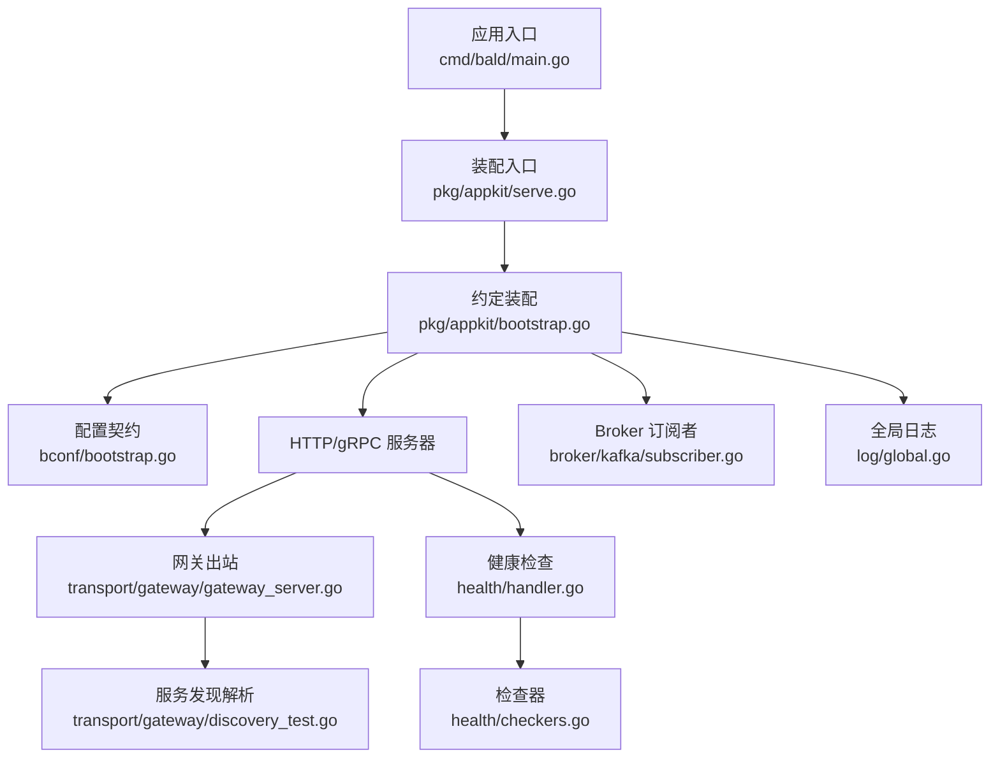
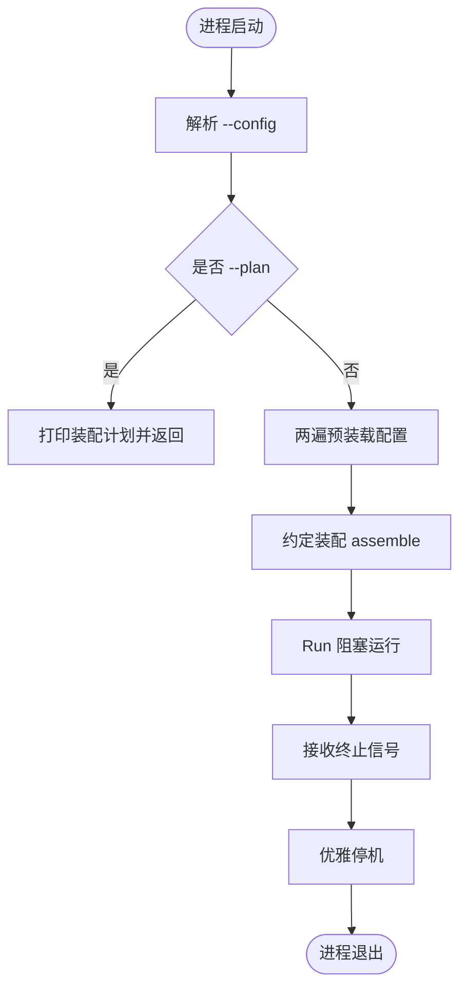
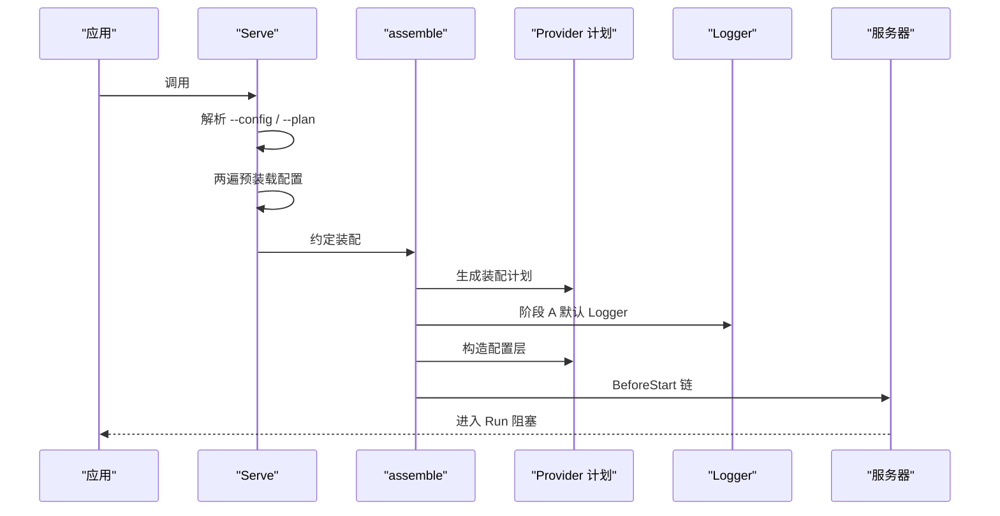
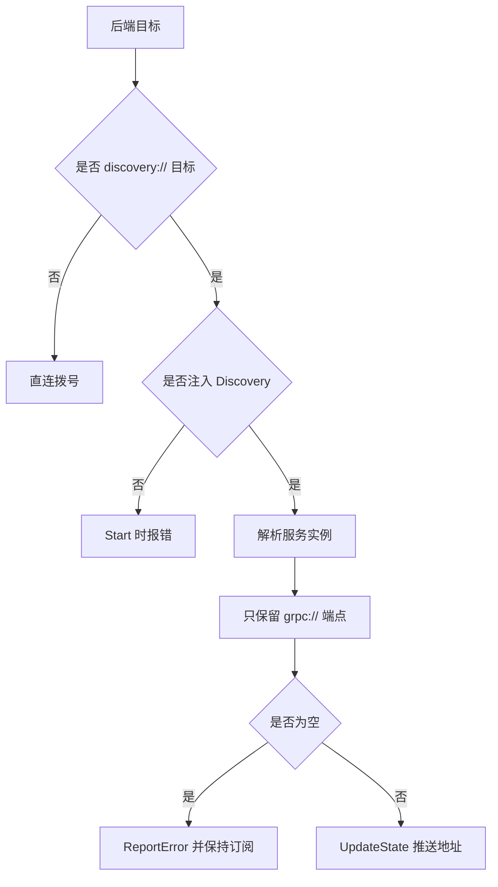
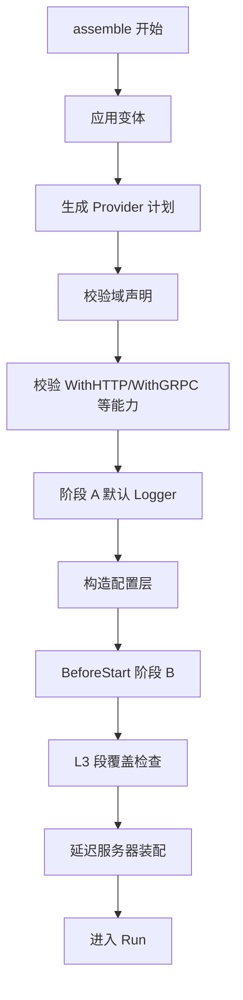
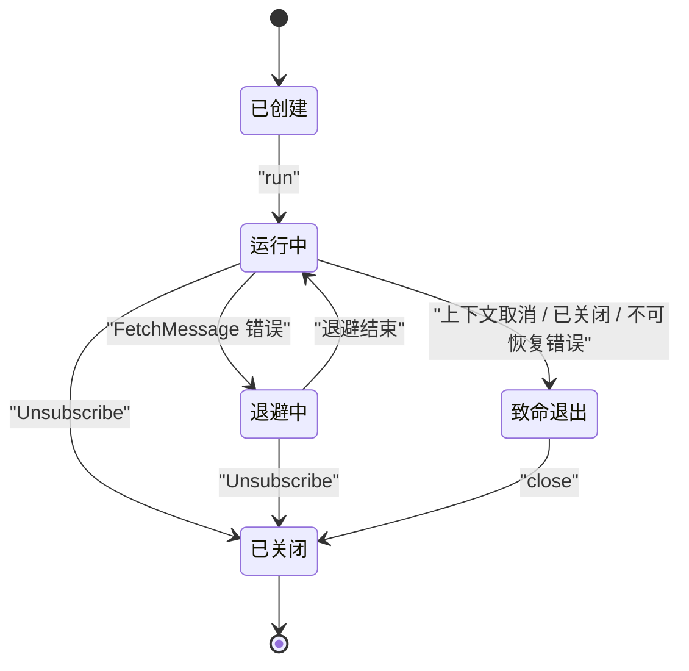
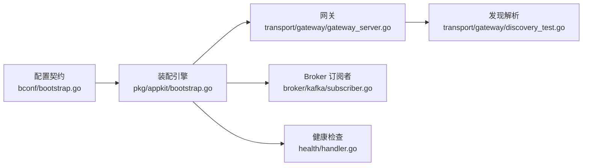

# 故障排查指南

<cite>
**本文引用的文件**   
- [serve.go](file://pkg/appkit/serve.go)
- [bootstrap.go](file://pkg/appkit/bootstrap.go)
- [gateway_server.go](file://transport/gateway/gateway_server.go)
- [discovery_test.go](file://transport/gateway/discovery_test.go)
- [bootstrap.go](file://bconf/bootstrap.go)
- [subscriber.go](file://broker/kafka/subscriber.go)
- [handler.go](file://health/handler.go)
- [checkers.go](file://health/checkers.go)
- [global.go](file://log/global.go)
</cite>

## 目录

1. [引言](#引言)
2. [项目结构](#项目结构)
3. [核心组件](#核心组件)
4. [架构总览](#架构总览)
5. [详细组件分析](#详细组件分析)
6. [依赖关系分析](#依赖关系分析)
7. [性能与可观测性](#性能与可观测性)
8. [故障排查手册](#故障排查手册)
9. [生产恢复与回滚](#生产恢复与回滚)
10. [结论](#结论)

## 引言

本文面向 Bald 框架的使用者与运维人员，聚焦三类真实故障场景：

- **启动失败**：配置加载失败、Provider 装配错误、服务端口冲突、健康检查未就绪。
- **性能瓶颈**：CPU 使用率异常、内存泄漏、GC 压力过高。
- **网络问题**：服务发现失败、连接池耗尽、超时与重试行为不符合预期。

文档同时给出日志分析方法、关键调试工具建议，以及生产环境故障恢复与回滚流程。为避免误导，仅对仓库中已实现的机制进行说明；未在代码中出现的工具或能力不写为「已支持」。

## 项目结构

Bald 是一个多模块 Go 仓库。根 `go.mod` 不是单一应用入口，而是由多个子模块通过相对 `replace` 组合成的可编译闭包。本故障排查文档关注以下子模块与路径：

| 主题 | 关键路径 | 作用 |
|---|---:|---|
| 启动装配 | `pkg/appkit/serve.go`、`pkg/appkit/bootstrap.go` | 解析 `--config`、预装载契约、按 Provider 计划装配并运行 |
| 配置契约 | `bconf/bootstrap.go` | 生成默认配置、校验 app/server/logger 等段 |
| 网关出站 | `transport/gateway/gateway_server.go` | gRPC 反向代理，支持直连与 `discovery:///` |
| 服务发现解析 | `transport/gateway/discovery_test.go` | 注册中心端点过滤、空快照、错误恢复的语义用例 |
| Broker 订阅者 | `broker/kafka/subscriber.go` | Kafka 消费者循环、退避、致命错误退出 |
| 健康检查 | `health/handler.go`、`health/checkers.go` | liveness/readiness 探针、TCP/HTTP 检查器 |
| 全局日志 | `log/global.go` | 全局 Logger 注入点 |

**图表来源**   
- [serve.go:1-180](file://pkg/appkit/serve.go#L1-L180)
- [bootstrap.go:1-200](file://pkg/appkit/bootstrap.go#L1-L200)
- [gateway_server.go:1-200](file://transport/gateway/gateway_server.go#L1-L200)
- [discovery_test.go:1-200](file://transport/gateway/discovery_test.go#L1-L200)
- [bootstrap.go:1-200](file://bconf/bootstrap.go#L1-L200)
- [subscriber.go:1-200](file://broker/kafka/subscriber.go#L1-L200)
- [handler.go:1-84](file://health/handler.go#L1-L84)
- [checkers.go:1-181](file://health/checkers.go#L1-L181)
- [global.go:1-28](file://log/global.go#L1-L28)

**章节来源**   
- [serve.go:1-180](file://pkg/appkit/serve.go#L1-L180)
- [bootstrap.go:1-200](file://pkg/appkit/bootstrap.go#L1-L200)
- [gateway_server.go:1-200](file://transport/gateway/gateway_server.go#L1-L200)
- [bootstrap.go:1-200](file://bconf/bootstrap.go#L1-L200)

## 核心组件

### 启动装配管线

`Serve` 是 Bald 应用的唯一约定装配入口，其生命周期如下：

1. 解析 `--config`，保持与后续配置装载相同的容错策略。
2. 若传入 `--plan`，先打印装配计划并返回零错误码，用于启动前预检。
3. 两遍预装载配置：第一遍读取本地文件与远程层，解析 `app.name`；第二遍挂载环境变量层并重合并形成正式契约。
4. 调用 `assemble` 执行段驱动 Provider 装配。
5. 进入 `Run`，处理信号并优雅停机。

**图表来源**   
- [serve.go:40-120](file://pkg/appkit/serve.go#L40-L120)

**章节来源**   
- [serve.go:1-180](file://pkg/appkit/serve.go#L1-L180)

### 配置契约与校验

`bconf.NewBootstrap` 提供默认配置，包括：

- 应用标识、名称、版本、停止超时。
- HTTP 默认监听 `:8080`。
- gRPC 默认监听 `:9090`。
- 默认 slog 日志后端，级别 `info`、格式 `console`、输出 `stdout`。

`Validate` 在启动前做 fail-fast 校验，覆盖：

- `app.id`、`app.name` 非空。
- `server.http.addr`、`server.grpc.addr` 为合法地址。
- `logger.backends` 至少一项，且各后端段值域合法。

**章节来源**   
- [bootstrap.go:1-120](file://bconf/bootstrap.go#L1-L120)
- [bootstrap.go:200-302](file://bconf/bootstrap.go#L200-L302)

### 健康检查

`health` 包暴露两类处理器：

- **liveness**：始终返回 200，只表示进程能响应 HTTP。
- **readiness**：聚合所有注册检查器，任一失败返回 503。

内置检查器包括 TCP 拨号与 HTTP GET，适用于数据库、缓存、下游服务等依赖探测。

**章节来源**   
- [handler.go:1-84](file://health/handler.go#L1-L84)
- [checkers.go:1-181](file://health/checkers.go#L1-L181)

## 架构总览

Bald 的启动装配采用「契约驱动 + Provider 计划」模式。`assemble` 不是简单顺序初始化，而是：

1. 解析变体。
2. 生成 Provider 计划。
3. 校验域声明。
4. 校验能力声明（例如 `WithHTTP` 必须对应 `server.http`）。
5. 构建阶段 A Logger，保证配置装载前的启动日志可见。
6. 构造配置层 Provider。
7. 进入 BeforeStart 链：装载最终契约、重建 Logger、执行 Provider 第二阶段。
8. 执行 L3 段覆盖检查，拦截未消费的配置段。
9. 注册业务钩子、延迟服务器、额外服务器、Effect、Reconcile 等。

**图表来源**   
- [bootstrap.go:201-500](file://pkg/appkit/bootstrap.go#L201-L500)
- [serve.go:40-120](file://pkg/appkit/serve.go#L40-L120)

**章节来源**   
- [bootstrap.go:201-500](file://pkg/appkit/bootstrap.go#L201-L500)

## 详细组件分析

### 网关出站与服务发现

`GatewayServer` 是 gRPC 反向代理，把 REST 请求转发到被代理的 gRPC 服务。它支持两种后端地址形式：

| 目标形式 | 行为 |
|---|---|
| 直连地址，如 `host:port` | 走原生 DNS 解析，直接拨号 |
| `discovery:///<服务名>` | 必须提供 `registry.Discovery`，否则 `Start` 报错 |

#### 三条既定语义

1. **Build 返回错误时 gRPC 不会重试**  
   当 `Watch` 失败导致 Build 返回错误时，gRPC 的重建时机不在解析器内部控制，而是由 gRPC 客户端重连退避决定。因此实现不应假设每次 Build 失败都会立即重试。

2. **空快照不推 `UpdateState`**  
   当服务尚未注册实例时，不能向 `ClientConn` 推送空地址集，因为 gRPC 会将其视为坏状态并清空已有健康地址。正确做法是 `ReportError` 上报原因，但继续维持订阅。

3. **只取 `grpc://` 端点**  
   注册中心中的实例可能同时暴露 HTTP、HTTPS、gRPC 多种面。gRPC 拨号器只接受裸 `host:port`，因此需要剥去 `grpc://` 前缀，丢弃其他 scheme；如果某实例没有 `grpc://` 面，该实例整体出局。

**图表来源**   
- [gateway_server.go:1-200](file://transport/gateway/gateway_server.go#L1-L200)
- [discovery_test.go:1-450](file://transport/gateway/discovery_test.go#L1-L450)

#### 常见排错要点

- 网关后端地址写成 `discovery:///<服务名>` 但未注入 `WithDiscovery` 或 `WithDiscoverySource`，启动即报找不到发现来源。
- 目标服务名拼写错误，注册中心查不到服务。
- 注册中心返回了 HTTP 面但没有 gRPC 面，解析后为空集，表现为“无实例”错误。
- nacos 把一个实例的多个端点拆成 `<Name>.<scheme>` 形式的多个服务，目标必须写 `discovery:///<服务名>.grpc`；内存与 etcd 用注册时填的 `ServiceInstance.Name` 原样。少这个后缀通常解析到的是 HTTP 面或空集。

**章节来源**   
- [gateway_server.go:1-200](file://transport/gateway/gateway_server.go#L1-L200)
- [discovery_test.go:1-450](file://transport/gateway/discovery_test.go#L1-L450)

### 启动装配与 Provider 错误

`assemble` 的错误路径有明确分层：

| 阶段 | 典型错误 | 表现 |
|---|---|---|
| 配置预装载 | `app.name` 缺失 | 启动失败，错误指明命名空间必须由 `app.name` 派生 |
| 能力校验 | 声明了 `WithHTTP` 但没有 `server.http` | 启动期 fail-fast |
| 日志装配 | Provider 返回类型不是 `log.Logger` | 启动失败，错误指向 logger Provider |
| 配置层构造 | Provider 返回类型不是配置层切片 | 启动失败并回滚阶段 A Logger |
| 段覆盖检查 | 配置中存在未被消费的段 | 启动期 error，避免静默失效 |

**图表来源**   
- [bootstrap.go:201-500](file://pkg/appkit/bootstrap.go#L201-L500)

**章节来源**   
- [bootstrap.go:201-500](file://pkg/appkit/bootstrap.go#L201-L500)

### Broker 订阅者生命周期

Kafka 订阅者维护一个带锁的 subscriber 对象，包含 reader、done channel、退避参数等。其关键生命周期如下：

1. 创建时初始化 reader 和退避参数。
2. 根据是否批量模式选择单消息或批处理循环。
3. 从 context 或 done channel 退出。
4. 遇到致命错误时关闭 reader 并退出 goroutine。
5. 正常 Unsubscribe 时可选择从管理器移除条目。

**图表来源**   
- [subscriber.go:1-200](file://broker/kafka/subscriber.go#L1-L200)
- [subscriber.go:200-362](file://broker/kafka/subscriber.go#L200-L362)

#### 重要约束：订阅者表条目不会自动清理

致命退出后，订阅者不会自行摘除 `SubscriberSyncMap` 条目。摘除是调用方或 `Disconnect` 的责任，重订阅是覆盖而非累积。代价是：

- `Topics()`、`Len()`、`Has()` 可能高报死订阅者数量。
- 这个口径由 `broker/kafka/subscriber_test.go` 钉住。

排查时应区分「逻辑上不再消费」和「映射表中仍记录」两个概念。

**章节来源**   
- [subscriber.go:1-200](file://broker/kafka/subscriber.go#L1-L200)
- [subscriber.go:200-362](file://broker/kafka/subscriber.go#L200-L362)

### 健康检查与就绪状态

健康检查处理器将内部 `Health` 聚合器暴露为 JSON 接口：

- `StatusUp` 返回 200。
- `StatusUnknown` 返回 200。
- `StatusDown` 返回 503。
- 响应体包含 status、message 和 checks 明细。

liveness 处理器始终返回 200，适合 Kubernetes livenessProbe。  
readiness 处理器执行所有检查器，适合 readinessProbe。

**章节来源**   
- [handler.go:1-84](file://health/handler.go#L1-L84)
- [checkers.go:1-181](file://health/checkers.go#L1-L181)

## 依赖关系分析

从故障排查角度，最关键的依赖边界有三处：

1. **配置 → 装配**  
   `serve.go` 负责 `--config` 与两遍预装载；`bootstrap.go` 负责按 Provider 计划装配。配置加载失败发生在装配之前，装配失败发生在契约已定型之后。

2. **网关 → 服务发现 → gRPC 客户端**  
   `gateway_server.go` 在 `Start` 阶段建立后端连接；`discovery_test.go` 断言解析器的 Build/ReportError/UpdateState 语义。

3. **Broker → Kafka Reader → 业务 Handler**  
   `subscriber.go` 封装底层 reader 的 FetchMessage 循环，业务 handler 的错误与 Ack 行为在更上层处理。

**图表来源**   
- [bootstrap.go:1-200](file://bconf/bootstrap.go#L1-L200)
- [bootstrap.go:201-500](file://pkg/appkit/bootstrap.go#L201-L500)
- [gateway_server.go:1-200](file://transport/gateway/gateway_server.go#L1-L200)
- [discovery_test.go:1-450](file://transport/gateway/discovery_test.go#L1-L450)
- [subscriber.go:1-200](file://broker/kafka/subscriber.go#L1-L200)
- [handler.go:1-84](file://health/handler.go#L1-L84)

**章节来源**   
- [bootstrap.go:1-200](file://bconf/bootstrap.go#L1-L200)
- [bootstrap.go:201-500](file://pkg/appkit/bootstrap.go#L201-L500)
- [gateway_server.go:1-200](file://transport/gateway/gateway_server.go#L1-L200)
- [discovery_test.go:1-450](file://transport/gateway/discovery_test.go#L1-L450)
- [subscriber.go:1-200](file://broker/kafka/subscriber.go#L1-L200)
- [handler.go:1-84](file://health/handler.go#L1-L84)

## 性能与可观测性

### CPU 使用率分析

当服务 CPU 偏高时，优先确认问题发生在哪个子系统：

- **配置装配阶段**：查看 `assemble` 相关日志，确认是否在 Provider 计划、配置层构造或 BeforeStart 链中卡住。
- **网关出站**：检查后端 gRPC 连接是否频繁断开重连，或注册中心推送风暴导致大量地址更新。
- **Broker 订阅者**：检查 Kafka 拉取频率、批处理大小、handler 耗时；注意致命错误退出后订阅者 goroutine 已退出，但映射表条目可能仍存在。
- **健康检查**：确认 readiness 检查器超时是否过长，尤其是 TCP/HTTP 检查器对外部依赖的超时设置。

### 内存泄漏检测

重点关注以下资源持有者：

- 配置层 Provider 的 cleanup 函数是否被正确挂入 Effect 逆序释放。
- 网关后端的 gRPC ClientConn 是否在 Stop 时关闭。
- Broker 订阅者的 reader 与 done channel 是否在 close 路径释放。
- 全局 Logger 在热更新时是否原子替换旧 cleanup，避免尾批日志丢失。

### GC 压力调优

Bald 的启动装配会在多个阶段重建 Logger 和 Provider 产物，因此应避免：

- 在 BeforeStart 中创建大对象并长期持有。
- 在 Provider Build 中分配无法复用的临时结构。
- 在 Broker handler 中频繁创建大消息体。
- 在健康检查中频繁分配大字符串或大缓冲。

### 调试工具建议

仓库未内嵌 pprof、expvar 或 pprof 可视化入口，因此这些工具属于外部调试手段，不是 Bald 内置功能。实践中可按以下方式接入：

| 工具 | 用途 | 注意事项 |
|---|---|---|
| pprof | CPU、heap、goroutine、block、mutex 分析 | 需在生产暴露 `/debug/pprof` 或通过 CLI 抓取 |
| expvar | 暴露运行时变量 | 需显式启用路由 |
| pprof 可视化 | 生成火焰图、热点报告 | 基于 pprof 数据导出后分析 |
| 结构化日志 | 定位错误堆栈、上下文字段 | 结合 slog/charm/loki/sentry 等后端 |

由于上述工具不在 Bald 核心中实现，本文不把它们描述为框架自带能力；它们应作为部署侧的可观测性补充。

**章节来源**   
- [bootstrap.go:201-500](file://pkg/appkit/bootstrap.go#L201-L500)
- [gateway_server.go:1-200](file://transport/gateway/gateway_server.go#L1-L200)
- [subscriber.go:200-362](file://broker/kafka/subscriber.go#L200-L362)
- [handler.go:1-84](file://health/handler.go#L1-L84)
- [checkers.go:1-181](file://health/checkers.go#L1-L181)
- [global.go:1-28](file://log/global.go#L1-L28)

## 故障排查手册

### 一、启动失败

#### 1. 配置文件加载失败

**现象**  
进程退出，日志可能为空，或仅在 stderr 出现简短错误。

**可能原因**

- `--config` 指定路径不存在。
- 配置文件存在但缺少必填字段 `app.name`。
- 远程配置源不可达。
- 配置文件语法或类型无法反序列化为 BootstrapConfig。

**排查步骤**

1. 确认 `--config` 参数是否正确传入。
2. 检查配置文件中是否存在 `app.name`。
3. 使用 `--plan` 预检装配计划，观察装配期错误。
4. 检查远程配置源的鉴权与网络可达性。
5. 确认配置文件的重复列表字段是否完整写出；repeated 字段整体替换默认列表，缺项不会继承默认值。

**相关错误位置**

- 配置预装载失败：`preloadContract`。
- `app.name` 缺失：`preloadContract` 中明确报错。
- 配置校验失败：`bconf.Validate`。

**章节来源**   
- [serve.go:40-120](file://pkg/appkit/serve.go#L40-L120)
- [bootstrap.go:1-120](file://bconf/bootstrap.go#L1-L120)

#### 2. Provider 装配错误

**现象**  
配置加载成功，但在装配阶段失败。

**可能原因**

- 声明了 `WithHTTP` 但没有 `server.http`。
- 声明了 `WithGRPC` 但没有 `server.grpc`。
- logger Provider 返回类型不是 `log.Logger`。
- config Provider 返回类型不是配置层切片。
- 配置中存在未消费的段，触发 L3 覆盖检查。

**排查步骤**

1. 检查业务代码中是否声明了对应的能力。
2. 检查 bootstrap 配置中 server 段是否存在。
3. 检查自定义 Provider 的 Build 返回值类型。
4. 使用 `--plan` 查看 Provider 计划，确认段是否被消费。
5. 检查是否有遗留配置段未接入新装配路径。

**章节来源**   
- [bootstrap.go:1-200](file://pkg/appkit/bootstrap.go#L1-L200)
- [bootstrap.go:201-500](file://pkg/appkit/bootstrap.go#L201-L500)

#### 3. 服务端口冲突

**现象**  
HTTP 或 gRPC 服务器启动失败，常见为端口已被占用。

**可能原因**

- 默认端口 `:8080` 或 `:9090` 被其他进程占用。
- 部署环境中多个实例未配置不同端口。
- flag/env 覆盖未生效。

**排查步骤**

1. 检查 `server.http.addr` 与 `server.grpc.addr`。
2. 检查命令行 flag、环境变量、配置文件优先级。
3. 使用系统工具查看端口占用情况。
4. 确认 `Validate` 已通过，排除非法地址导致的早期失败。

**章节来源**   
- [bootstrap.go:1-120](file://bconf/bootstrap.go#L1-L120)
- [bootstrap.go:120-200](file://bconf/bootstrap.go#L120-L200)

### 二、网络问题

#### 1. 服务发现失败

**现象**  
网关后端地址使用 `discovery:///<服务名>`，但无法连接到任何实例。

**可能原因**

- 未注入 `WithDiscovery` 或 `WithDiscoverySource`。
- 服务名拼写错误。
- 注册中心中只有 HTTP 面，没有 gRPC 面。
- nacos 下使用了错误的服务名后缀。
- 首次快照失败，但订阅未恢复。

**排查步骤**

1. 确认 `GatewayServer` 构造时注入了 Discovery。
2. 检查注册中心中是否存在该服务。
3. 检查实例端点是否包含 `grpc://` 形式。
4. 如果是 nacos，确认目标为 `<Name>.grpc`。
5. 检查解析器是否持续收到 Watch 推送。

**章节来源**   
- [gateway_server.go:1-200](file://transport/gateway/gateway_server.go#L1-L200)
- [discovery_test.go:1-450](file://transport/gateway/discovery_test.go#L1-L450)

#### 2. 连接池耗尽

Bald 的 Broker 与 gRPC 出站均依赖底层连接，连接池耗尽通常表现为：

- Kafka 消费者频繁报错。
- gRPC 后端连接建立缓慢或失败。
- 健康检查超时。
- goroutine 数增长。

**排查步骤**

1. 检查 Kafka 消费者是否因 handler 慢导致积压。
2. 检查 gRPC 后端是否频繁断连。
3. 检查健康检查超时是否过短。
4. 检查是否有 goroutine 泄漏，例如订阅者未正确关闭。
5. 使用外部 pprof 抓取 goroutine 与 heap 快照。

**章节来源**   
- [subscriber.go:1-200](file://broker/kafka/subscriber.go#L1-L200)
- [subscriber.go:200-362](file://broker/kafka/subscriber.go#L200-L362)
- [checkers.go:1-181](file://health/checkers.go#L1-L181)

#### 3. 超时与重试机制

| 组件 | 行为 |
|---|---|
| 网关后端 TLS | 由 backend gRPC 段的 tls 配置决定明文或 TLS |
| 服务发现空实例 | 不推 `UpdateState`，改 `ReportError`，保持订阅 |
| 服务发现 Build 失败 | 不立即重试，等待 gRPC 客户端重连退避 |
| Kafka 订阅者 | 对非致命错误指数退避加抖动，最多尝试有限次数 |
| 致命错误 | 立即退出订阅者 goroutine |

**章节来源**   
- [gateway_server.go:1-200](file://transport/gateway/gateway_server.go#L1-L200)
- [discovery_test.go:201-450](file://transport/gateway/discovery_test.go#L201-L450)
- [subscriber.go:200-362](file://broker/kafka/subscriber.go#L200-L362)

### 三、日志分析方法

#### 关键日志字段

- `appkit: serve failed`：Serve 启动失败兜底日志。
- `appkit: provider plan warning`：Provider 计划警告。
- `appkit: bootstrap logger`：引导日志装配失败。
- `appkit: config layers`：配置层 Provider 失败。
- `[batch] handleMessage failed`：Kafka 批处理消息失败。
- `unmarshal message failed`：消息反序列化失败。
- `handle message failed`：业务 handler 失败。
- `fatal FetchMessage error, exiting`：Kafka 致命错误退出。

#### 错误堆栈分析

- 启动期错误优先看 `appkit:` 前缀。
- Broker 错误优先看 topic、partition、offset 上下文。
- 健康检查错误优先看 status 与 checks 明细。
- 服务发现错误优先看服务名、scheme、实例端点。

#### 上下文信息提取

- 使用结构化日志后端（slog、charm、loki、sentry、aliyun、tencent）统一输出 key-value。
- 利用 `filter_keys` 控制敏感字段脱敏。
- 在 handler 中携带 trace/span 上下文，关联一次请求的全链路日志。

**章节来源**   
- [serve.go:120-180](file://pkg/appkit/serve.go#L120-L180)
- [bootstrap.go:201-500](file://pkg/appkit/bootstrap.go#L201-L500)
- [subscriber.go:200-362](file://broker/kafka/subscriber.go#L200-L362)
- [handler.go:1-84](file://health/handler.go#L1-L84)
- [global.go:1-28](file://log/global.go#L1-L28)

## 生产恢复与回滚

### 故障恢复流程

推荐按以下顺序处理：

1. **确认影响范围**  
   通过 liveness/readiness 判断进程是否存活、是否可接流量。
2. **快速止血**  
   - 若是配置错误，回滚到上一份可用配置。
   - 若是服务发现异常，切回直连或降级。
   - 若是 Broker 积压，暂停消费或扩容消费者。
3. **采集证据**  
   - 保存配置快照。
   - 抓取 goroutine、heap、cpu pprof。
   - 导出关键时段日志。
4. **定位根因**  
   - 区分配置装配失败、Provider 装配失败、网络连通性问题。
   - 区分瞬时故障与持久故障。
5. **验证恢复**  
   - 确认 readiness 返回 200。
   - 确认下游依赖健康检查通过。
   - 观察错误日志是否消失。

### 回滚策略

| 变更类型 | 回滚方式 |
|---|---|
| 配置文件变更 | 回滚到上一个有效配置版本 |
| Provider 代码变更 | 回滚镜像或二进制 |
| 服务发现变更 | 检查注册中心实例状态，必要时下线异常实例 |
| Broker 配置变更 | 回滚消费者配置，重新消费或跳过积压 |
| 健康检查配置变更 | 放宽超时或暂时移除强依赖检查 |

### 优雅停机

Bald 的装配过程通过 Effect 与 BeforeStop/AfterStop 管理停机序：

- 审计恢复排在最后。
- 配置层 cleanup 逆序回放。
- 网关后端 gRPC 连接在 Stop 时关闭。
- Broker 订阅者在致命错误或正常关闭时释放 reader 与 done channel。

**章节来源**   
- [handler.go:1-84](file://health/handler.go#L1-L84)
- [gateway_server.go:1-200](file://transport/gateway/gateway_server.go#L1-L200)
- [subscriber.go:1-200](file://broker/kafka/subscriber.go#L1-L200)
- [bootstrap.go:201-500](file://pkg/appkit/bootstrap.go#L201-L500)

## 结论

Bald 的故障排查应以启动装配为主线，以配置契约为基础，以 Provider 计划为诊断边界，以健康检查与日志为观测窗口。对于网络问题，重点区分直连与 `discovery://` 两条路径，并严格遵循解析器的三条语义：Build 错误不重试、空快照不上报地址、只取 gRPC 端点。对于 Broker 订阅者，要特别注意致命退出后映射表条目的清理责任归属。对于性能问题，应结合外部 pprof 与结构化日志定位热点，而不是仅凭 CPU 百分比推断根因。