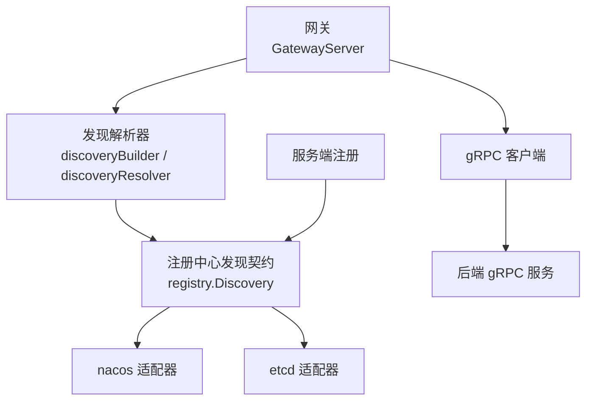
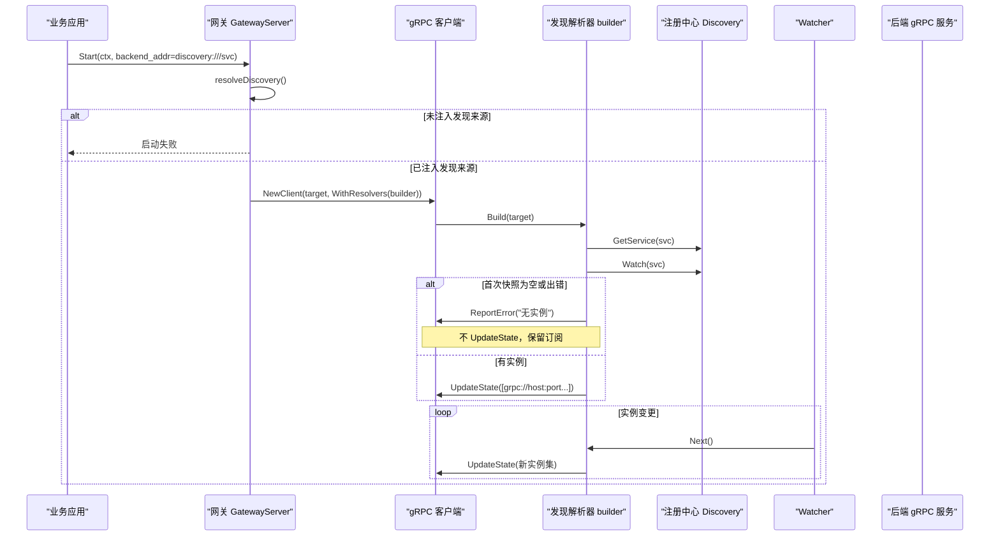
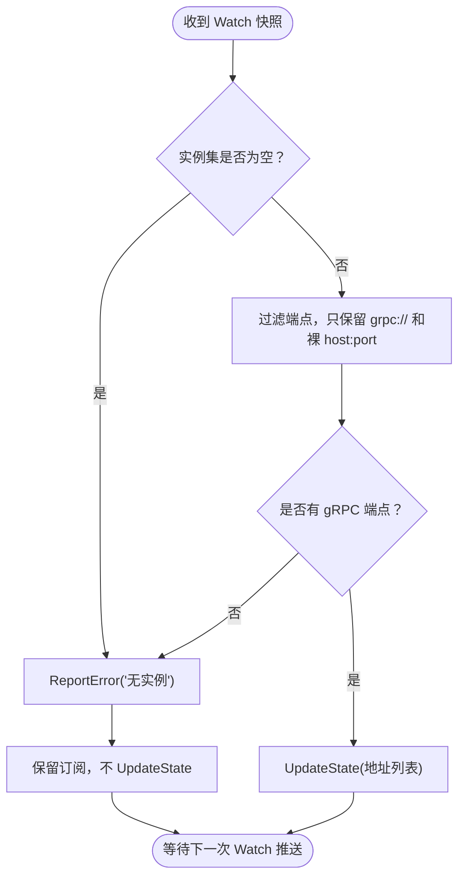
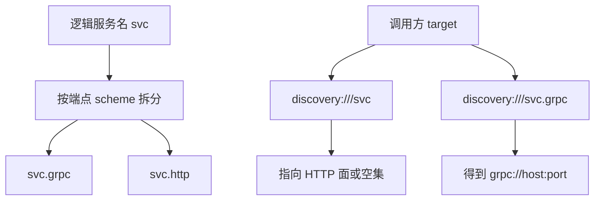
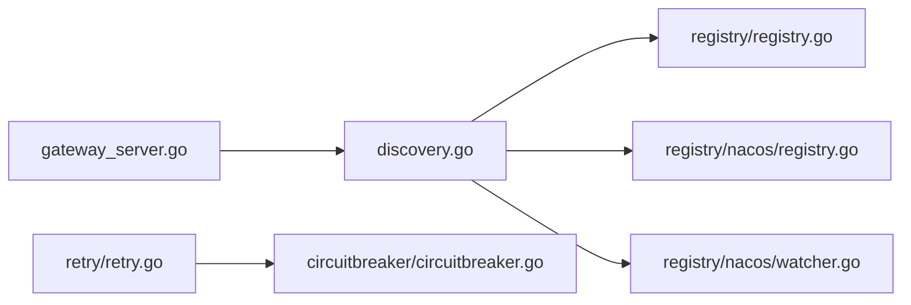

# 网络问题排查

<cite>
**本文引用的文件**   
- [transport/gateway/discovery.go](file://transport/gateway/discovery.go)
- [transport/gateway/gateway_server.go](file://transport/gateway/gateway_server.go)
- [transport/gateway/contract/discovery.go](file://transport/gateway/contract/discovery.go)
- [transport/endpoint.go](file://transport/endpoint.go)
- [registry/registry.go](file://registry/registry.go)
- [registry/nacos/watcher.go](file://registry/nacos/watcher.go)
- [registry/nacos/registry.go](file://registry/nacos/registry.go)
- [retry/retry.go](file://retry/retry.go)
- [circuitbreaker/circuitbreaker.go](file://circuitbreaker/circuitbreaker.go)
</cite>

## 目录

1. [引言](#引言)
2. [项目结构](#项目结构)
3. [核心组件](#核心组件)
4. [架构总览](#架构总览)
5. [详细组件分析](#详细组件分析)
6. [依赖关系分析](#依赖关系分析)
7. [性能与容量特征](#性能与容量特征)
8. [故障排查指南](#故障排查指南)
9. [结论](#结论)

## 引言

本文面向 Bald 框架中「服务发现与网关出站」相关网络问题的定位、诊断与修复。重点覆盖三类场景：

- 注册中心连接失败、实例过期或端点解析错误导致 `discovery:///<服务名>` 无法解析出可用后端。
- 直连 gRPC 后端的连接超时、连接池耗尽、DNS 解析失败等通用网络问题。
- 通过重试、超时和熔断器对负载均衡与服务路由进行调优，并说明监控与诊断手段。

需要特别注意：**本仓库是 93 个 Go module 的多模块仓库（无 go.work），子模块靠相对 replace 组成可编译闭包。** 根 module 不得 require 任何适配器；`*/contract` 包只放契约装配、不 import 具体后端；适配器放在独立模块中。因此文档不应把某个注册中心实现画成全局依赖，而应按「契约层 + 适配器」的方式理解耦合边界。

**章节来源**
- [scripts/list-modules.sh:1-24](file://scripts/list-modules.sh#L1-L24)

## 项目结构

与网络出站和服务发现直接相关的代码主要分布在以下路径：

| 路径 | 职责 |
|---|---|
| `transport/gateway` | gRPC 反向代理网关、`discovery://` 目标解析、gRPC resolver 适配 |
| `transport/endpoint.go` | 从监听地址提取对调用方可达的 host:port，用于注册中心端点 |
| `registry` | 服务注册/发现抽象契约、内存实现及 nacos/etcd/consul/kubernetes 适配器 |
| `retry` | 可组合的重试策略，支持指数退避、抖动、最大尝试次数与总超时 |
| `circuitbreaker` | 熔断器抽象接口，供 SRE/Hystrix/Vegas/Sentinel 等实现 |



**图示来源**
- [transport/gateway/gateway_server.go:1-60](file://transport/gateway/gateway_server.go#L1-L60)
- [transport/gateway/discovery.go:1-40](file://transport/gateway/discovery.go#L1-L40)
- [registry/registry.go:1-40](file://registry/registry.go#L1-L40)
- [registry/nacos/registry.go:1-40](file://registry/nacos/registry.go#L1-L40)

**章节来源**
- [transport/gateway/gateway_server.go:1-60](file://transport/gateway/gateway_server.go#L1-L60)
- [transport/gateway/discovery.go:1-40](file://transport/gateway/discovery.go#L1-L40)
- [registry/registry.go:1-40](file://registry/registry.go#L1-L40)

## 核心组件

### 服务发现与网关出站

网关后端地址有两种写法：

| target 写法 | 行为 |
|---|---|
| `host:port` | 走 gRPC 原生 DNS resolver，直连后端 |
| `discovery:///<服务名>` | 走注册中心解析，由注入的 `registry.Discovery` 提供实例列表 |

只有当 backend 地址以 `discovery://` 开头时，网关才启用服务发现解析器；否则保持直连语义不变。如果写了 `discovery://` 却没有提供发现来源（既没有显式 `WithDiscovery`，也没有延迟来源 `WithDiscoverySource`），`Start` 阶段就会报错，而不是把非法目标交给 gRPC 默认 DNS。

**章节来源**
- [transport/gateway/gateway_server.go:120-160](file://transport/gateway/gateway_server.go#L120-L160)
- [transport/gateway/discovery.go:14-36](file://transport/gateway/discovery.go#L14-L36)

### 注册中心契约

`registry.ServiceInstance` 描述一个注册到服务发现中心的实例，包含 ID、Name、Version、Metadata、Endpoints、Kind 等字段。`Validate` 是 Register 的前置闸门：缺少 Name 或 ID 会直接报错，避免静默注册到畸形 key。

`Registrar`、`Discovery`、`Watcher` 共同构成最小抽象：

| 接口 | 方法 | 作用 |
|---|---|---|
| `Registrar` | `Register`、`Deregister` | 注册与注销实例 |
| `Discovery` | `GetService`、`Watch` | 一次性拉取实例、订阅实例变更 |
| `Watcher` | `Next`、`Stop` | 阻塞返回最新全量实例、释放资源 |

**章节来源**
- [registry/registry.go:11-81](file://registry/registry.go#L11-L81)

### 端点可达性

`transport/endpoint.Extract` 负责从监听地址提取「对调用方可达」的 host:port。它处理两类关键情况：

1. **端口为 0**：用 listener 实际分配的端口替换动态端口。
2. **通配符 host**：如 `""`、`"0.0.0.0"`、`"[::]"`、`"::"`，替换为本机首个全局单播 IP。

这是服务注册可达性的关键：如果直接注册通配符地址，其他节点无法直连。

**章节来源**
- [transport/endpoint.go:1-105](file://transport/endpoint.go#L1-L105)

## 架构总览

下图展示一次使用 `discovery://` 的完整出站流程，以及典型失败分支：



**图示来源**
- [transport/gateway/gateway_server.go:120-204](file://transport/gateway/gateway_server.go#L120-L204)
- [transport/gateway/discovery.go:41-174](file://transport/gateway/discovery.go#L41-L174)

**章节来源**
- [transport/gateway/gateway_server.go:120-204](file://transport/gateway/gateway_server.go#L120-L204)
- [transport/gateway/discovery.go:41-174](file://transport/gateway/discovery.go#L41-L174)

## 详细组件分析

### `discovery://` 解析规则与三条既定语义

#### 目标语法

`discovery:///<服务名>` 中的 authority 留空，服务名取自 URL path。这样写可以避免主机名字符规则把下划线等字符规范化，使服务名与注册中心真实名称一致。

#### 三种关键语义

| 语义 | 行为 | 原因 |
|---|---|---|
| `Build` 返回错误时，gRPC 不会重试 | 只调用 `cc.ReportError`，继续等待 `Watch` 推送 | 解析失败不代表后端不可恢复；实例可能稍后注册上来 |
| 空快照不推 `UpdateState` | 改为 `ReportError("no instances")` | gRPC 对空地址集会回 `ErrBadResolverState`，并清掉已有健康地址 |
| 只取 `grpc://` 端点 | 非 `grpc://` 且带 scheme 的端点被丢弃 | gRPC 拨号器不接受带 scheme 的地址，只能接受 `host:port` |



**图示来源**
- [transport/gateway/discovery.go:61-120](file://transport/gateway/discovery.go#L61-L120)

**章节来源**
- [transport/gateway/discovery.go:14-120](file://transport/gateway/discovery.go#L14-L120)

### 注册中心后端差异：Nacos 与 etcd

#### Nacos

Nacos 会把一个实例的多个端点拆成 `<服务名>.<scheme>` 形式的多个服务。例如 gRPC 面注册的服务名是 `Name.grpc`，HTTP 面是 `Name.http`。

这意味着消费方必须写：

```text
discovery:///<服务名>.grpc
```

少 `.grpc` 后缀时，解析到的通常是 HTTP 面或空集。



**图示来源**
- [registry/nacos/registry.go:130-160](file://registry/nacos/registry.go#L130-L160)
- [registry/nacos/watcher.go:55-85](file://registry/nacos/watcher.go#L55-L85)

#### etcd 与内存

etcd 与内存实现使用注册时填写的 `ServiceInstance.Name` 原样作为发现键。只要注册名与查询名一致，就不会出现 Nacos 那样的 scheme 后缀问题。

**章节来源**
- [registry/nacos/registry.go:120-200](file://registry/nacos/registry.go#L120-L200)
- [registry/nacos/watcher.go:55-85](file://registry/nacos/watcher.go#L55-L85)
- [registry/registry.go:11-40](file://registry/registry.go#L11-L40)

### 网关出站决策

`GatewayServer.resolveDiscovery` 的决策顺序是：

1. 已显式注入 `WithDiscovery` → 直接使用。
2. 后端地址不是 `discovery://` → 不启用服务发现。
3. 后端地址是 `discovery://` 但没有注入来源 → 启动失败。
4. 通过 `WithDiscoverySource` 延迟获取注册中心发现能力。

这保证了直连配置零开销，同时让段驱动装配可以按需接入已装配的注册中心。

**章节来源**
- [transport/gateway/gateway_server.go:120-160](file://transport/gateway/gateway_server.go#L120-L160)
- [transport/gateway/contract/discovery.go:1-62](file://transport/gateway/contract/discovery.go#L1-L62)

## 依赖关系分析



**图示来源**
- [transport/gateway/gateway_server.go:1-60](file://transport/gateway/gateway_server.go#L1-L60)
- [transport/gateway/discovery.go:1-40](file://transport/gateway/discovery.go#L1-L40)
- [registry/registry.go:1-40](file://registry/registry.go#L1-L40)
- [retry/retry.go:1-40](file://retry/retry.go#L1-L40)
- [circuitbreaker/circuitbreaker.go:1-40](file://circuitbreaker/circuitbreaker.go#L1-L40)

**章节来源**
- [transport/gateway/gateway_server.go:1-60](file://transport/gateway/gateway_server.go#L1-L60)
- [transport/gateway/discovery.go:1-40](file://transport/gateway/discovery.go#L1-L40)
- [registry/registry.go:1-40](file://registry/registry.go#L1-L40)
- [retry/retry.go:1-40](file://retry/retry.go#L1-L40)
- [circuitbreaker/circuitbreaker.go:1-40](file://circuitbreaker/circuitbreaker.go#L1-L40)

## 性能与容量特征

### 服务发现推送模型

发现解析器采用 watch-based 模式：

- `Build` 先拉一次快照，再启动 `Watch`。
- 后续实例变化通过 `Watcher.Next` 推送。
- `ResolveNow` 无需动作，因为刷新由订阅驱动。
- `Close` 取消上下文并停止 watcher。

这种设计避免了被动轮询带来的额外负载，但要求注册中心 watcher 正确响应上下文取消。

**章节来源**
- [transport/gateway/discovery.go:120-174](file://transport/gateway/discovery.go#L120-L174)

### 重试与熔断

`retry.Retrier` 提供可组合的重试机制，包括：

- 最大尝试次数。
- 指数退避。
- 抖动。
- 可重试错误分类器。
- 最大总等待时间。
- 上下文取消。

熔断器抽象定义 `Allow`、`MarkSuccess`、`MarkFailure`、`Execute`、`State`、`Close`。成功允许请求后，必须恰好调用一次成功或失败标记，防止状态漂移。

**章节来源**
- [retry/retry.go:1-120](file://retry/retry.go#L1-L120)
- [circuitbreaker/circuitbreaker.go:1-84](file://circuitbreaker/circuitbreaker.go#L1-L84)

## 故障排查指南

### 一、服务发现失败的原因分析与解决

#### 1. 注册中心连接失败

**现象**

- 网关 `Start` 报找不到发现来源。
- 解析器初始 `GetService` 或 `Watch` 失败。
- 日志中出现 `watch ...` 或 `discovery ...` 相关错误。

**排查步骤**

1. 确认后端地址确实写成 `discovery:///<服务名>`。
2. 确认已通过 `WithDiscovery` 或 `WithDiscoverySource` 注入发现能力。
3. 检查注册中心客户端配置是否正确（server address、namespace、认证）。
4. 对于 nacos，确认 `ServiceInstance` 已成功注册。
5. 对于 etcd，确认 endpoints 可连通。

**对应实现位置**

- 网关启动前检查发现来源：[transport/gateway/gateway_server.go:120-160](file://transport/gateway/gateway_server.go#L120-L160)
- 解析器 Build 时调用 `GetService` 与 `Watch`：[transport/gateway/discovery.go:61-85](file://transport/gateway/discovery.go#L61-L85)
- nacos 客户端创建与关闭：[registry/nacos/registry.go:40-110](file://registry/nacos/registry.go#L40-L110)

#### 2. 服务实例过期或下线

**现象**

- 初始能访问，一段时间后不可用。
- 观察不到新的 `UpdateState`。
- 注册中心侧实例已被摘除。

**排查步骤**

1. 在注册中心查看该服务的实例是否仍 healthy。
2. 检查服务端优雅停机流程是否调用 `Deregister`。
3. 确认 watcher 未被提前取消。
4. 若实例数变为 0，解析器会上报错误但不推进 `UpdateState`，属于预期行为。

**对应实现位置**

- nacos 注销实现：[registry/nacos/registry.go:170-200](file://registry/nacos/registry.go#L170-L200)
- watcher 推送与空集处理：[transport/gateway/discovery.go:85-120](file://transport/gateway/discovery.go#L85-L120)

#### 3. 端点解析错误

**常见错误**

| 错误 | 原因 | 修复 |
|---|---|---|
| 解析到 HTTP 面而非 gRPC 面 | Nacos 上忘记加 `.grpc` 后缀 | target 改为 `discovery:///<服务名>.grpc` |
| 解析结果为空 | 端点不带 `grpc://` 且含其他 scheme | 确保 gRPC 端点以 `grpc://host:port` 注册 |
| 解析到通配符地址 | 注册时用了 `0.0.0.0` 或 `:0` 未替换 | 使用 `transport/endpoint.Extract` 生成注册端点 |
| 服务名为空 | target 写成 `discovery://` 或 `discovery://:/` | 改为 `discovery:///<服务名>` |

**对应实现位置**

- Nacos 注册时按 scheme 拆分服务名：[registry/nacos/registry.go:130-160](file://registry/nacos/registry.go#L130-L160)
- 解析器只接受 `grpc://` 端点：[transport/gateway/discovery.go:95-115](file://transport/gateway/discovery.go#L95-L115)
- 通配符 host 替换为可达 IP：[transport/endpoint.go:1-105](file://transport/endpoint.go#L1-L105)
- 服务名为空时报错：[transport/gateway/discovery.go:61-70](file://transport/gateway/discovery.go#L61-L70)

### 二、网络连接问题诊断

#### 1. 连接超时

**定位方向**

- 检查后端 gRPC 地址是否可达。
- 检查 TLS 配置是否与后端一致。
- 检查网络策略、防火墙、VPC 路由。
- 使用 `retry` 的最大尝试次数与总超时控制重试预算。

**对应实现位置**

- 网关 dialOpts 根据后端 TLS 配置选择凭据：[transport/gateway/gateway_server.go:100-120](file://transport/gateway/gateway_server.go#L100-L120)
- retry 总超时与尝试次数：[retry/retry.go:1-120](file://retry/retry.go#L1-L120)

#### 2. 连接池耗尽

**定位方向**

- 检查上游服务连接数是否超过后端容量。
- 检查是否存在短连接风暴。
- 结合重试策略判断是否放大流量。
- 使用熔断器限制并发探测请求。

**建议**

- 将重试次数控制在合理范围。
- 使用抖动避免雪崩。
- 对瞬时失败启用熔断，避免持续打满连接池。

#### 3. DNS 解析失败

**定位方向**

- 直连模式下，gRPC 使用原生 DNS resolver。
- 域名解析失败通常表现为连接阶段错误。
- 确认 DNS 服务器、hosts 文件、容器网络 DNS 配置。
- 如需走注册中心，改用 `discovery:///<服务名>`。

**对应实现位置**

- 直连与发现分流判定：[transport/gateway/discovery.go:29-36](file://transport/gateway/discovery.go#L29-L36)

### 三、负载均衡与服务路由调优

#### 1. 重试策略

推荐参数方向：

| 参数 | 建议 | 说明 |
|---|---|---|
| 最大尝试次数 | 2~4 | 避免放大瞬时故障 |
| 初始退避 | 100ms~500ms | 给下游短暂恢复时间 |
| 最大退避 | 2s~10s | 防止长尾重试拖垮系统 |
| 抖动 | 开启 | 降低多副本同时重试风险 |
| 总超时 | 小于业务超时 | 避免重试占满请求生命周期 |
| 分类器 | 仅对瞬时错误重试 | 拒绝参数错误、权限错误等不可重试错误 |

**对应实现位置**

- retry 默认与选项：[retry/retry.go:60-120](file://retry/retry.go#L60-L120)

#### 2. 超时配置

建议分层设置：

- 单次请求超时：由业务或 gRPC 调用方控制。
- 重试总超时：由 `retry.WithMaxTotalWait` 控制。
- 网关到后端连接超时：由 gRPC dial 配置控制。
- 注册中心心跳与订阅超时：由各后端 SDK 配置控制。

#### 3. 熔断器调优

熔断器状态：

| 状态 | 含义 | 行为 |
|---|---|---|
| closed | 健康 | 放行请求 |
| open | 熔断打开 | 立即拒绝 |
| half-open | 探测恢复 | 允许有限试探请求 |

调优要点：

- 熔断打开后应快速失败，避免堆积请求。
- 半开状态只放少量探测请求。
- 每次 `Allow` 成功后必须恰好调用一次 `MarkSuccess` 或 `MarkFailure`。
- 不要对概率型组件做静态阈值断言；应先构造确定前置状态再验证。

**对应实现位置**

- 熔断器接口与状态：[circuitbreaker/circuitbreaker.go:1-84](file://circuitbreaker/circuitbreaker.go#L1-L84)

### 四、监控与诊断工具

#### 1. 连接状态监控

建议暴露或采集：

- 网关到后端 gRPC 连接状态。
- 注册中心 watcher 是否存活。
- 服务发现实例数量变化。
- 重试次数、失败率、熔断器状态。

诊断入口：

- 观察 `ReportError` 上报的错误消息。
- 观察 `UpdateState` 推送的地址集合。
- 观察 watcher 是否因上下文取消退出。

**对应实现位置**

- 解析器错误上报：[transport/gateway/discovery.go:85-120](file://transport/gateway/discovery.go#L85-L120)
- watcher 运行循环：[transport/gateway/discovery.go:120-174](file://transport/gateway/discovery.go#L120-L174)

#### 2. 流量分析

重点观察：

- 重试放大后的请求峰值。
- 熔断打开期间的拒绝流量。
- 服务实例切换时的短暂中断。
- 空实例集的 `ReportError` 是否被业务误判为永久失败。

#### 3. 网络拓扑可视化

建议绘制：

- 网关 → 注册中心 → 后端实例 的关系图。
- Nacos 中 `svc.grpc`、`svc.http` 等服务名区分。
- etcd namespace 隔离下的实例可见性。
- 重试与熔断在调用链中的位置。

### 五、常见问题对照表

| 症状 | 最可能原因 | 处理方式 |
|---|---|---|
| `discovery://` 启动即失败 | 未注入发现来源 | 传入 `WithDiscovery` 或 `WithDiscoverySource` |
| Nacos 上查不到 gRPC 端点 | target 漏写 `.grpc` | 改为 `discovery:///<服务名>.grpc` |
| 初始无实例但之后正常 | 启动期后端尚未注册 | 不需要重启，解析器已保留订阅 |
| 端点全是 HTTP 面 | 注册端点 scheme 不是 `grpc://` | 确保 gRPC 面注册为 `grpc://host:port` |
| 注册地址不可达 | 用了通配符 host 或动态端口 | 使用 `transport/endpoint.Extract` |
| 重试过多导致雪崩 | 重试次数大、无抖动 | 控制最大尝试次数与总超时，开启抖动 |
| 熔断器状态异常 | 未配对调用 `MarkSuccess`/`MarkFailure` | 保证每次 `Allow` 成功后恰好记录一次结果 |

**章节来源**
- [transport/gateway/gateway_server.go:120-204](file://transport/gateway/gateway_server.go#L120-L204)
- [transport/gateway/discovery.go:61-174](file://transport/gateway/discovery.go#L61-L174)
- [registry/nacos/registry.go:120-200](file://registry/nacos/registry.go#L120-L200)
- [transport/endpoint.go:1-105](file://transport/endpoint.go#L1-L105)
- [retry/retry.go:1-120](file://retry/retry.go#L1-L120)
- [circuitbreaker/circuitbreaker.go:1-84](file://circuitbreaker/circuitbreaker.go#L1-L84)

## 结论

排查 Bald 框架的网络问题时，应优先区分三类边界：

1. **配置语义**：`discovery:///<服务名>` 与直连 `host:port` 是两种不同出站路径。
2. **注册中心差异**：Nacos 需要 `.grpc` 后缀，etcd 与内存使用原样 service name。
3. **运行时行为**：空实例集不上报 `UpdateState`，只上报错误并保持订阅；gRPC 重试不在解析失败处触发，而是由上层重连机制驱动。

在实际排障中，建议按以下顺序进行：

1. 确认 target 是否匹配注册中心的真实服务名。
2. 确认 gRPC 端点是否以 `grpc://` 注册。
3. 确认注册端点是可达 IP 与真实端口。
4. 确认发现来源已在网关启动前注入。
5. 检查重试与熔断是否放大了故障。
6. 通过 watcher、错误上报与实例快照验证订阅是否正常推进。