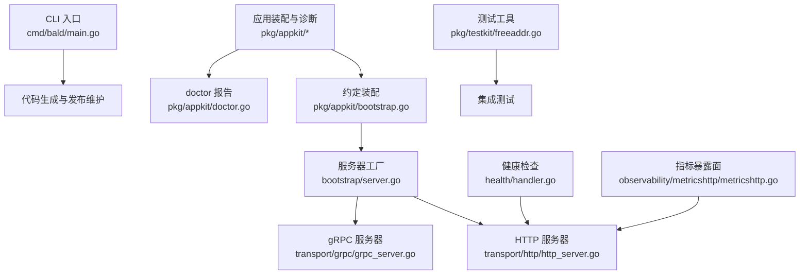
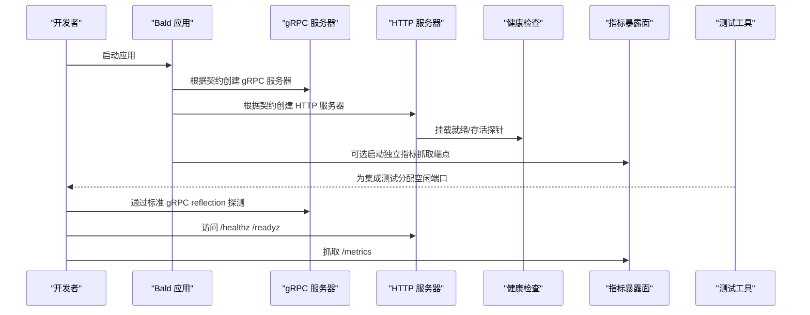
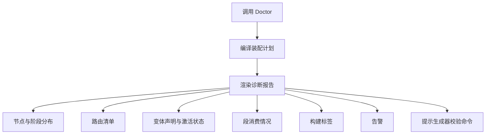
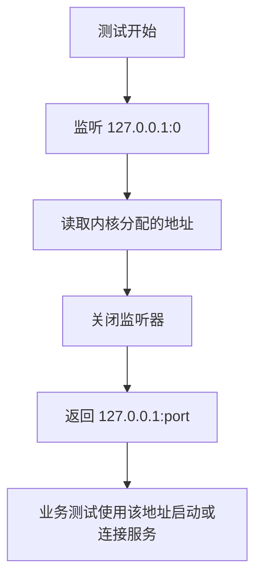
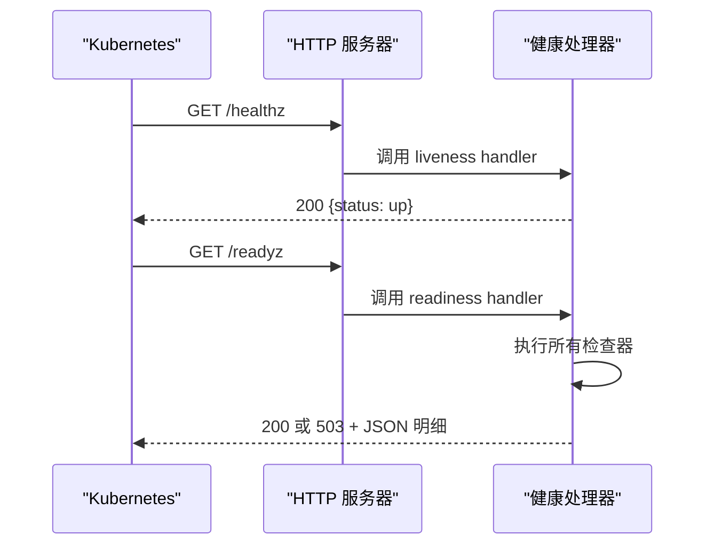
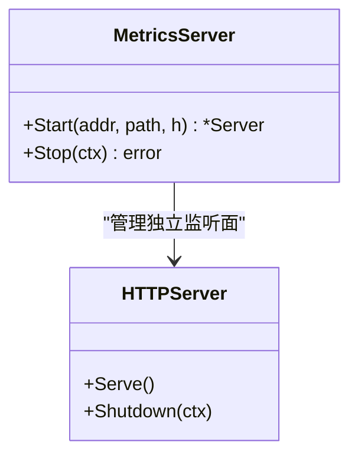
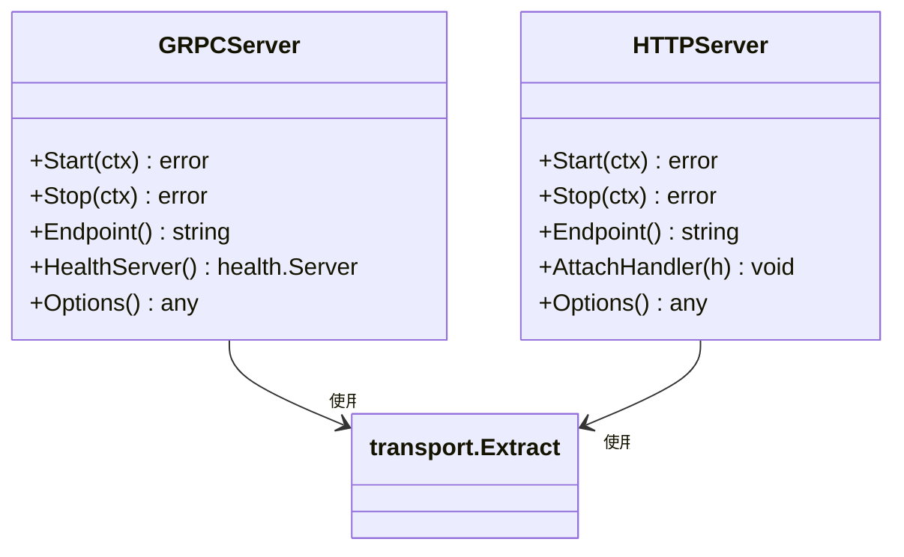
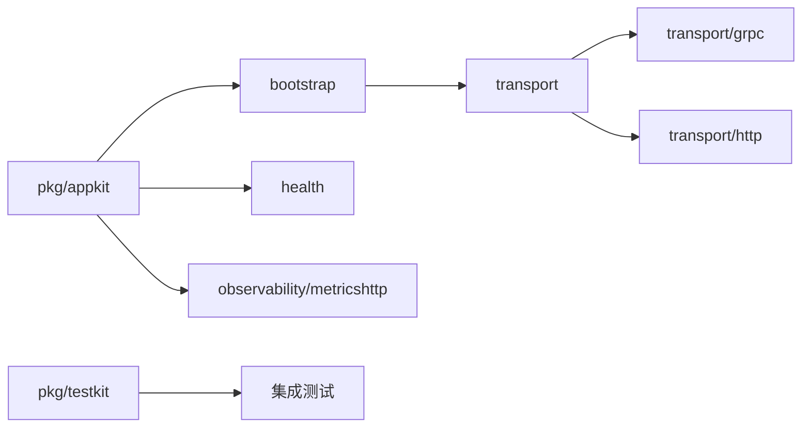

# 调试工具使用

<cite>
**本文引用的文件**   
- [main.go](file://cmd/bald/main.go)
- [doctor.go](file://pkg/appkit/doctor.go)
- [bootstrap.go](file://pkg/appkit/bootstrap.go)
- [harness.go](file://pkg/appkit/harness.go)
- [freeaddr.go](file://pkg/testkit/freeaddr.go)
- [server.go](file://bootstrap/server.go)
- [http.go](file://bootstrap/http.go)
- [metricshttp.go](file://observability/metricshttp/metricshttp.go)
- [grpc_server.go](file://transport/grpc/grpc_server.go)
- [http_server.go](file://transport/http/http_server.go)
- [handler.go](file://health/handler.go)
</cite>

## 目录
1. [简介](#简介)
2. [项目结构](#项目结构)
3. [核心组件](#核心组件)
4. [架构总览](#架构总览)
5. [详细组件分析](#详细组件分析)
6. [依赖关系分析](#依赖关系分析)
7. [性能与调试特性](#性能与调试特性)
8. [故障排查指南](#故障排查指南)
9. [结论](#结论)
10. [附录：常见调试场景操作清单](#附录常见调试场景操作清单)

## 简介
本文面向 Bald 框架使用者与维护者，整理仓库中与调试、诊断和测试相关的可观测能力。内容覆盖以下方面：
- pprof 的通用采集与分析流程；
- expvar 监控端点的配置方法与指标含义；
- Bald 框架内置 `bald doctor` 命令的诊断输出解读；
- 测试工具 freeaddr 的端口分配机制与集成测试环境搭建；
- 常见调试场景（端口冲突、依赖模拟、慢查询定位）的操作步骤。

需要特别说明：**本仓未实现专用的 pprof HTTP 服务或 expvar 暴露端点**，也未提供名为 `bald doctor` 的二进制命令。因此相关说明以“如何在基于 Bald 的服务中启用这些标准 Go 能力”以及“如何理解仓库内已有诊断能力”的方式给出，避免把未实现的特性写成已支持。

## 项目结构
与调试能力直接相关的代码集中在以下位置：
- CLI 入口：`cmd/bald/main.go`，仅提供代码生成与发布维护子命令；
- 应用装配与诊断：`pkg/appkit/doctor.go`、`pkg/appkit/bootstrap.go`、`pkg/appkit/harness.go`；
- 协议服务器：`transport/grpc/grpc_server.go`、`transport/http/http_server.go`；
- 健康检查：`health/handler.go`；
- 指标暴露面：`observability/metricshttp/metricshttp.go`；
- 测试工具：`pkg/testkit/freeaddr.go`；
- Bootstrap 层对 HTTP/gRPC 服务器的装配：`bootstrap/server.go`、`bootstrap/http.go`。

**图表来源**
- [main.go:1-47](file://cmd/bald/main.go#L1-L47)
- [doctor.go:1-60](file://pkg/appkit/doctor.go#L1-L60)
- [bootstrap.go:1-120](file://pkg/appkit/bootstrap.go#L1-L120)
- [server.go:1-149](file://bootstrap/server.go#L1-L149)
- [grpc_server.go:1-149](file://transport/grpc/grpc_server.go#L1-L149)
- [http_server.go:1-123](file://transport/http/http_server.go#L1-L123)
- [handler.go:1-84](file://health/handler.go#L1-L84)
- [metricshttp.go:1-60](file://observability/metricshttp/metricshttp.go#L1-L60)
- [freeaddr.go:1-30](file://pkg/testkit/freeaddr.go#L1-L30)

**章节来源**
- [main.go:1-47](file://cmd/bald/main.go#L1-L47)
- [bootstrap.go:1-120](file://pkg/appkit/bootstrap.go#L1-L120)

## 核心组件
- **Bald CLI**：官方开发工具，负责代码生成、应用骨架生成、域产物生成以及维护者的发布计划、同步、打标签等任务。它不是运行时诊断工具。
- **Doctor 报告**：由 `pkg/appkit/doctor.go` 提供，用于只读地编译装配计划并输出节点、路由、变体、段、构建标签、告警等信息，适合在 CI 或运维探针中使用。
- **服务器工厂**：`bootstrap/server.go` 把契约中的 HTTP/gRPC 配置转成 `transport.Server`，并支持 gRPC 反射、标准健康服务注入、业务 handler 注入。
- **协议服务器**：`transport/grpc` 与 `transport/http` 分别封装 gRPC 与 HTTP 服务器，处理监听、TLS、优雅停机与 endpoint 解析。
- **健康检查**：`health/handler.go` 提供 liveness 与 readiness HTTP 处理器，返回 JSON 状态，便于 Kubernetes 探针消费。
- **指标暴露面**：`observability/metricshttp/metricshttp.go` 提供独立端口上的 Prometheus 抓取端点。
- **测试工具**：`pkg/testkit/freeaddr.go` 提供跨模块复用的空闲 TCP 端口分配器。

**章节来源**
- [main.go:1-47](file://cmd/bald/main.go#L1-L47)
- [doctor.go:1-60](file://pkg/appkit/doctor.go#L1-L60)
- [server.go:1-149](file://bootstrap/server.go#L1-L149)
- [grpc_server.go:1-149](file://transport/grpc/grpc_server.go#L1-L149)
- [http_server.go:1-123](file://transport/http/http_server.go#L1-L123)
- [handler.go:1-84](file://health/handler.go#L1-L84)
- [metricshttp.go:1-60](file://observability/metricshttp/metricshttp.go#L1-L60)
- [freeaddr.go:1-30](file://pkg/testkit/freeaddr.go#L1-L30)

## 架构总览
Bald 的调试能力由“运行时标准库能力 + 框架诊断输出 + 测试工具”共同构成：

**图表来源**
- [server.go:60-149](file://bootstrap/server.go#L60-L149)
- [grpc_server.go:60-149](file://transport/grpc/grpc_server.go#L60-L149)
- [http_server.go:60-123](file://transport/http/http_server.go#L60-L123)
- [handler.go:1-84](file://health/handler.go#L1-L84)
- [metricshttp.go:20-60](file://observability/metricshttp/metricshttp.go#L20-L60)

## 详细组件分析

### pprof 调试：安装、采集与分析
仓库没有自带 pprof HTTP 服务。pprof 是 Go 标准库提供的运行时性能分析能力，适用于 CPU profile、内存 profile、goroutine dump、阻塞/互斥分析等。

#### 安装
- 本地 Go 工具链版本：1.27.1；CI 使用 1.27.3。
- 一般无需额外安装；Go 1.10+ 已内置 `net/http/pprof`。

#### 在 Bald 应用中启用
推荐在 HTTP 服务器中挂载 `/debug/pprof`：
- 如果应用使用 `transport/http`，可在业务根 handler 上注册 pprof mux；
- 如果使用 `transport/grpc`，可通过 gRPC reflection 辅助发现服务，但 pprof 本身仍是 HTTP 能力；
- 注意不要把 pprof 暴露到公网，仅用于本地或受控网络环境。

#### 常用采集命令
- CPU profile：
  - `go tool pprof -cpu=profile http://localhost:<端口>/debug/pprof/profile?seconds=30`
- 内存 profile：
  - `go tool pprof -alloc_space http://localhost:<端口>/debug/pprof/heap`
- goroutine dump：
  - `go tool pprof -inuse_goroutines http://localhost:<端口>/debug/pprof/goroutine`
- 阻塞分析：
  - `go tool pprof -block http://localhost:<端口>/debug/pprof/block`
- 互斥分析：
  - `go tool pprof -mutex http://localhost:<端口>/debug/pprof/mutex`

#### 分析方法
- 使用 `top` 查看热点函数；
- 使用 `tree` 查看调用栈；
- 使用 `list <函数名>` 查看源码热点行；
- 导出 SVG 后结合 IDE 或浏览器分析火焰图；
- 对比多个 profile 确认问题是否回归。

#### 注意事项
- CPU profile 建议采集 15–30 秒，避免采样过短导致统计不稳定；
- heap profile 建议使用 `-inuse_objects` 或 `-inuse_space` 看当前驻留内存，`-alloc_objects` 看分配峰值；
- goroutine dump 要谨慎使用，大量并发下可能产生较大响应；
- 不要在生产公网暴露 pprof，应配合鉴权、IP 白名单或内网限制。

本节为通用 Go 调试实践，不直接对应仓库中某个具体实现文件。

### expvar 监控端点：配置与指标含义
仓库同样没有内置 expvar HTTP 端点。expvar 是 Go 标准库提供的运行时变量暴露机制，常用于进程级指标观察。

#### 启用方式
- 使用标准库 `expvar` 包注册自定义指标；
- 在应用的 HTTP server 上挂载 `/debug/vars`；
- 或通过自定义 handler 暴露聚合后的指标。

#### 内置运行时指标
expvar 默认暴露 Go 运行时变量，例如 goroutine 数量、GC 信息、内存分配统计、系统负载等。这些指标适合快速观察进程健康状态，但不等同于 Prometheus 指标模型。

#### 自定义指标定义
- 使用 `expvar.Int`、`expvar.Float64`、`expvar.Map` 等类型注册指标；
- 在业务关键路径更新指标值；
- 查询时访问 `/debug/vars`，获得 JSON 格式数据；
- 如需外部系统消费，可编写轻量抓取器将其转发到 Prometheus、日志系统或监控系统。

#### 查询方法
- 命令行：`curl http://localhost:<端口>/debug/vars`；
- 脚本化抓取后入库或告警；
- 不建议直接对外公开，应与权限控制组合。

本节为通用 Go 调试实践，不直接对应仓库中某个具体实现文件。

### Bald 内置 `doctor` 诊断能力
仓库没有名为 `bald doctor` 的命令。`cmd/bald/main.go` 导出的 CLI 只提供代码生成与发布维护子命令。真正的诊断能力来自 `pkg/appkit/doctor.go` 中的 `Doctor` 函数，它编译装配计划并输出结构化诊断文本。

#### 功能边界
- 只读：不会触发 Provider.Build、钩子或阶段 A logger；
- 不写文件、不联网；
- 输出包含应用元数据、装配哈希、节点分布、Opaque 节点、覆盖项、命令式槽位、路由、变体、段、构建标签、告警及生成器校验提示；
- 适合在 CI 或运维探针中运行，用于检测装配漂移。

#### 典型输出字段
- `app`：应用名称、版本与环境；
- `plan`：装配计划哈希；
- `nodes`：节点总数与 Opaque 节点数，按 phase 分组；
- `routes`：REST 路由清单；
- `variants`：变体声明与激活状态；
- `segments`：段消费情况；
- `build tags`：构建标签；
- `warnings`：装配警告；
- 末尾提示在生成树中运行 `bald gen app --check` 与 `bald gen domain --check`。

#### 使用建议
- 在 CI 中先执行代码生成，再调用装配层的 Doctor 逻辑验证计划；
- 将输出纳入变更比对，关注 plan 哈希变化、新增/移除路由、变体命中态变化；
- 不要把它当作运行时健康检查，它是装配期诊断。

**图表来源**
- [doctor.go:1-60](file://pkg/appkit/doctor.go#L1-L60)
- [doctor.go:201-356](file://pkg/appkit/doctor.go#L201-L356)

**章节来源**
- [main.go:1-47](file://cmd/bald/main.go#L1-L47)
- [doctor.go:1-60](file://pkg/appkit/doctor.go#L1-L60)
- [doctor.go:201-356](file://pkg/appkit/doctor.go#L201-L356)

### 测试工具：freeaddr 端口分配
`pkg/testkit/freeaddr.go` 提供 `FreeAddr`，用于在测试中分配一个当前空闲的 TCP 地址。

#### 行为说明
- 监听 `127.0.0.1:0`，让内核分配端口；
- 立即关闭监听器，返回 `127.0.0.1:port`；
- 带 `127.0.0.1` 是为避免 gRPC 客户端把裸端口解析为 IPv6 `[::1]`，造成连接被拒绝；
- 注释明确指出这不是 100% 可靠：两次调用之间端口可能被抢占，但对测试足够安全。

#### 使用场景
- GatewayServer 后端 gRPC 地址不能用 `:0`，因为转码转发时需要确定端口；
- e2e 测试先拿地址，再启动监听；
- 多实例集成测试避免端口冲突。

#### 集成测试环境搭建
- 使用 `testing.TB` 作为参数，失败时直接中止测试；
- 为每个被测服务分配独立地址；
- 启动服务后，用该地址构造 gRPC/HTTP 客户端；
- 若依赖服务不可达，应在测试中显式跳过，避免误判。

**图表来源**
- [freeaddr.go:1-30](file://pkg/testkit/freeaddr.go#L1-L30)

**章节来源**
- [freeaddr.go:1-30](file://pkg/testkit/freeaddr.go#L1-L30)

### 健康检查与就绪探针
`health/handler.go` 提供两类 HTTP 健康处理器：
- Liveness：始终返回 200，表示进程能响应请求；
- Readiness：执行所有注册的依赖检查器，任一失败返回 503，并输出 JSON 明细。

#### 适用场景
- Kubernetes livenessProbe 使用 liveness handler；
- Kubernetes readinessProbe 使用 readiness handler；
- 手动 curl 或监控脚本检查服务依赖健康状态。

#### 响应结构
- `status`：up、down 等状态字符串；
- `message`：可选消息；
- `checks`：各检查器的状态明细。

**图表来源**
- [handler.go:1-84](file://health/handler.go#L1-L84)

**章节来源**
- [handler.go:1-84](file://health/handler.go#L1-L84)

### 指标暴露面：metricshttp
`observability/metricshttp/metricshttp.go` 提供独立的 metrics 监听面，默认监听 `:9091`，路径 `/metrics`。

#### 设计要点
- 真起监听面是“能力构造”，不是 App 编排；
- 后端 Provider 在自身 Build 中调用 Start，返回 Server 交给引擎；
- 停机序列先停暴露端，再 flush 指标，避免尾批丢失；
- 监听失败异步记日志，不 panic，保证业务旁路语义；
- 默认地址与 gRPC 默认端口错峰，减少冲突风险。

#### 配置与使用
- addr 为空时使用默认 `:9091`；
- path 为空时使用默认 `/metrics`；
- handler 由上层注入，通常是 Prometheus exporter；
- Stop 使用 `http.Server.Shutdown` 语义，排空在途请求。

**图表来源**
- [metricshttp.go:1-60](file://observability/metricshttp/metricshttp.go#L1-L60)

**章节来源**
- [metricshttp.go:1-60](file://observability/metricshttp/metricshttp.go#L1-L60)

### gRPC 与 HTTP 服务器调试特性
两个协议服务器都实现了统一契约，并提供 Endpoint 解析、TLS 配置、优雅停机与并发安全保护。

#### gRPC 服务器
- 支持 reflection，便于调试工具发现服务；
- 注册 gRPC 标准健康服务；
- Endpoint 支持 `:0` 动态端口，并把通配符绑定解析为本机可达 IP；
- TLS 配置错误在启动期报错，而不是先占端口再失败；
- Stop 使用 GracefulStop，ctx 到期则强制停止。

#### HTTP 服务器
- 不注册任何框架路由，路由完全由业务 handler 拥有；
- AttachHandler 支持延迟挂载；
- Endpoint 同样支持动态端口与本机可达 IP 解析；
- TLS 配置错误在启动期报错；
- Stop 使用 Shutdown。

**图表来源**
- [grpc_server.go:60-149](file://transport/grpc/grpc_server.go#L60-L149)
- [http_server.go:60-123](file://transport/http/http_server.go#L60-L123)

**章节来源**
- [grpc_server.go:1-149](file://transport/grpc/grpc_server.go#L1-L149)
- [http_server.go:1-123](file://transport/http/http_server.go#L1-L123)

## 依赖关系分析
从调试角度观察，Bald 的依赖关系呈现“协议实现解耦 + 装配层集中调度”的特点：

- `pkg/appkit` 负责装配与诊断；
- `bootstrap` 负责把契约转为服务器工厂；
- `transport` 提供协议无关的 Server 契约；
- `health` 提供健康检查处理器；
- `observability/metricshttp` 提供指标暴露面；
- `pkg/testkit` 提供测试工具。

**图表来源**
- [bootstrap.go:1-120](file://pkg/appkit/bootstrap.go#L1-L120)
- [server.go:1-149](file://bootstrap/server.go#L1-L149)
- [grpc_server.go:1-149](file://transport/grpc/grpc_server.go#L1-L149)
- [http_server.go:1-123](file://transport/http/http_server.go#L1-L123)
- [handler.go:1-84](file://health/handler.go#L1-L84)
- [metricshttp.go:1-60](file://observability/metricshttp/metricshttp.go#L1-L60)
- [freeaddr.go:1-30](file://pkg/testkit/freeaddr.go#L1-L30)

**章节来源**
- [bootstrap.go:1-120](file://pkg/appkit/bootstrap.go#L1-L120)
- [server.go:1-149](file://bootstrap/server.go#L1-L149)

## 性能与调试特性
- pprof：标准库能力，需自行在 HTTP 服务中挂载；适合定位 CPU 热点、内存泄漏、goroutine 泄漏、阻塞与互斥竞争。
- expvar：标准库能力，需自行挂载 `/debug/vars`；适合进程级指标观察，不适合替代 Prometheus。
- metricshttp：框架提供的独立指标抓取面，默认 `:9091`，适合 Prometheus 抓取。
- gRPC reflection：便于调试工具发现服务，但属于协议外能力，需在装配层按契约开启。
- 健康检查：liveness 与 readiness 分离，便于区分进程存活与服务就绪。
- Doctor：装配期诊断，适合 CI 与部署前校验。

[本节为通用指导，不直接分析具体文件]

## 故障排查指南

### 端口冲突检测
- 现象：服务启动时报 listen 失败；
- 原因：端口被其他进程占用；
- 解决：
  - 本地优先使用 `:0` 让内核分配端口；
  - 集成测试使用 `testkit.FreeAddr` 分配动态地址；
  - 确保不同服务使用不同固定端口；
  - 检查 HTTP/gRPC 是否同时监听同一端口。

**章节来源**
- [freeaddr.go:1-30](file://pkg/testkit/freeaddr.go#L1-L30)
- [grpc_server.go:90-149](file://transport/grpc/grpc_server.go#L90-L149)
- [http_server.go:70-123](file://transport/http/http_server.go#L70-L123)

### 依赖服务不可达
- 现象：readiness 返回 503；
- 原因：下游数据库、缓存、消息队列、注册中心不可用；
- 解决：
  - 在 readiness 检查器中登记依赖；
  - 使用独立健康检查 handler 暴露 `/readyz`；
  - 集成测试中先探活，再断言；
  - 不可达时应跳过测试，避免静默绿。

**章节来源**
- [handler.go:1-84](file://health/handler.go#L1-L84)

### 慢查询定位
- 使用 pprof CPU profile 定位热点函数；
- 使用 pprof block/mutex 定位阻塞与锁竞争；
- 使用 pprof heap 定位内存增长；
- 结合业务日志与 tracing 定位慢查询上下文；
- 在集成测试中注入真实或模拟后端，复现慢查询路径。

[本节为通用指导，不直接分析具体文件]

### gRPC 服务无法被发现
- 现象：调试工具看不到服务；
- 原因：reflection 未启用；
- 解决：
  - 在契约中开启 reflection；
  - 由装配层注册 reflection；
  - 不要用业务回调重复注册服务，否则会 panic。

**章节来源**
- [server.go:60-120](file://bootstrap/server.go#L60-L120)
- [grpc_server.go:60-110](file://transport/grpc/grpc_server.go#L60-L110)

### 指标抓取失败
- 现象：Prometheus 无法抓取指标；
- 原因：metrics 暴露端未启动、端口冲突、路径错误；
- 解决：
  - 确认 metricshttp.Start 被调用；
  - 检查默认端口 `:9091` 或自定义 addr；
  - 检查默认路径 `/metrics` 或自定义 path；
  - 确认暴露端启动失败不会 panic，而是异步记日志。

**章节来源**
- [metricshttp.go:1-60](file://observability/metricshttp/metricshttp.go#L1-L60)

### 装配计划异常
- 现象：启动失败或行为不符合预期；
- 原因：节点、路由、变体、段配置不一致；
- 解决：
  - 运行 Doctor 输出装配计划；
  - 关注 plan 哈希变化、新增/移除路由、变体命中态；
  - 在生成树中运行生成器校验命令；
  - 在 CI 中固化诊断输出比对。

**章节来源**
- [doctor.go:1-60](file://pkg/appkit/doctor.go#L1-L60)
- [doctor.go:201-356](file://pkg/appkit/doctor.go#L201-L356)

## 结论
Bald 框架的调试体系由三层组成：
1. **标准库能力**：pprof 与 expvar 需要应用在 HTTP 服务中自行启用，适合通用 Go 性能与运行时诊断；
2. **框架诊断能力**：Doctor 报告、健康检查、gRPC reflection、metricshttp 暴露面，提供装配期与运行期可观测性；
3. **测试工具**：freeaddr 为集成测试提供稳定端口分配，配合真实或模拟后端完成端到端验证。

使用时应避免把未实现的特性写成已支持：本仓没有专用 pprof 服务、没有 expvar 暴露端、也没有 `bald doctor` 命令。正确的做法是在应用层启用标准库能力，并使用框架提供的 Doctor、健康检查与 metricshttp 能力进行系统化调试。

[本节为总结，不直接分析具体文件]

## 附录：常见调试场景操作清单

| 场景 | 推荐工具 | 操作步骤 | 注意事项 |
|---|---|---|---|
| 端口冲突 | testkit.FreeAddr、`:0` | 测试中分配动态端口；服务监听 `:0` 后读取 Endpoint | 两次 FreeAddr 调用间端口可能被抢占 |
| 依赖服务不可达 | health.Handler | 注册依赖检查器；暴露 `/readyz`；不可达时跳过测试 | 不能只跑套件而不探活 |
| CPU 热点 | pprof CPU profile | 挂载 pprof；采集 15–30 秒；分析 top/tree/list | 不要暴露到公网 |
| 内存增长 | pprof heap | 使用 inuse_objects 或 inuse_space | 区分分配峰值与常驻内存 |
| goroutine 泄漏 | pprof goroutine | 抓取 goroutine dump；分析阻塞 goroutine | 并发高时响应体积大 |
| 阻塞与锁竞争 | pprof block/mutex | 采集 block 与 mutex profile | 与业务并发模型结合分析 |
| 服务发现 | gRPC reflection | 开启 reflection；用 gRPC 工具发现服务 | 不要重复注册 service |
| 指标抓取 | metricshttp | 确认 Start 被调用；检查 `:9091` 与 `/metrics` | 监听失败异步记日志 |
| 装配诊断 | Doctor | 运行 Doctor；关注 plan、nodes、routes、variants、segments | 只读，不触发业务副作用 |
| 集成测试 | harness、FreeAddr | 构造测试装置；分配端口；驱动 ReconcileCtx | harness 不监听端口、不加载配置 |

[本节为通用清单，不直接分析具体文件]