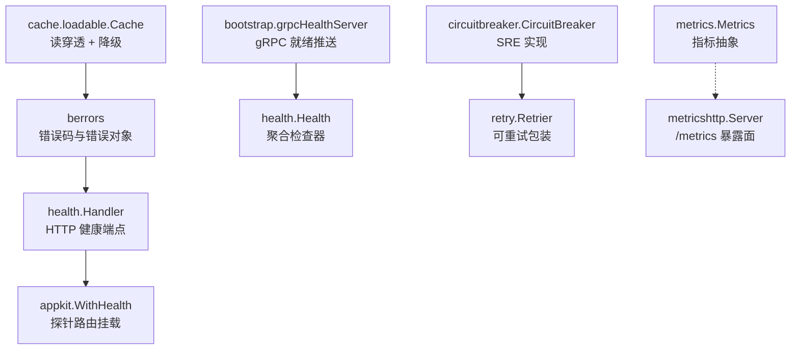
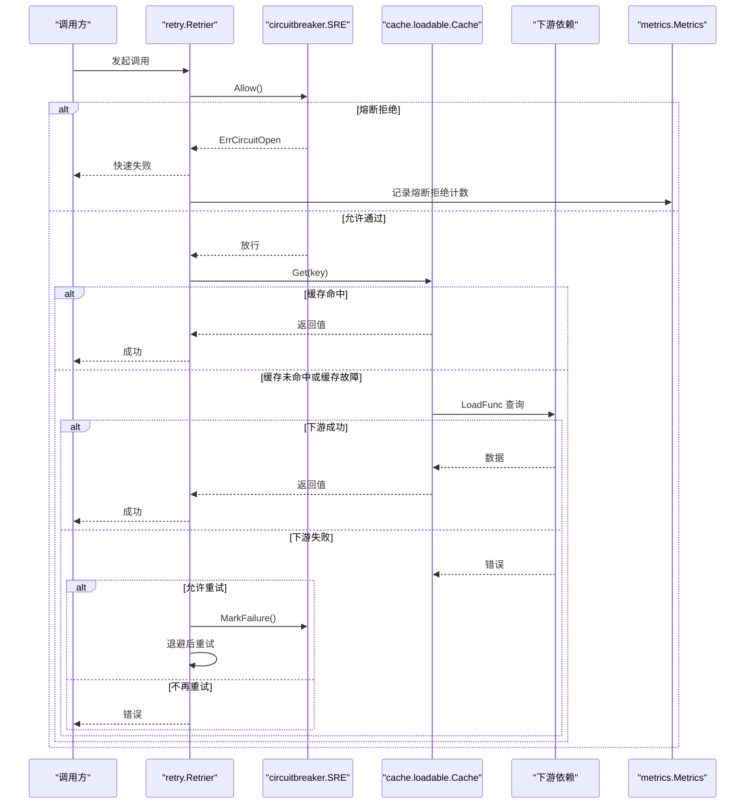
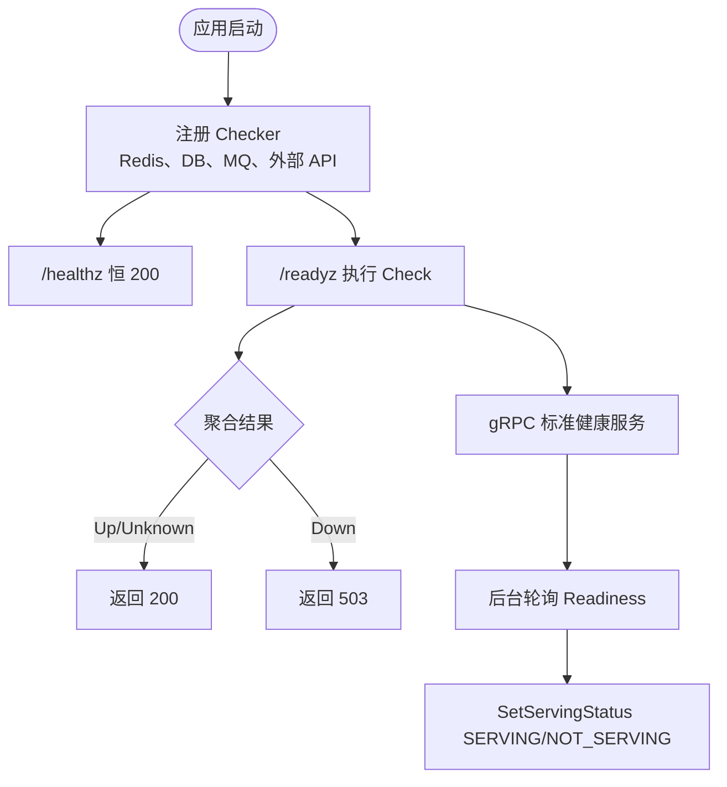
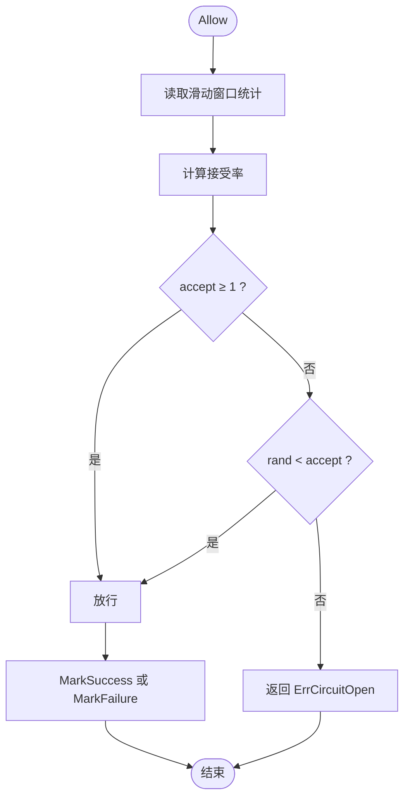
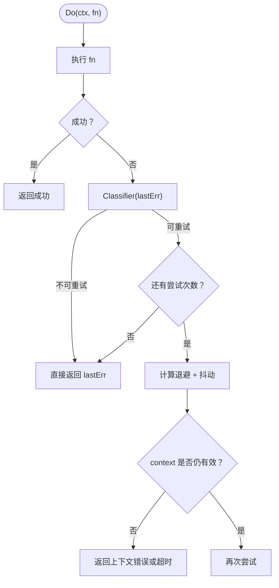
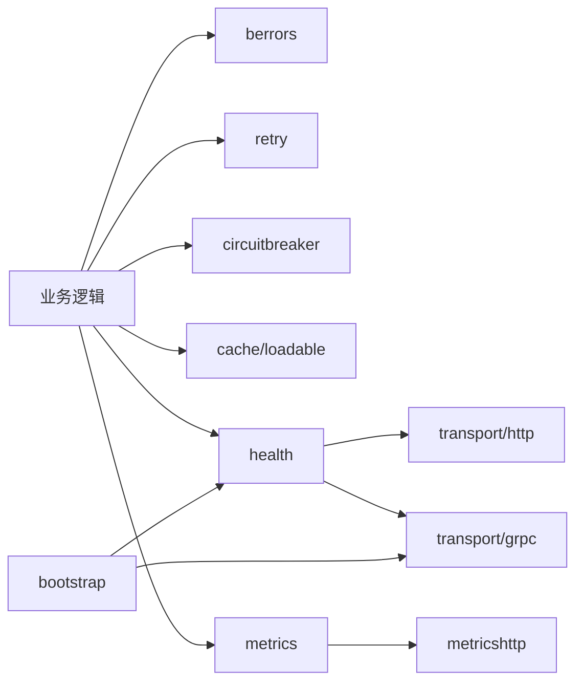

# 错误处理与恢复

<cite>
**本文引用的文件**   
- [berrors/code.go](file://berrors/code.go)
- [berrors/errors_test.go](file://berrors/errors_test.go)
- [berrors/httperr/httperr_test.go](file://berrors/httperr/httperr_test.go)
- [berrors/grpcerr/grpcerr_test.go](file://berrors/grpcerr/grpcerr_test.go)
- [health/health.go](file://health/health.go)
- [health/handler.go](file://health/handler.go)
- [health/readiness.go](file://health/readiness.go)
- [bootstrap/health.go](file://bootstrap/health.go)
- [pkg/appkit/health.go](file://pkg/appkit/health.go)
- [circuitbreaker/circuitbreaker.go](file://circuitbreaker/circuitbreaker.go)
- [circuitbreaker/sres/sres.go](file://circuitbreaker/sres/sres.go)
- [cache/loadable/loadable.go](file://cache/loadable/loadable.go)
- [retry/retry.go](file://retry/retry.go)
- [metrics/metrics.go](file://metrics/metrics.go)
- [observability/metricshttp/metricshttp.go](file://observability/metricshttp/metricshttp.go)
</cite>

## 目录
1. [引言](#引言)
2. [项目结构](#项目结构)
3. [核心组件](#核心组件)
4. [架构总览](#架构总览)
5. [详细组件分析](#详细组件分析)
6. [依赖关系分析](#依赖关系分析)
7. [性能考量](#性能考量)
8. [故障排查指南](#故障排查指南)
9. [结论](#结论)
10. [附录：生产告警配置建议](#附录生产告警配置建议)

## 引言
本文面向 Bald 框架使用者，聚焦“错误处理与恢复”主题，覆盖以下范围：
- 错误码体系与分类：业务错误、系统错误、网络错误的统一抽象。
- 健康检查机制：就绪检查与存活检查的装配、语义与故障场景。
- 恢复策略：优雅降级、熔断回退、重试、数据一致性保障。
- 可观测性与告警：关键错误指标如何接入 Prometheus / OpenTelemetry 等后端，并给出常见告警规则思路。
- 典型故障恢复流程：数据库连接断开、消息队列中断、外部 API 调用失败。

本仓库是 93 个 go.mod 的多模块工程；本文只引用与错误处理和恢复直接相关的模块与文件，避免把无关适配器或注册中心实现画成依赖。

## 项目结构
与错误处理及恢复直接相关的代码分布在以下包中：
- `berrors`：传输层错误码与不可变错误构造器，定义业务、系统、网络三类错误的统一编码。
- `health`：进程级健康聚合器、HTTP 探针处理器、就绪判定。
- `bootstrap`：gRPC 标准健康服务就绪状态同步。
- `pkg/appkit`：将健康探针挂载到 HTTP/gateway 路由。
- `circuitbreaker`：熔断接口与 SRE 概率式实现。
- `cache/loadable`：读穿透缓存，带缓存故障降级与回写最佳努力。
- `retry`：指数退避 + 抖动 + 分类器的可组合重试。
- `metrics`、`observability/metricshttp`：指标上报抽象与独立抓取端口暴露面。

**图表来源**
- [health/health.go:1-120](file://health/health.go#L1-L120)
- [health/handler.go:1-84](file://health/handler.go#L1-L84)
- [bootstrap/health.go:1-101](file://bootstrap/health.go#L1-L101)
- [pkg/appkit/health.go:1-80](file://pkg/appkit/health.go#L1-L80)
- [circuitbreaker/circuitbreaker.go:1-84](file://circuitbreaker/circuitbreaker.go#L1-L84)
- [circuitbreaker/sres/sres.go:1-120](file://circuitbreaker/sres/sres.go#L1-L120)
- [cache/loadable/loadable.go:1-120](file://cache/loadable/loadable.go#L1-L120)
- [retry/retry.go:1-120](file://retry/retry.go#L1-L120)
- [metrics/metrics.go:1-34](file://metrics/metrics.go#L1-L34)
- [observability/metricshttp/metricshttp.go:1-60](file://observability/metricshttp/metricshttp.go#L1-L60)

**章节来源**
- [health/health.go:1-120](file://health/health.go#L1-L120)
- [health/handler.go:1-84](file://health/handler.go#L1-L84)
- [bootstrap/health.go:1-101](file://bootstrap/health.go#L1-L101)
- [pkg/appkit/health.go:1-80](file://pkg/appkit/health.go#L1-L80)

## 核心组件
本节概览错误处理与恢复的关键构件及其职责。

| 组件 | 职责 | 关键行为 |
|---|---|---|
| `berrors.Error` | 统一错误对象 | 用 `Code`（对应 gRPC codes）+ `Reason`（领域唯一标识）+ `Message` + `Details` 表达错误；支持 `WithCause`、`Is` 匹配、堆栈捕获。 |
| `health.Health` | 健康检查聚合器 | 并发执行多个 `Checker`，任一 Down 则整体 Down；超时、未知、Up 按优先级聚合。 |
| `health.Handler` | HTTP 健康端点 | `/readyz` 返回 Up/Unknown 为 200，Down 为 503；`/healthz` 由 liveness handler 恒 200。 |
| `bootstrap.grpcHealthServer` | gRPC 就绪推送 | 后台轮询 `health.Readiness`，把结果设为 gRPC health 服务的 SERVING / NOT_SERVING。 |
| `circuitbreaker.SRE` | SRE 风格熔断器 | 基于滑动窗口统计请求与错误，接受率随错误比例平滑下降；无硬切 Open/Closed，只有 Closed/HalfOpen 语义提示。 |
| `cache.loadable.Cache` | 读穿透缓存 | 未命中触发 `LoadFunc`，使用 singleflight 合并并发 miss；缓存后端故障可按配置降级到直读。 |
| `retry.Retrier` | 重试器 | 指数退避 + 可选抖动 + 最大尝试次数 + 总超时 + 自定义错误分类器。 |
| `metrics.Metrics` | 指标上报抽象 | Counter / Histogram / Gauge / GaugeAdd；具体后端 Prometheus、OTel、Datadog 等实现。 |

**章节来源**
- [berrors/code.go:1-64](file://berrors/code.go#L1-L64)
- [health/health.go:1-120](file://health/health.go#L1-L120)
- [health/handler.go:1-84](file://health/handler.go#L1-L84)
- [bootstrap/health.go:1-101](file://bootstrap/health.go#L1-L101)
- [circuitbreaker/circuitbreaker.go:1-84](file://circuitbreaker/circuitbreaker.go#L1-L84)
- [circuitbreaker/sres/sres.go:1-120](file://circuitbreaker/sres/sres.go#L1-L120)
- [cache/loadable/loadable.go:1-120](file://cache/loadable/loadable.go#L1-L120)
- [retry/retry.go:1-120](file://retry/retry.go#L1-L120)
- [metrics/metrics.go:1-34](file://metrics/metrics.go#L1-L34)

## 架构总览
下图展示一次远程调用的错误处理与恢复路径：业务调用通过重试与熔断保护下游，缓存层提供降级与防击穿，健康检查暴露服务可用性，指标系统采集关键错误信号。

**图表来源**
- [retry/retry.go:1-200](file://retry/retry.go#L1-L200)
- [circuitbreaker/circuitbreaker.go:1-84](file://circuitbreaker/circuitbreaker.go#L1-L84)
- [circuitbreaker/sres/sres.go:1-200](file://circuitbreaker/sres/sres.go#L1-L200)
- [cache/loadable/loadable.go:1-186](file://cache/loadable/loadable.go#L1-L186)
- [metrics/metrics.go:1-34](file://metrics/metrics.go#L1-L34)

## 详细组件分析

### 一、错误码体系与分类方法

#### 1.1 错误码定义
`berrors` 定义了与 gRPC codes 一一对应的 `uint32` 错误码，包括：
- 参数类：`CodeInvalidArgument`、`CodeOutOfRange`、`CodeFailedPrecondition`。
- 权限与认证类：`CodeUnauthenticated`、`CodePermissionDenied`。
- 资源类：`CodeNotFound`、`CodeAlreadyExists`、`CodeResourceExhausted`。
- 系统与服务类：`CodeInternal`、`CodeUnavailable`、`CodeDataLoss`、`CodeCanceled`、`CodeDeadlineExceeded`、`CodeAborted`、`CodeUnimplemented`、`CodeOK`。

这些数值不应修改，因为它们同时被 HTTP 映射与 gRPC status 转换使用。

#### 1.2 错误对象与分类
`berrors.New` 构造的错误对象包含：
- `Code`：传输级别类别。
- `Reason`：业务唯一标识，用于跨边界判断错误类型。
- `Message`：人类可读信息。
- `Details`：结构化附加字段。
- `Cause`：底层原生错误链。

推荐分类方式：
- **业务错误**：使用 `BadRequest`、`NotFound`、`AlreadyExists`、`PermissionDenied`、`FailedPrecondition` 等便捷工厂，配合领域 Reason，如 `ORDER_NOT_FOUND`。
- **系统错误**：使用 `Internal`、`DataLoss`、`Unimplemented`。
- **网络错误**：使用 `Unavailable`、`DeadlineExceeded`、`Canceled`、`ResourceExhausted`。

测试证明：
- `Is` 匹配以 `Reason` 为准，不同 Code 但相同 Reason 仍可匹配。
- `WithCause` 支持 unwrap 到根因。
- 派生错误不污染原始 sentinel，`Details` 深拷贝。

**章节来源**
- [berrors/code.go:1-64](file://berrors/code.go#L1-L64)
- [berrors/errors_test.go:1-123](file://berrors/errors_test.go#L1-L123)

#### 1.3 HTTP 与 gRPC 边界转换
- HTTP 侧：`httperr.CodeToHTTP` / `HTTPToCode` 负责 berrors 与 HTTP 状态码的双向映射；未知状态码兜底 500，未映射状态码回落到 `CodeUnknown`。
- gRPC 侧：`grpcerr.ToStatus` / `FromStatus` 负责与 gRPC status 双向转换，保留 `ErrorInfo` 中的 Reason 与 Metadata，并把普通 status 文本放入 Message 而非 Reason。

这意味着在网关或 HTTP 入口应把业务错误转换为 `berrors.Error`，再交给中间件或响应封装器输出统一状态码。

**章节来源**
- [berrors/httperr/httperr_test.go:1-68](file://berrors/httperr/httperr_test.go#L1-L68)
- [berrors/grpcerr/grpcerr_test.go:1-96](file://berrors/grpcerr/grpcerr_test.go#L1-L96)

### 二、健康检查机制

#### 2.1 健康检查模型
`health.Health` 管理一组命名 `Checker`：
- 默认全局超时 5 秒。
- 每个 checker 在独立 goroutine 中执行，受 context 超时约束。
- 聚合规则：任一 Down → 整体 Down；否则任一 Unknown → 整体 Unknown；全部 Up → 整体 Up。

常用 checker：
- `PingFunc`：把任意返回 error 的函数适配为 checker。
- `TCP`：TCP 端口拨号检查。
- `AllCheckers`：所有子检查器都 Up 才 Up。
- `AnyCheckers`：至少一个子检查器 Up 即 Up。

#### 2.2 存活检查与就绪检查
- 存活检查（liveness）：`NewLivenessHandler()` 始终返回 200，仅表示进程能响应 HTTP。
- 就绪检查（readiness）：`NewHandler(h)` 对 `h.Check` 结果映射为 HTTP 状态码；Up 或 Unknown 返回 200，Down 返回 503。
- `Readiness(ctx)` 把 Down 检查结果拼装为 error，便于 gRPC 标准健康服务使用。

#### 2.3 gRPC 健康服务联动
`bootstrap.NewGRPCHealthServer` 在 gRPC server 之上叠加后台轮询：
- 启动时立即同步一次。
- 之后按 interval（默认 2 秒）周期调用 `health.Readiness`。
- 若 Readiness 返回 nil，则设为 SERVING；否则 NOT_SERVING。
- Stop 先取消轮询，再优雅停止 gRPC server，避免残留 goroutine。

#### 2.4 HTTP 探针挂载
`pkg/appkit.WithHealth` 默认挂载：
- `/healthz`：存活探针。
- `/readyz`：就绪探针。
可通过 `WithProbePaths` 覆盖路径；`WithHealthPollInterval` 覆盖 gRPC 侧同步间隔。

**图表来源**
- [health/health.go:1-200](file://health/health.go#L1-L200)
- [health/handler.go:1-84](file://health/handler.go#L1-L84)
- [health/readiness.go:1-42](file://health/readiness.go#L1-L42)
- [bootstrap/health.go:1-101](file://bootstrap/health.go#L1-L101)
- [pkg/appkit/health.go:1-80](file://pkg/appkit/health.go#L1-L80)

#### 2.5 健康检查故障场景
| 场景 | 表现 | 建议 |
|---|---|---|
| 某个依赖不可达 | 该 checker 返回 Down，整体 Down | 将其加入 readiness，使 /readyz 返回 503，K8s 停止转发流量。 |
| 依赖响应缓慢 | checker 被全局超时截断，标记 Down | 调整 `WithTimeout`，并为慢依赖设置更短超时。 |
| 未注册任何 checker | 整体 Up，附带 message 说明 | 生产环境至少注册关键依赖 checker。 |
| gRPC 健康服务状态滞后 | 探针延迟反映真实就绪状态 | 合理设置同步间隔，不要小于 kubelet 探测频率。 |

**章节来源**
- [health/health.go:1-200](file://health/health.go#L1-L200)
- [health/handler.go:1-84](file://health/handler.go#L1-L84)
- [health/readiness.go:1-42](file://health/readiness.go#L1-L42)
- [bootstrap/health.go:1-101](file://bootstrap/health.go#L1-L101)
- [pkg/appkit/health.go:1-80](file://pkg/appkit/health.go#L1-L80)

### 三、错误恢复策略

#### 3.1 熔断与优雅降级
`circuitbreaker.CircuitBreaker` 定义 Allow / MarkSuccess / MarkFailure / Execute / State / Close 契约。
SRE 实现的特点：
- 使用滑动时间窗统计 requests 与 errors。
- 接受率公式近似为 `(requests - K * errors) / (requests + 1)`。
- 当 accept < 1 且 > 0 时进行概率放行；accept ≤ 0 时直接拒绝。
- 没有传统 Open/Closed 硬切换；`StateClosed` 仅在零请求时可达，产生请求后通常进入 HalfOpen 语义区间。

建议：
- 对外部不稳定依赖使用 SRE 熔断器，避免雪崩。
- 熔断拒绝时返回明确的 `berrors.Unavailable` 或业务降级响应。
- 在 Allow 放行后，必须严格调用一次 MarkSuccess 或 MarkFailure。

**图表来源**
- [circuitbreaker/circuitbreaker.go:1-84](file://circuitbreaker/circuitbreaker.go#L1-L84)
- [circuitbreaker/sres/sres.go:1-200](file://circuitbreaker/sres/sres.go#L1-L200)

**章节来源**
- [circuitbreaker/circuitbreaker.go:1-84](file://circuitbreaker/circuitbreaker.go#L1-L84)
- [circuitbreaker/sres/sres.go:1-200](file://circuitbreaker/sres/sres.go#L1-L200)

#### 3.2 重试与退避
`retry.Retrier` 提供：
- 最大尝试次数。
- 指数退避策略，支持 Initial、Factor、Max。
- 抖动策略，防止雪崩。
- 错误分类器，决定哪些错误可重试。
- 总超时上限，避免重试无限延长请求。
- 可注入时钟和随机源，方便测试。

最佳实践：
- 只对幂等、瞬时失败重试，例如网络抖动、限流、短暂不可用。
- 对业务非法参数、权限不足、资源不存在等确定性错误不重试。
- 结合熔断：先熔断，再重试，避免在下游已明显退化时继续放大压力。

**图表来源**
- [retry/retry.go:1-200](file://retry/retry.go#L1-L200)

**章节来源**
- [retry/retry.go:1-200](file://retry/retry.go#L1-L200)

#### 3.3 缓存降级与数据一致性
`cache/loadable.Cache` 提供读穿透：
- 缓存命中直接返回。
- 未命中触发 `LoadFunc`，并使用 singleflight 合并同一 key 的并发加载。
- 非 `ErrNotFound` 的后端错误默认上抛；开启 `WithDegradeOnError` 后视同未命中，走 loader，使缓存故障不升级为业务故障。
- backfill 是 best-effort：写入缓存失败不影响已加载数据的返回，下次请求会重新加载。

一致性建议：
- 写多读少场景，优先保证主存储一致性，缓存作为加速层。
- 写操作后主动删除或更新缓存键，避免脏读。
- 对强一致读，可直接绕过缓存或启用较短 TTL。
- 使用 `SetNX` 做分布式去重时，注意过期时间与竞态条件。

**章节来源**
- [cache/loadable/loadable.go:1-186](file://cache/loadable/loadable.go#L1-L186)

### 四、可观测性与错误指标

#### 4.1 指标抽象
`metrics.Metrics` 提供：
- Counter：单调递增计数。
- Histogram：分布观测。
- Gauge：绝对值。
- GaugeAdd：增量值。

要求：同一 metric name 的 label key 集合必须恒定，因为某些后端（如 Prometheus）首次使用时冻结维度。

#### 4.2 指标暴露面
`observability/metricshttp.Start` 在独立监听面暴露指标：
- 默认地址 `:9091`，路径 `/metrics`。
- 监听失败异步记日志，不 panic，遵循旁路语义：指标面挂了不应拖垮业务。
- Stop 使用 `http.Server.Shutdown` 优雅关闭。

#### 4.3 关键错误指标建议
建议在业务层或中间件层记录以下指标：
- `bald_error_total{code,reason,service}`：按 berrors 的 Code 与 Reason 分组的错误计数。
- `bald_circuit_breaker_state{service,downstream}`：当前熔断状态或接受率。
- `bald_retry_total{operation,classified}`：重试次数与是否最终成功。
- `bald_health_status{component}`：各 checker 的状态。
- `bald_http_status{status_code,route,service}`：HTTP 状态码分布。
- `bald_grpc_status{code,service}`：gRPC 状态码分布。

这些指标可由 Prometheus、OpenTelemetry Metrics、Datadog 等后端消费。

**章节来源**
- [metrics/metrics.go:1-34](file://metrics/metrics.go#L1-L34)
- [observability/metricshttp/metricshttp.go:1-60](file://observability/metricshttp/metricshttp.go#L1-L60)

## 依赖关系分析
从错误处理与恢复角度看，主要依赖方向如下：

**图表来源**
- [berrors/code.go:1-64](file://berrors/code.go#L1-L64)
- [retry/retry.go:1-200](file://retry/retry.go#L1-L200)
- [circuitbreaker/circuitbreaker.go:1-84](file://circuitbreaker/circuitbreaker.go#L1-L84)
- [cache/loadable/loadable.go:1-186](file://cache/loadable/loadable.go#L1-L186)
- [health/health.go:1-200](file://health/health.go#L1-L200)
- [bootstrap/health.go:1-101](file://bootstrap/health.go#L1-L101)
- [metrics/metrics.go:1-34](file://metrics/metrics.go#L1-L34)
- [observability/metricshttp/metricshttp.go:1-60](file://observability/metricshttp/metricshttp.go#L1-L60)

**章节来源**
- [berrors/code.go:1-64](file://berrors/code.go#L1-L64)
- [health/health.go:1-200](file://health/health.go#L1-L200)
- [bootstrap/health.go:1-101](file://bootstrap/health.go#L1-L101)
- [metrics/metrics.go:1-34](file://metrics/metrics.go#L1-L34)

## 性能考量
- 健康检查应轻量：checker 内避免长耗时 I/O，必要时用 TCP Ping 或简化查询。
- 全局健康检查超时要短于应用请求超时，避免探针本身成为瓶颈。
- 熔断 SRE 实现使用滑动窗口和桶统计，注意窗口大小和桶数量对内存和精度的影响。
- 重试总超时要小于上游调用方（如网关、负载均衡）的超时，避免重复等待。
- 缓存 backfill 失败不应阻塞读路径；singleflight 只在单进程内合并并发 miss。
- 指标暴露面独立监听，避免与业务端口竞争 CPU 和连接池。

## 故障排查指南

### 5.1 数据库连接断开
现象：
- 健康检查中 DB checker 返回 Down。
- `/readyz` 返回 503。
- 业务报错可能为 `berrors.Internal` 或底层驱动错误。

恢复步骤：
1. 确认 DB checker 是否正确注册到 `health.Health`。
2. 检查 DB 连接配置、网络连通性、认证信息。
3. 对只读查询可启用缓存降级：让 `cache.loadable.Cache` 在缓存可用时继续提供服务。
4. 对写操作不重试，除非明确幂等；对只读可配合 `retry.Retrier` 重试瞬时连接错误。
5. 观察 metrics：DB 错误计数上升、健康状态 Down。
6. DB 恢复后，/readyz 自动回到 200，K8s 重新转发流量。

### 5.2 消息队列中断
现象：
- Broker 订阅者或发布者出现连接错误。
- 消息积压或消费停滞。
- 健康检查中 MQ checker 失败。

恢复步骤：
1. 在 readiness 中注册 MQ 连接或简单命令 checker。
2. 生产者使用 retry + circuitbreaker 包装发送；消费者根据业务幂等性决定是否重试。
3. 对于暂时不可用，熔断器应避免继续投递；对可重试错误，使用有限次重试。
4. 观察 MQ 相关指标与 broker 监控面板。
5. 恢复后重新建立连接；若订阅者需要重建，由调用方负责清理旧订阅。

### 5.3 外部 API 调用失败
现象：
- 外部 API 超时、限流、5xx。
- 业务出现大量 `berrors.Unavailable` 或 `berrors.ResourceExhausted`。
- 熔断器开始概率拒绝请求。

恢复步骤：
1. 对幂等 GET 请求可加 retry；POST/PUT 谨慎重试。
2. 使用 SRE 熔断器限制失败扩散，避免雪崩。
3. 对热点数据启用 `cache.loadable.Cache`，在外部 API 不可用时返回最近缓存值。
4. 记录 `bald_error_total` 与 `bald_circuit_breaker_state`，配置告警。
5. 外部 API 恢复后，熔断接受率回升，缓存逐步刷新。

### 5.4 健康检查误报或漏报
常见问题：
- 未注册 checker：/readyz 返回 Up，但实际依赖不可用。
- checker 太慢：被全局超时标记 Down。
- gRPC 健康状态滞后：轮询间隔过长。

修复建议：
- 生产环境至少注册 DB、缓存、MQ、关键外部 API。
- 为慢依赖单独设置更短 checker 超时。
- 调整 `WithHealthPollInterval`，使其与集群探测频率匹配。

**章节来源**
- [health/health.go:1-200](file://health/health.go#L1-L200)
- [health/handler.go:1-84](file://health/handler.go#L1-L84)
- [bootstrap/health.go:1-101](file://bootstrap/health.go#L1-L101)
- [cache/loadable/loadable.go:1-186](file://cache/loadable/loadable.go#L1-L186)
- [retry/retry.go:1-200](file://retry/retry.go#L1-L200)
- [circuitbreaker/sres/sres.go:1-200](file://circuitbreaker/sres/sres.go#L1-L200)

## 结论
Bald 的错误处理与恢复建立在四个层次：
1. 统一错误码与错误对象，保证跨 HTTP/gRPC 边界的错误语义稳定。
2. 健康检查将依赖可用性显式暴露给编排系统与负载均衡。
3. 重试、熔断、缓存降级构成弹性防护层。
4. 指标抽象与独立暴露面支撑生产监控与告警。

正确组合这些组件，可以在依赖退化时快速降级、在依赖恢复后自动回归，同时保持错误可观测、可诊断、可回溯。

## 附录：生产告警配置建议

### A.1 关键错误指标
- `bald_error_total`：按 code、reason、service 分组，观察突发错误。
- `bald_circuit_breaker_accept_rate{service,downstream}`：接受率持续下降表示下游退化。
- `bald_retry_duration_seconds_bucket{operation}`：重试耗时分布。
- `bald_health_component_status{component}`：各依赖 checker 状态。
- `bald_http_request_duration_seconds_bucket{route,status}`：HTTP 请求延迟与状态码。
- `bald_grpc_request_duration_seconds_bucket{service,method,status}`：gRPC 请求延迟与状态码。

### A.2 告警规则思路
| 规则 | 条件 | 严重级别 | 动作 |
|---|---|---|---|
| 高错误率 | bald_error_total 增长速率超过阈值 | P1 | 通知值班、自动扩容或限流 |
| 熔断频繁 | accept_rate < 0.2 持续一段时间 | P2 | 检查下游、准备降级 |
| 健康状态 Down | health_component_status != up | P1 | 暂停流量、触发自愈脚本 |
| 重试超时增多 | bald_retry_duration_seconds 大量超时 | P2 | 检查依赖、调整重试策略 |
| 指标面不可达 | /metrics 返回非 200 | P3 | 修复指标采集，不影响业务 |

### A.3 指标暴露注意事项
- 使用 `observability/metricshttp.Start` 启动独立抓取端口。
- 监听失败只记日志，不 panic。
- 停机顺序应先 Stop 指标服务器，再 flush 指标后端，避免丢失尾批数据。

**章节来源**
- [metrics/metrics.go:1-34](file://metrics/metrics.go#L1-L34)
- [observability/metricshttp/metricshttp.go:1-60](file://observability/metricshttp/metricshttp.go#L1-L60)