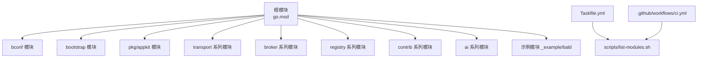
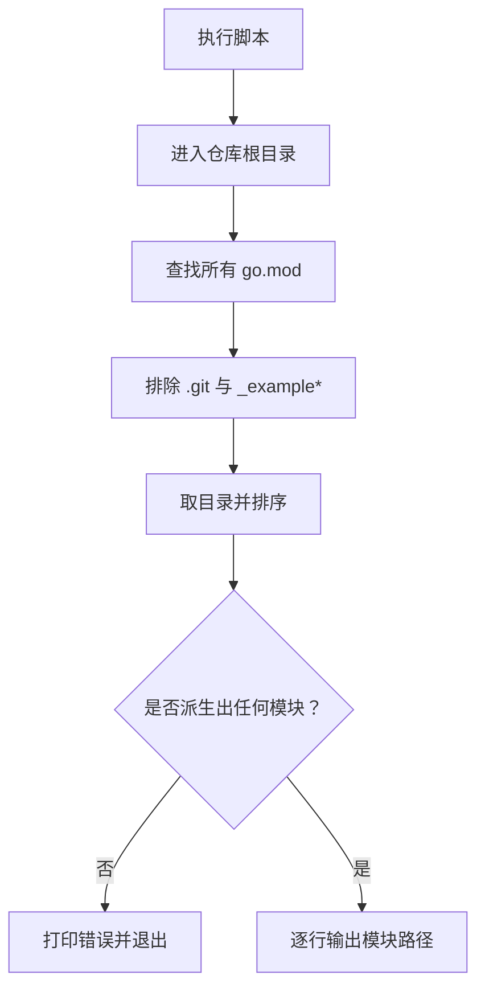

# 本地开发环境搭建

<cite>
**本文引用的文件**   
- [Taskfile.yml](file://Taskfile.yml)
- [scripts/list-modules.sh](file://scripts/list-modules.sh)
- [.github/workflows/ci.yml](file://.github/workflows/ci.yml)
- [.github/workflows/windows.yml](file://.github/workflows/windows.yml)
- [.github/workflows/workflow-lint.yml](file://.github/workflows/workflow-lint.yml)
- [.golangci.yml](file://.golangci.yml)
- [go.mod](file://go.mod)
</cite>

## 目录
1. [引言](#引言)
2. [项目结构总览](#项目结构总览)
3. [核心组件与工具链](#核心组件与工具链)
4. [模块派生机制](#模块派生机制)
5. [跨平台兼容性说明](#跨平台兼容性说明)
6. [完整搭建与验证步骤](#完整搭建与验证步骤)
7. [常见问题排查](#常见问题排查)
8. [环境变量与最佳实践](#环境变量与最佳实践)
9. [结论](#结论)

## 引言
本指南面向首次参与 Bald 框架本地开发的贡献者，目标是让你在本机复现仓库的构建、代码生成、静态检查与测试流程。Bald 是一个多 Go module 仓库（根 `go.mod` 通过相对 `replace` 把子模块拼成可编译闭包），所有工具链版本由 `Taskfile.yml` 的 `vars` 集中钉住；脚本与 CI 共用同一份模块清单派生逻辑，因此本地与持续集成环境的覆盖范围保持一致。

需要特别注意的是：
- 仓库是 93 个 go module 的多模块仓库，没有全局 `go.work`。
- 根 module 不得依赖适配器后端，适配器放在独立子模块中。
- `_example/bald` 是独立 module，不在根 `go build ./...` / `go test ./...` 范围内。
- Windows/macOS/Linux 三端都有对应处理，但某些全仓扫描任务依赖 POSIX shell，Windows 下会显式失败并引导逐模块运行。

## 项目结构总览
仓库不是“一个 Go 应用”，而是由大量功能域组成的多模块集合：`bconf`、`bootstrap`、`pkg/appkit`、`transport/*`、`broker/*`、`registry/*`、`contrib/*`、`ai/*`、`_example/bald` 等各自有独立 `go.mod`。顶层 `Taskfile.yml` 提供统一入口，`.github/workflows/ci.yml` 提供持续集成闸门，`scripts/list-modules.sh` 是模块发现真相源。



**图表来源**
- [go.mod:1-20](file://go.mod#L1-L20)
- [Taskfile.yml:1-20](file://Taskfile.yml#L1-L20)
- [scripts/list-modules.sh:1-24](file://scripts/list-modules.sh#L1-L24)
- [.github/workflows/ci.yml:1-20](file://.github/workflows/ci.yml#L1-L20)

**章节来源**
- [go.mod:1-20](file://go.mod#L1-L20)
- [Taskfile.yml:1-20](file://Taskfile.yml#L1-L20)
- [scripts/list-modules.sh:1-24](file://scripts/list-modules.sh#L1-L24)
- [.github/workflows/ci.yml:1-20](file://.github/workflows/ci.yml#L1-L20)

## 核心组件与工具链

### Go 版本要求
根模块声明使用 Go 1.27.1：
- 根 `go.mod` 指定 `go 1.27.1`。
- 本地推荐安装 Go 1.27.1。
- CI 主循环与 workflow lint 使用 Go 1.27.3；Windows 周界作业使用 Go 1.27.1。
- 若本机 Go 版本低于根模块要求，`go mod tidy`、`go build`、`go test` 等命令都会直接报错。

建议操作：
1. 安装 Go 1.27.1。
2. 确认 `go version` 输出包含 `go1.27.1`。
3. 如果安装了多个版本，用 `go install` 或版本管理工具切换到 1.27.1。

**章节来源**
- [go.mod:1-5](file://go.mod#L1-L5)
- [.github/workflows/ci.yml:54-62](file://.github/workflows/ci.yml#L54-L62)
- [.github/workflows/windows.yml:34-40](file://.github/workflows/windows.yml#L34-L40)

### Task 与 Taskfile
Bald 用 Taskfile 替代 Makefile，作为本地构建、生成、检查、测试的统一入口。

安装方式：
```text
go install github.com/go-task/task/v3/cmd/task@latest
```

安装后确认：
```text
task --version
```

关键约定：
- 所有跨目录命令使用 Taskfile 的 `dir:` 字段，而不是在命令里写 `cd`。
- 平台相关检测使用 Task 内置的 `sh`/`bash` 判定，避免 Windows cmd/pwsh 差异。
- 模块清单不手写，全部来自 `scripts/list-modules.sh`。
- 工具链版本集中在 `vars` 中，升级时只改一处。

常用任务：
| 任务 | 作用 | 适用场景 |
|---|---|---|
| `task help` | 列出全部任务 | 不确定要跑哪个命令 |
| `task tools` | 安装 protoc-gen-defaults 等生成期工具 | 第一次开发前 |
| `task proto` | 生成全部 Protobuf 契约代码 | 修改 `.proto` 后 |
| `task verify-module MOD=<dir>` | 按 CI 口径验证单个模块 | 本地单模块调试 |
| `task verify-modules` | 逐模块验证派生出的全部模块 | 提交前快速自检 |
| `task lint` | golangci-lint 全仓检查 | 静态检查 |
| `task vuln` | govulncheck 漏洞扫描 | 安全扫描 |
| `task race` | 竞态检测 | 并发路径改动后 |
| `task example-e2e` | 运行示例端到端回归 | 变更示例装配链路 |
| `task ci-workflow-lint` | 校验 GitHub 作业文件 | 修改 `.github/workflows/*.yml` 后 |

**章节来源**
- [Taskfile.yml:1-20](file://Taskfile.yml#L1-L20)
- [Taskfile.yml:24-100](file://Taskfile.yml#L24-L100)
- [Taskfile.yml:380-452](file://Taskfile.yml#L380-L452)

### 工具链版本与安装位置
所有工具都安装在 `$(go env GOPATH)/bin` 目录下。Taskfile 会在命令不可用时自动执行 `go install`，但前提是 PATH 已经包含该目录。

| 工具 | 版本 | 安装来源 | 用途 |
|---|---:|---|---|
| task | 自行安装最新版 | `github.com/go-task/task/v3/cmd/task` | 统一构建入口 |
| golangci-lint | v2.15.0 | `github.com/golangci/golangci-lint/v2/cmd/golangci-lint` | 静态检查 |
| govulncheck | v1.9.0 | `golang.org/x/vuln/cmd/govulncheck` | 依赖漏洞扫描 |
| actionlint | v1.7.12 | `github.com/rhysd/actionlint/cmd/actionlint` | GitHub 工作流语法与脚本检查 |
| protoc-gen-defaults | v0.0.2 | `github.com/onexstack/protoc-gen-defaults` | Protobuf 默认值生成插件 |

安装命令参考：
```text
go install github.com/golangci/golangci-lint/v2/cmd/golangci-lint@v2.15.0
go install golang.org/x/vuln/cmd/govulncheck@v1.9.0
go install github.com/rhysd/actionlint/cmd/actionlint@v1.7.12
go install github.com/onexstack/protoc-gen-defaults@v0.0.2
```

确认安装结果：
```text
which golangci-lint
which govulncheck
which actionlint
which protoc-gen-defaults
```

如果提示找不到命令，通常是因为 `$(go env GOPATH)/bin` 没有加入 PATH。

**章节来源**
- [Taskfile.yml:24-38](file://Taskfile.yml#L24-L38)
- [Taskfile.yml:40-88](file://Taskfile.yml#L40-L88)
- [.github/workflows/workflow-lint.yml:38-46](file://.github/workflows/workflow-lint.yml#L38-L46)

### Protobuf 代码生成
bconf 模块的契约层通过 buf 生成，并由 Taskfile 管理：
- `task proto`：生成全部契约代码。
- `task proto-contract`：生成 bconf 契约层。
- `task proto-contract-local`：用本机 buf + protoc-gen-go 重新生成，与远端 BSR 产物一致。
- `task proto-contract-check`：校验生成物与 proto 是否一致。
- `task proto-example`：生成示例模块的 gRPC/gRPC-Gateway 服务代码。

注意：
- 生成过程依赖 `buf` 与 `protoc-gen-defaults`。
- 如果 `protoc-gen-defaults` 不在 PATH，Taskfile 会按 pin 版本安装到 GOBIN。
- `_example/bald/api` 的生成可能依赖远程 buf 插件，网络不通时会降级或跳过部分检查。

**章节来源**
- [Taskfile.yml:40-88](file://Taskfile.yml#L40-L88)
- [Taskfile.yml:90-140](file://Taskfile.yml#L90-L140)

### 静态检查配置
根目录的 `.golangci.yml` 启用以下检查：
- errcheck
- govet
- ineffassign
- staticcheck
- unused

规则要点：
- 默认开启五类检查，风格交给 `gofmt`。
- 测试文件中关闭 errcheck，因为资源清理与临时文件写入不属于被测行为。
- staticcheck 保留 SA* 与 S1*，排除 ST* 和 QF* 等风格类规则。
- lint 配置对根模块与子模块均生效，子模块目录会自动向上发现根配置。

**章节来源**
- [.golangci.yml:1-47](file://.golangci.yml#L1-L47)

## 模块派生机制

### scripts/list-modules.sh 的工作原理
`scripts/list-modules.sh` 是仓库 Go module 清单的唯一派生来源。它的作用是：
1. 进入仓库根目录。
2. 递归查找所有 `go.mod`。
3. 排除 `.git` 目录下的残留文件。
4. 排除 `_example*` 目录。
5. 去重并排序。
6. 每行输出一个相对路径，以 `./` 开头。
7. 根模块输出为 `.`。
8. 如果派生结果为空，脚本向 stderr 打印错误并退出非零状态。



**图表来源**
- [scripts/list-modules.sh:1-24](file://scripts/list-modules.sh#L1-L24)

为什么这个设计重要：
- CI 和本地 `Taskfile.yml` 消费同一条派生结果。
- 新增模块不需要同时维护两份清单。
- 清单为空不是“通过”，而是明确失败，防止闸门静默失效。
- `_example/bald` 被排除，因为它有独立的依赖装载方式，由 Taskfile 的 `example-*` 任务单独覆盖。

**章节来源**
- [scripts/list-modules.sh:1-24](file://scripts/list-modules.sh#L1-L24)
- [Taskfile.yml:24-38](file://Taskfile.yml#L24-L38)
- [.github/workflows/ci.yml:1-20](file://.github/workflows/ci.yml#L1-L20)

### 根模块与子模块关系
根 `go.mod` 使用 `replace` 把多个子模块指向本地目录，使整个仓库可被当作一个可编译单元。例如 `bconf`、`bootstrap`、`log/*`、`registry`、`transport` 等都被 replace 到本地。

这意味着：
- 开发者修改子模块源码后，根模块可直接引用最新实现。
- 发布时需要通过 release 工具链同步内部依赖并打 tag。
- 本地开发不要手动修改 `require` 中的子模块版本号；应通过 `replace` 机制保持本地一致性。

**章节来源**
- [go.mod:1-20](file://go.mod#L1-L20)

## 跨平台兼容性说明

### Windows
- Taskfile 对 Windows 使用 `where` 探测工具，对 Linux/macOS 使用 `command -v`。
- 全仓 `verify`、`lint`、`vuln`、`race` 等依赖 POSIX shell 的任务在 Windows 上会显式失败，不会静默跳过。
- Windows 下推荐逐模块运行：
  ```text
  task verify-module MOD=.<dir>
  task lint-module MOD=.<dir>
  task vuln-module MOD=.<dir>
  ```
- Windows 周界 CI 仅覆盖 root、bootstrap、contrib/authz-casbin 三个模块，不包含全量 race 检测。

### macOS 与 Linux
- 全仓任务均可正常执行。
- `scripts/list-modules.sh` 基于 POSIX shell，macOS/Linux 原生支持。
- race 检测需要 cgo，未启用 cgo 时 `go test -race` 会失败。

### 常见平台差异
| 场景 | Linux/macOS | Windows |
|---|---|---|
| 工具探测 | `command -v` | `where` |
| 全仓模块扫描 | 直接运行 | 显式失败，需逐模块 |
| 竞态检测 | 支持 | 由 Windows CI 窄口径覆盖 |
| Protobuf 生成 | 正常 | 需要 buf 与 protoc-gen-defaults |
| GitHub 工作流 | CI 使用 Ubuntu | 另有 windows.yml |

**章节来源**
- [Taskfile.yml:24-38](file://Taskfile.yml#L24-L38)
- [Taskfile.yml:142-180](file://Taskfile.yml#L142-L180)
- [Taskfile.yml:300-380](file://Taskfile.yml#L300-L380)
- [.github/workflows/windows.yml:1-59](file://.github/workflows/windows.yml#L1-L59)

## 完整搭建与验证步骤

### 第一步：准备 Go 环境
1. 安装 Go 1.27.1。
2. 确认 `go version`。
3. 确保 `GOPATH/bin` 已加入 PATH。

验证命令：
```text
go version
echo $(go env GOPATH)/bin
```

**章节来源**
- [go.mod:1-5](file://go.mod#L1-L5)

### 第二步：安装 Task
```text
go install github.com/go-task/task/v3/cmd/task@latest
task help
```

如果提示找不到 `task`，检查 PATH 是否包含 `$(go env GOPATH)/bin`。

**章节来源**
- [Taskfile.yml:1-20](file://Taskfile.yml#L1-L20)

### 第三步：安装工具链
```text
task tools
task tools-golangci-lint
task tools-govulncheck
task tools-actionlint
task tools-protoc-gen-defaults
```

或者一次性安装：
```text
go install github.com/golangci/golangci-lint/v2/cmd/golangci-lint@v2.15.0
go install golang.org/x/vuln/cmd/govulncheck@v1.9.0
go install github.com/rhysd/actionlint/cmd/actionlint@v1.7.12
go install github.com/onexstack/protoc-gen-defaults@v0.0.2
```

**章节来源**
- [Taskfile.yml:40-88](file://Taskfile.yml#L40-L88)

### 第四步：生成 Protobuf 代码
```text
task proto
```

如果只需要 bconf 契约层：
```text
task proto-contract
```

如果需要在离线环境复现生成结果：
```text
task proto-contract-local
task proto-contract-check
```

**章节来源**
- [Taskfile.yml:40-88](file://Taskfile.yml#L40-L88)

### 第五步：验证单个模块
假设你要验证根模块：
```text
task verify-module MOD=.
```

假设你要验证 broker 模块：
```text
task verify-module MOD=./broker
```

这条命令等价于 CI 的单模块口径：
1. `go mod tidy -diff`
2. `go build ./...`
3. `go vet ./...`
4. `go test -short -timeout 5m ./...`

根模块的 vet 会使用 `-copylocks=false`，因为 appkit hotReload 中存在顶层浅拷贝 proto 结构的既定设计。

**章节来源**
- [Taskfile.yml:330-380](file://Taskfile.yml#L330-L380)
- [.github/workflows/ci.yml:70-100](file://.github/workflows/ci.yml#L70-L100)

### 第六步：运行全仓验证
```text
task verify-modules
```

这会遍历 `scripts/list-modules.sh` 派生的全部模块，执行 tidy、build、vet、test -short。

如果只想运行根模块测试：
```text
task test
```

**章节来源**
- [Taskfile.yml:380-452](file://Taskfile.yml#L380-L452)

### 第七步：静态检查
```text
task lint
```

单模块检查：
```text
task lint-module MOD=.<dir>
```

**章节来源**
- [Taskfile.yml:300-330](file://Taskfile.yml#L300-L330)
- [.golangci.yml:1-47](file://.golangci.yml#L1-L47)

### 第八步：漏洞扫描
```text
task vuln
```

单模块扫描：
```text
task vuln-module MOD=.<dir>
```

注意：govulncheck 需要访问 `vuln.go.dev`，网络不通时可能失败。

**章节来源**
- [Taskfile.yml:300-330](file://Taskfile.yml#L300-L330)

### 第九步：竞态检测
Linux/macOS：
```text
task race
```

Windows：
- 全仓 race 任务不支持 POSIX shell，会显式失败。
- 建议对怀疑并发问题的模块单独运行：
  ```text
  go test -short -race -timeout 10m ./...
  ```

**章节来源**
- [Taskfile.yml:360-420](file://Taskfile.yml#L360-L420)

### 第十步：示例端到端回归
```text
task example-e2e
```

这会先生成示例 gRPC 代码，然后运行示例模块的测试。

**章节来源**
- [Taskfile.yml:90-140](file://Taskfile.yml#L90-L140)

### 第十一步：GitHub 工作流检查
修改 `.github/workflows/*.yml` 后：
```text
task ci-workflow-lint
```

**章节来源**
- [Taskfile.yml:310-325](file://Taskfile.yml#L310-L325)
- [.github/workflows/workflow-lint.yml:1-46](file://.github/workflows/workflow-lint.yml#L1-L46)

## 常见问题排查

### PATH 中没有 `$(go env GOPATH)/bin`
现象：
- `task`、`golangci-lint`、`govulncheck`、`actionlint`、`protoc-gen-defaults` 报找不到命令。

解决：
```text
export PATH="$(go env GOPATH)/bin:$PATH"
```

在 Bash/zsh 中写入 shell 配置文件；在 PowerShell 中写入 `$PROFILE`。

**章节来源**
- [Taskfile.yml:40-88](file://Taskfile.yml#L40-L88)
- [.github/workflows/workflow-lint.yml:38-46](file://.github/workflows/workflow-lint.yml#L38-L46)

### Go 版本不匹配
现象：
- `go mod tidy`、`go build`、`go test` 报版本过低。

原因：
- 根模块要求 Go 1.27.1。
- 本地 Go 版本低于 1.27.1。

解决：
1. 安装 Go 1.27.1。
2. 切换默认版本。
3. 重新执行命令。

**章节来源**
- [go.mod:1-5](file://go.mod#L1-L5)

### 权限问题
现象：
- `go install` 无法写入 `$(go env GOPATH)/bin`。
- Task 执行任务时报权限拒绝。

原因：
- GOPATH 目录当前用户无写权限。
- Windows 下终端未以管理员权限运行（较少见，通常是 GOPATH 权限问题）。

解决：
1. 把 GOPATH 改为当前用户有写权限的目录。
2. 修正 GOPATH 目录权限。
3. Windows 下确认终端用户有权写入目标目录。

**章节来源**
- [Taskfile.yml:40-88](file://Taskfile.yml#L40-L88)

### 网络代理与依赖下载失败
现象：
- `go mod download`、`go mod tidy`、`go install` 超时或 HTTP 错误。
- CI 上出现 goproxy.io 或 proxy.golang.org 连接问题。

原因：
- 公司网络需要代理。
- Go 官方镜像源不可达。
- CI 上 goproxy.io 为主源，proxy.golang.org 为备源。

解决：
```text
export GOPROXY=https://goproxy.io|https://proxy.golang.org,direct
export GOPROXY=https://你的企业代理,https://goproxy.io|https://proxy.golang.org,direct
```

CI 中已经预置双源策略，本地也可复用相同模式。

**章节来源**
- [.github/workflows/ci.yml:62-80](file://.github/workflows/ci.yml#L62-L80)
- [.github/workflows/windows.yml:40-46](file://.github/workflows/windows.yml#L40-L46)
- [.github/workflows/workflow-lint.yml:34-40](file://.github/workflows/workflow-lint.yml#L34-L40)

### Windows 下全仓任务失败
现象：
- `task verify`、`task lint`、`task vuln`、`task race` 直接报错，而不是跳过。

原因：
- 这些任务依赖 POSIX shell。
- Windows 下不会静默成功，而是显式失败，引导你改用逐模块命令。

解决：
```text
task verify-module MOD=.<dir>
task lint-module MOD=.<dir>
task vuln-module MOD=.<dir>
```

**章节来源**
- [Taskfile.yml:300-330](file://Taskfile.yml#L300-L330)
- [Taskfile.yml:360-420](file://Taskfile.yml#L360-L420)

### protobuf 生成失败
现象：
- `task proto` 或 `task proto-contract` 失败。
- 提示找不到 `protoc-gen-defaults` 或 `buf`。

原因：
- 工具未安装。
- `$(go env GOPATH)/bin` 不在 PATH。
- 网络不可达，无法拉取远程 buf 插件。

解决：
```text
task tools
task tools-protoc-gen-defaults
```

如果只需离线校验生成物：
```text
task proto-contract-local
task proto-contract-check
```

**章节来源**
- [Taskfile.yml:40-88](file://Taskfile.yml#L40-L88)

### 示例模块无法装载
现象：
- `_example/bald` 的模块依赖解析失败。

原因：
- `_example/bald/go.mod` 把两个 kratos contrib 模块 replace 到仓库外的同级检出。
- 干净检出下这些路径不存在。

结论：
- 这不是本地环境搭建失败，而是示例模块依赖外部仓库检出。
- 文档明确说明：不要在 CI 中强行要求 `_example/bald` 的可装载性。

**章节来源**
- [.github/workflows/ci.yml:100-160](file://.github/workflows/ci.yml#L100-L160)

## 环境变量与最佳实践

### 推荐环境变量模板
```text
# Go 版本
GO_VERSION=1.27.1

# 模块代理
GOPROXY=https://goproxy.io|https://proxy.golang.org,direct

# GOPATH（可选，默认 ~/.local/share/go 或系统默认）
GOPATH=$(go env GOPATH)

# PATH（必须包含 GOPATH/bin）
PATH=$(go env GOPPATH)/bin:$PATH

# 本地代理（按需）
HTTPS_PROXY=http://127.0.0.1:端口
HTTP_PROXY=http://127.0.0.1:端口
NO_PROXY=localhost,127.0.0.1

# 集成测试后端地址（仅本地 e2e 需要）
BALD_E2E_ETCD_ADDR=127.0.0.1:2379
BALD_TEST_REDIS_URI=redis://127.0.0.1:6379
BALD_MONGO_URI=mongodb://127.0.0.1:27017
```

说明：
- `GOPROXY` 应与 CI 保持一致，减少本地与 CI 差异。
- 集成测试后端地址仅在运行真实 etcd/redis/mongo 时需要。
- 代理变量名称因 shell 而异，PowerShell 下请使用大写形式。

**章节来源**
- [.github/workflows/ci.yml:62-80](file://.github/workflows/ci.yml#L62-L80)
- [.github/workflows/ci.yml:160-220](file://.github/workflows/ci.yml#L160-L220)

### 日常开发最佳实践
1. **先装工具，再跑任务**  
   初次克隆仓库后先执行 `task tools`，再执行后续命令。

2. **优先用 Taskfile，不要手写长命令**  
   Taskfile 已处理跨平台、模块清单、工具版本、目录切换等问题。

3. **修改 `.proto` 后生成并校验**  
   使用 `task proto-contract-local` 与 `task proto-contract-check`，确保生成物稳定。

4. **提交前至少跑单模块验证**  
   使用 `task verify-module MOD=.<你的模块>`，比全仓快，且与 CI 口径一致。

5. **修改 GitHub 工作流前先跑 workflow lint**  
   使用 `task ci-workflow-lint`，避免推上去后 CI 出现“0 个 job”的诡异失败。

6. **不要手动维护模块清单**  
   新增模块后，让 `scripts/list-modules.sh` 自然发现，不要手写 `for` 列表。

7. **不要把适配器后端加到根模块依赖**  
   根模块只放契约装配，具体后端在适配器包。

8. **示例模块不纳入根模块测试**  
   `_example/bald` 是独立 module，需通过 `task example-bald-vet` 或 `task example-e2e` 覆盖。

9. **Windows 下用逐模块命令**  
   全仓任务失败不代表环境问题，只是工具链依赖 POSIX shell。

10. **网络受限环境优先缓存依赖**  
    先用 `go mod download` 拉齐依赖，再进行 build/vet/test，可减少重复网络请求。

**章节来源**
- [Taskfile.yml:1-20](file://Taskfile.yml#L1-L20)
- [Taskfile.yml:90-140](file://Taskfile.yml#L90-L140)
- [Taskfile.yml:300-452](file://Taskfile.yml#L300-L452)
- [scripts/list-modules.sh:1-24](file://scripts/list-modules.sh#L1-L24)

## 结论
Bald 的本地开发环境围绕五个事实组织：Go 1.27.1、Taskfile 统一入口、`scripts/list-modules.sh` 唯一模块清单、`.github/workflows` 中的 CI 闸门、以及 `$(go env GOPATH)/bin` 下的工具链。只要正确安装 Go 和 task，并把 `$(go env GOPATH)/bin` 加入 PATH，就能通过 `task tools`、`task proto`、`task verify-module`、`task lint`、`task vuln`、`task race` 等任务复现仓库的主要开发流程。

遇到环境问题时，优先检查：
1. Go 版本是否为 1.27.1。
2. PATH 是否包含 `$(go env GOPATH)/bin`。
3. GOPROXY 是否能访问 Go 模块代理。
4. 是否在 Windows 下误用了 POSIX shell 全仓任务。
5. 是否缺少 `protoc-gen-defaults`、`buf`、`golangci-lint`、`govulncheck`、`actionlint`。

遵循上述步骤后，本地开发与 CI 的行为将保持一致。