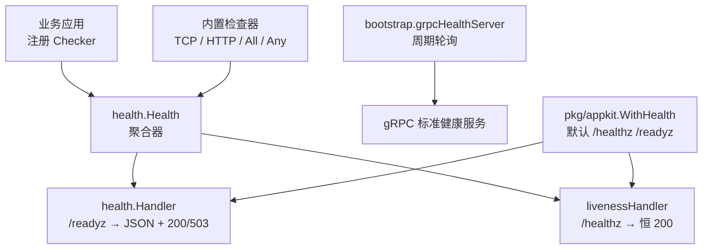
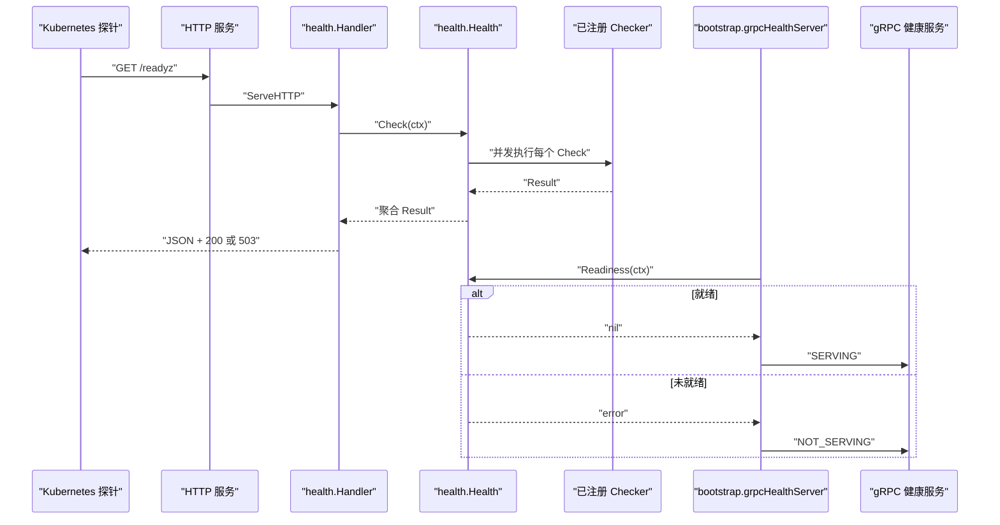
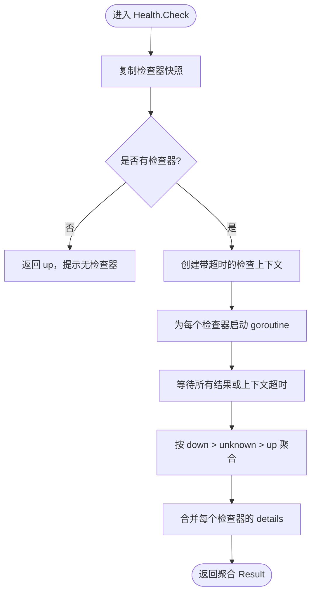
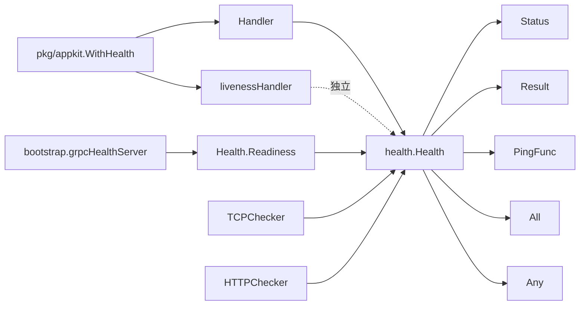

# 健康检查

<cite>
**本文引用的文件**   
- [health.go](file://health/health.go)
- [checkers.go](file://health/checkers.go)
- [handler.go](file://health/handler.go)
- [readiness.go](file://health/readiness.go)
- [http_helper.go](file://health/http_helper.go)
- [bootstrap_health.go](file://bootstrap/health.go)
- [appkit_health.go](file://pkg/appkit/health.go)
- [Bald 健康检查设计.md](file://docs/devel/zh-CN/Bald 健康检查设计.md)
- [Bald 健康检查.md](file://docs/guide/zh-CN/Bald 健康检查.md)
</cite>

## 目录

1. [引言](#引言)
2. [项目结构](#项目结构)
3. [核心组件](#核心组件)
4. [架构总览](#架构总览)
5. [详细组件分析](#详细组件分析)
6. [依赖关系分析](#依赖关系分析)
7. [性能与超时特性](#性能与超时特性)
8. [Kubernetes 探针配置指南](#kubernetes-探针配置指南)
9. [自定义检查器实现指南](#自定义检查器实现指南)
10. [数据库与外部服务依赖检查示例](#数据库与外部服务依赖检查示例)
11. [最佳实践](#最佳实践)
12. [常见问题排查](#常见问题排查)
13. [结论](#结论)

## 引言

本仓库的 `health` 模块提供一套三态健康检查抽象：一个 `Checker` 接口、一个并发聚合器 `Health`，以及两个面向编排系统的 HTTP 出口——就绪探针 `/readyz` 与存活探针 `/healthz`。它的设计目标是让 Kubernetes、负载均衡器和调度系统能区分「进程是否还活着」和「服务是否还能接流量」。

- **就绪检查（Readiness）**：判断服务能否对外提供服务；任一依赖失败时返回 `503`，摘除流量。
- **存活检查（Liveness）**：只判断进程是否仍响应 HTTP；始终返回 `200`，不检查外部依赖。
- **gRPC 标准健康状态**：`bootstrap` 层周期轮询 `health.Health`，把就绪结果推送到 gRPC 标准健康服务，使 K8s gRPC 探针与 HTTP `/readyz` 同源。

该模块是独立 Go module，零第三方依赖，HTTP handler 实现为原生 `net/http` 类型，可被任意 Web 框架适配或直接挂载。

## 项目结构

健康检查相关代码集中在 `health` 包中，装配与集成分别由 `bootstrap` 和 `pkg/appkit` 承担：



**图示来源**
- [health.go:1-227](file://health/health.go#L1-L227)
- [handler.go:1-84](file://health/handler.go#L1-L84)
- [bootstrap_health.go:1-101](file://bootstrap/health.go#L1-L101)
- [appkit_health.go:1-80](file://pkg/appkit/health.go#L1-L80)
- [checkers.go:1-181](file://health/checkers.go#L1-L181)

**章节来源**
- [health.go:1-40](file://health/health.go#L1-L40)
- [handler.go:1-20](file://health/handler.go#L1-L20)
- [appkit_health.go:1-20](file://pkg/appkit/health.go#L1-L20)

## 核心组件

| 概念 | 职责 | 关键行为 |
|---|---|---|
| `Status` | 健康状态枚举 | `unknown`、`up`、`down`；零值为 `unknown` |
| `Result` | 单次检查结果 | 包含状态、人类可读消息、可扩展详情字段 |
| `Checker` | 健康检查统一接口 | `Check(ctx)` 返回 `Result` |
| `PingFunc` | 函数型检查器 | `nil` 错误对应 `up`，非空错误对应 `down` |
| `Health` | 命名检查器聚合器 | 并发执行、全局超时、按传染性聚合 |
| `All` / `Any` | 组合检查器 | 全通过或任一通过，用于单名字下子检查聚合 |
| `Handler` | readiness HTTP 端点 | `down` 返回 `503`，其他返回 `200` |
| `livenessHandler` | liveness HTTP 端点 | 恒返回 `200` |
| `grpcHealthServer` | gRPC 就绪同步 | 周期调用 `Readiness` 并更新 gRPC 整体服务状态 |

**章节来源**
- [health.go:41-120](file://health/health.go#L41-L120)
- [checkers.go:1-40](file://health/checkers.go#L1-L40)
- [handler.go:1-30](file://health/handler.go#L1-L30)
- [bootstrap_health.go:1-40](file://bootstrap/health.go#L1-L40)

## 架构总览

健康检查的数据流从业务侧注册检查器开始，经过聚合器计算，最终暴露给 HTTP 探针、gRPC 探针和业务内部逻辑。



**图示来源**
- [handler.go:21-84](file://health/handler.go#L21-L84)
- [health.go:121-227](file://health/health.go#L121-L227)
- [readiness.go:1-42](file://health/readiness.go#L1-L42)
- [bootstrap_health.go:41-101](file://bootstrap/health.go#L41-L101)

## 详细组件分析

### 健康状态与结果模型

`Status` 是三态状态机的基础：

| 值 | 含义 | 对就绪的影响 |
|---|---|---|
| `StatusUnknown` | 尚未检查或检查结果不确定 | 宁可乐观，HTTP 仍返回 `200` |
| `StatusUp` | 组件正常 | 若全部为 `up`，整体为 `up` |
| `StatusDown` | 组件不可用 | 任一 `down` 使整体为 `down` |

`Result` 是单次检查的结果载体：

| 字段 | 类型 | 说明 |
|---|---|---|
| `status` | 字符串 | `up`、`down`、`unknown` |
| `message` | 可选字符串 | 错误描述或诊断信息 |
| `details` | 可选键值映射 | 扩展信息，如连接池水位、下游状态等 |

**章节来源**
- [health.go:41-90](file://health/health.go#L41-L90)

### 检查器接口与函数适配器

`Checker` 是健康检查的统一抽象，所有内置检查器、组合检查器和用户自定义检查器都实现该方法。它的优势是把 TCP 拨号、HTTP 请求、数据库 ping、缓存连通性、队列连通性等异构依赖收敛到同一个调用点。

`PingFunc` 是对常见 `Ping(ctx) error` 形态的零成本适配：

- 返回 `nil` 表示 `up`
- 返回非空错误表示 `down`
- 自身为 `nil` 函数时返回 `unknown`

这种设计让 `*sql.DB.PingContext`、Redis client 的 ping 方法等直接注册，无需额外包装。

**章节来源**
- [health.go:91-120](file://health/health.go#L91-L120)

### 聚合器与健康检查执行模型

`Health` 管理一组命名检查器，并提供以下能力：

- `Register(name, checker)`：注册或替换命名检查器
- `Deregister(name)`：移除检查器
- `Names()`：列出已注册检查器名称
- `Check(ctx)`：并发执行所有检查器并聚合结果
- `WithTimeout(d)`：设置全局检查超时，默认 `5` 秒
- `Readiness(ctx)`：适配为 error 语义，供 gRPC 健康同步或其他启动门禁使用

#### 聚合规则

聚合顺序具有传染性：

1. 任一 `down` → 整体 `down`
2. 否则任一 `unknown` → 整体 `unknown`
3. 全部 `up` → 整体 `up`
4. 没有注册检查器 → 整体 `up`

#### 并发与超时

每次 `Check` 的执行流程如下：



**图示来源**
- [health.go:121-227](file://health/health.go#L121-L227)

关键点：

- 注册表读操作持读锁，执行检查器前释放锁，避免阻塞长耗时检查。
- 每个检查器在独立 goroutine 中运行。
- 每个检查器受 `WithTimeout` 创建的上下文约束。
- 即使检查器忽略上下文，外层 `select` 也会兜底超时，并把该检查器标记为 `down`。
- 这是安全边界，不是“检查器一定被取消”的保证——无视上下文的检查器可能继续运行直到自然结束。

**章节来源**
- [health.go:121-227](file://health/health.go#L121-L227)

### HTTP 就绪端点

`Handler` 把 `Health.Check` 的结果映射到 HTTP 响应：

| 聚合状态 | HTTP 状态码 | 是否摘流量 |
|---|---:|---:|
| `up` | `200 OK` | 否 |
| `unknown` | `200 OK` | 否 |
| `down` | `503 Service Unavailable` | 是 |

响应体是 JSON，包含整体状态、可选消息和每个检查器的明细：

```json
{
  "status": "down",
  "message": "...",
  "checks": {
    "mysql": {
      "status": "down",
      "message": "connection refused"
    },
    "redis": {
      "status": "up"
    }
  }
}
```

Content-Type 固定为 `application/json; charset=utf-8`。

**章节来源**
- [handler.go:21-60](file://health/handler.go#L21-L60)

### HTTP 存活端点

`livenessHandler` 是独立的轻量 handler，不持有 `Health`，也不检查任何依赖。只要 HTTP 服务器能响应请求，就返回 `200` 和简单 JSON。

这符合健康检查的核心原则：**存活检查不应检查外部依赖**。因为重启进程无法修复数据库断连、Redis 不可用或下游服务故障，反而可能造成重启风暴。

**章节来源**
- [handler.go:61-84](file://health/handler.go#L61-L84)

### gRPC 健康状态同步

`bootstrap` 中的 `grpcHealthServer` 在 gRPC 服务之上叠加就绪状态推送：

- 默认每 `2` 秒轮询一次 `health.Health.Readiness`
- 首次启动立即同步一次，尽快暴露未就绪状态
- 若 `Readiness` 返回错误，将 gRPC 整体服务设置为 `NOT_SERVING`
- 否则设置为 `SERVING`
- 停止时先取消轮询 goroutine，再优雅关闭 gRPC 服务

这使得 K8s 的 gRPC 探针与 HTTP `/readyz` 基于同一份健康数据，避免 HTTP 就绪但 gRPC 未就绪、或反之的情况。

**章节来源**
- [bootstrap_health.go:1-101](file://bootstrap/health.go#L1-L101)
- [readiness.go:1-42](file://health/readiness.go#L1-L42)

### AppKit 装配层

`pkg/appkit` 的健康装配提供两条路径：

1. `WithHealth(h, ...Option)`：声明式装配默认 `/healthz` 和 `/readyz`，并把 gRPC 健康轮询间隔纳入配置。
2. `WithProbes(business, h, live, ready)`：手工装配场景复用，在业务 handler 外层包裹探针 mux。

默认路径常量：

| 探针 | 默认路径 | 行为 |
|---|---|---|
| 存活 | `/healthz` | 恒 `200` |
| 就绪 | `/readyz` | 依赖检查，`down` 返回 `503` |

**章节来源**
- [appkit_health.go:1-80](file://pkg/appkit/health.go#L1-L80)

## 依赖关系分析



**图示来源**
- [health.go:41-227](file://health/health.go#L41-L227)
- [checkers.go:1-181](file://health/checkers.go#L1-L181)
- [handler.go:1-84](file://health/handler.go#L1-L84)
- [readiness.go:1-42](file://health/readiness.go#L1-L42)
- [bootstrap_health.go:1-101](file://bootstrap/health.go#L1-L101)
- [appkit_health.go:1-80](file://pkg/appkit/health.go#L1-L80)

注意：根模块不得依赖具体适配器，而 `health` 模块本身仅依赖标准库，不包含任何后端适配器。其依赖方向是单向的：业务装配层引入 `health`，而不是反过来。

**章节来源**
- [health.go:1-20](file://health/health.go#L1-L20)
- [checkers.go:1-20](file://health/checkers.go#L1-L20)

## 性能与超时特性

### 并发执行

`Health.Check` 会为每个检查器启动 goroutine，因此多个依赖的检查可以并行进行。这对同时检查数据库、缓存、消息队列的场景很有意义，总延迟接近最慢的那个检查器，而不是各检查器耗时之和。

### 双层超时

| 超时层 | 位置 | 作用 |
|---|---|---|
| `Health.WithTimeout` | 聚合器 | 限制整次健康检查的全局时间 |
| 单个检查器内部超时 | 如 `TCPChecker`、`HTTPChecker` | 限制目标连接或请求时间 |
| K8s `timeoutSeconds` | 探针侧 | 探针自身超时阈值 |

建议关系：

```
Health.WithTimeout < K8s.timeoutSeconds
```

例如：

- 健康检查全局超时：`2~3` 秒
- K8s 就绪超时：`3~5` 秒
- K8s 检查间隔：`5~10` 秒
- K8s 初始延迟：覆盖应用启动阶段

### HTTP 客户端上限

`HTTPChecker` 使用的默认 HTTP 客户端超时为 `5` 秒。这意味着即使构造 `HTTP(url, timeout)` 时传入更大的超时，实际请求也不会超过默认客户端的 `5` 秒上限。当前默认客户端未导出注入 API，因此 `HTTPChecker` 的单请求超时只能缩短不能放大。

**章节来源**
- [health.go:121-227](file://health/health.go#L121-L227)
- [http_helper.go:1-28](file://health/http_helper.go#L1-L28)
- [checkers.go:41-120](file://health/checkers.go#L41-L120)

## Kubernetes 探针配置指南

### 就绪探针

就绪探针应指向 `/readyz`，并挂载 `health.NewHandler(h)`。当任一依赖失败时返回 `503`，Kubernetes 会摘除 Pod 流量。

推荐配置要点：

| 字段 | 建议值 | 说明 |
|---|---:|---|
| `path` | `/readyz` | 健康检查 JSON 端点 |
| `port` | 服务监听端口 | 通常为业务 HTTP 端口 |
| `initialDelaySeconds` | `10~30` | 覆盖应用启动阶段 |
| `periodSeconds` | `5~10` | 检查频率不宜过高 |
| `timeoutSeconds` | `3~5` | 必须大于 `Health.WithTimeout` |
| `failureThreshold` | `3~5` | 连续失败后摘除流量 |
| `successThreshold` | `1` | 恢复后立刻重新接入 |

### 存活探针

存活探针应指向 `/healthz`，并挂载 `health.NewLivenessHandler()`。它不检查数据库、缓存或下游服务，只确认进程仍在响应 HTTP。

推荐配置要点：

| 字段 | 建议值 | 说明 |
|---|---:|---|
| `path` | `/healthz` | 恒 `200` |
| `port` | 服务监听端口 | 通常为业务 HTTP 端口 |
| `initialDelaySeconds` | `5~15` | 短于就绪探针即可 |
| `periodSeconds` | `10~30` | 存活检查可更保守 |
| `timeoutSeconds` | `1~3` | 存活检查要快 |
| `failureThreshold` | `3` | 进程真正挂掉才重启 |

### 调优建议

1. **就绪检查应比存活检查更严格**：就绪失败摘流量，存活失败重启进程。
2. **不要对存活检查加入数据库或外部依赖**：外部依赖故障不适合用重启解决。
3. **K8s `timeoutSeconds` 要大于健康检查全局超时**：否则探针先到期，Pod 可能被误摘。
4. **初始延迟要覆盖初始化阶段**：包括数据库连接、配置加载、缓存预热、订阅者启动等。
5. **失败阈值不宜过小**：网络抖动可能导致瞬时失败，频繁摘流量会放大级联影响。
6. **成功阈值设为 `1`**：依赖恢复后应尽快重新接收流量。

**章节来源**
- [handler.go:21-84](file://health/handler.go#L21-L84)
- [appkit_health.go:1-80](file://pkg/appkit/health.go#L1-L80)
- [Bald 健康检查.md:1-60](file://docs/guide/zh-CN/Bald 健康检查.md#L1-L60)

## 自定义检查器实现指南

### 何时需要自定义检查器

以下情况建议使用自定义 `Checker`，而不是 `PingFunc`：

- 需要返回 `unknown` 状态，表达“检查未执行”或“结果不确定”。
- 需要附带结构化 `details`，例如连接池使用率、队列积压量、下游服务版本等。
- 现有依赖方法签名不是 `Ping(ctx) error`。
- 需要组合多个子检查并在单一名字下输出诊断信息。

### 自定义检查器基本模式

实现 `Checker` 接口，即提供一个 `Check(ctx context.Context) health.Result` 方法。典型返回形式：

- 成功：`Status: up`，可附带 `Details`。
- 失败：`Status: down`，附带 `Message`。
- 不确定：`Status: unknown`，解释为什么无法判断。

### 组合检查器

仓库提供了两种组合策略：

| 组合器 | 语义 | 适用场景 |
|---|---|---|
| `AllCheckers` | 全部通过才算 `up` | 同名字下的多项依赖，如 storage = DB + Redis |
| `AnyCheckers` | 任一通过就算 `up` | 多副本高可用，如 redis-1 或 redis-2 有一个可达 |

`AllCheckers` 支持短路：遇到第一个 `down` 立即返回，不再执行后续子检查。

**章节来源**
- [checkers.go:41-181](file://health/checkers.go#L41-L181)
- [health.go:91-120](file://health/health.go#L91-L120)

## 数据库与外部服务依赖检查示例

### 数据库连接检查

对于已有 `PingContext(ctx) error` 的数据库驱动，可直接使用 `PingFunc` 零适配：

- 成功：连接可用
- 失败：连接不可用或查询失败
- 适合：MySQL、PostgreSQL、GORM 封装等

如果希望暴露连接池水位，则应实现自定义 `Checker`，并在 `Details` 中写入打开连接数、使用中连接数等指标。

**章节来源**
- [health.go:91-120](file://health/health.go#L91-L120)

### 缓存连接检查

Redis、Memcached 等缓存通常可通过 ping 或简单命令验证连通性：

- 已有 `Ping(ctx) error`：使用 `PingFunc`。
- 只有底层连接对象：闭包调用其 ping 方法并返回 error。
- 需要多实例高可用：使用 `AnyCheckers`，任一实例可达即可。

**章节来源**
- [checkers.go:121-181](file://health/checkers.go#L121-L181)
- [Bald 健康检查.md:60-140](file://docs/guide/zh-CN/Bald 健康检查.md#L60-L140)

### 消息队列依赖检查

对于 Kafka、RabbitMQ、RocketMQ、Redis pub/sub 等中间件，健康检查通常分为两层：

1. **TCP 层**：`TCPChecker` 检查端口可达。
2. **协议层**：自定义 `Checker` 执行最小认证、topic 列表、消费者组或生产者通道校验。

生产环境建议至少做协议层检查，因为端口可达不等于认证通过、主题存在或消费者可消费。

**章节来源**
- [checkers.go:1-40](file://health/checkers.go#L1-L40)

### 外部服务依赖检查

`HTTPChecker` 通过发送 GET 请求探测下游服务的健康端点：

- URL 为目标服务的健康端点
- 默认 User-Agent 为 `bald-health-checker`
- 状态码 `2xx` 至 `3xx` 视为健康
- `4xx` 或 `5xx` 视为 `down`
- 默认客户端超时上限为 `5` 秒

**章节来源**
- [checkers.go:81-120](file://health/checkers.go#L81-L120)
- [http_helper.go:1-28](file://health/http_helper.go#L1-L28)

### 内部组件状态检查

内部组件如调度器、工作协程、事件处理器、订阅者等，可以通过自定义 `Checker` 暴露：

- 是否已启动
- 是否处于空闲或过载状态
- 是否有致命错误
- 是否有长时间未推进的任务

这类检查适合放在就绪检查中，不适合放入存活检查。

**章节来源**
- [health.go:91-120](file://health/health.go#L91-L120)

## 最佳实践

1. **区分就绪与存活**：就绪检查负责摘流量，存活检查只负责确认进程存活。
2. **就绪检查要诚实但不激进**：`unknown` 返回 `200`，避免启动竞态或检查器 bug 导致误摘流量。
3. **对外部依赖设置合理超时**：不要让健康检查被慢依赖拖垮。
4. **优先使用 `PingFunc`**：大多数依赖已有 ping 方法，零适配成本最低。
5. **需要细节时实现自定义 `Checker`**：连接池水位、队列积压、下游版本等信息有助于排障。
6. **多副本依赖使用 `AnyCheckers`**：一个副本失败不算整体故障。
7. **同名字下多项依赖使用 `AllCheckers`**：把 storage、cache、queue 等逻辑分组。
8. **不要把健康检查写成缓存查询**：每次探针都应实时执行，避免陈旧状态。
9. **gRPC 服务启用健康状态同步**：让 K8s gRPC 探针与 HTTP `/readyz` 同源。
10. **不要在健康检查中执行写操作**：健康检查应是只读、幂等、快速的操作。

**章节来源**
- [Bald 健康检查设计.md:1-120](file://docs/devel/zh-CN/Bald 健康检查设计.md#L1-L120)
- [Bald 健康检查.md:60-200](file://docs/guide/zh-CN/Bald 健康检查.md#L60-L200)

## 常见问题排查

### 就绪检查一直返回 `503`

排查步骤：

1. 访问 `/readyz`，查看 JSON 响应中的 `checks` 字段。
2. 定位具体失败的检查器名称。
3. 检查该依赖的网络连通性、认证配置、服务地址。
4. 如果是数据库，确认连接池是否耗尽。
5. 如果是消息队列，确认 topic、消费者组、权限是否正常。
6. 如果是自定义检查器，检查是否意外返回了 `down` 或 panic。

**章节来源**
- [handler.go:21-60](file://health/handler.go#L21-L60)

### 存活检查突然失败

由于 `livenessHandler` 恒返回 `200`，若 `/healthz` 失败，通常不是健康检查逻辑问题，而是：

- HTTP 服务未启动
- 路由未被挂载
- 反向代理或 Ingress 配置错误
- 端口冲突或服务崩溃

**章节来源**
- [handler.go:61-84](file://health/handler.go#L61-L84)

### 健康检查超时

可能原因：

1. `Health.WithTimeout` 设置过短。
2. 某个检查器内部耗时过长。
3. 外部依赖响应缓慢。
4. K8s `timeoutSeconds` 小于健康检查全局超时。
5. 自定义检查器忽略了上下文，触发了聚合器外层超时兜底。

建议先增大 `WithTimeout`，再优化具体检查器，最后调整 K8s `timeoutSeconds`。

**章节来源**
- [health.go:121-227](file://health/health.go#L121-L227)

### HTTP 检查器超时不到预期

`HTTPChecker` 的超时受两个因素限制：

- 构造时传入的 `timeout`
- 默认 HTTP 客户端的 `5` 秒超时

当前默认客户端不可注入，因此传入更大超时不会生效。若下游健康端点响应超过 `5` 秒，应先优化下游，而不是试图扩大超时。

**章节来源**
- [checkers.go:81-120](file://health/checkers.go#L81-L120)
- [http_helper.go:1-28](file://health/http_helper.go#L1-L28)

### gRPC 探针与 HTTP 就绪不一致

检查 `bootstrap` 是否正确装配 gRPC 健康服务，以及轮询间隔是否合理。默认间隔为 `2` 秒，若刚启动或刚恢复，可能存在短暂不一致窗口。

**章节来源**
- [bootstrap_health.go:1-101](file://bootstrap/health.go#L1-L101)

### 自定义检查器没有出现在响应中

确认：

- 检查器已通过 `Register` 注册。
- 名称没有重复覆盖。
- 没有在运行时意外 `Deregister`。
- 检查器没有 panic。

**章节来源**
- [health.go:121-227](file://health/health.go#L121-L227)

## 结论

`health` 模块以极简接口实现了完整的健康检查体系：三态状态、并发聚合、双 HTTP 探针、gRPC 健康同步、内置 TCP/HTTP 检查器以及组合检查器。它的关键价值在于把「进程存活」和「服务就绪」拆成两个明确问题，避免把外部依赖故障转嫁给进程重启。

实际落地时，应遵循以下原则：

- 用 `/healthz` 做存活检查，只确认进程响应。
- 用 `/readyz` 做就绪检查，覆盖数据库、缓存、消息队列、下游服务和内部组件。
- 用 `PingFunc` 覆盖已有 ping 方法。
- 用 `TCPChecker` 检查 TCP 依赖。
- 用 `HTTPChecker` 检查下游健康端点。
- 用 `AllCheckers` 和 `AnyCheckers` 表达命名粒度内的 AND/OR 逻辑。
- 用自定义 `Checker` 表达 `unknown` 状态和结构化诊断信息。
- 让 `bootstrap` 或 `appkit` 装配 gRPC 健康状态，保持多探针同源。