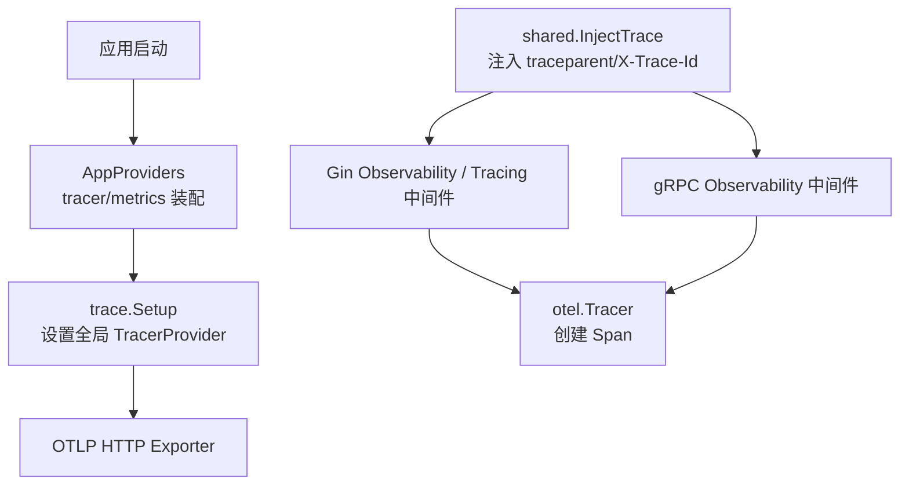
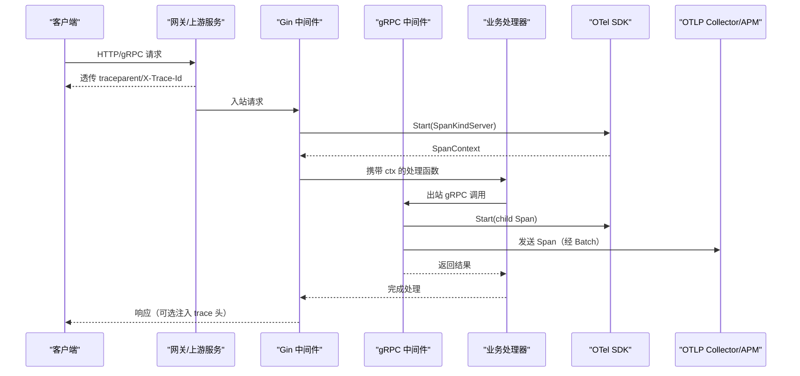
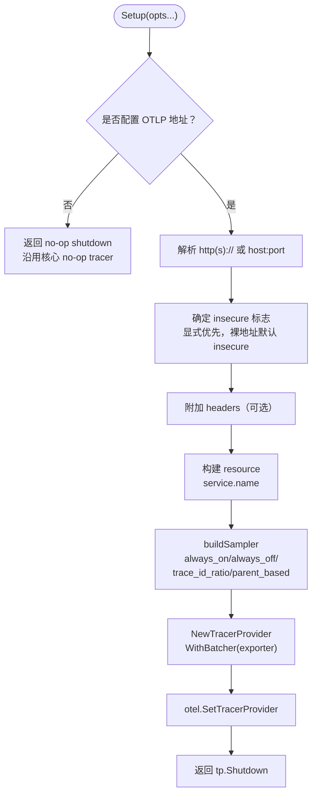
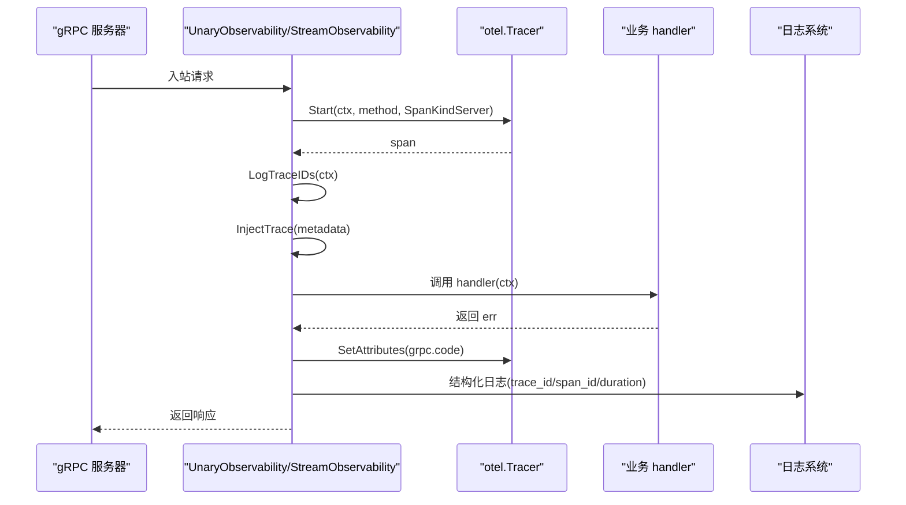
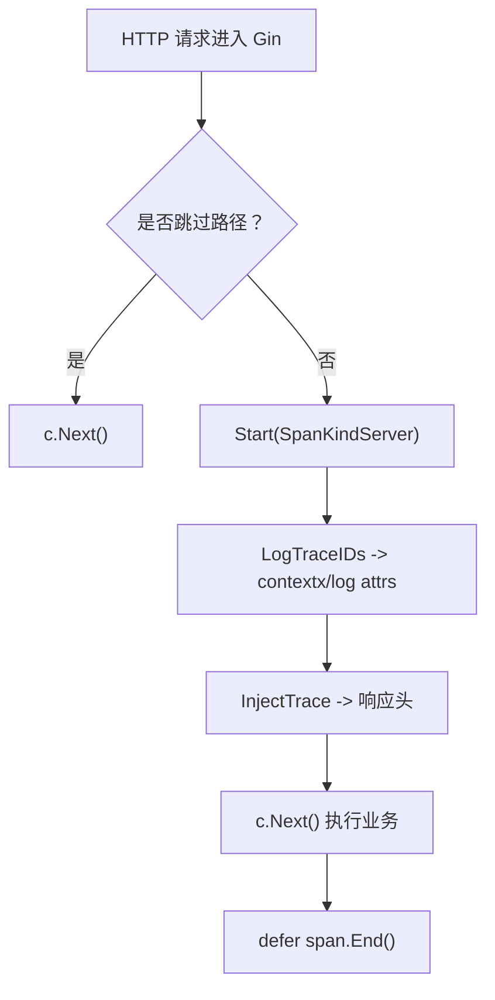
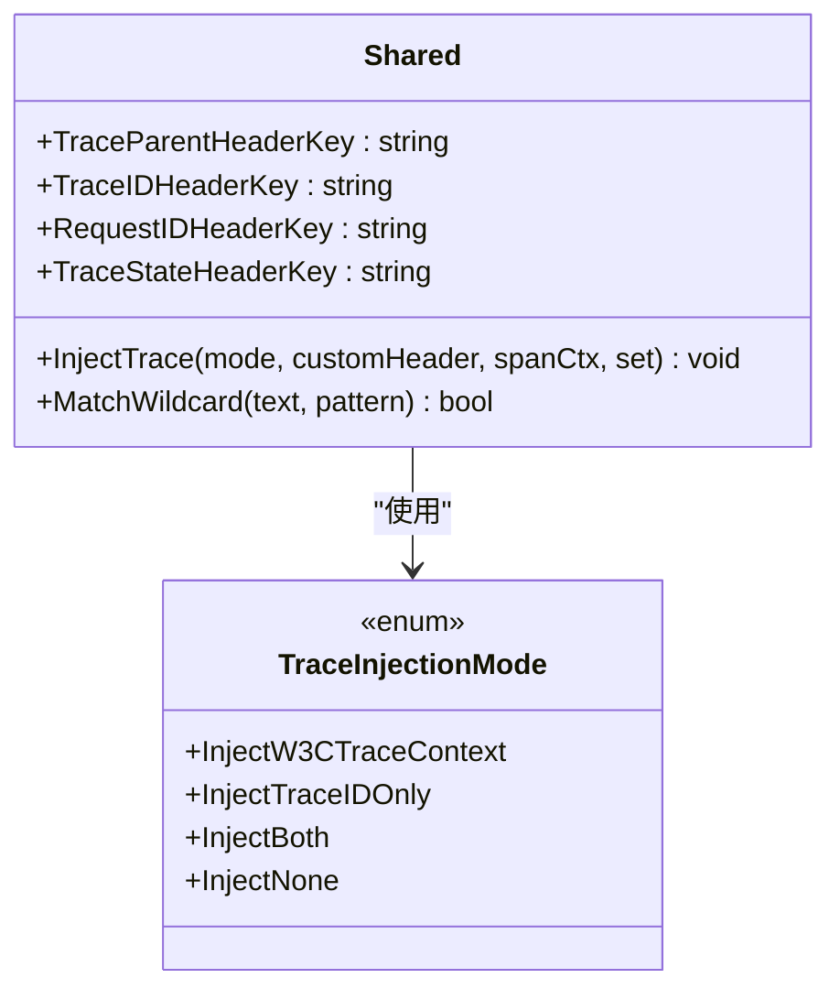
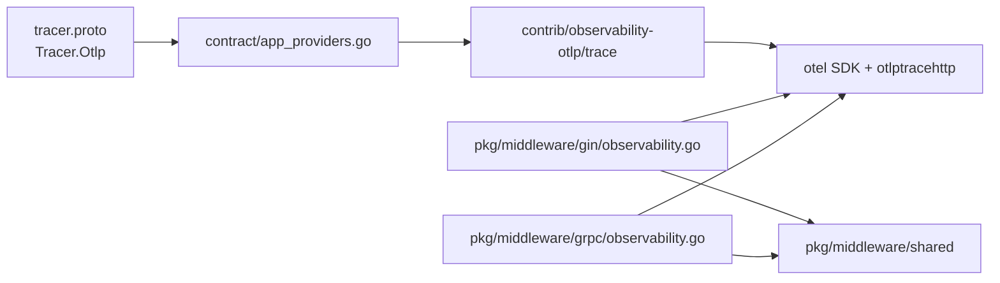

# 分布式追踪

<cite>
**本文引用的文件**   
- [trace.go](file://contrib/observability-otlp/trace/trace.go)
- [metrics.go（指标桥接）](file://contrib/observability-otlp/metrics/metrics.go)
- [app_providers.go](file://contrib/observability-otlp/contract/app_providers.go)
- [tracing.go（中间件共享）](file://pkg/middleware/tracing.go)
- [tracing.go（Gin）](file://pkg/middleware/gin/tracing.go)
- [observability.go（Gin）](file://pkg/middleware/gin/observability.go)
- [observability.go（gRPC）](file://pkg/middleware/grpc/observability.go)
- [shared.go](file://pkg/middleware/shared/shared.go)
- [tracer.proto](file://bconf/proto/bootstrap/v1/tracer.proto)
- [server.proto](file://bconf/proto/bootstrap/v1/server.proto)
</cite>

## 目录
1. [简介](#简介)
2. [项目结构](#项目结构)
3. [核心组件](#核心组件)
4. [架构总览](#架构总览)
5. [详细组件分析](#详细组件分析)
6. [依赖关系分析](#依赖关系分析)
7. [性能与采样](#性能与采样)
8. [故障诊断与实用技巧](#故障诊断与实用技巧)
9. [结论](#结论)
10. [附录：配置速查](#附录配置速查)

## 简介
本仓库的分布式追踪以 OpenTelemetry 为核心，采用“核心零后端耦合、调用方接线”的设计：框架在 Gin HTTP 与 gRPC 拦截器中统一创建 Span、注入 trace 上下文，并把 `trace_id`/`span_id` 写入日志；是否真正采样并导出，取决于是否设置了全局 `TracerProvider`。远端 APM 通过 OTLP HTTP exporter 直推，不引入 Jaeger SDK、Zipkin SDK 等特定后端。

关键点：
- 链路追踪：Gin 与 gRPC 中间件均起 `SpanKindServer` Span，上游已有 Span 则作为子 Span。
- 上下文传播：W3C `traceparent`、`X-Trace-Id`、`X-Request-Id`、`tracestate` 等头由 shared 层统一计算与注入。
- 远端导出：`contrib/observability-otlp/trace` 包将全局 TracerProvider 挂到 OTLP HTTP exporter；未配置地址时沿用 no-op tracer，零配置可运行。
- 配置契约：`bconf/proto/bootstrap/v1/tracer.proto` 定义 `Tracer` 段，包含 OTLP endpoint、insecure、headers、sampler、sample_ratio。

## 项目结构
与分布式追踪直接相关的代码集中在以下位置：
- `contrib/observability-otlp/trace`：OTLP trace 初始化、采样器构造、资源属性设置。
- `contrib/observability-otlp/contract`：基于 appkit Provider 的 tracer/metrics 装配节点。
- `pkg/middleware/{gin,grpc}/observability.go`：HTTP/gRPC 观测中间件（日志 + 追踪）。
- `pkg/middleware/gin/tracing.go`：仅追踪、不写请求日志的 Gin 中间件。
- `pkg/middleware/tracing.go`：日志关联用的 `LogTraceIDs`，no-op 下兜底随机 ID。
- `pkg/middleware/shared/shared.go`：跨协议统一的 trace header 常量、注入模式与通配匹配。
- `bconf/proto/bootstrap/v1/tracer.proto`：Tracer 配置消息。
- `bconf/proto/bootstrap/v1/server.proto`：HTTP/gRPC server 中间件声明（含 tracing 空段）。

**图表来源**
- [app_providers.go:1-117](file://contrib/observability-otlp/contract/app_providers.go#L1-L117)
- [trace.go:1-136](file://contrib/observability-otlp/trace/trace.go#L1-L136)
- [observability.go（Gin）:1-200](file://pkg/middleware/gin/observability.go#L1-L200)
- [observability.go（gRPC）:1-200](file://pkg/middleware/grpc/observability.go#L1-L200)
- [shared.go:1-104](file://pkg/middleware/shared/shared.go#L1-L104)

**章节来源**
- [tracer.proto:1-32](file://bconf/proto/bootstrap/v1/tracer.proto#L1-L32)
- [server.proto:1-200](file://bconf/proto/bootstrap/v1/server.proto#L1-L200)

## 核心组件
- **OTLP Trace 初始化器**：`contrib/observability-otlp/trace` 提供 `Setup`，按 option 设置 endpoint、insecure、headers、service name、sampler、sample ratio，最终调用 `otel.SetTracerProvider`。
- **gRPC 观测中间件**：`pkg/middleware/grpc/observability.go` 的 `UnaryObservability`/`StreamObservability` 创建服务端 Span，注入 trace metadata，记录状态码属性，并输出结构化日志。
- **Gin 观测中间件**：`pkg/middleware/gin/observability.go` 的 `Observability` 做相同职责，同时支持跳过路径、捕获请求/响应体（debug 级别）、注入 trace 响应头。
- **仅追踪 Gin 中间件**：`pkg/middleware/gin/tracing.go` 的 `Tracing` 只起 Span、写 trace 关联字段，不写请求日志。
- **日志链路 ID 工具**：`pkg/middleware/tracing.go` 的 `LogTraceIDs` 在无真实 tracer 时生成随机 ID，保证日志仍可关联。
- **跨协议共享逻辑**：`pkg/middleware/shared/shared.go` 收敛 trace header key、注入模式、通配匹配。

**章节来源**
- [trace.go:1-136](file://contrib/observability-otlp/trace/trace.go#L1-L136)
- [observability.go（gRPC）:1-325](file://pkg/middleware/grpc/observability.go#L1-L325)
- [observability.go（Gin）:1-200](file://pkg/middleware/gin/observability.go#L1-L200)
- [tracing.go（Gin）:1-43](file://pkg/middleware/gin/tracing.go#L1-L43)
- [tracing.go（中间件共享）:1-35](file://pkg/middleware/tracing.go#L1-L35)
- [shared.go:1-104](file://pkg/middleware/shared/shared.go#L1-L104)

## 架构总览
OpenTelemetry 集成分为三层：

1. **协议中间件层**：Gin 与 gRPC 拦截器负责“建 Span、传上下文、写日志”。
2. **SDK 与导出层**：`contrib/observability-otlp/trace` 负责把全局 `TracerProvider` 指向 OTLP HTTP exporter。
3. **配置装配层**：`contrib/observability-otlp/contract` 暴露 `AppProviders`，由应用通过 appkit 装配 tracer/metrics 段。

**图表来源**
- [observability.go（Gin）:1-200](file://pkg/middleware/gin/observability.go#L1-L200)
- [observability.go（gRPC）:1-200](file://pkg/middleware/grpc/observability.go#L1-L200)
- [trace.go:1-136](file://contrib/observability-otlp/trace/trace.go#L1-L136)

## 详细组件分析

### OTLP Trace 初始化与采样
`contrib/observability-otlp/trace` 包的 `Setup` 是分布式追踪的入口。其关键行为如下：
- 若未传入 OTLP 地址，返回 no-op shutdown，保持核心 no-op tracer 不变。
- 地址解析：以 `http://` 或 `https://` 前缀区分完整 EndpointURL 与裸 host:port。
- insecure 三态：显式 true/false 优先；未显式且为裸地址时默认 insecure。
- 支持 headers，用于远端鉴权（如 Bearer token）。
- 资源属性设置 service.name（默认 `bald-app`）。
- 采样器构造：
  - `always_on`：始终采样。
  - `always_off`：永不采样。
  - `trace_id_ratio`：按比率采样，非正值回退为 1.0。
  - `parent_based` 或空值：`ParentBased(AlwaysSample)`。
  - 未知值 WARN 并回退 parent_based。

**图表来源**
- [trace.go:1-136](file://contrib/observability-otlp/trace/trace.go#L1-L136)

**章节来源**
- [trace.go:1-136](file://contrib/observability-otlp/trace/trace.go#L1-L136)
- [tracer.proto:1-32](file://bconf/proto/bootstrap/v1/tracer.proto#L1-L32)

### gRPC 中间件追踪
`pkg/middleware/grpc/observability.go` 实现两个拦截器：
- `UnaryObservability`：对 unary 请求起 Span，记录 duration、status code 属性，注入 trace metadata，输出结构化日志。
- `StreamObservability`：对 stream 请求同样起 Span，并通过包装 `ServerStream` 传递 enriched context。

共同点：
- 使用 `otel.Tracer("bald/grpc")`，未设全局 TracerProvider 时为 no-op。
- 使用 `middleware.LogTraceIDs` 获取 trace_id/span_id，no-op 下兜底随机 ID。
- 使用 `contextx.WithTraceID` 把 trace_id 写入审计可用上下文。
- 使用 `log.ContextWithAttrs` 让 slog 自动附带 trace_id/span_id。
- 通过 `injectTraceMetadata` 调用 `shared.InjectTrace` 注入 traceparent/X-Trace-Id。
- 跳过方法列表支持通配，默认跳过 `/metrics`。

**图表来源**
- [observability.go（gRPC）:1-325](file://pkg/middleware/grpc/observability.go#L1-L325)
- [tracing.go（中间件共享）:1-35](file://pkg/middleware/tracing.go#L1-L35)
- [shared.go:1-104](file://pkg/middleware/shared/shared.go#L1-L104)

**章节来源**
- [observability.go（gRPC）:1-325](file://pkg/middleware/grpc/observability.go#L1-L325)

### Gin 中间件追踪
Gin 侧有两个相关中间件：

1. **`Observability`**：兼顾日志与追踪。起 Span，写 trace_id/span_id 到日志与审计上下文，注入响应 trace 头，支持跳过路径、捕获请求/响应体（需 debug 且未禁用 body log）。
2. **`Tracing`**：仅追踪，不写请求日志。适合只想追踪而不想重复打日志的场景。

两者都：
- 使用 `otel.Tracer("bald/gin")`。
- 使用 `middleware.LogTraceIDs` 获取日志关联 ID。
- 通过 `shared.InjectTrace` 注入 W3C traceparent 和 X-Trace-Id。
- 在未设置全局 TracerProvider 时走 no-op，不报错。

**图表来源**
- [observability.go（Gin）:1-200](file://pkg/middleware/gin/observability.go#L1-L200)
- [tracing.go（Gin）:1-43](file://pkg/middleware/gin/tracing.go#L1-L43)
- [shared.go:1-104](file://pkg/middleware/shared/shared.go#L1-L104)

**章节来源**
- [observability.go（Gin）:1-200](file://pkg/middleware/gin/observability.go#L1-L200)
- [tracing.go（Gin）:1-43](file://pkg/middleware/gin/tracing.go#L1-L43)

### 上下文传播与 Header 约定
`pkg/middleware/shared/shared.go` 定义了四种标准键：
- `traceparent`：W3C Trace Context。
- `X-Trace-Id`：简单 trace ID。
- `X-Request-Id`：通用请求 ID。
- `tracestate`：额外上下文。

`InjectTrace` 根据注入模式选择写出哪些头：
- `InjectW3CTraceContext`：只写 traceparent。
- `InjectTraceIDOnly`：只写 X-Trace-Id。
- `InjectBoth`：同时写 traceparent 与 X-Trace-Id。
- `InjectNone`：不注入。

当 SpanContext 无效（no-op tracer）时，不注入任何 trace 头，避免污染下游。

**图表来源**
- [shared.go:1-104](file://pkg/middleware/shared/shared.go#L1-L104)

**章节来源**
- [shared.go:1-104](file://pkg/middleware/shared/shared.go#L1-L104)

### 配置装配与生命周期
`contrib/observability-otlp/contract/app_providers.go` 暴露 `AppProviders(serviceName)`，同时注册 tracer 与 metrics 两个 appkit Node：
- tracer Node：PhaseBootstrap，PriorityTracer，TeardownAfter logger/metrics，EffectName `appkit:tracer-shutdown`。
- metrics Node：PhaseBootstrap，PriorityMetrics，TeardownAfter logger，EffectName `appkit:metrics-server`。

tracer Build 流程：
- 读取 Tracer 配置。
- 校验 type 必须为 otlp。
- 调用 `NewTracerProvider(serviceName)(ctx, tc)` 实际执行 trace.Setup。
- Cleanup 回调调用 shutdown 以 flush 缓冲。

**章节来源**
- [app_providers.go:1-117](file://contrib/observability-otlp/contract/app_providers.go#L1-L117)
- [tracer.proto:1-32](file://bconf/proto/bootstrap/v1/tracer.proto#L1-L32)

## 依赖关系分析
- `contrib/observability-otlp/trace` 依赖 OpenTelemetry SDK 与 OTLP HTTP exporter，不依赖具体 APM 后端（Jaeger/Zipkin 等由 Collector 或 APM 自身对接）。
- `pkg/middleware/{gin,grpc}` 依赖 `otel.Tracer`，但仅消费全局 TracerProvider，不直接 require exporter。
- `pkg/middleware/shared` 是纯工具包，被 gin/grpc 两侧复用。
- `bconf/proto` 定义 Tracer/Metrics 配置消息，由应用配置加载后传给 provider。

**图表来源**
- [tracer.proto:1-32](file://bconf/proto/bootstrap/v1/tracer.proto#L1-L32)
- [app_providers.go:1-117](file://contrib/observability-otlp/contract/app_providers.go#L1-L117)
- [trace.go:1-136](file://contrib/observability-otlp/trace/trace.go#L1-L136)
- [observability.go（Gin）:1-200](file://pkg/middleware/gin/observability.go#L1-L200)
- [observability.go（gRPC）:1-325](file://pkg/middleware/grpc/observability.go#L1-L325)
- [shared.go:1-104](file://pkg/middleware/shared/shared.go#L1-L104)

## 性能与采样
### 采样策略
trace.Setup 支持四种 sampler：
- `always_on`：全量采样，适合开发或小流量环境。
- `always_off`：关闭采样，生产高吞吐场景可临时关闭。
- `trace_id_ratio`：按比例采样，sample_ratio ∈ (0.0, 1.0]，非正值按 1.0。
- `parent_based`：默认策略，父级决定是否采样。

建议：
- 生产推荐 `trace_id_ratio`，根据 QPS 与存储成本调参。
- 故障排查时可临时切换 `always_on`，再切回 ratio。
- 对内部 RPC 也可结合 parent_based，避免子调用放大采样。

### 性能影响评估
- 中间件起 Span 与写属性是轻量操作；主要开销来自 OTLP 批量导出。
- `WithBatcher` 已启用批处理，降低网络与序列化压力。
- 日志带 trace_id/span_id 属常规 slog 属性，影响有限。
- Gin 请求/响应体捕获仅在 debug 且未禁用 body log 时生效，不应在生产开启。

### 存储优化建议
- 使用合理的 sample_ratio，避免全量导入。
- 配合 APM 端的聚合与保留策略（如只保留错误 Span、慢请求）。
- 对高频健康检查、指标端点使用 skip_paths/skip_methods 跳过追踪或日志。

**章节来源**
- [trace.go:1-136](file://contrib/observability-otlp/trace/trace.go#L1-L136)
- [observability.go（Gin）:1-200](file://pkg/middleware/gin/observability.go#L1-L200)
- [observability.go（gRPC）:1-325](file://pkg/middleware/grpc/observability.go#L1-L325)

## 故障诊断与实用技巧

### 无 APM 数据时的排查
1. 确认是否调用 `trace.Setup` 并传入有效 OTLP 地址。
2. 检查 endpoint 是否可达（HTTP collector/APM 端口）。
3. 确认 insecure 与 URL 前缀匹配：裸 host:port 默认 insecure；带 `http(s)://` 前缀按前缀推断。
4. 若远端需要鉴权，检查 headers 是否传入（如 Authorization）。
5. 确认 sampler 不是 `always_off`。
6. 在未配置 TracerProvider 时，中间件仍会起 no-op Span，日志中的 trace_id/span_id 为随机 ID，不会导出。

### 日志与链路不一致
- 如果未装配全局 TracerProvider，`LogTraceIDs` 返回随机 ID，日志有 ID 但无真实链路。
- 若 Gin/gRPC 中间件与日志 logger 不同实例，确保日志走 `log.GetLogger()` 或使用 WithLogger 注入同一 logger。
- 审计事件依赖 `contextx.WithTraceID`，若只写 slog attrs 而未写 contextx，审计 trace_id 可能为空。

### 慢查询定位
- 在 APM 中按 span duration 排序，找到耗时 Span。
- 利用 `grpc.code` 属性过滤错误 Span。
- 结合日志 trace_id 精确定位同一次请求。
- 对数据库/外部调用埋点时，尽量继承当前 Span，避免断链。

### 常见陷阱
- 忘记调用 trace.Setup：追踪零副作用，no-op tracer。
- 忘记 shutdown：进程退出时可能丢失最后一段 Span。
- sampler 写错名称：未知 sampler 会 WARN 并回退 parent_based(always_on)。
- Gin 同时挂载 Observability 与 Tracing：会产生嵌套 Span，通常二选一。
- 在 debug 级别开启 body log：可能泄露敏感信息并增加 IO。

**章节来源**
- [tracing.go（中间件共享）:1-35](file://pkg/middleware/tracing.go#L1-L35)
- [observability.go（Gin）:1-200](file://pkg/middleware/gin/observability.go#L1-L200)
- [observability.go（gRPC）:1-325](file://pkg/middleware/grpc/observability.go#L1-L325)
- [trace.go:1-136](file://contrib/observability-otlp/trace/trace.go#L1-L136)

## 结论
本仓库的分布式追踪以 OpenTelemetry 为中心，通过 Gin 与 gRPC 中间件统一创建 Span、传播上下文、注入 trace 头，并由 `contrib/observability-otlp/trace` 将全局 TracerProvider 接入 OTLP HTTP exporter。核心模块不耦合具体 APM 后端，便于对接 Jaeger、Zipkin、Grafana Cloud、VictoriaMetrics 等 OTLP 兼容后端。生产环境应合理配置采样率、skip 路径与方法，并配合 APM 端保留策略控制存储成本。

## 附录：配置速查

### Tracer 配置字段
| 字段 | 类型 | 说明 | 默认值 |
| --- | --- | --- | --- |
| type | enum | 追踪类型，目前仅支持 OTLP | unspecified |
| otlp.endpoint | string | OTLP Collector 端点 | 无 |
| otlp.insecure | bool | 是否使用 insecure 连接 | 由代码推断 |
| otlp.headers | map<string,string> | OTLP 请求头 | 空 |
| otlp.sampler | string | always_on / always_off / trace_id_ratio / parent_based | parent_based |
| otlp.sample_ratio | double | trace_id_ratio 采样比率 | 1.0（非正值） |

**章节来源**
- [tracer.proto:1-32](file://bconf/proto/bootstrap/v1/tracer.proto#L1-L32)

### Gin/gRPC 中间件常用选项
- Gin Observability：
  - `WithSkipPaths`：跳过日志与追踪的路径。
  - `WithSkipMetrics`：内置跳过健康/指标端点。
  - `DisableBodyLog`：禁止捕获请求/响应体。
  - `TraceInjectionMode`：控制注入 traceparent/X-Trace-Id。
- gRPC Observability：
  - `SkipMethods`：跳过日志的方法。
  - `DisableBodyLog`：禁止记录请求/响应。
  - `TraceInjectionMode`：控制注入 metadata。

**章节来源**
- [observability.go（Gin）:1-200](file://pkg/middleware/gin/observability.go#L1-L200)
- [observability.go（gRPC）:1-325](file://pkg/middleware/grpc/observability.go#L1-L325)
- [shared.go:1-104](file://pkg/middleware/shared/shared.go#L1-L104)