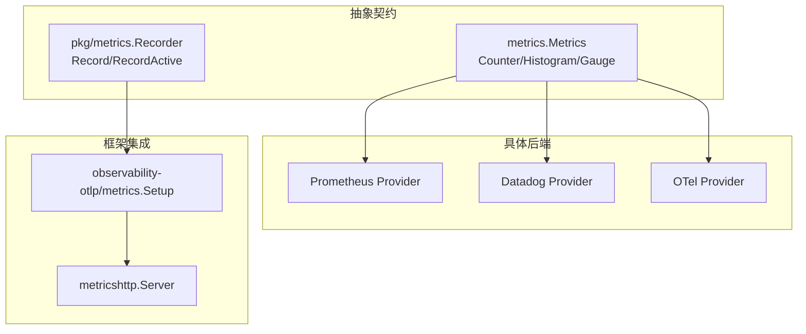
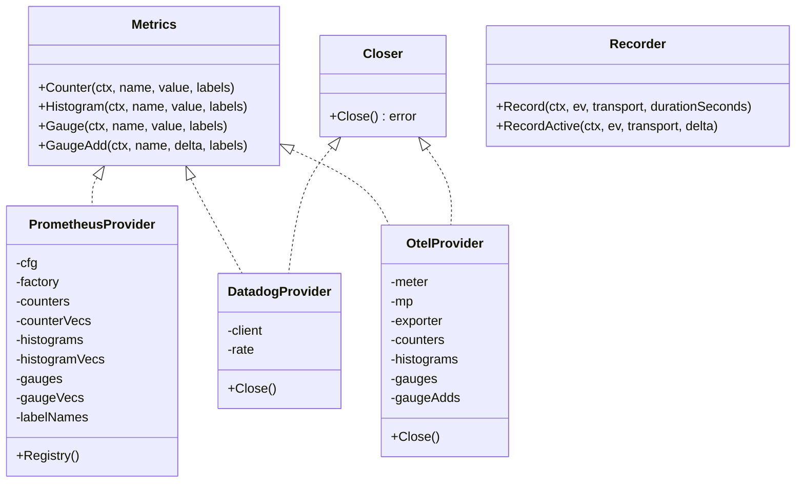
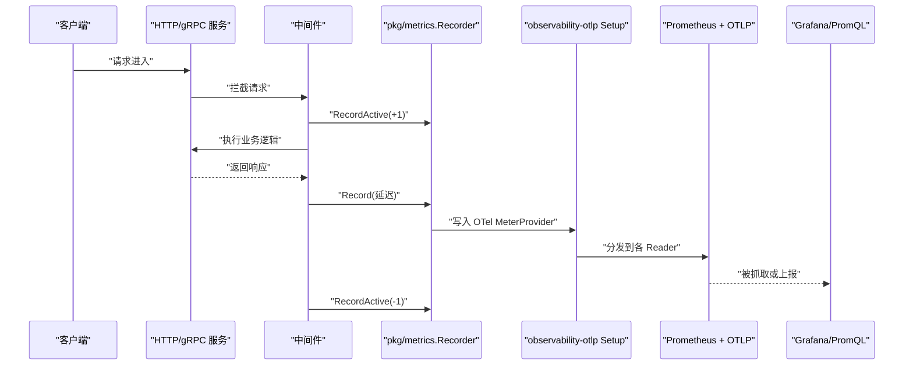
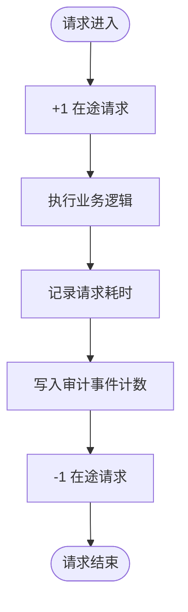
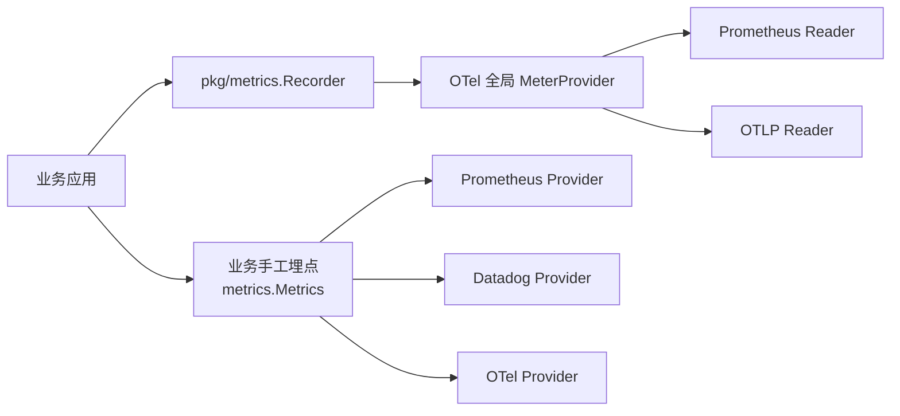

# 指标收集

<cite>
**本文引用的文件**   
- [metrics/metrics.go](file://metrics/metrics.go)
- [metrics/prometheus/prometheus.go](file://metrics/prometheus/prometheus.go)
- [metrics/datadog/datadog.go](file://metrics/datadog/datadog.go)
- [metrics/otel/otel.go](file://metrics/otel/otel.go)
- [pkg/metrics/metrics.go](file://pkg/metrics/metrics.go)
- [contrib/observability-otlp/metrics/metrics.go](file://contrib/observability-otlp/metrics/metrics.go)
- [observability/metricshttp/metricshttp.go](file://observability/metricshttp/metricshttp.go)
</cite>

## 目录
1. [简介](#简介)
2. [项目结构](#项目结构)
3. [核心组件](#核心组件)
4. [架构总览](#架构总览)
5. [详细组件分析](#详细组件分析)
6. [依赖关系分析](#依赖关系分析)
7. [性能与采样策略](#性能与采样策略)
8. [故障排查](#故障排查)
9. [结论](#结论)
10. [附录：配置速查](#附录配置速查)

## 简介
本仓库实现了两套并存但职责不同的指标体系：
- **请求级指标**：由中间件自动采集 HTTP/gRPC 协议延迟、在途请求数及审计事件计数，协议维度对齐 OTel semconv v1.43.0。
- **传输级指标**：业务代码通过 `Counter` / `Histogram` / `Gauge` 手工埋点，后端可在 Prometheus、Datadog、OpenTelemetry 之间切换。

本文聚焦“指标收集配置”，覆盖注册、自定义指标定义、导出端点、多后端选择差异、关键业务指标示例、Grafana 面板与告警思路、存储优化建议，以及性能影响评估与采样策略。

## 项目结构
指标相关代码分布在四个层次：
- 抽象契约层：`metrics/metrics.go` 定义统一的 `Metrics` 接口；`pkg/metrics/metrics.go` 定义请求级 `Recorder`。
- 具体后端实现层：`metrics/prometheus`、`metrics/datadog`、`metrics/otel` 分别提供三种 `Metrics` 实现。
- 框架集成层：`contrib/observability-otlp/metrics` 用 OTel 多 Reader 模式同时暴露本地 Prometheus `/metrics` 和远端 OTLP。
- 暴露面：`observability/metricshttp` 提供独立监听端口（默认 `:9091`）挂载 `/metrics`。

**图表来源**
- [metrics/metrics.go:6-34](file://metrics/metrics.go#L6-L34)
- [pkg/metrics/metrics.go:23-75](file://pkg/metrics/metrics.go#L23-L75)
- [contrib/observability-otlp/metrics/metrics.go:74-120](file://contrib/observability-otlp/metrics/metrics.go#L74-L120)
- [observability/metricshttp/metricshttp.go:24-60](file://observability/metricshttp/metricshttp.go#L24-L60)

**章节来源**
- [metrics/metrics.go:6-34](file://metrics/metrics.go#L6-L34)
- [pkg/metrics/metrics.go:1-40](file://pkg/metrics/metrics.go#L1-L40)
- [observability/metricshttp/metricshttp.go:1-60](file://observability/metricshttp/metricshttp.go#L1-L60)

## 核心组件
- **`metrics.Metrics` 接口**：统一四种操作——单调计数器、直方图、绝对值 Gauge、增量 GaugeAdd。所有方法接收 `context.Context`、指标名、数值和标签映射。
- **`pkg/metrics.Recorder` 接口**：负责请求级指标，包括单次请求耗时记录和在途请求数维护，并输出正交的审计事件计数。
- **`Provider` 类型**：三个后端各自实现 `Metrics`；其中 Datadog 与 OTel 还实现可选的 `Closer`，用于优雅关闭。

**图表来源**
- [metrics/metrics.go:6-34](file://metrics/metrics.go#L6-L34)
- [metrics/prometheus/prometheus.go:35-115](file://metrics/prometheus/prometheus.go#L35-L115)
- [metrics/datadog/datadog.go:35-78](file://metrics/datadog/datadog.go#L35-L78)
- [metrics/otel/otel.go:61-120](file://metrics/otel/otel.go#L61-L120)
- [pkg/metrics/metrics.go:55-75](file://pkg/metrics/metrics.go#L55-L75)

**章节来源**
- [metrics/metrics.go:6-34](file://metrics/metrics.go#L6-L34)
- [pkg/metrics/metrics.go:55-75](file://pkg/metrics/metrics.go#L55-L75)

## 架构总览
系统存在两条数据流：
1. **请求级自动指标流**：HTTP/gRPC 中间件调用 `Recorder.Record` / `Recorder.RecordActive`，最终写入 OTel 全局 `MeterProvider`。
2. **业务手工指标流**：业务代码构造具体 `Metrics.Provider`，直接调用 `Counter` / `Histogram` / `Gauge`。

**图表来源**
- [pkg/metrics/metrics.go:150-212](file://pkg/metrics/metrics.go#L150-L212)
- [contrib/observability-otlp/metrics/metrics.go:74-120](file://contrib/observability-otlp/metrics/metrics.go#L74-L120)

## 详细组件分析

### 一、请求级指标：自动采集
#### 指标集合
- `http.server.request.duration`：HTTP 请求耗时，单位秒。
- `rpc.server.call.duration`：gRPC 调用耗时，单位秒。
- `http.server.active_requests`：HTTP 在途请求数，支持 scheme、server.address、server.port 属性。
- `bald_audit_events_total`：审计事件计数，按 transport/object/action/result 维度统计。

#### 协议维度
- HTTP 侧使用 `http.request.method`、`url.scheme`、`url.template`、`http.response.status_code`。
- gRPC 侧使用 `rpc.system.name=grpc`、`rpc.method`、`rpc.response.status_code`（字符串形态）。

#### 生命周期
- `Recorder` 惰性创建 instrument，避免全局 MeterProvider 装配顺序问题。
- `RecordActive` 仅对 HTTP 生效，gRPC 分支为 no-op。

**图表来源**
- [pkg/metrics/metrics.go:150-212](file://pkg/metrics/metrics.go#L150-L212)

**章节来源**
- [pkg/metrics/metrics.go:23-75](file://pkg/metrics/metrics.go#L23-L75)
- [pkg/metrics/metrics.go:150-212](file://pkg/metrics/metrics.go#L150-L212)

### 二、业务手工指标：`metrics.Metrics` 后端
#### 通用约定
- 同一指标名的标签键必须稳定；后一次调用新增标签键会被静默丢弃。
- 所有方法不抛错给调用方；错误处理由后端自身决定。

#### Prometheus 后端
- 懒注册：首次使用时创建 Counter/Histogram/Gauge 及其 Vec 版本。
- 支持私有 Registry 或默认 Registry；`NewWithDefaultRegistry` 可直接接入标准 `promhttp.Handler()`。
- 提供 `Registry()` 暴露 Gatherer，便于挂载 `promhttp.HandlerFor`。

典型用法：
- 通过 `WithNamespace` / `WithSubsystem` 设置指标前缀。
- 通过 `WithRegistry` 注入测试 Registry。

**章节来源**
- [metrics/prometheus/prometheus.go:12-115](file://metrics/prometheus/prometheus.go#L12-L115)
- [metrics/prometheus/prometheus.go:116-283](file://metrics/prometheus/prometheus.go#L116-L283)

#### Datadog 后端
- 基于 DogStatsD UDP 客户端，默认地址 `127.0.0.1:8125`。
- 支持 namespace、UDP buffer size、flush period、sample rate。
- `GaugeAdd` 通过 statsd count 模拟增量语义。
- 实现 `Closer.Close()`，用于 flush 并关闭连接。

**章节来源**
- [metrics/datadog/datadog.go:1-78](file://metrics/datadog/datadog.go#L1-L78)
- [metrics/datadog/datadog.go:79-152](file://metrics/datadog/datadog.go#L79-L152)

#### OpenTelemetry 后端
- 基于 OTLP exporter，支持 gRPC 与 HTTP 两种传输。
- 可配置 endpoint、service name/version、insecure、export interval。
- 内部缓存四类 instrument：Counter、Histogram、Gauge、UpDownCounter（用于 GaugeAdd）。
- 实现 `Closer.Close()`，超时关闭 MeterProvider。

**章节来源**
- [metrics/otel/otel.go:1-60](file://metrics/otel/otel.go#L1-L60)
- [metrics/otel/otel.go:61-170](file://metrics/otel/otel.go#L61-L170)
- [metrics/otel/otel.go:170-274](file://metrics/otel/otel.go#L170-L274)

### 三、框架集成：OTel 多 Reader 模式
`contrib/observability-otlp/metrics` 将两类能力组合：
- 始终挂载 Prometheus exporter，返回 `promhttp.Handler()` 作为本地 `/metrics`。
- 可选启用 OTLP metric HTTP exporter，直推远端 APM。
- 通过多个 `metric.WithReader` 共享同一个全局 `MeterProvider`。

`Setup` 返回：
- Prometheus 抓取 handler。
- shutdown 函数，用于进程退出时 flush 并释放资源。
- Recorder 工厂，供中间件使用。

**章节来源**
- [contrib/observability-otlp/metrics/metrics.go:1-73](file://contrib/observability-otlp/metrics/metrics.go#L1-L73)
- [contrib/observability-otlp/metrics/metrics.go:74-158](file://contrib/observability-otlp/metrics/metrics.go#L74-L158)

### 四、指标暴露端点
`observability/metricshttp` 启动独立 HTTP 服务器，默认监听 `:9091`，路径 `/metrics`。
- 监听失败异步记日志，不 panic。
- Stop 执行 `http.Server.Shutdown`，但不 flush 指标；flush 由 Provider 的 shutdown 负责。

典型部署：
- 将 `observability-otlp/metrics.Setup` 返回的 handler 交给 `metricshttp.Start`。
- 把返回的 `*Server` 注册为应用暴露面，使引擎在停机阶段先停暴露面，再 flush。

**章节来源**
- [observability/metricshttp/metricshttp.go:1-60](file://observability/metricshttp/metricshttp.go#L1-L60)

## 依赖关系分析
- `pkg/metrics` 依赖 OTel 全局 `MeterProvider`，但不直接 import Prometheus/Datadog 具体导出器。
- `contrib/observability-otlp/metrics` 是实际桥接层，引入 prometheus/promhttp 和 OTLP exporter。
- `metrics/prometheus`、`metrics/datadog`、`metrics/otel` 均只依赖各自的 SDK，并通过 `metrics.Metrics` 解耦。

**图表来源**
- [pkg/metrics/metrics.go:23-75](file://pkg/metrics/metrics.go#L23-L75)
- [contrib/observability-otlp/metrics/metrics.go:74-120](file://contrib/observability-otlp/metrics/metrics.go#L74-L120)
- [metrics/prometheus/prometheus.go:12-115](file://metrics/prometheus/prometheus.go#L12-L115)
- [metrics/datadog/datadog.go:35-78](file://metrics/datadog/datadog.go#L35-L78)
- [metrics/otel/otel.go:61-120](file://metrics/otel/otel.go#L61-L120)

**章节来源**
- [pkg/metrics/metrics.go:1-40](file://pkg/metrics/metrics.go#L1-L40)
- [contrib/observability-otlp/metrics/metrics.go:1-73](file://contrib/observability-otlp/metrics/metrics.go#L1-L73)

## 性能与采样策略

### 性能影响评估
- **Prometheus Provider**：每次带标签调用会查找或创建 Vec，并使用互斥锁保护；标签维度越多，内存与索引开销越大。
- **Datadog Provider**：UDP 发送无阻塞，但高吞吐下受 Agent 与网络限制；buffer size 与 flush period 影响批量化效果。
- **OTel Provider**：instrument 惰性创建，指标经 PeriodicReader 批量导出；Close 带 10 秒超时，避免退出阻塞。
- **请求级 Recorder**：第一次 Record 才初始化 instrument，后续为轻量写入；`RecordActive` 仅在 HTTP 分支生效。

### 采样与降维建议
- 控制标签基数：避免高频变化的标签（如 trace id、用户 id）成为指标维度。
- 对高 QPS 直方图考虑降低 bucket 数量或使用下游聚合。
- Datadog 可通过 sample rate 控制上报比例。
- OTel export interval 不宜过短，避免频繁唤醒导出器。

**章节来源**
- [metrics/prometheus/prometheus.go:116-283](file://metrics/prometheus/prometheus.go#L116-L283)
- [metrics/datadog/datadog.go:79-152](file://metrics/datadog/datadog.go#L79-L152)
- [metrics/otel/otel.go:170-274](file://metrics/otel/otel.go#L170-L274)
- [pkg/metrics/metrics.go:150-212](file://pkg/metrics/metrics.go#L150-L212)

## 故障排查

| 现象 | 可能原因 | 排查建议 |
|---|---|---|
| Prometheus `/metrics` 无指标 | 未挂载 `promhttp.Handler()` 或未使用默认 Registry | 确认是否调用 `NewWithDefaultRegistry`，或将 `Provider.Registry()` 传入 `promhttp.HandlerFor` |
| 指标标签动态变化导致部分标签丢失 | Prometheus 首次注册冻结 label keys | 确保同指标名调用时标签键集合稳定 |
| Datadog 指标未出现 | Agent 不可达或 sample rate 过低 | 检查 DogStatsD 地址、buffer size、flush period、sample rate |
| OTel 指标未上报 | endpoint 不可达、TLS 配置错误或 export interval 过长 | 检查 endpoint、insecure、HTTP/gRPC 模式、shutdown 是否被调用 |
| 进程退出丢指标 | 未调用 Provider 的 Close/shutdown | 确保在应用停机流程中调用 |
| 指标端口冲突 | 默认 `:9091` 被占用 | 通过 `metricshttp.Start` 自定义 addr/path |

**章节来源**
- [metrics/prometheus/prometheus.go:12-115](file://metrics/prometheus/prometheus.go#L12-L115)
- [metrics/datadog/datadog.go:35-78](file://metrics/datadog/datadog.go#L35-L78)
- [metrics/otel/otel.go:61-120](file://metrics/otel/otel.go#L61-L120)
- [observability/metricshttp/metricshttp.go:24-60](file://observability/metricshttp/metricshttp.go#L24-L60)

## 结论
本仓库的指标体系以“请求级自动采集 + 业务手工埋点”双轨运行：前者面向协议观测，后者面向业务可观测性。Prometheus 适合本地抓取与 Grafana 原生生态，Datadog 适合云原生 APM 管线，OTel 则作为通用导出通道。关键在于稳定标签、合理采样、正确暴露 `/metrics`，并在停机阶段完成 flush。

## 附录：配置速查

### Prometheus 集成
- 构造函数选项：
  - `WithNamespace`
  - `WithSubsystem`
  - `WithRegistry`
- 导出方式：
  - 使用 `NewWithDefaultRegistry` 配合标准 `promhttp.Handler()`。
  - 或使用 `New` + `Provider.Registry()` + `promhttp.HandlerFor`。
- 暴露端口：
  - 推荐通过 `observability/metricshttp` 独立监听 `:9091`。

**章节来源**
- [metrics/prometheus/prometheus.go:12-115](file://metrics/prometheus/prometheus.go#L12-L115)
- [observability/metricshttp/metricshttp.go:24-60](file://observability/metricshttp/metricshttp.go#L24-L60)

### Datadog 集成
- 构造函数选项：
  - `WithAddress`
  - `WithNamespace`
  - `WithBufferSize`
  - `WithFlushPeriod`
  - `WithSampleRate`
- 关闭：
  - 调用 `Close()` flush 并关闭 UDP 连接。

**章节来源**
- [metrics/datadog/datadog.go:35-78](file://metrics/datadog/datadog.go#L35-L78)
- [metrics/datadog/datadog.go:79-152](file://metrics/datadog/datadog.go#L79-L152)

### OpenTelemetry 集成
- 构造函数选项：
  - `WithEndpoint`
  - `WithServiceName`
  - `WithServiceVersion`
  - `WithInsecure`
  - `WithHTTP`
  - `WithExportInterval`
- 关闭：
  - 调用 `Close()` 关闭 MeterProvider。

**章节来源**
- [metrics/otel/otel.go:61-120](file://metrics/otel/otel.go#L61-L120)
- [metrics/otel/otel.go:170-274](file://metrics/otel/otel.go#L170-L274)

### 框架级集成（推荐）
- 调用 `contrib/observability-otlp/metrics.Setup`：
  - 始终启用本地 Prometheus exporter。
  - 可选启用 OTLP exporter。
- 将返回的 handler 交给 `observability/metricshttp.Start`。
- 在应用停机流程调用 shutdown。

**章节来源**
- [contrib/observability-otlp/metrics/metrics.go:74-158](file://contrib/observability-otlp/metrics/metrics.go#L74-L158)
- [observability/metricshttp/metricshttp.go:24-60](file://observability/metricshttp/metricshttp.go#L24-L60)

### 业务指标定义示例

| 指标类别 | 推荐名称 | 类型 | 维度建议 | 说明 |
|---|---|---|---|---|
| 请求计数 | `requests_total` | Counter | `method`、`path`、`status` | 手工埋点或复用请求级自动指标 |
| 响应时间 | `request_duration_seconds` | Histogram | `method`、`path` | 手工埋点；协议延迟已有 `http.server.request.duration` |
| 错误率 | `errors_total` | Counter | `error_type`、`module` | 从业务异常分类计数 |
| 队列长度 | `queue_depth` | Gauge | `queue_name` | 当前队列堆积量 |
| 并发连接 | `connections_active` | GaugeAdd | `type` | 增量维护活跃连接数 |

注意：
- 请求级自动指标已覆盖协议延迟、在途请求数和审计事件计数，业务无需重复埋点协议维度。
- 业务指标应围绕领域语义，例如订单创建次数、支付失败次数、缓存命中率等。

**章节来源**
- [metrics/metrics.go:6-34](file://metrics/metrics.go#L6-L34)
- [pkg/metrics/metrics.go:150-212](file://pkg/metrics/metrics.go#L150-L212)

### Grafana 面板与告警思路

- **面板建议**：
  - 使用 PromQL 查询 `http.server.request.duration` 分位数，展示 P50/P90/P99。
  - 使用 `http.server.active_requests` 监控瞬时负载。
  - 使用 `bald_audit_events_total` 观察业务对象/动作分布。
  - 手工业务指标通过相同 `/metrics` 暴露后可直接可视化。

- **告警规则建议**：
  - 错误率突增：基于 `errors_total` 或状态码维度计算比率。
  - 延迟升高：基于 `http.server.request.duration` 上分位超过阈值。
  - 在途请求堆积：`http.server.active_requests` 持续高于容量上限。
  - 业务异常：审计事件计数中出现特定 object/action/result 组合。

本仓库未内置 Grafana 面板 JSON 或 Alertmanager 规则文件；上述规则需结合部署环境中的 Prometheus 或 APM 平台自行编写。

**章节来源**
- [observability/metricshttp/metricshttp.go:24-60](file://observability/metricshttp/metricshttp.go#L24-L60)
- [pkg/metrics/metrics.go:150-212](file://pkg/metrics/metrics.go#L150-L212)

### 指标存储优化建议
- 控制标签基数，避免高基数维度造成存储膨胀。
- 对高频直方图减少 bucket 数量，或在上游做聚合。
- 调整 OTel export interval，平衡实时性与带宽。
- 对 Datadog 场景合理使用 sample rate 与 buffer size。
- 将 `/metrics` 放在独立端口，避免与业务端口争抢资源。

**章节来源**
- [metrics/prometheus/prometheus.go:116-283](file://metrics/prometheus/prometheus.go#L116-L283)
- [metrics/datadog/datadog.go:35-78](file://metrics/datadog/datadog.go#L35-L78)
- [metrics/otel/otel.go:61-120](file://metrics/otel/otel.go#L61-L120)
- [observability/metricshttp/metricshttp.go:24-60](file://observability/metricshttp/metricshttp.go#L24-L60)