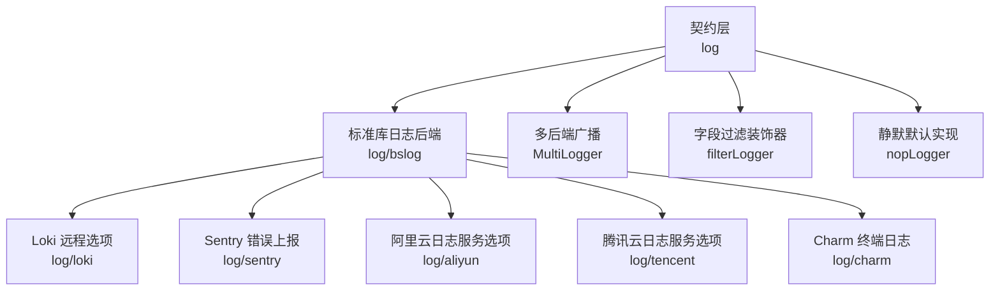
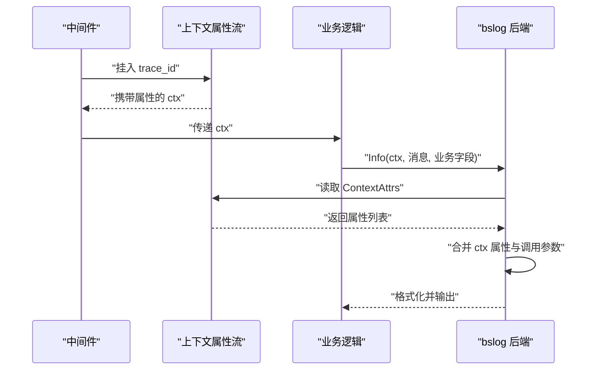
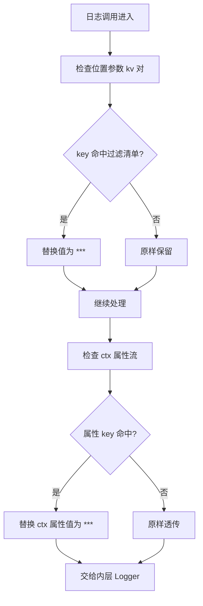
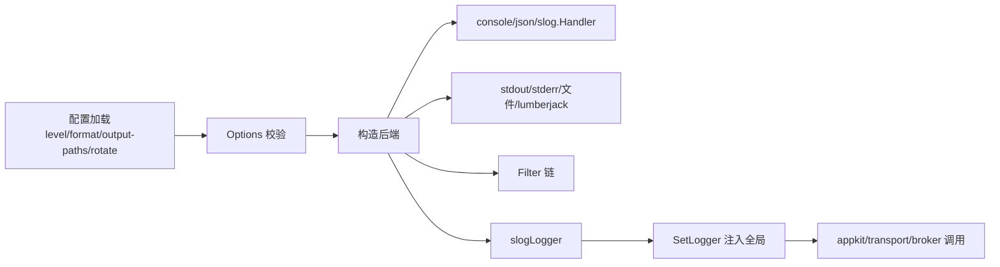
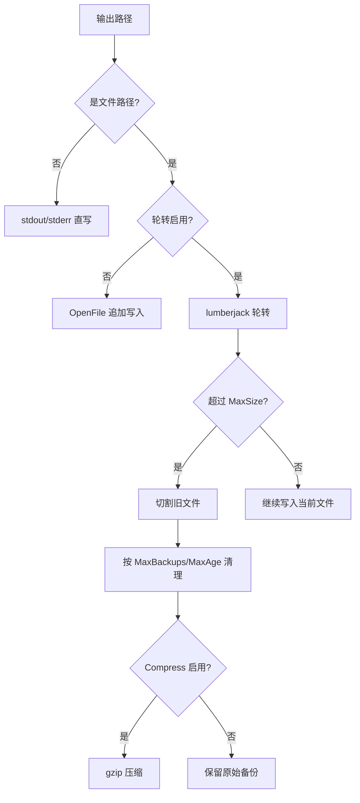
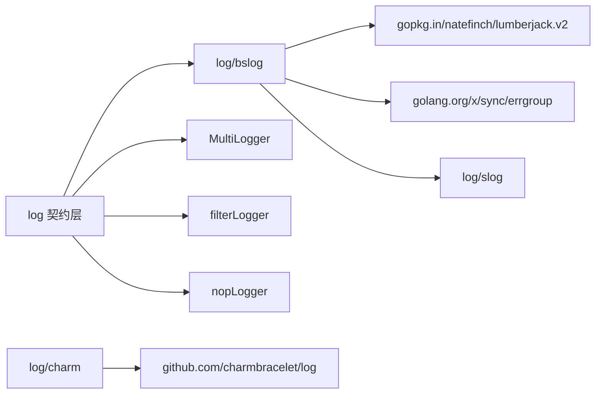

# 日志系统

<cite>
**本文引用的文件**   
- [log/doc.go](file://log/doc.go)
- [log/global.go](file://log/global.go)
- [log/global_helpers.go](file://log/global_helpers.go)
- [log/context.go](file://log/context.go)
- [log/filter.go](file://log/filter.go)
- [log/multi.go](file://log/multi.go)
- [log/nop.go](file://log/nop.go)
- [log/bslog/bslog.go](file://log/bslog/bslog.go)
- [log/bslog/options.go](file://log/bslog/options.go)
- [log/bslog/filter.go](file://log/bslog/filter.go)
- [log/bslog/otel.go](file://log/bslog/otel.go)
- [log/aliyun/options.go](file://log/aliyun/options.go)
- [log/loki/options.go](file://log/loki/options.go)
- [log/sentry/options.go](file://log/sentry/options.go)
- [log/tencent/options.go](file://log/tencent/options.go)
- [log/charm/charm.go](file://log/charm/charm.go)
</cite>

## 目录

1. [引言](#引言)
2. [项目结构](#项目结构)
3. [核心组件](#核心组件)
4. [架构总览](#架构总览)
5. [详细组件分析](#详细组件分析)
6. [依赖关系分析](#依赖关系分析)
7. [性能与缓冲策略](#性能与缓冲策略)
8. [故障排查指南](#故障排查指南)
9. [结论](#结论)
10. [附录：配置参考](#附录配置参考)

## 引言

本仓库的日志体系采用「契约层 + 多后端实现」的设计：顶层 `log` 包只声明日志接口、全局句柄、上下文属性流和通用装饰器，不直接绑定具体日志库；实际输出由子包适配器提供，默认是零成本静默实现。这一设计让业务代码、框架中间件、传输层、Broker 等全部通过统一入口写结构化日志，同时允许在装配期替换为控制台、JSON 文件、远程采集或 OpenTelemetry 后端。

面向运维与开发者的关键能力包括：

| 主题 | 已实现能力 | 说明 |
|---|---:|---|
| 结构化字段 | 是 | 基于 `slog.Attr` 键值对与上下文属性流传递 |
| 日志级别 | 是 | Debug / Info / Warn / Error |
| 输出格式 | 是 | console 文本与 json |
| 输出目标 | 是 | stdout、stderr、本地文件、多目标并发写入 |
| 字段过滤与脱敏 | 是 | 全后端通用 kv 过滤、slog handler 级 Attr 过滤 |
| 多后端广播 | 是 | `MultiLogger` 同时写本地与远程 |
| 文件轮转与压缩 | 是 | lumberjack 按大小切割、保留份数、保留天数、gzip |
| 远程日志收集 | 部分 | aliyun、tencent、loki、sentry 提供独立后端选项 |
| Trace ID 关联 | 是 | 通过上下文属性流注入，适配各后端 |
| 异步缓冲 | 否 | 契约层与 bslog 同步落盘；异步需自行接入带缓冲的后端（如 OTel processor） |

## 项目结构

日志相关代码集中在 `log` 包及其子包中：



**图示来源**
- [log/doc.go:1-15](file://log/doc.go#L1-L15)
- [log/bslog/bslog.go:1-30](file://log/bslog/bslog.go#L1-L30)
- [log/multi.go:1-20](file://log/multi.go#L1-L20)
- [log/charm/charm.go:1-25](file://log/charm/charm.go#L1-L25)

契约层保持「无第三方依赖」，具体后端放在子包：

| 模块 | 职责 |
|---|---|
| `log` | Logger 接口、Level、全局 Set/Get、ContextWithAttrs、通用 Filter/Multi/Nop |
| `log/bslog` | 基于 `log/slog` 的实现，支持 console/json、stdout/stderr/文件、lumberjack 轮转、OTel 桥接 |
| `log/aliyun` | 阿里云日志服务接入选项 |
| `log/loki` | Grafana Loki HTTP Push 接入选项 |
| `log/sentry` | Sentry 错误事件上报选项 |
| `log/tencent` | 腾讯云日志服务接入选项 |
| `log/charm` | Charmbracelet 彩色终端日志适配器 |

**章节来源**
- [log/doc.go:1-15](file://log/doc.go#L1-L15)
- [log/bslog/bslog.go:1-30](file://log/bslog/bslog.go#L1-L30)

## 核心组件

### 契约层 Logger 与全局句柄

契约层定义了统一的日志接口，包含四个级别方法、Enabled 门槛判断和 With 派生。所有框架模块只依赖该接口，不关心底层使用 slog、zap 还是其它实现。

全局句柄通过读写锁保护，默认值是 `nopLogger`——未注入任何后端时，导入 `log` 包不会产生产出，也不会 panic。调用方可通过 `SetLogger` 在进程启动阶段注入真实后端；传入 nil 会回退到静默实现。

```mermaid
classDiagram
    class Logger {
        +Debug(ctx, msg, args)
        +Info(ctx, msg, args)
        +Warn(ctx, msg, args)
        +Error(ctx, msg, args)
        +Enabled(level) bool
        +With(args) Logger
    }

    class Global {
        -global Logger
        +SetLogger(l)
        +GetLogger() Logger
        +Debug(ctx, msg, args)
        +Info(ctx, msg, args)
        +Warn(ctx, msg, args)
        +Error(ctx, msg, args)
        +Enabled(level) bool
        +With(args) Logger
    }

    class NopLogger {
        +Debug(ctx, msg, args)
        +Info(ctx, msg, args)
        +Warn(ctx, msg, args)
        +Error(ctx, msg, args)
        +Enabled(level) bool
        +With(args) Logger
    }

    class MultiLogger {
        -loggers []Logger
        +Debug(ctx, msg, args)
        +Info(ctx, msg, args)
        +Warn(ctx, msg, args)
        +Error(ctx, msg, args)
        +Enabled(level) bool
        +With(args) Logger
    }

    class FilterLogger {
        -inner Logger
        -keys map[string]struct{}
        +Debug(ctx, msg, args)
        +Info(ctx, msg, args)
        +Warn(ctx, msg, args)
        +Error(ctx, msg, args)
        +Enabled(level) bool
        +With(args) Logger
    }

    Global --> Logger : "持有"
    NopLogger ..|> Logger
    MultiLogger ..|> Logger
    FilterLogger ..|> Logger
```

**图示来源**
- [log/global.go:1-28](file://log/global.go#L1-L28)
- [log/global_helpers.go:1-37](file://log/global_helpers.go#L1-L37)
- [log/nop.go:1-18](file://log/nop.go#L1-L18)
- [log/multi.go:1-73](file://log/multi.go#L1-L73)
- [log/filter.go:1-137](file://log/filter.go#L1-L137)

**章节来源**
- [log/doc.go:1-15](file://log/doc.go#L1-L15)
- [log/global.go:1-28](file://log/global.go#L1-L28)
- [log/global_helpers.go:1-37](file://log/global_helpers.go#L1-L37)
- [log/nop.go:1-18](file://log/nop.go#L1-L18)

### 上下文属性流与 Trace ID

上下文属性流是 trace ID、请求 ID、租户 ID、用户 ID 等跨层调试信息的载体。`ContextWithAttrs` 把一组 `slog.Attr` 挂载到 context；同层级属性会合并追加，而不是覆盖。`ContextAttrs` 供底层适配器读取，`ContextAttrsToArgs` 则拍平成 key/value 序列，供非 slog 后端低成本合并。

典型 trace ID 用法：

1. 网关或中间件从请求头解析 trace ID。
2. 调用 `ContextWithAttrs(ctx, slog.String("trace_id", id))`。
3. 下游所有日志调用自动携带 trace ID。
4. 后端在序列化前把 ctx 属性合并到日志条目。

需要注意：ctx 属性流本身只是数据管道，不解释字段含义；具体如何展示、是否上送远端，由各后端决定。



**图示来源**
- [log/context.go:1-51](file://log/context.go#L1-L51)
- [log/bslog/bslog.go:221-245](file://log/bslog/bslog.go#L221-L245)
- [log/charm/charm.go:60-84](file://log/charm/charm.go#L60-L84)

**章节来源**
- [log/context.go:1-51](file://log/context.go#L1-L51)
- [log/bslog/bslog.go:221-245](file://log/bslog/bslog.go#L221-L245)

### 字段过滤与敏感信息脱敏

仓库有两套互补的脱敏机制：

| 机制 | 作用范围 | 驱动方式 | 适用场景 |
|---|---|---|---|
| `NewFilterLogger` | 位置参数 kv 对、With 派生 kv 对、ctx 属性流 | 配置驱动 key 清单 | 全后端通用，避免密码等外泄 |
| `bslog.FilterKey` | slog.Handler 层的任意 Attr | 代码驱动 Filter | 处理 `slog.Attr` 形式字段，仅 bslog 生效 |

`filterLogger` 会把命中 key 的值替换为 `***`，但保留字段名；它不会丢弃整条日志。对于 `slog.Attr` 形式的字段，只有 bslog 的 handler 层能改写，因此如果业务代码大量使用 `slog.String(...)` 传参，应同时启用两者。



**图示来源**
- [log/filter.go:1-137](file://log/filter.go#L1-L137)
- [log/bslog/filter.go:1-54](file://log/bslog/filter.go#L1-L54)

**章节来源**
- [log/filter.go:1-137](file://log/filter.go#L1-L137)
- [log/bslog/filter.go:1-54](file://log/bslog/filter.go#L1-L54)

## 架构总览

日志系统的装配顺序可概括为：



**图示来源**
- [log/bslog/options.go:1-104](file://log/bslog/options.go#L1-L104)
- [log/bslog/bslog.go:60-110](file://log/bslog/bslog.go#L60-L110)
- [log/global.go:10-28](file://log/global.go#L10-L28)

## 详细组件分析

### 结构化日志配置

#### 日志级别

契约层定义 Debug / Info / Warn / Error 四级。bslog 将字符串映射为 `log/slog.Level`：

| 配置值 | 行为 |
|---|---|
| debug | 输出 Debug、Info、Warn、Error |
| info | 输出 Info、Warn、Error |
| warn | 输出 Warn、Error |
| error | 仅输出 Error |
| 非法值 | 回退为 info，避免崩溃 |

#### 输出格式

| 格式值 | 实现 |
|---|---|
| console | `slog.NewTextHandler`，适合人类阅读 |
| json | `slog.NewJSONHandler`，适合机器解析与远端采集 |

#### 字段过滤

推荐在生产环境至少启用以下两类：

1. 通过 `NewFilterLogger` 配置敏感 key，例如 password、token、secret、authorization。
2. 若代码中使用 `slog.String` 传参，再通过 `bslog.WithFilter(bslog.FilterKey(...))` 覆盖 Attr 路径。

#### 示例：控制台 JSON 日志加 trace ID

建议步骤：

1. 创建 `bslog.Options`，设置 level、format=json、output-paths=stdout。
2. 通过 `ContextWithAttrs` 挂入 trace_id。
3. 通过 `bslog.WithAttrs` 挂 service.name、version 等固定字段。
4. 用 `bslog.New` 构造后端并 `log.SetLogger` 注入。
5. 业务代码通过 `log.Info(ctx, ...)` 输出。

**章节来源**
- [log/bslog/options.go:1-104](file://log/bslog/options.go#L1-L104)
- [log/context.go:1-51](file://log/context.go#L1-L51)
- [log/filter.go:1-137](file://log/filter.go#L1-L137)

### 日志后端配置

#### 控制台输出

默认 output-paths 为 stdout。console 格式适合本地开发，json 格式适合容器化部署与集中式日志平台。

#### 文件输出

当 output-paths 包含文件路径时，bslog 会：

1. 先创建父目录。
2. 以追加模式打开文件。
3. 打开失败时回退到 stdout，保证可观测性不丢失。
4. 多目标时使用并发写入器，任一失败不影响其余目标。

#### 远程日志收集集成

仓库提供了多个远程后端的选项模块：

| 后端 | 主要配置项 | 用途 |
|---|---|---|
| aliyun | endpoint、project、logstore、accessKey、accessSecret、securityToken | 阿里云日志服务 |
| tencent | endpoint、topicID、accessKey、accessSecret | 腾讯云日志服务 |
| loki | endpoint、labels、batchSize、flushInterval、httpClient | Grafana Loki HTTP Push |
| sentry | dsn、environment、release、serverName | 错误与异常事件上报 |
| charm | 终端颜色、级别、调用者、时间戳 | 本地调试终端日志 |

这些后端通常作为独立 Provider 装配；契约层只暴露 Logger 接口，远程后端的具体发送逻辑由其各自包承担。

#### 示例：同时输出控制台与 Loki

推荐组合方式：

1. 创建一个 bslog 控制台或 JSON 后端用于本地观察。
2. 创建一个 Loki 后端用于集中检索。
3. 使用 `NewMultiLogger` 把两个 Logger 广播组合。
4. 把组合后的 Logger 注入全局。

注意：广播是顺序执行，单个后端失败不会影响其它后端。

**章节来源**
- [log/bslog/bslog.go:110-199](file://log/bslog/bslog.go#L110-L199)
- [log/multi.go:1-73](file://log/multi.go#L1-L73)
- [log/aliyun/options.go:1-56](file://log/aliyun/options.go#L1-L56)
- [log/loki/options.go:1-66](file://log/loki/options.go#L1-L66)
- [log/sentry/options.go:1-47](file://log/sentry/options.go#L1-L47)
- [log/tencent/options.go:1-38](file://log/tencent/options.go#L1-L38)
- [log/charm/charm.go:1-117](file://log/charm/charm.go#L1-L117)

### 日志轮转、压缩与清理

bslog 的文件轮转基于 lumberjack，由 `RotateOptions` 控制：

| 配置项 | 默认值 | 含义 |
|---|---:|---|
| enabled | false | 是否启用轮转 |
| max-size | 100 | 单文件大小上限，单位 MB |
| max-backups | 7 | 保留历史文件份数 |
| max-age | 30 | 历史文件最长保留天数 |
| compress | true | 是否 gzip 压缩历史文件 |

轮转只在「某个 output-path 是文件路径且 enabled=true」时生效；否则文件路径按普通 `os.OpenFile` 直写，不切割。

轮转策略建议：

| 场景 | 建议 |
|---|---|
| 本地开发 | 关闭轮转，直接 stdout 或 stderr |
| 单机容器 | 开启轮转，max-size 根据日志量调整，保留 7~14 份 |
| 高吞吐生产 | 优先走远端采集；本地只留少量诊断日志，关闭或限制轮转 |
| 磁盘受限环境 | 缩短 max-age，减少 max-backups，开启 compress |
| 合规归档 | 结合外部 logrotate 或对象存储生命周期策略 |



**图示来源**
- [log/bslog/bslog.go:130-199](file://log/bslog/bslog.go#L130-L199)
- [log/bslog/options.go:13-36](file://log/bslog/options.go#L13-L36)

**章节来源**
- [log/bslog/options.go:1-104](file://log/bslog/options.go#L1-L104)
- [log/bslog/bslog.go:130-199](file://log/bslog/bslog.go#L130-L199)

### 调试信息与上下文传递

调试信息应通过上下文属性流注入，而不是硬编码进业务消息。推荐统一字段命名：

| 字段 | 含义 | 示例 |
|---|---|---|
| trace_id | 分布式链路追踪 ID | UUID 或 trace span ID |
| span_id | 当前 span | 可选 |
| req_id | 请求 ID | 网关生成 |
| user_id | 用户标识 | 匿名时为空 |
| tenant_id | 租户标识 | 多租户场景 |
| method | 接口方法 | gRPC/HTTP 方法名 |
| path | 请求路径 | HTTP path |
| status | 状态码 | 响应后补充 |

完整调试流程：

1. 入口解析 trace_id。
2. 中间件把 trace_id、method、path 挂入 ctx。
3. 业务层记录请求开始、数据库访问、外部调用。
4. 出口记录响应状态和耗时。
5. 远程后端通过标签或字段聚合查询。

**章节来源**
- [log/context.go:1-51](file://log/context.go#L1-L51)
- [log/bslog/bslog.go:221-245](file://log/bslog/bslog.go#L221-L245)

### OpenTelemetry 集成

bslog 通过 `WithHandler` 或语义别名 `WithOTelHandler` 接收自定义 `slog.Handler`，从而把日志桥接到 OpenTelemetry Logs。契约层本身不引入 otel 依赖，符合「契约层零三方依赖」原则。

推荐做法：

1. 在应用模块引入 otel 相关依赖。
2. 构建 otelslog handler。
3. 通过 `bslog.WithOTelHandler` 注入。
4. 如需本地文件，再用 `MultiLogger` 与 bslog 默认 writer 组合。

**章节来源**
- [log/bslog/otel.go:1-26](file://log/bslog/otel.go#L1-L26)
- [log/bslog/bslog.go:40-60](file://log/bslog/bslog.go#L40-L60)

## 依赖关系分析



**图示来源**
- [log/bslog/bslog.go:1-30](file://log/bslog/bslog.go#L1-L30)
- [log/charm/charm.go:1-25](file://log/charm/charm.go#L1-L25)

契约层不 import 任何具体后端；具体后端放在子包，避免根 module 被 adapter 反向依赖。这是作者明确强调的模块划分口径：`contract` 包只放契约装配，不 import 具体后端。

**章节来源**
- [log/doc.go:1-15](file://log/doc.go#L1-L15)
- [log/bslog/bslog.go:1-30](file://log/bslog/bslog.go#L1-L30)

## 性能与缓冲策略

### 同步写入模型

当前 bslog 实现是同步落盘：每条日志经 slog.Handler → writer → 文件系统或 stdout。它没有内置队列、批处理器或后台 flush goroutine。这意味着：

- 日志延迟主要由磁盘 I/O 和序列化决定。
- 进程退出时需要调用 `NewWithCleanup` 返回的 cleanup 函数，触发 lumberjack 缓冲落盘。
- 热更新重建后端时必须关闭旧后端，否则可能丢尾批并泄漏句柄。

### 优化建议

| 问题 | 建议 |
|---|---|
| 高频 Debug 日志拖慢主流程 | 使用 `Enabled(LevelDebug)` 守卫昂贵参数构造 |
| 本地开发 IO 阻塞 | 使用 stdout 或 stderr，避免频繁写大文件 |
| 生产高吞吐 | 优先走远端采集，本地只保留必要级别 |
| 需要异步缓冲 | 使用带异步 processor 的 OTel handler，或在应用侧封装队列后端 |
| 多后端广播开销 | 把远程后端放在最后，避免本地写完后因网络失败重试放大 |
| 轮转频繁触发 | 调大 max-size，减少切割次数 |
| 磁盘空间增长 | 合理设置 max-backups 与 max-age，开启 compress |

### 与测试约束的关系

由于本项目是多模块仓库且 CI 有短测与非短测双轨，日志模块的测试也应遵循“不可达即跳过”的原则：远程后端测试不应假设网络可达，而应在无法连接时跳过断言。这与仓库整体集成测试策略一致。

**章节来源**
- [log/bslog/bslog.go:60-110](file://log/bslog/bslog.go#L60-L110)
- [log/bslog/bslog.go:130-199](file://log/bslog/bslog.go#L130-L199)
- [log/loki/options.go:1-66](file://log/loki/options.go#L1-L66)

## 故障排查指南

### 日志没有输出

常见原因：

1. 未调用 `SetLogger`，仍使用默认 nopLogger。
2. 级别高于当前 threshold，例如设置为 warn 却只打 info。
3. output-paths 为空，validate 失败或默认回退 stdout。
4. 文件路径权限不足，bslog 会回退 stdout。
5. 远程后端网络不可达，但本地后端正常。

排查步骤：

1. 确认进程启动阶段已注入非 nil Logger。
2. 打印 Enabled 结果或使用 info 级别验证。
3. 检查 output-paths 是否为空、路径是否可写。
4. 查看 stdout 是否混入 json 行，这通常是文件写入失败的回退现象。

**章节来源**
- [log/nop.go:1-18](file://log/nop.go#L1-L18)
- [log/bslog/options.go:76-104](file://log/bslog/options.go#L76-L104)
- [log/bslog/bslog.go:140-170](file://log/bslog/bslog.go#L140-L170)

### 脱敏未生效

如果使用了 `slog.String` 传参，`NewFilterLogger` 可能不覆盖该路径。应同时启用：

- `NewFilterLogger(logger, keys...)`
- `bslog.WithFilter(bslog.FilterKey(key))`

**章节来源**
- [log/filter.go:15-50](file://log/filter.go#L15-L50)
- [log/bslog/filter.go:1-54](file://log/bslog/filter.go#L1-L54)

### 文件轮转未切割

检查：

1. rotate.enabled 是否为 true。
2. output-paths 是否包含文件路径。
3. max-size 是否大于 0。
4. 日志是否真的写入该文件而非 stdout。

**章节来源**
- [log/bslog/options.go:13-36](file://log/bslog/options.go#L13-L36)
- [log/bslog/bslog.go:130-199](file://log/bslog/bslog.go#L130-L199)

### 进程退出丢尾日志

如果使用 `NewWithCleanup`，必须在合适时机调用 cleanup。如果直接调用 `New`，返回值不携带 cleanup，资源释放由进程退出兜底，但不保证 lumberjack 内部缓冲被刷新。

**章节来源**
- [log/bslog/bslog.go:60-110](file://log/bslog/bslog.go#L60-L110)

## 结论

该项目的日志系统以契约层为核心，把「结构化字段、上下文属性、级别门限、多后端广播、字段脱敏」与「控制台、JSON、文件轮转、远程采集」解耦。bslog 提供开箱即用的标准库日志实现，并通过 lumberjack 完成文件轮转与压缩；其他远程后端以独立选项模块存在，便于按需组合。

在实际工程中，建议：

1. 统一通过全局 `log` 包输出，不要在各模块直接 import 具体日志库。
2. 用上下文属性流传递 trace_id 与请求元信息。
3. 生产环境至少启用字段过滤，并对 `slog.Attr` 路径补充 bslog handler 层过滤。
4. 本地开发用 console，生产用 json 并优先走远端采集。
5. 文件轮转配合 max-size、max-backups、max-age 和 compress。
6. 如需异步缓冲，选择带异步 processor 的 OTel handler，而不是假设契约层自带队列。

## 附录：配置参考

### bslog Options

| 字段 | 类型 | 默认值 | 说明 |
|---|---|---|---|
| Level | string | info | debug / info / warn / error |
| Format | string | console | console / json |
| OutputPaths | string[] | ["stdout"] | stdout / stderr / 文件路径 |
| Rotate.Enabled | bool | false | 启用 lumberjack 轮转 |
| Rotate.MaxSize | int | 100 | 单文件最大 MB |
| Rotate.MaxBackups | int | 7 | 保留历史文件数 |
| Rotate.MaxAge | int | 30 | 历史文件保留天数 |
| Rotate.Compress | bool | true | 历史文件 gzip 压缩 |

### 远程后端选项摘要

| 后端 | 关键字段 |
|---|---|
| aliyun | endpoint、project、logstore、accessKey、accessSecret、securityToken |
| tencent | endpoint、topicID、accessKey、accessSecret |
| loki | endpoint、labels、batchSize、flushInterval、httpClient |
| sentry | dsn、environment、release、serverName |
| charm | 终端级别、时间戳、调用者报告 |

**章节来源**
- [log/bslog/options.go:1-104](file://log/bslog/options.go#L1-L104)
- [log/aliyun/options.go:1-56](file://log/aliyun/options.go#L1-L56)
- [log/loki/options.go:1-66](file://log/loki/options.go#L1-L66)
- [log/sentry/options.go:1-47](file://log/sentry/options.go#L1-L47)
- [log/tencent/options.go:1-38](file://log/tencent/options.go#L1-L38)
- [log/charm/charm.go:1-117](file://log/charm/charm.go#L1-L117)