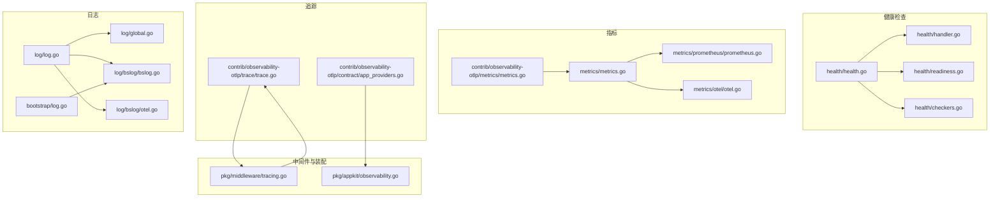
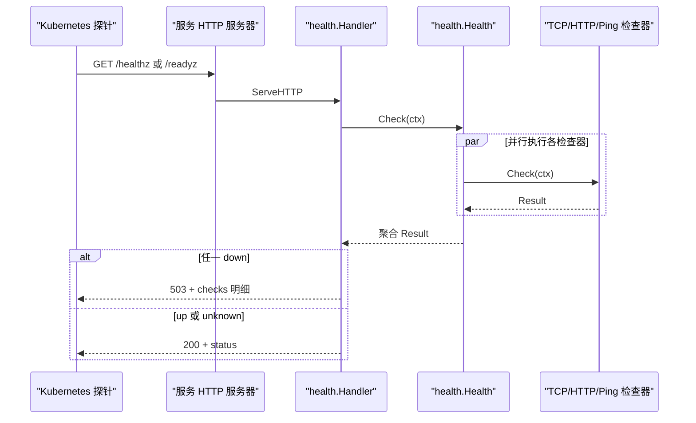
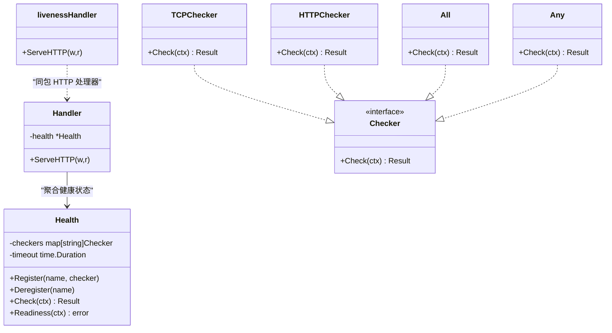
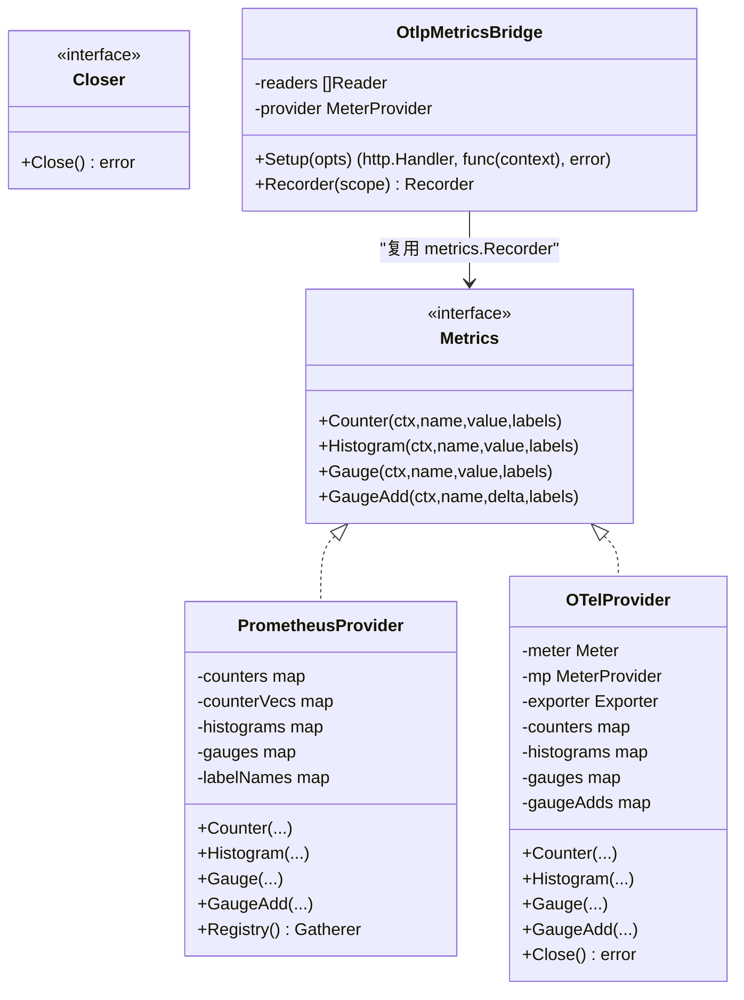
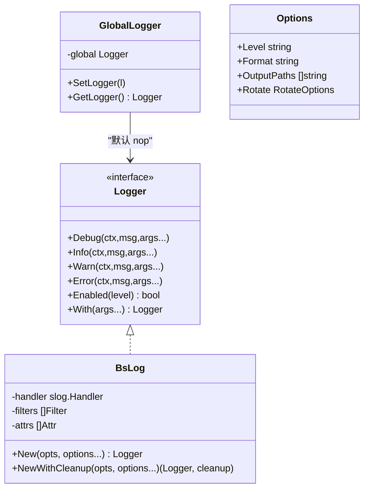
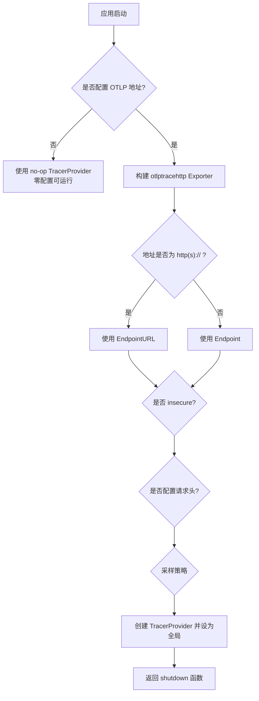
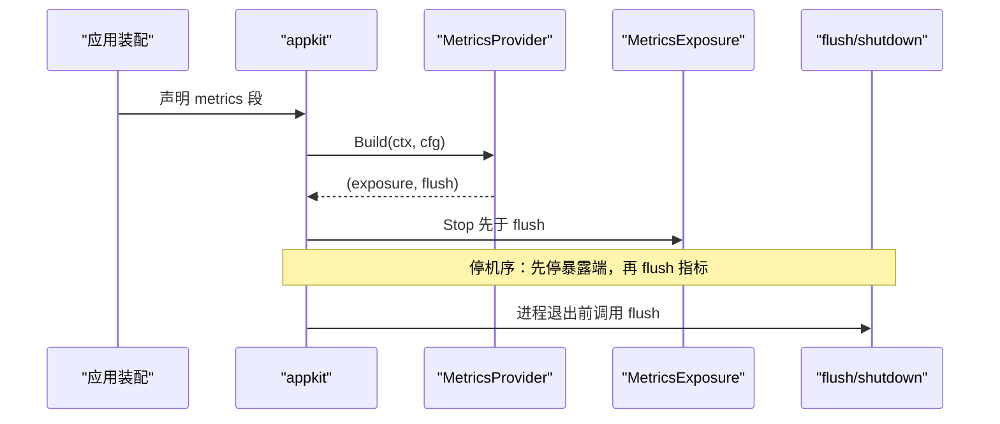
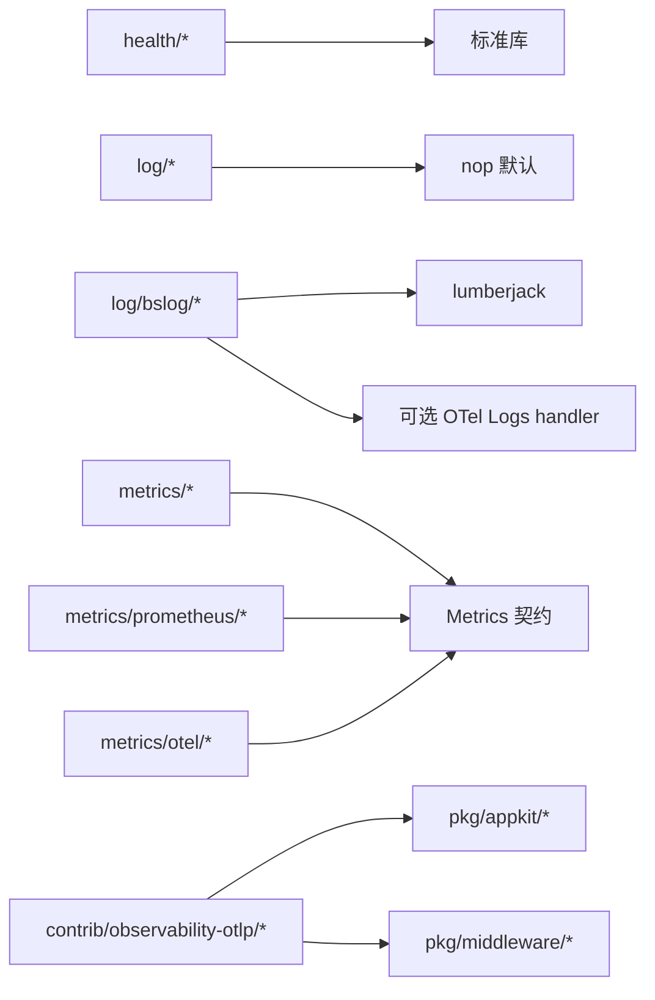

# 监控与可观测性

<cite>
**本文引用的文件**   
- [health/health.go](file://health/health.go)
- [health/handler.go](file://health/handler.go)
- [health/readiness.go](file://health/readiness.go)
- [health/checkers.go](file://health/checkers.go)
- [metrics/metrics.go](file://metrics/metrics.go)
- [metrics/prometheus/prometheus.go](file://metrics/prometheus/prometheus.go)
- [metrics/otel/otel.go](file://metrics/otel/otel.go)
- [contrib/observability-otlp/metrics/metrics.go](file://contrib/observability-otlp/metrics/metrics.go)
- [contrib/observability-otlp/trace/trace.go](file://contrib/observability-otlp/trace/trace.go)
- [contrib/observability-otlp/contract/app_providers.go](file://contrib/observability-otlp/contract/app_providers.go)
- [pkg/middleware/tracing.go](file://pkg/middleware/tracing.go)
- [pkg/appkit/observability.go](file://pkg/appkit/observability.go)
- [bootstrap/log.go](file://bootstrap/log.go)
- [log/log.go](file://log/log.go)
- [log/global.go](file://log/global.go)
- [log/bslog/bslog.go](file://log/bslog/bslog.go)
- [log/bslog/otel.go](file://log/bslog/otel.go)
</cite>

## 目录
1. [引言](#引言)
2. [项目结构](#项目结构)
3. [核心组件](#核心组件)
4. [架构总览](#架构总览)
5. [详细组件分析](#详细组件分析)
6. [依赖关系分析](#依赖关系分析)
7. [性能与容量规划](#性能与容量规划)
8. [故障诊断指南](#故障诊断指南)
9. [生产环境最佳实践](#生产环境最佳实践)
10. [结论](#结论)

## 引言
本文件面向 Bald 框架的运维与 SRE 读者，系统性说明健康检查、指标收集、日志系统、分布式追踪、告警与面板、以及故障诊断方法。文档同时标注每个实现点对应的源码位置，便于在生产环境中快速定位代码。

需要特别强调：Bald 的可观测性遵循「核心零后端耦合」原则——核心包只定义契约（`health`、`log`、`metrics`），具体 Prometheus/OpenTelemetry/Lumberjack 等实现放在 `contrib/observability-otlp`、`metrics/prometheus`、`metrics/otel`、`log/bslog` 等子模块中，由应用装配层选择启用。

## 项目结构
可观测性相关代码主要分布在以下区域：

| 主题 | 路径 | 职责 |
|---|---|---|
| 健康检查 | `health/` | 统一健康状态、聚合检查器、HTTP 探针端点 |
| 指标契约与实现 | `metrics/` | `Metrics` 接口、Prometheus 直出、OpenTelemetry OTLP 直出 |
| OTLP 能力集成 | `contrib/observability-otlp/{trace,metrics,contract}` | 把全局 TracerProvider/MeterProvider 接到远端 APM，并提供 AppKit 段 Provider |
| 日志契约与实现 | `log/`、`log/bslog/` | 结构化日志、级别控制、文件轮转、OTel Logs 桥接 |
| 中间件与装配 | `pkg/middleware/`、`pkg/appkit/` | trace_id/span_id 关联日志、指标暴露生命周期 |
| 启动期配置映射 | `bootstrap/log.go` | 把契约日志配置映射为 bslog.Options |

**图表来源**
- [health/health.go:1-200](file://health/health.go#L1-L200)
- [health/handler.go:1-84](file://health/handler.go#L1-L84)
- [health/readiness.go:1-42](file://health/readiness.go#L1-L42)
- [health/checkers.go:1-181](file://health/checkers.go#L1-L181)
- [metrics/metrics.go:1-34](file://metrics/metrics.go#L1-L34)
- [metrics/prometheus/prometheus.go:1-283](file://metrics/prometheus/prometheus.go#L1-L283)
- [metrics/otel/otel.go:1-274](file://metrics/otel/otel.go#L1-L274)
- [contrib/observability-otlp/metrics/metrics.go:1-158](file://contrib/observability-otlp/metrics/metrics.go#L1-L158)
- [contrib/observability-otlp/trace/trace.go:1-136](file://contrib/observability-otlp/trace/trace.go#L1-L136)
- [contrib/observability-otlp/contract/app_providers.go:1-117](file://contrib/observability-otlp/contract/app_providers.go#L1-L117)
- [pkg/middleware/tracing.go:1-35](file://pkg/middleware/tracing.go#L1-L35)
- [pkg/appkit/observability.go:1-55](file://pkg/appkit/observability.go#L1-L55)
- [bootstrap/log.go:1-53](file://bootstrap/log.go#L1-L53)
- [log/log.go:1-48](file://log/log.go#L1-L48)
- [log/global.go:1-28](file://log/global.go#L1-L28)
- [log/bslog/bslog.go:1-200](file://log/bslog/bslog.go#L1-L200)
- [log/bslog/otel.go:1-26](file://log/bslog/otel.go#L1-L26)

**章节来源**
- [health/health.go:1-200](file://health/health.go#L1-L200)
- [metrics/metrics.go:1-34](file://metrics/metrics.go#L1-L34)
- [log/log.go:1-48](file://log/log.go#L1-L48)

## 核心组件
Bald 的可观测性由三类契约驱动：

1. **健康检查契约**
   - `Status`：`up` / `down` / `unknown`。
   - `Checker`：单个命名检查器，返回 `Result{status,message,details}`。
   - `Health`：并发安全的检查器聚合器，支持 `Register`/`Deregister`、全局超时、按名称快照执行。
   - `Handler`：将聚合结果暴露为 HTTP JSON；Down 返回 503，Up/Unknown 返回 200。
   - `livenessHandler`：始终返回 200，适合 Kubernetes `livenessProbe`。
   - `Readiness`：把聚合结果适配成返回 error 的形式，供 gRPC health 或业务探针使用。

2. **指标契约**
   - `Metrics`：统一 `Counter`、`Histogram`、`Gauge`、`GaugeAdd`，所有方法要求 label key 集合稳定。
   - `Closer`：可选关闭接口，用于 OTLP 导出器 flush。
   - Prometheus 实现：懒注册、缓存 instrument、标签维度冻结。
   - OpenTelemetry 实现：通过 OTLP gRPC/HTTP 周期导出。

3. **日志契约**
   - `Logger`：Debug/Info/Warn/Error + `Enabled` + `With`，第一参数是 `context.Context`，方便提取 trace_id/span_id。
   - 全局后端：默认 nop，可通过 `SetLogger` 注入 `bslog`。
   - `bslog`：基于 `log/slog`，支持 console/json、多输出、文件轮转、固定属性、过滤脱敏、OTel handler 桥接。

**章节来源**
- [health/health.go:1-200](file://health/health.go#L1-L200)
- [health/handler.go:1-84](file://health/handler.go#L1-L84)
- [health/readiness.go:1-42](file://health/readiness.go#L1-L42)
- [metrics/metrics.go:1-34](file://metrics/metrics.go#L1-L34)
- [log/log.go:1-48](file://log/log.go#L1-L48)
- [log/global.go:1-28](file://log/global.go#L1-L28)
- [log/bslog/bslog.go:1-200](file://log/bslog/bslog.go#L1-L200)

## 架构总览
Bald 的可观测性分层如下：

**图表来源**
- [health/handler.go:20-84](file://health/handler.go#L20-L84)
- [health/health.go:100-200](file://health/health.go#L100-L200)
- [health/checkers.go:10-181](file://health/checkers.go#L10-L181)

## 详细组件分析

### 健康检查机制：就绪探针与存活探针

#### 组件关系

**图表来源**
- [health/health.go:60-200](file://health/health.go#L60-L200)
- [health/handler.go:10-84](file://health/handler.go#L10-L84)
- [health/checkers.go:10-181](file://health/checkers.go#L10-L181)

#### 关键行为与边界
- `Health.Check` 对每个已注册检查器创建独立 goroutine，并通过全局超时 context 限制；任一 Down 则整体 Down，否则 Unknown，最后 Up。
- `Handler.ServeHTTP` 仅区分 Down 与非 Down：Down 返回 503，其余返回 200。
- `NewLivenessHandler()` 不依赖任何外部依赖，只要进程能响应 HTTP 就认为存活。
- `Readiness` 把所有 Down 的检查器名称与消息排序拼接成错误串，适合喂给 gRPC health 或启动门禁。

#### 探针配置建议
- **存活探针**：使用 `/healthz`，指向 `NewLivenessHandler()`。适用于“进程是否还活着”。
- **就绪探针**：使用 `/readyz`，指向 `NewHandler(health)`。适用于“依赖数据库、缓存、下游服务是否可用”。
- 推荐注册：
  - 数据库：`TCP("db:5432", timeout)`
  - Redis：`PingFunc(redisClient.Ping)`
  - 下游微服务：`HTTP("http://payment-svc:8080/healthz", timeout)`
  - 高可用场景：`Any(TCP("redis-1:6379"), TCP("redis-2:6379"))`
  - 强一致场景：`All(TCP("db:5432"), PingFunc(redisClient.Ping))`

**章节来源**
- [health/health.go:60-200](file://health/health.go#L60-L200)
- [health/handler.go:10-84](file://health/handler.go#L10-L84)
- [health/readiness.go:1-42](file://health/readiness.go#L1-L42)
- [health/checkers.go:10-181](file://health/checkers.go#L10-L181)

### 指标收集系统：Prometheus 与 OpenTelemetry

#### 指标契约与实现

**图表来源**
- [metrics/metrics.go:1-34](file://metrics/metrics.go#L1-L34)
- [metrics/prometheus/prometheus.go:1-283](file://metrics/prometheus/prometheus.go#L1-L283)
- [metrics/otel/otel.go:1-274](file://metrics/otel/otel.go#L1-L274)
- [contrib/observability-otlp/metrics/metrics.go:1-158](file://contrib/observability-otlp/metrics/metrics.go#L1-L158)

#### Prometheus 集成
- 提供两种构造方式：
  - `prometheus.New(...)`：使用私有 Registry，隔离 `DefaultRegisterer`。
  - `prometheus.NewWithDefaultRegistry(...)`：接入 `prometheus.DefaultRegisterer`，配合 `promhttp.Handler()` 暴露 `/metrics`。
- 标签维度在首次使用时冻结；后续调用新增 label key 会被静默丢弃，因此同一 metric name 的 label key 必须稳定。
- 常用用法：
  - 设置 namespace/subsystem：`WithNamespace`、`WithSubsystem`。
  - 自定义 registry：`WithRegistry`。
  - 暴露端点：挂载 `promhttp.Handler()` 到 `/metrics`。

#### OpenTelemetry 指标直出
- `metrics/otel.Provider`：通过 OTLP gRPC 或 HTTP 周期性导出到 collector/APM。
- 可配置 endpoint、service name/version、insecure、HTTP/gRPC、export interval。
- `Close` 会带 10 秒超时 shutdown MeterProvider，避免进程退出丢尾批指标。

#### OTLP 能力包的多 Reader 模式
- `contrib/observability-otlp/metrics.Setup` 同时挂 Prometheus exporter 与可选 OTLP metric exporter。
- 返回 Prometheus `/metrics` handler 与 provider shutdown。
- 支持 insecure 三态推断：裸 `host:port` 默认 insecure，`http(s)://` 按前缀。
- 支持 headers 透传到远端 APM，常用于鉴权。

#### 指标聚合策略
仓库未内置统一的指标聚合层；聚合策略体现在：
- Prometheus 侧：由下游 prometheus 抓取后由 PromQL/Grafana 聚合。
- OTLP 侧：由远端 APM（如 VictoriaMetrics、Grafana Cloud）聚合。
- 本地双写：`contrib/observability-otlp/metrics` 可同时写 Prometheus 与 OTLP 远端，但这是「双出口」而非「本地聚合计算」。

**章节来源**
- [metrics/metrics.go:1-34](file://metrics/metrics.go#L1-L34)
- [metrics/prometheus/prometheus.go:1-283](file://metrics/prometheus/prometheus.go#L1-L283)
- [metrics/otel/otel.go:1-274](file://metrics/otel/otel.go#L1-L274)
- [contrib/observability-otlp/metrics/metrics.go:1-158](file://contrib/observability-otlp/metrics/metrics.go#L1-L158)

### 日志系统：结构化日志、级别、轮转与远程采集

#### 组件关系

**图表来源**
- [log/log.go:1-48](file://log/log.go#L1-L48)
- [log/global.go:1-28](file://log/global.go#L1-L28)
- [log/bslog/bslog.go:1-200](file://log/bslog/bslog.go#L1-L200)
- [bootstrap/log.go:1-53](file://bootstrap/log.go#L1-L53)

#### 结构化日志与级别
- `log.Logger` 是框架级最小契约，所有方法接受 `context.Context`，便于后续从上下文提取 trace_id/span_id。
- 默认全局后端是 nop，调用 `SetLogger` 注入 `bslog`。
- `bslog` 基于 `log/slog`，支持 `console` 与 `json` 格式；非法 level 回退 info，避免崩溃。

#### 日志级别控制
- 级别：Debug < Info < Warn < Error。
- 通过 `bootstrap.LogOptions` 把契约中的 `level`、`format`、`output_path(s)`、`rotate` 映射为 `bslog.Options`。
- 契约缺失时回退默认 stdout + info，保证开箱即用。

#### 日志轮转
- 非轮转：直接 `os.OpenFile`，失败时回退 stdout，保证可观测性不丢。
- 轮转：使用 lumberjack，支持最大文件大小、备份数、保留天数、压缩。
- 多输出目标：stdout/stderr/多个文件；任一路径打开失败不影响其他目标。
- 资源释放：`NewWithCleanup` 返回 cleanup，确保 lumberjack 缓冲落盘并关闭自有文件句柄。

#### 远程日志收集
- 通过 `bslog.WithOTelHandler` 注入 OpenTelemetry Logs 的 slog handler。
- 设计约束：`log` 契约包保持零 otel 依赖，实际 otel 依赖由消费方引入。
- 典型流程：初始化 OTel log provider → 构造 otelslog handler → 传入 `WithOTelHandler` → 作为全局 logger。

**章节来源**
- [log/log.go:1-48](file://log/log.go#L1-L48)
- [log/global.go:1-28](file://log/global.go#L1-L28)
- [log/bslog/bslog.go:1-200](file://log/bslog/bslog.go#L1-L200)
- [log/bslog/otel.go:1-26](file://log/bslog/otel.go#L1-L26)
- [bootstrap/log.go:1-53](file://bootstrap/log.go#L1-L53)

### 分布式追踪：OpenTelemetry 集成、链路追踪与性能分析

#### 追踪装配

**图表来源**
- [contrib/observability-otlp/trace/trace.go:1-136](file://contrib/observability-otlp/trace/trace.go#L1-L136)

#### 链路追踪与日志关联
- `pkg/middleware/tracing.LogTraceIDs`：若 SpanContext 有效则返回真实 trace_id/span_id；否则生成随机 ID，让零配置下日志仍可按请求关联。
- 这避免了无 tracer 时 trace_id/span_id 恒为零的问题。

#### 采样策略
- 支持 `always_on`、`always_off`、`parent_based`、`trace_id_ratio`。
- 空值或未知值退化为 ParentBased(AlwaysSample)，未知值额外 WARN。
- `trace_id_ratio` 非正值按 1.0 处理。

#### AppKit 段装配
- `contrib/observability-otlp/contract.AppProviders` 提供 tracer 与 metrics 两段 Provider。
- tracer 段 Build 后 shutdown 被挂在引擎停机序，排在 logger/metrics 之后。
- metrics 段支持 `prometheus` 与 `otlp` 两种 type，未知 type 启动时报错。

**章节来源**
- [contrib/observability-otlp/trace/trace.go:1-136](file://contrib/observability-otlp/trace/trace.go#L1-L136)
- [pkg/middleware/tracing.go:1-35](file://pkg/middleware/tracing.go#L1-L35)
- [contrib/observability-otlp/contract/app_providers.go:1-117](file://contrib/observability-otlp/contract/app_providers.go#L1-L117)

### 指标暴露面与生命周期

**图表来源**
- [pkg/appkit/observability.go:1-55](file://pkg/appkit/observability.go#L1-L55)
- [contrib/observability-otlp/contract/app_providers.go:60-117](file://contrib/observability-otlp/contract/app_providers.go#L60-L117)

## 依赖关系分析
- `health` 包自包含，不依赖业务后端，只依赖标准库。
- `metrics` 契约包不依赖 Prometheus/OpenTelemetry；具体实现分别位于 `metrics/prometheus`、`metrics/otel`。
- `contrib/observability-otlp` 是能力集成层：
  - `trace` 负责 TracerProvider。
  - `metrics` 负责 MeterProvider 与 Prometheus/OTLP 双写。
  - `contract` 负责 AppKit 段 Provider。
- `log` 契约包零第三方依赖；`log/bslog` 引入 lumberjack 和可选 otel handler。
- `bootstrap/log.go` 是装配层，同时依赖契约类型与 bslog.Options。

**图表来源**
- [log/bslog/bslog.go:1-200](file://log/bslog/bslog.go#L1-L200)
- [metrics/prometheus/prometheus.go:1-283](file://metrics/prometheus/prometheus.go#L1-L283)
- [metrics/otel/otel.go:1-274](file://metrics/otel/otel.go#L1-L274)
- [contrib/observability-otlp/contract/app_providers.go:1-117](file://contrib/observability-otlp/contract/app_providers.go#L1-L117)
- [pkg/appkit/observability.go:1-55](file://pkg/appkit/observability.go#L1-L55)
- [pkg/middleware/tracing.go:1-35](file://pkg/middleware/tracing.go#L1-L35)

**章节来源**
- [log/bslog/bslog.go:1-200](file://log/bslog/bslog.go#L1-L200)
- [metrics/prometheus/prometheus.go:1-283](file://metrics/prometheus/prometheus.go#L1-L283)
- [metrics/otel/otel.go:1-274](file://metrics/otel/otel.go#L1-L274)
- [contrib/observability-otlp/contract/app_providers.go:1-117](file://contrib/observability-otlp/contract/app_providers.go#L1-L117)
- [pkg/appkit/observability.go:1-55](file://pkg/appkit/observability.go#L1-L55)
- [pkg/middleware/tracing.go:1-35](file://pkg/middleware/tracing.go#L1-L35)

## 性能与容量规划

### 健康检查
- `Health.Check` 对每个检查器起 goroutine，并在检查 context 上叠加全局超时。
- 建议：
  - 数据库 TCP 拨号超时控制在 1~3 秒，避免阻塞探针。
  - HTTP 下游健康检查应使用轻量 `/healthz`，不要做复杂查询。
  - 组合检查器优先用 `Any` 做高可用降级，`All` 做强一致性阻断。

### 指标采集
- Prometheus 实现会在首次使用时创建 instrument 并缓存；label key 集合必须稳定，否则会丢失新维度。
- OTLP 指标采用 PeriodicReader，默认间隔由各自实现决定：
  - `metrics/otel` 默认 60 秒。
  - `contrib/observability-otlp/metrics` 默认 15 秒。
- 双写 Prometheus 与 OTLP 会增加网络与 CPU 开销，建议仅在需要远端 APM 时开启 OTLP 直出。

### 日志
- 多 writer 写入使用 errgroup 并行，任一路径失败不影响其他路径。
- 文件轮转由 lumberjack 触发，进程退出前必须调用 cleanup，否则尾批日志可能丢失。
- 建议生产环境：
  - 使用 json 格式以便 ELK/Loki 解析。
  - 至少一个输出目标是 stdout，便于容器平台采集。
  - 本地文件仅用于调试；生产优先走 stdout + 远程日志系统。

### 追踪
- 未配置 OTLP 地址时，tracer 为 no-op，零配置可运行。
- 建议生产环境开启采样率控制，避免全量采样导致 APM 压力过大。

[本节为通用指导，不直接分析具体源码行]

## 故障诊断指南

### 健康检查故障
- 现象：就绪探针持续 503。
- 排查步骤：
  1. 查看 `/readyz` JSON 响应中的 `checks` 字段，定位具体失败检查器。
  2. 若是 TCP 检查失败，确认端口连通性与防火墙。
  3. 若是 HTTP 检查失败，确认下游服务健康端点与状态码范围。
  4. 若是超时，调整 `Health.WithTimeout` 与各检查器的 timeout。
- 相关代码：
  - [health/handler.go:20-84](file://health/handler.go#L20-L84)
  - [health/checkers.go:10-181](file://health/checkers.go#L10-L181)

### 指标不可见
- 现象：Prometheus 无法抓取 `/metrics`。
- 排查步骤：
  1. 确认是否使用了 `prometheus.NewWithDefaultRegistry` 并挂载了 `promhttp.Handler()`。
  2. 确认 label key 集合是否稳定；新增 dimension 不会自动生效。
  3. 若使用 `contrib/observability-otlp/metrics.Setup`，确认返回的 handler 已暴露到独立监听面。
- 相关代码：
  - [metrics/prometheus/prometheus.go:1-283](file://metrics/prometheus/prometheus.go#L1-L283)
  - [contrib/observability-otlp/metrics/metrics.go:1-158](file://contrib/observability-otlp/metrics/metrics.go#L1-L158)

### 指标未发送到远端
- 现象：APM 平台无指标。
- 排查步骤：
  1. 确认 OTLP endpoint、insecure、headers 是否正确。
  2. 确认 `metrics/otel.Provider.Close` 是否在进程退出前调用。
  3. 确认 `contrib/observability-otlp/metrics.Setup` 是否传入了 `WithOTLPAddr`。
- 相关代码：
  - [metrics/otel/otel.go:1-274](file://metrics/otel/otel.go#L1-L274)
  - [contrib/observability-otlp/metrics/metrics.go:1-158](file://contrib/observability-otlp/metrics/metrics.go#L1-L158)

### 日志丢失或无法轮转
- 现象：重启后缺少尾部日志，或文件未切割。
- 排查步骤：
  1. 确认是否使用 `NewWithCleanup` 并调用 cleanup。
  2. 确认 `Rotate.Enabled` 与 `MaxSize`/`MaxBackups`/`MaxAge`。
  3. 确认输出路径父目录存在，或启用轮转让 lumberjack 自行创建。
- 相关代码：
  - [log/bslog/bslog.go:1-200](file://log/bslog/bslog.go#L1-L200)
  - [bootstrap/log.go:1-53](file://bootstrap/log.go#L1-L53)

### 日志与追踪无法关联
- 现象：日志中 trace_id/span_id 为空或全零。
- 排查步骤：
  1. 确认是否已初始化 OTel TracerProvider。
  2. 若未初始化，`LogTraceIDs` 会生成随机 ID，仍可用于单进程日志关联。
  3. 若使用 OTel Logs，确认通过 `WithOTelHandler` 注入了 slog handler。
- 相关代码：
  - [pkg/middleware/tracing.go:1-35](file://pkg/middleware/tracing.go#L1-L35)
  - [log/bslog/otel.go:1-26](file://log/bslog/otel.go#L1-L26)

**章节来源**
- [health/handler.go:20-84](file://health/handler.go#L20-L84)
- [health/checkers.go:10-181](file://health/checkers.go#L10-L181)
- [metrics/prometheus/prometheus.go:1-283](file://metrics/prometheus/prometheus.go#L1-L283)
- [metrics/otel/otel.go:1-274](file://metrics/otel/otel.go#L1-L274)
- [contrib/observability-otlp/metrics/metrics.go:1-158](file://contrib/observability-otlp/metrics/metrics.go#L1-L158)
- [log/bslog/bslog.go:1-200](file://log/bslog/bslog.go#L1-L200)
- [bootstrap/log.go:1-53](file://bootstrap/log.go#L1-L53)
- [pkg/middleware/tracing.go:1-35](file://pkg/middleware/tracing.go#L1-L35)
- [log/bslog/otel.go:1-26](file://log/bslog/otel.go#L1-L26)

## 生产环境最佳实践

### 健康检查
- 使用两个端点：
  - `/healthz`：`NewLivenessHandler()`，判断进程存活。
  - `/readyz`：`NewHandler(health)`，判断依赖就绪。
- 注册所有关键依赖：数据库、缓存、消息队列、关键下游。
- 使用 `All` 阻断强依赖，使用 `Any` 容忍副本降级。
- 控制检查超时，避免探针拖慢服务启动与调度。

### 指标
- 本地 Prometheus：使用 `promhttp.Handler()` 暴露 `/metrics`，由集群内 prometheus 抓取。
- 远端 APM：如需跨集群/云厂商集中化，启用 OTLP 直出，并配置合理 export interval。
- 标签维度稳定：同一 metric name 的 label key 集合不能动态变化。
- 生命周期：确保 metrics 暴露端先 Stop，再 flush，避免指标丢失。

### 日志
- 生产首选 json 格式，便于结构化检索。
- 优先 stdout + 远程日志系统；本地文件用于短期调试。
- 启用轮转时务必调用 cleanup。
- 通过 `WithAttrs` 注入 service.name、version、env 等固定属性。
- 通过 `WithFilter` 脱敏敏感字段。

### 追踪
- 未配置 OTLP 地址时保持 no-op，零配置可运行。
- 生产建议开启采样策略，结合业务 QPS 与成本控制采样率。
- 使用 `LogTraceIDs` 保证日志与追踪链路可关联。

### 告警规则与监控面板
仓库未内置 Prometheus alert rule 或 Grafana dashboard YAML；告警与面板应由使用者基于以下指标与探针设计：
- 健康检查：
  - `/readyz` 长期 503。
  - 具体 check 项长期 down。
- 指标：
  - 业务 Counter/Histogram/Gauge 异常增长或停滞。
  - OTLP 导出失败、延迟升高。
- 日志：
  - Error 级别突增。
  - 特定脱敏后关键字出现。
- 追踪：
  - 热点 span、失败 span、延迟 P95/P99 升高。

[本节为通用指导，不直接分析具体源码行]

## 结论
Bald 的可观测性以最小契约为核心，把 Prometheus、OpenTelemetry、lumberjack 等实现解耦到子模块，由应用装配层按需启用。健康检查提供清晰的 liveness/readiness 语义；指标契约统一 Counter/Histogram/Gauge；日志契约支持结构化、级别控制与文件轮转；追踪通过 OTLP 直推远端 APM，并支持采样与 header 鉴权。生产部署时应严格区分存活与就绪探针、稳定指标标签、正确关闭日志与指标资源，并结合业务指标与日志构建告警与面板。