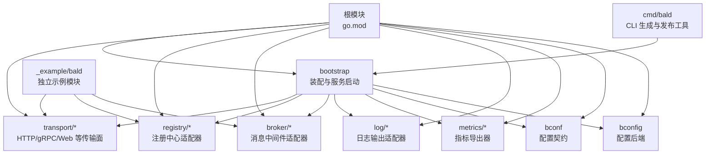
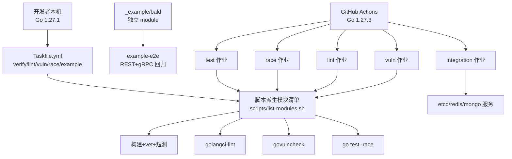
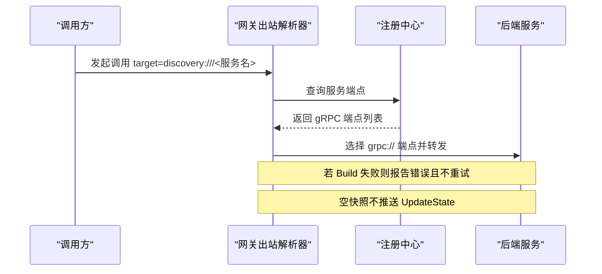
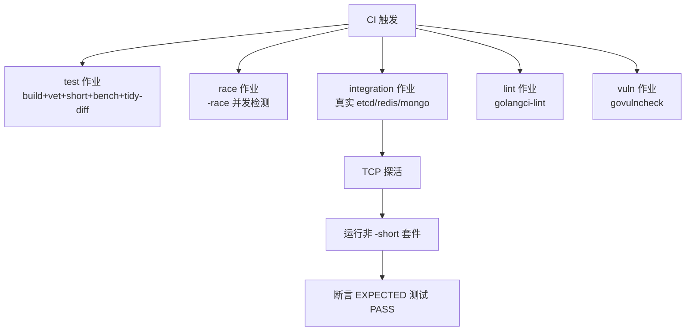
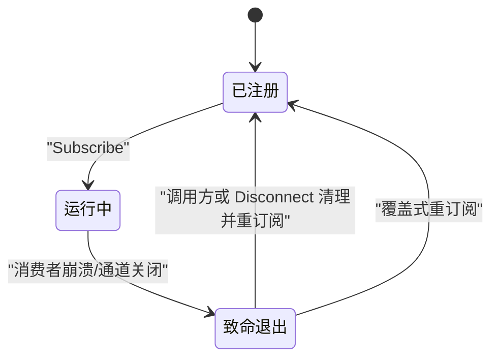
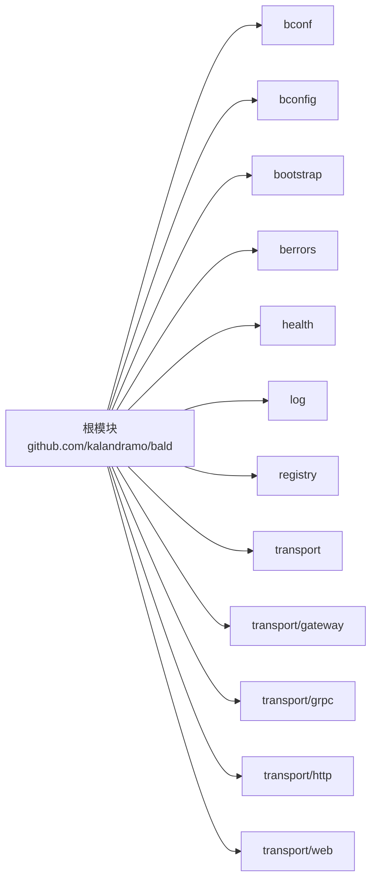

# 部署与运维

<cite>
**本文引用的文件**   
- [go.mod](file://go.mod)
- [scripts/list-modules.sh](file://scripts/list-modules.sh)
- [Taskfile.yml](file://Taskfile.yml)
- [.github/workflows/ci.yml](file://.github/workflows/ci.yml)
- [.github/workflows/workflow-lint.yml](file://.github/workflows/workflow-lint.yml)
- [.github/workflows/windows.yml](file://.github/workflows/windows.yml)
- [cmd/bald/main.go](file://cmd/bald/main.go)
</cite>

## 目录
1. [引言](#引言)
2. [项目结构](#项目结构)
3. [核心组件](#核心组件)
4. [架构总览](#架构总览)
5. [详细组件分析](#详细组件分析)
6. [依赖关系分析](#依赖关系分析)
7. [性能考虑](#性能考虑)
8. [故障排查指南](#故障排查指南)
9. [结论](#结论)
10. [附录](#附录)

## 引言
本指南面向 Bald 框架的本地开发、持续集成、容器化与生产运维人员，覆盖 Go 工具链、多模块仓库管理、CI 质量闸门、服务发现与网关出站、Broker 订阅者生命周期、配置与可观测性、Kubernetes/Helm/服务网格集成、日志指标告警、回滚与灾难恢复、容量规划与成本优化等主题。

Bald 是一个 93 个 `go.mod` 的多模块仓库（无 `go.work`），子模块通过相对 `replace` 组成可编译闭包；根模块不得 require 任何适配器，以避免模块环。CI 与 Taskfile 都消费由 `scripts/list-modules.sh` 派生的唯一模块清单，因此“本地绿”和“CI 覆盖范围”必须保持一致。

**章节来源**
- [go.mod:1-12](file://go.mod#L1-L12)
- [scripts/list-modules.sh:1-24](file://scripts/list-modules.sh#L1-L24)
- [Taskfile.yml:1-28](file://Taskfile.yml#L1-L28)

## 项目结构
仓库按功能划分：`bconf`/`bootstrap`/`bconfig` 负责配置与引导；`transport` 提供 HTTP/gRPC/WebSocket/SSE/MCP 等传输面；`registry` 提供注册中心实现；`broker` 提供 Kafka/RabbitMQ/Redis/RocketMQ 消息能力；`observability`、`log`、`metrics` 提供可观测性；`_example/bald` 是独立示例模块，不参与根模块构建。

**图表来源**
- [go.mod:1-12](file://go.mod#L1-L12)
- [cmd/bald/main.go:1-47](file://cmd/bald/main.go#L1-L47)

**章节来源**
- [go.mod:1-12](file://go.mod#L1-L12)
- [cmd/bald/main.go:1-47](file://cmd/bald/main.go#L1-L47)

## 核心组件
- **多模块清单**：`scripts/list-modules.sh` 是 CI 和本地任务共享的唯一派生源，排除 `.git` 和 `_example*`，空清单会直接报错，避免闸门静默失效。
- **Taskfile 任务**：`task verify`、`task lint`、`task vuln`、`task race`、`task example-e2e` 等封装跨平台构建、静态检查、漏洞扫描、竞态检测与示例端到端测试。
- **CI 作业**：`test`、`race`、`integration`、`lint`、`vuln` 五个主作业，全部基于同一份模块派生，版本固定为 Go 1.27.3。
- **CLI 工具**：`cmd/bald` 提供代码生成与发布维护命令，不是运行时服务入口。

**章节来源**
- [scripts/list-modules.sh:1-24](file://scripts/list-modules.sh#L1-L24)
- [Taskfile.yml:201-452](file://Taskfile.yml#L201-L452)
- [.github/workflows/ci.yml:1-298](file://.github/workflows/ci.yml#L1-L298)
- [cmd/bald/main.go:1-47](file://cmd/bald/main.go#L1-L47)

## 架构总览
下图展示本地开发与 CI 的关键路径差异：本地以 Go 1.27.1 为主，使用 Taskfile 驱动；CI 以 Go 1.27.3 运行，并在多个 job 中并行校验构建、竞态、集成、静态检查和漏洞。

**图表来源**
- [go.mod:1-5](file://go.mod#L1-L5)
- [Taskfile.yml:1-28](file://Taskfile.yml#L1-L28)
- [.github/workflows/ci.yml:1-298](file://.github/workflows/ci.yml#L1-L298)
- [.github/workflows/windows.yml:1-59](file://.github/workflows/windows.yml#L1-L59)

**章节来源**
- [go.mod:1-5](file://go.mod#L1-L5)
- [Taskfile.yml:1-28](file://Taskfile.yml#L1-L28)
- [.github/workflows/ci.yml:1-298](file://.github/workflows/ci.yml#L1-L298)
- [.github/workflows/windows.yml:1-59](file://.github/workflows/windows.yml#L1-L59)

## 详细组件分析

### 本地开发环境搭建
- **Go 版本**：根模块声明 `go 1.27.1`，这是本地默认工具链版本；CI 使用 `setup-go@v5` 并指定 `go-version: "1.27.3"`。
- **工具安装位置**：Taskfile 中所有工具均通过 `go install ... @version` 安装到 `$(go env GOPATH)/bin`，这是版本 pin 的唯一真相源之一。
- **必需工具**：
  - `task`：跨平台构建编排。
  - `golangci-lint`：静态检查。
  - `govulncheck`：代码可达漏洞扫描。
  - `buf`：契约层 Protobuf 生成。
  - `actionlint`：GitHub 工作流文件 schema 与 shellcheck 检查。
  - `protoc-gen-defaults`：契约层生成依赖。
- **推荐安装步骤**：
  1. 安装 Go 1.27.1。
  2. 执行 `task tools` 或按需执行 `task tools-golangci-lint`、`task tools-govulncheck`、`task tools-actionlint`、`task tools-protoc-gen-defaults`。
  3. 执行 `task proto-contract` 生成 `bconf` 契约代码。
  4. 执行 `task verify-modules` 验证所有模块。
  5. 执行 `task example-e2e` 验证示例应用。

**章节来源**
- [go.mod:1-5](file://go.mod#L1-L5)
- [Taskfile.yml:28-98](file://Taskfile.yml#L28-L98)
- [Taskfile.yml:201-452](file://Taskfile.yml#L201-L452)
- [.github/workflows/ci.yml:1-298](file://.github/workflows/ci.yml#L1-L298)

### CI 环境与本地环境的差异
| 维度 | 本地 | CI |
|---|---|---|
| Go 版本 | 1.27.1 | 1.27.3 |
| 构建编排 | `task` | GitHub Actions |
| 模块清单 | `scripts/list-modules.sh` | 同左 |
| 短测 | `task verify-module` 默认 `-short` | `test` 作业 `-short -timeout 5m` |
| 竞态检测 | `task race`（Linux/macOS） | `race` 作业（排除 `.github/race-skip.txt`） |
| 集成测试 | 手动起 etcd/redis/mongo | `integration` 作业注入真实服务 |
| 示例模块 | `task example-e2e` | 单独 `example-*` 任务 |
| 工作流检查 | `task ci-workflow-lint` | `.github/workflows/workflow-lint.yml` |

**章节来源**
- [go.mod:1-5](file://go.mod#L1-L5)
- [Taskfile.yml:201-452](file://Taskfile.yml#L201-L452)
- [.github/workflows/ci.yml:1-298](file://.github/workflows/ci.yml#L1-L298)
- [.github/workflows/windows.yml:1-59](file://.github/workflows/windows.yml#L1-L59)

### 容器化部署最佳实践
仓库未提供内置 Dockerfile 或 Helm Chart，因此容器化应围绕以下原则设计：
- **多阶段构建**：第一阶段用 Go 1.27.1 编译二进制；第二阶段用精简基础镜像运行。
- **不可变镜像**：将版本号、commit、构建时间写入镜像标签或环境变量。
- **资源配置**：在容器内暴露健康端口，并通过进程级资源限制控制内存/CPU。
- **最小权限**：非 root 用户运行，只挂载必要配置与证书。
- **配置外置**：通过环境变量、ConfigMap/Secret、远程配置后端加载，不硬编码到镜像。
- **可观测性**：启用 HTTP/gRPC 健康端点、指标暴露、结构化日志。

由于仓库没有现成镜像定义，建议把业务服务作为独立可执行产物打包，Bald 框架作为库依赖被业务模块引入。

**章节来源**
- [go.mod:1-12](file://go.mod#L1-L12)
- [cmd/bald/main.go:1-47](file://cmd/bald/main.go#L1-L47)

### Kubernetes 部署清单与 Helm Chart
仓库未提供官方 Kubernetes Manifest 或 Helm Chart，但框架具备以下可集成能力：
- **健康检查**：通过 `health` 与 `bootstrap` 提供的健康端点实现 readiness/liveness。
- **配置管理**：支持 file/env/http/kubernetes/consul/apollo/etcd/nacos/vault 等多后端。
- **服务发现**：通过 `registry` 适配器对接 etcd/nacos/consul/kubernetes。
- **消息队列**：通过 `broker` 适配器对接 Kafka/RabbitMQ/Redis/RocketMQ。
- **可观测性**：通过 `log`、`metrics`、`observability` 接入 OTLP、Prometheus、Sentry、阿里云/腾讯云日志等。

Helm Chart 应抽象以下值：
- 副本数、资源请求/限制、探针路径。
- 配置后端地址、密钥引用。
- 注册中心连接参数。
- 消息后端 URI。
- OTLP/Prometheus/日志采集目标。
- 网络策略与 Ingress/Gateway 暴露。

**章节来源**
- [bootstrap/config/config.go](file://bootstrap/config/config.go)
- [bconfig/bconfig.go](file://bconfig/bconfig.go)
- [registry/registry.go](file://registry/registry.go)
- [broker/broker.go](file://broker/broker.go)
- [log/global.go](file://log/global.go)
- [metrics/metrics.go](file://metrics/metrics.go)

### 服务发现与网关出站
网关出站只有 target 写成 `discovery:///<服务名>` 才走注册中心解析；直连仍是默认行为。解析器有三条既定语义：
1. `Build` 返回错误时，gRPC 客户端不会重试；因此实现应只调用 `cc.ReportError`，并把更新推进交给 `Watch`。
2. 空快照不推 `UpdateState`，避免触发无效更新。
3. 只取 `grpc://` 端点，忽略其他 scheme。

不同注册中心的命名约定不同：
- **Nacos**：一个实例的多个端点拆成 `<Name>.<scheme>` 形式的多个服务，目标必须写 `discovery:///<服务名>.grpc`；少写 `.grpc` 后缀通常解析到 HTTP 面或空集。
- **内存与 etcd**：使用注册时填写的 `ServiceInstance.Name` 原样匹配。

**图表来源**
- [transport/gateway/gateway_server.go](file://transport/gateway/gateway_server.go)
- [registry/registry.go](file://registry/registry.go)

**章节来源**
- [transport/gateway/discovery_test.go](file://transport/gateway/discovery_test.go)
- [registry/nacos/registry.go](file://registry/nacos/registry.go)
- [registry/etcd/registry.go](file://registry/etcd/registry.go)

### CI 质量闸门
CI 有五个作业：
- **test**：逐模块 build + vet + test -short + 基准冒烟 + 依赖面 tidy -diff。
- **race**：逐模块 go test -short -race，排除 `.github/race-skip.txt`。
- **integration**：注入真实 etcd/redis/mongo，跑非 -short 套件，并以“判据出现 `--- PASS`”兜住 Skip。
- **lint**：逐模块 golangci-lint。
- **vuln**：逐模块 govulncheck。

关键约束：
- 主循环必须保留 `go test -short`，因为 `transport/{redis,kafka,rabbitmq,rocketmq,tcp,webrtc}` 的 `TestServer`/`TestClient` 是等信号的手动用例，去掉 `-short` 会超时。
- 禁用模式：GitHub 作业文件的 `services` 只接受 `credentials/env/image/options/ports/volumes`；写 `args` 会让整个 workflow 文件在编译期拒绝，表现为 0 个 job。容器参数改用同名环境变量，例如 etcd 使用 `ETCD_LISTEN_CLIENT_URLS` 与 `ETCD_ADVERTISE_CLIENT_URLS`。
- 注入真后端的用例一律写成“不可达即 `t.Skip`”，所以集成作业必须先 TCP 探活，再断言期望测试名真的 PASS。

**图表来源**
- [.github/workflows/ci.yml:1-298](file://.github/workflows/ci.yml#L1-L298)

**章节来源**
- [.github/workflows/ci.yml:1-298](file://.github/workflows/ci.yml#L1-L298)
- [.github/workflows/workflow-lint.yml:1-46](file://.github/workflows/workflow-lint.yml#L1-L46)

### Broker 订阅者生命周期
Broker 订阅者在致命退出后**不会自行摘除** `SubscriberSyncMap` 条目；摘除是调用方或 `Disconnect` 的责任。重订阅是覆盖而非累积。代价是 `Topics()`/`Len()`/`Has()` 可能高报死订阅者数量，该口径由 `broker/kafka/subscriber_test.go` 钉住。

**图表来源**
- [broker/kafka/subscriber.go](file://broker/kafka/subscriber.go)
- [broker/kafka/subscriber_test.go](file://broker/kafka/subscriber_test.go)

**章节来源**
- [broker/kafka/subscriber.go](file://broker/kafka/subscriber.go)
- [broker/kafka/subscriber_test.go](file://broker/kafka/subscriber_test.go)

### 配置管理与密钥管理
Bald 通过 `bconfig` 提供多后端配置加载，包括文件、环境变量、HTTP、Kubernetes、Consul、Apollo、etcd、Nacos、Vault。`bootstrap` 在此基础上装配服务、日志、监听、TLS、gRPC/HTTP 服务器等。

生产建议：
- 使用远端配置后端统一管理配置。
- 敏感信息使用 Vault/KMS/云密钥管理服务。
- 配置变更应支持热更新，并通过 watcher 回调刷新状态。
- 对未知字段做严格校验，避免配置漂移。

**章节来源**
- [bconfig/bconfig.go](file://bconfig/bconfig.go)
- [bconfig/fallback.go](file://bconfig/fallback.go)
- [bootstrap/bootstrap.go](file://bootstrap/bootstrap.go)

### 日志收集、指标监控与告警规则
- **日志**：`log` 包提供全局日志、过滤、多输出、OTEL 集成，以及阿里云、Tencent、Sentry、Charm、Loki 等适配器。
- **指标**：`metrics` 包提供 Prometheus、Datadog、OTLP 指标导出。
- **可观测性**：`observability/metricshttp` 暴露指标 HTTP 端点。

生产建议：
- 日志采用结构化格式，统一 trace_id/span_id。
- 指标暴露 Prometheus `/metrics`，配合 Prometheus Server 抓取。
- 告警规则基于关键业务指标、错误率、延迟分位、下游依赖健康状态。
- 对注册中心、消息队列、数据库、对象存储等外部依赖建立健康探测与告警。

**章节来源**
- [log/context.go](file://log/context.go)
- [log/filter.go](file://log/filter.go)
- [metrics/prometheus/prometheus.go](file://metrics/prometheus/prometheus.go)
- [observability/metricshttp/metricshttp.go](file://observability/metricshttp/metricshttp.go)

### 服务网格集成
Bald 本身不强制绑定特定服务网格，但可通过以下方式集成：
- **Sidecar 模式**：将服务以普通进程运行，由 Istio/Linkerd 接管流量。
- **Ingress/Gateway**：通过 HTTP/gRPC 网关暴露 API。
- **服务发现**：若服务网格接管 DNS/LB，可跳过框架内部注册中心，或使用注册中心作为补充视图。
- **TLS**：利用网格 mTLS，同时保留框架 TLS 选项用于调试或边界场景。

**章节来源**
- [transport/grpc/grpc_server.go](file://transport/grpc/grpc_server.go)
- [transport/http/http_server.go](file://transport/http/http_server.go)
- [bootstrap/server.go](file://bootstrap/server.go)

## 依赖关系分析
根模块通过 `replace` 指向本地子模块，形成自包含开发图；发布时这些 replace 会被移除，由远端版本替代。

**图表来源**
- [go.mod:1-40](file://go.mod#L1-L40)

**章节来源**
- [go.mod:1-40](file://go.mod#L1-L40)

## 性能考虑
- **短测与长测分离**：主 CI 使用 `-short`，避免等信号的手动集成用例拖垮流水线。
- **竞态检测**：单独 `-race` job，避免影响常规构建速度。
- **基准冒烟**：每模块单迭代跑基准，主要拦截基准编译/panic，不做阈值断言。
- **概率组件测试**：如 `circuitbreaker/sres`，不能直接对统计量断言阈值；应先构造有界前置状态，再断言放行率上界。
- **资源限制**：容器与 Kubernetes Pod 应设置 CPU/memory request/limit，避免节点过载。
- **连接池**：数据库、缓存、消息后端、注册中心连接池应按 QPS 与延迟目标调优。
- **容量规划**：结合历史 QPS、P99 延迟、错误率、下游吞吐，估算副本数与实例规格。
- **成本优化**：优先使用按需扩缩容、Spot/抢占实例（适用于无状态 worker）、缓存热点数据、合并小请求。

**章节来源**
- [.github/workflows/ci.yml:1-298](file://.github/workflows/ci.yml#L1-L298)
- [Taskfile.yml:201-452](file://Taskfile.yml#L201-L452)

## 故障排查指南

### 启动失败诊断
1. 检查配置文件是否被正确加载，确认后端地址、认证凭据、TLS 证书。
2. 查看健康端点，区分 liveness 与 readiness 失败原因。
3. 检查注册中心连通性，确认服务名与 scheme（特别是 Nacos 的 `.grpc` 后缀）。
4. 检查消息后端连接，确认 topic/exchange/stream 是否存在且权限正确。
5. 查看日志是否出现重复订阅、死订阅者、通道关闭、上下文取消。

**章节来源**
- [bootstrap/config/config.go](file://bootstrap/config/config.go)
- [registry/nacos/registry.go](file://registry/nacos/registry.go)
- [broker/kafka/subscriber.go](file://broker/kafka/subscriber.go)

### 性能瓶颈分析
1. 通过指标观察 QPS、延迟分布、错误率、GC 停顿、goroutine 数。
2. 定位慢接口：结合 trace、日志、数据库慢查询、消息积压。
3. 检查连接池饱和、锁竞争、序列化开销、大对象分配。
4. 对概率组件（熔断、限流）检查状态初始化与并发交错行为。

**章节来源**
- [metrics/prometheus/prometheus.go](file://metrics/prometheus/prometheus.go)
- [log/context.go](file://log/context.go)

### 网络问题定位
1. 检查容器到宿主机、Pod 到 Service、Service 到 Endpoint 的网络连通性。
2. 检查防火墙、安全组、NetworkPolicy。
3. 检查 TLS 握手、证书有效期、域名解析。
4. 检查服务网格 sidecar 是否拦截预期流量。

**章节来源**
- [transport/grpc/grpc_server.go](file://transport/grpc/grpc_server.go)
- [transport/http/http_server.go](file://transport/http/http_server.go)

### 常见 CI 问题
- 修改 `.github/workflows/*.yml` 后未运行 `task ci-workflow-lint`，导致 workflow 文件在 GitHub 编译期被拒。
- 在 `services` 下误写 `args`，应改为同名环境变量。
- 集成测试因外部服务不可达而 Skip，需先做 TCP 探活并断言期望测试 PASS。
- 忘记 `-short` 导致 `transport` 下的手动用例超时。

**章节来源**
- [.github/workflows/workflow-lint.yml:1-46](file://.github/workflows/workflow-lint.yml#L1-L46)
- [.github/workflows/ci.yml:1-298](file://.github/workflows/ci.yml#L1-L298)

## 结论
Bald 是一个以多模块为核心的 Go 服务框架。其部署与运维的关键在于：
- 明确本地 Go 1.27.1 与 CI Go 1.27.3 的差异。
- 以 `scripts/list-modules.sh` 为唯一模块清单来源，保持本地与 CI 一致。
- 使用 Taskfile 统一构建、检查、扫描与示例回归。
- 按协议约定配置服务发现与网关出站。
- 对 Broker 订阅者生命周期做好显式清理。
- 将容器化、Kubernetes、Helm、服务网格、配置、密钥、日志、指标、告警纳入统一运维流程。
- 以可观测性和自动化闸门保障稳定性，以容量规划与成本优化支撑规模化生产。

## 附录

### 本地常用命令速查
- `task help`：列出全部任务。
- `task verify`：全量验证模块与示例。
- `task verify-modules`：派生出的全部模块 build + vet + short。
- `task lint`：全模块静态检查。
- `task vuln`：全模块漏洞扫描。
- `task race`：全模块竞态检测（Linux/macOS）。
- `task example-e2e`：示例 REST+gRPC 端到端回归。
- `task ci-workflow-lint`：检查 GitHub 工作流文件。

**章节来源**
- [Taskfile.yml:1-28](file://Taskfile.yml#L1-L28)
- [Taskfile.yml:201-452](file://Taskfile.yml#L201-L452)

### 生产运维手册要点
- **上线前**：完成单元测试、短测、竞态检测、静态检查、漏洞扫描、示例 e2e。
- **上线中**：灰度发布、蓝绿或滚动升级、健康检查就绪后再切流量。
- **运行期**：监控核心指标、告警规则生效、日志可检索、备份可恢复。
- **回滚策略**：镜像不可变、版本可追踪、配置可回退、数据迁移可逆或可补偿。
- **灾难恢复**：定期演练数据恢复、密钥轮换、注册中心恢复、消息队列恢复。

[本节为通用运维建议，不直接分析具体源码文件]