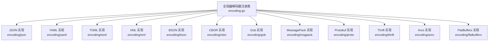
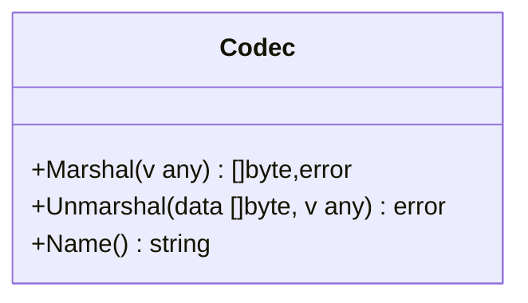
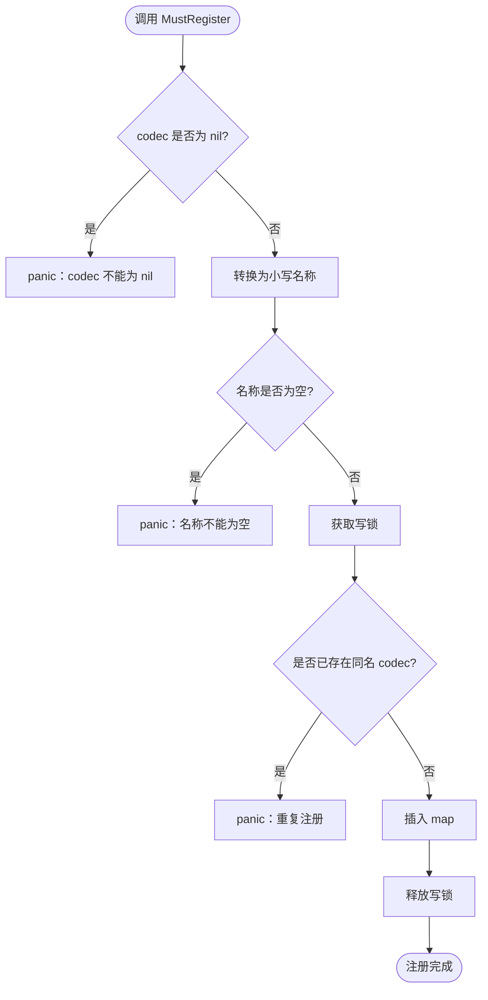
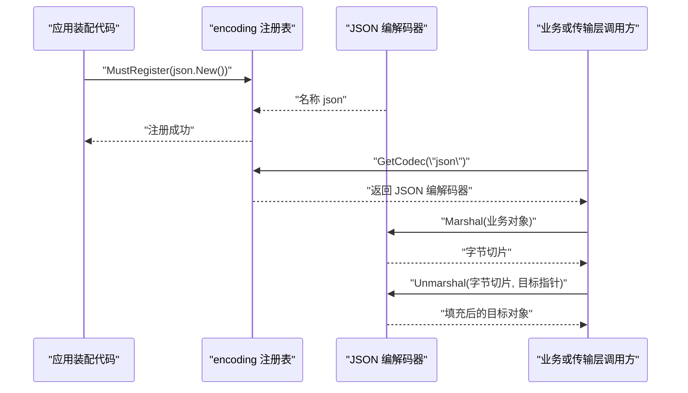
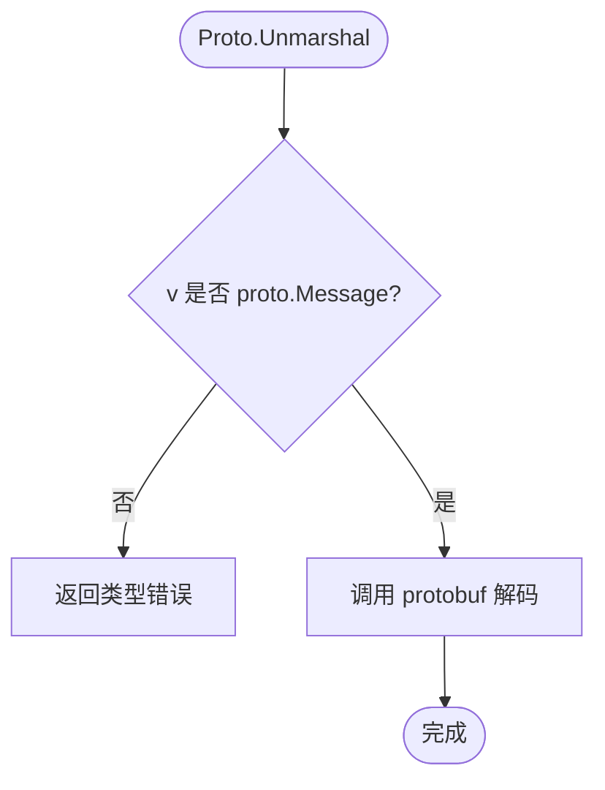
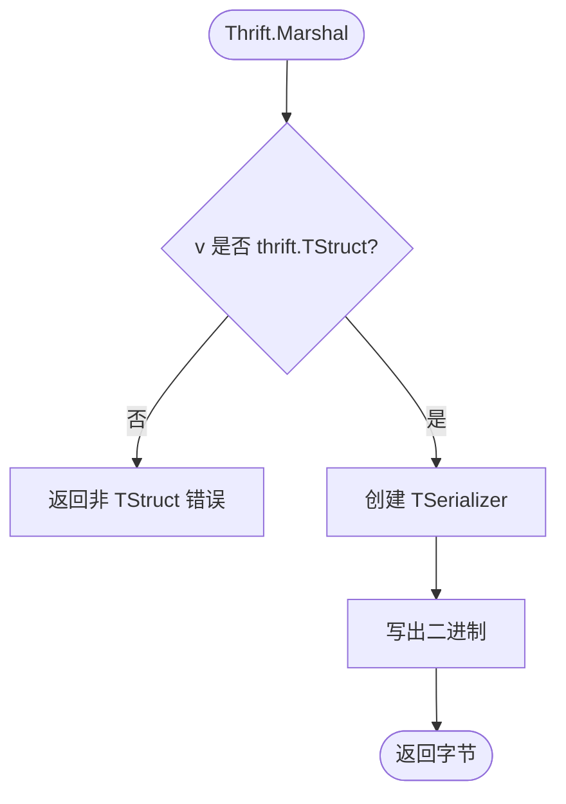
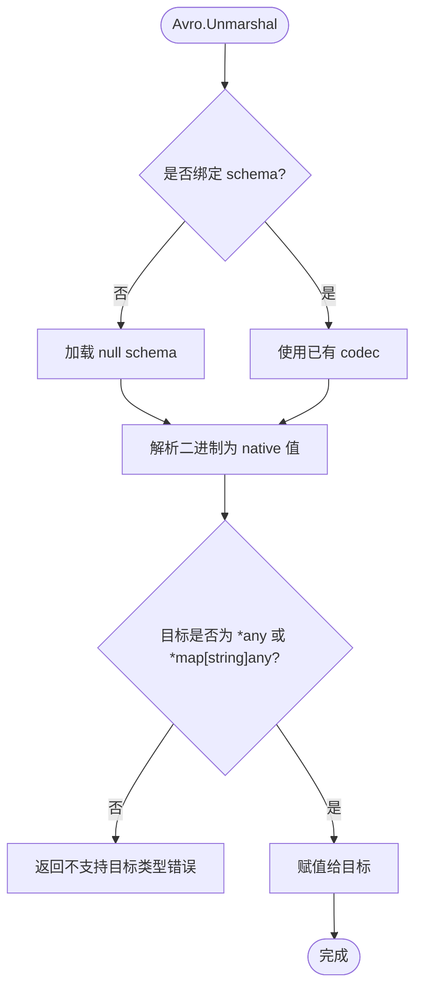
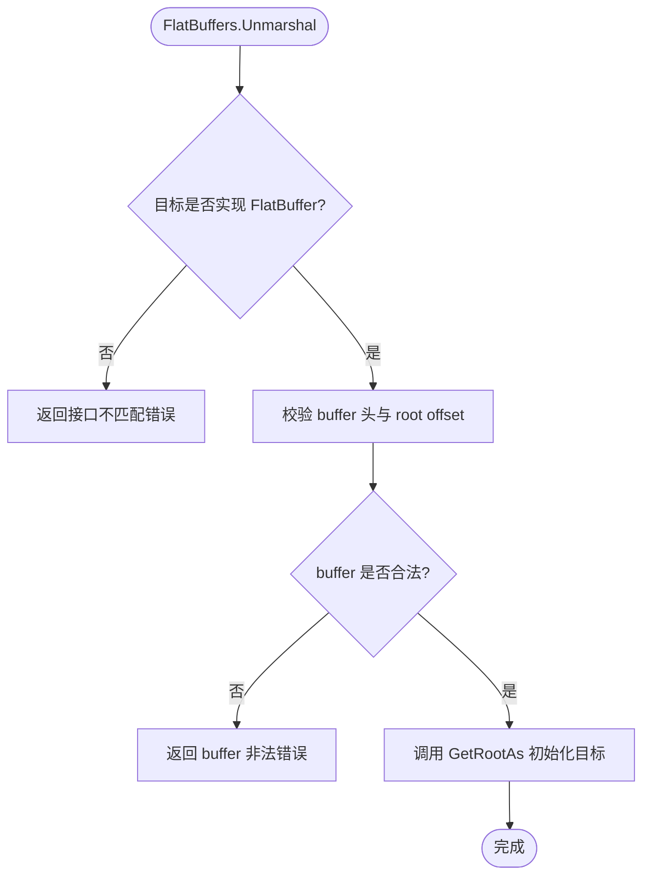
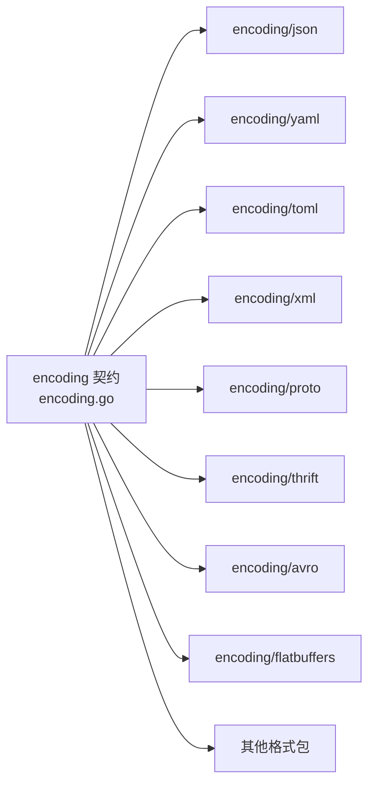
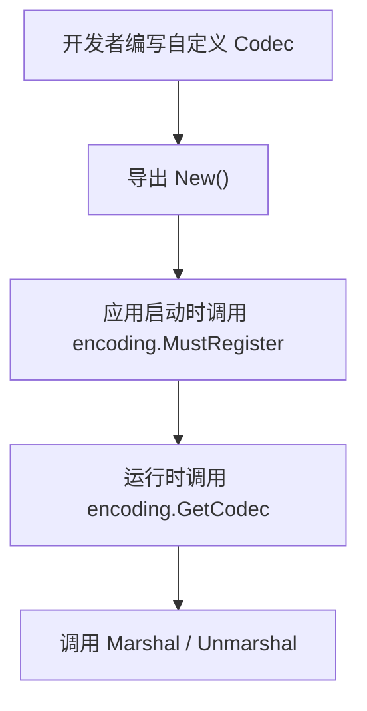

# Decoder 扩展机制

<cite>
**本文引用的文件**   
- [encoding.go](file://encoding/encoding.go)
- [encoding_test.go](file://encoding/encoding_test.go)
- [json.go](file://encoding/json/json.go)
- [json_test.go](file://encoding/json/json_test.go)
- [yaml.go](file://encoding/yaml/yaml.go)
- [yaml_test.go](file://encoding/yaml/yaml_test.go)
- [toml.go](file://encoding/toml/toml.go)
- [toml_test.go](file://encoding/toml/toml_test.go)
- [xml.go](file://encoding/xml/xml.go)
- [xml_test.go](file://encoding/xml/xml_test.go)
- [bson.go](file://encoding/bson/bson.go)
- [cbor.go](file://encoding/cbor/cbor.go)
- [gob.go](file://encoding/gob/gob.go)
- [msgpack.go](file://encoding/msgpack/msgpack.go)
- [proto.go](file://encoding/proto/proto.go)
- [proto_test.go](file://encoding/proto/proto_test.go)
- [thrift.go](file://encoding/thrift/thrift.go)
- [thrift_test.go](file://encoding/thrift/thrift_test.go)
- [avro.go](file://encoding/avro/avro.go)
- [avro_test.go](file://encoding/avro/avro_test.go)
- [flatbuffers.go](file://encoding/flatbuffers/flatbuffers.go)
- [flatbuffers_test.go](file://encoding/flatbuffers/flatbuffers_test.go)
</cite>

## 目录

1. [引言](#引言)
2. [项目结构](#项目结构)
3. [核心组件](#核心组件)
4. [架构总览](#架构总览)
5. [详细组件分析](#详细组件分析)
6. [依赖关系分析](#依赖关系分析)
7. [性能与并发特性](#性能与并发特性)
8. [自定义解码器开发指南](#自定义解码器开发指南)
9. [测试策略与调试技巧](#测试策略与调试技巧)
10. [故障排查](#故障排查)
11. [结论](#结论)

## 引言

本仓的 `encoding` 子模块提供统一的编解码抽象：所有传输面（HTTP、gRPC、TCP、WebSocket、SSE 等）和业务层通过名称取用编码器或解码器，而不直接耦合具体序列化库。其设计目标是：

- 定义最小接口，让 JSON、YAML、TOML、XML、Protobuf、Thrift、Avro、FlatBuffers、BSON、CBOR、MessagePack、Gob 等格式可拔插替换。
- 使用显式注册而非 `init()` 隐式自注册，避免意外副作用和难以追踪的全局状态。
- 对未注册格式返回 `nil`，由调用方快速失败，而不是静默降级。
- 保证全局注册表在并发访问下的安全性，同时尽量保持编解码器实例无状态，便于跨 goroutine 复用。

需要特别注意：**“Decoder”在本仓库中并非独立类型**。它统一收敛于 `encoding.Codec` 接口；所谓“解码扩展”，就是实现这个接口并注册到全局注册表。

## 项目结构

`encoding` 目录按“契约 + 多格式实现”组织：

| 路径 | 职责 |
|---|---|
| `encoding/encoding.go` | 定义 `Codec` 接口、全局注册表、查找函数和诊断枚举函数 |
| `encoding/json` | JSON 编解码实现 |
| `encoding/yaml` | YAML 编解码实现 |
| `encoding/toml` | TOML 编解码实现 |
| `encoding/xml` | XML 编解码实现 |
| `encoding/bson` | MongoDB BSON 实现 |
| `encoding/cbor` | CBOR 实现 |
| `encoding/gob` | Go 原生 Gob 实现 |
| `encoding/msgpack` | MessagePack 实现 |
| `encoding/proto` | Protobuf 实现 |
| `encoding/thrift` | Thrift 二进制协议实现 |
| `encoding/avro` | Avro 模式驱动实现 |
| `encoding/flatbuffers` | FlatBuffers 零拷贝实现 |
| `encoding/*_test.go` | 各格式单元测试 |

**图表来源**
- [encoding.go:1-69](file://encoding/encoding.go#L1-L69)
- [json.go:1-35](file://encoding/json/json.go#L1-L35)
- [yaml.go:1-34](file://encoding/yaml/yaml.go#L1-L34)
- [toml.go:1-46](file://encoding/toml/toml.go#L1-L46)
- [xml.go:1-39](file://encoding/xml/xml.go#L1-L39)
- [bson.go:1-43](file://encoding/bson/bson.go#L1-L43)
- [cbor.go:1-44](file://encoding/cbor/cbor.go#L1-L44)
- [gob.go:1-50](file://encoding/gob/gob.go#L1-L50)
- [msgpack.go:1-41](file://encoding/msgpack/msgpack.go#L1-L41)
- [proto.go:1-44](file://encoding/proto/proto.go#L1-L44)
- [thrift.go:1-64](file://encoding/thrift/thrift.go#L1-L64)
- [avro.go:1-112](file://encoding/avro/avro.go#L1-L112)
- [flatbuffers.go:1-102](file://encoding/flatbuffers/flatbuffers.go#L1-L102)

**章节来源**
- [encoding.go:1-69](file://encoding/encoding.go#L1-L69)

## 核心组件

### Codec 接口

`Codec` 是编码与解码的统一契约，包含三个方法：

| 方法 | 输入 | 输出 | 语义 |
|---|---|---|---|
| `Marshal(v any)` | 任意值 | 字节切片与错误 | 将业务对象序列化为字节流 |
| `Unmarshal(data []byte, v any)` | 字节流与目标指针 | 错误 | 将字节流反序列化为目标对象 |
| `Name() string` | 无 | 字符串 | 编解码器的稳定名称，用于全局注册和查找 |

接口本身不区分“编码器”和“解码器”。因此，“Decoder 扩展”的实现要求等价于“Codec 实现”要求：

1. `Marshal` 必须返回完整字节切片，不能写入半包。
2. `Unmarshal` 必须把数据写入传入的目标指针，不得创建新对象后丢弃。
3. `Name` 应返回稳定、可读、大小写规范的小写名称。
4. 编解码器实例通常应为无状态，以便被多个 goroutine 安全复用。
5. 错误应返回 `error`，不应 panic；panic 只应用于注册期编程错误。

**图表来源**
- [encoding.go:18-27](file://encoding/encoding.go#L18-L27)

**章节来源**
- [encoding.go:18-27](file://encoding/encoding.go#L18-L27)

### 全局注册表

全局注册表维护一个从“小写名称”到 `Codec` 的映射，并提供三类能力：

| 函数 | 行为 | 线程安全 |
|---|---|---|
| `MustRegister(c Codec)` | 按 `c.Name()` 注册；nil、空名、重复名均 panic | 写操作加写锁 |
| `GetCodec(name string)` | 按名称查找；未注册或空名返回 nil | 读操作加读锁 |
| `Names() []string` | 返回升序排列的所有已注册名称 | 读操作加读锁 |

注册名称统一转为小写存储，查找时也统一转小写，因此名称匹配是大小写无关的。

**图表来源**
- [encoding.go:30-52](file://encoding/encoding.go#L30-L52)

**章节来源**
- [encoding.go:29-69](file://encoding/encoding.go#L29-L69)

## 架构总览

下图展示应用装配阶段如何显式注册格式，以及运行时如何按名称取用编解码器。

**图表来源**
- [encoding.go:30-69](file://encoding/encoding.go#L30-L69)
- [json.go:12-35](file://encoding/json/json.go#L12-L35)
- [json_test.go:35-44](file://encoding/json/json_test.go#L35-L44)

## 详细组件分析

### 内置编解码器概览

| 格式 | 包名 | 底层库 | 特殊约束 |
|---|---|---|---|
| JSON | `encoding/json` | 标准库 `encoding/json` | 无额外约束 |
| YAML | `encoding/yaml` | `gopkg.in/yaml.v3` | 无额外约束 |
| TOML | `encoding/toml` | `github.com/BurntSushi/toml` | 无额外约束 |
| XML | `encoding/xml` | 标准库 `encoding/xml` | 无额外约束 |
| BSON | `encoding/bson` | `go.mongodb.org/mongo-driver/bson` | 无额外约束 |
| CBOR | `encoding/cbor` | `github.com/fxamacker/cbor/v2` | 无额外约束 |
| Gob | `encoding/gob` | 标准库 `encoding/gob` | Go 专用，非跨语言 |
| MessagePack | `encoding/msgpack` | `github.com/vmihailenco/msgpack/v5` | 无额外约束 |
| Protobuf | `encoding/proto` | `google.golang.org/protobuf/proto` | 值必须是 `proto.Message` |
| Thrift | `encoding/thrift` | `github.com/apache/thrift/lib/go/thrift` | 值必须实现 `thrift.TStruct` |
| Avro | `encoding/avro` | `github.com/linkedin/goavro/v2` | 推荐用 `NewCodec(schema)` 构造 |
| FlatBuffers | `encoding/flatbuffers` | `github.com/google/flatbuffers/go` | Marshal/Unmarshal 有生成代码约束 |

### Protobuf 编解码器

Protobuf 实现会做类型断言，确保传入值和接收目标都实现 `proto.Message`。如果类型不正确，`Marshal` 与 `Unmarshal` 都会返回错误，而不是 panic。

**图表来源**
- [proto.go:24-43](file://encoding/proto/proto.go#L24-L43)

**章节来源**
- [proto.go:1-44](file://encoding/proto/proto.go#L1-L44)
- [proto_test.go:1-44](file://encoding/proto/proto_test.go#L1-L44)

### Thrift 编解码器

Thrift 实现要求值实现 `thrift.TStruct`，也就是由 Thrift 编译器生成的结构体。每次编解码都创建新的 `TSerializer` 或 `TDeserializer`，因为上游库未声明这些对象线程安全。实现注释明确指出：如果编解码器持有共享状态，可能埋下数据竞争隐患。

**图表来源**
- [thrift.go:34-63](file://encoding/thrift/thrift.go#L34-L63)

**章节来源**
- [thrift.go:1-64](file://encoding/thrift/thrift.go#L1-L64)
- [thrift_test.go:1-44](file://encoding/thrift/thrift_test.go#L1-L44)

### Avro 编解码器

Avro 是模式驱动的格式。默认 `New()` 返回的编解码器没有绑定业务 schema，内部回退到 Avro 的 `null` schema，只能处理 null 值。对于真实记录类型，应使用 `NewCodec(schema string)` 构造带 schema 的编解码器。

`Unmarshal` 的结果是 Avro native 值，实现只支持写入 `*any` 或 `*map[string]any`，其他目标类型会返回错误。

**图表来源**
- [avro.go:55-111](file://encoding/avro/avro.go#L55-L111)

**章节来源**
- [avro.go:1-112](file://encoding/avro/avro.go#L1-L112)
- [avro_test.go:1-47](file://encoding/avro/avro_test.go#L1-L47)

### FlatBuffers 编解码器

FlatBuffers 是零拷贝格式，没有通用 `Marshal/Unmarshal` API。该实现桥接了两个约定：

- `Marshal`：值必须实现包内定义的 `FlatBufferMarshaler`，即提供 `PackFlatBuffer()`。
- `Unmarshal`：目标必须实现 `flatbuffers.FlatBuffer`。

为避免下游零拷贝库在未校验 buffer 时越界或 panic，`Unmarshal` 先检查根偏移长度和 root offset 范围，再调用 `fb.GetRootAs`。

**图表来源**
- [flatbuffers.go:40-101](file://encoding/flatbuffers/flatbuffers.go#L40-L101)

**章节来源**
- [flatbuffers.go:1-102](file://encoding/flatbuffers/flatbuffers.go#L1-L102)
- [flatbuffers_test.go:1-88](file://encoding/flatbuffers/flatbuffers_test.go#L1-L88)

### 简单文本与二进制格式

JSON、YAML、TOML、XML、BSON、CBOR、MessagePack、Gob 的实现更接近“包装现有库”的模式：它们直接委托标准库或第三方库完成编解码，并在 `Marshal`/`Unmarshal` 中透传错误。

其中 Gob 使用 `bytes.Buffer` 和 `bytes.NewReader` 适配标准库的流式 API，使其符合 `[]byte` 语义。

**章节来源**
- [json.go:1-35](file://encoding/json/json.go#L1-L35)
- [yaml.go:1-34](file://encoding/yaml/yaml.go#L1-L34)
- [toml.go:1-46](file://encoding/toml/toml.go#L1-L46)
- [xml.go:1-39](file://encoding/xml/xml.go#L1-L39)
- [bson.go:1-43](file://encoding/bson/bson.go#L1-L43)
- [cbor.go:1-44](file://encoding/cbor/cbor.go#L1-L44)
- [gob.go:1-50](file://encoding/gob/gob.go#L1-L50)
- [msgpack.go:1-41](file://encoding/msgpack/msgpack.go#L1-L41)

## 依赖关系分析

`encoding` 契约包不依赖任何具体格式实现；具体格式包反向依赖 `encoding`。这避免了根模块引入适配器形成环，也是全仓「契约包不 import 具体后端」这条口径在编码面上的落点。

**图表来源**
- [encoding.go:1-69](file://encoding/encoding.go#L1-L69)

**章节来源**
- [encoding.go:1-10](file://encoding/encoding.go#L1-L10)

## 性能与并发特性

### 全局注册表

注册表使用 `sync.RWMutex`：

- `MustRegister` 使用写锁，因为要修改 map。
- `GetCodec` 和 `Names` 使用读锁，因为只是读取 map。
- 名称统一小写化发生在锁前，减少锁内字符串比较成本。

这意味着：

- 注册阶段可能有写锁竞争，但通常是单次或极少次调用。
- 运行时的编解码器查找几乎无锁争用。
- 名称查询 `Names()` 会分配切片并对结果排序，适合诊断场景，不适合高频热路径。

### 编解码器实例

大多数内置编解码器是无状态的：

- JSON、YAML、TOML、XML、BSON、CBOR、MessagePack、Gob、Protobuf、FlatBuffers 的 codec 都是空结构体或仅持不可变字段。
- Thrift 明确每调用新建序列化器/反序列化器，以避免潜在数据竞争。
- Avro 的默认 codec 在首次编解码时懒加载 null schema，但后续缓存到 `avroCodec` 字段。

### 内存分配

- JSON、YAML、BSON、CBOR、MessagePack 直接委托底层库，分配行为取决于具体实现。
- TOML 使用 `bytes.Buffer` 作为中间缓冲区。
- Gob 使用 `bytes.Buffer` 和 `bytes.Reader` 适配流式 API。
- FlatBuffers 设计目标是零拷贝，但本包装仍会复制 buffer 进入 `GetRootAs` 的参数。

### 时间复杂度

编解码器本身的时间复杂度完全由底层序列化库决定。`encoding` 层只做名称查找和类型断言，属于常数级开销。

**章节来源**
- [encoding.go:30-69](file://encoding/encoding.go#L30-L69)
- [thrift.go:34-63](file://encoding/thrift/thrift.go#L34-L63)
- [avro.go:37-54](file://encoding/avro/avro.go#L37-L54)
- [gob.go:28-49](file://encoding/gob/gob.go#L28-L49)

## 自定义解码器开发指南

### 实现步骤

1. **确定格式名称**  
   选择一个稳定的小写字符串作为格式名称，例如 `json`、`yaml`、`myformat`。

2. **定义编解码器类型**  
   创建一个空结构体或小结构体。如果需要缓存 schema、连接池或编译产物，放在这里；否则保持无状态。

3. **实现 `Marshal`**  
   - 接收任意值。
   - 将值序列化为字节切片。
   - 遇到格式错误、类型不兼容或 I/O 错误时返回 `error`。
   - 不要 panic。

4. **实现 `Unmarshal`**  
   - 接收字节切片和目标指针。
   - 将数据写入目标指针指向的对象。
   - 如果目标不是期望类型，返回错误。
   - 如果数据不完整、格式错误或超出限制，返回错误。

5. **实现 `Name`**  
   - 返回注册名称。
   - 建议与包常量一致，方便测试和文档引用。

6. **添加编译期接口检查**  
   像内置实现一样，使用变量断言确保类型满足 `encoding.Codec`。

7. **提供显式构造器**  
   导出 `New()`，让调用方在装配阶段显式注册。

8. **在装配期注册**  
   调用 `encoding.MustRegister(New())`。不要在 `init()` 中自动注册。

### 错误处理约定

参考内置实现：

- 类型不匹配：返回 `fmt.Errorf` 包裹的错误，说明实际类型和期望类型。
- 数据无效：返回底层库的错误，必要时追加上下文。
- 注册期错误：`MustRegister` 使用 panic 快速失败，因为这是编程错误。
- 运行时错误：编解码器方法应返回错误，不 panic。

### 线程安全约定

- 编解码器实例应由多个 goroutine 共享。
- 如果底层库不保证线程安全，应在每次调用中创建局部对象。
- 如果需要在编解码器中缓存状态，必须加锁或使用线程安全结构。
- Thrift 实现是重要参考：它明确避免共享序列化器实例。

### 验证逻辑位置

`encoding.Codec` 不定义独立的 `Validate` 方法。因此，自定义格式的验证可以放在：

- `Unmarshal` 中：在填充目标对象后检查业务规则。
- 上层业务层：在拿到目标对象后进一步校验。
- 自定义包装类型：在 `Unmarshal` 中封装格式校验与业务校验。

示例参考路径：

- JSON 类型转换：[json.go:23-34](file://encoding/json/json.go#L23-L34)
- Protobuf 类型断言：[proto.go:24-43](file://encoding/proto/proto.go#L24-L43)
- Thrift 类型断言：[thrift.go:45-63](file://encoding/thrift/thrift.go#L45-L63)
- Avro 目标类型校验：[avro.go:85-110](file://encoding/avro/avro.go#L85-L110)
- FlatBuffers buffer 合法性校验：[flatbuffers.go:68-101](file://encoding/flatbuffers/flatbuffers.go#L68-L101)

### 注册与查找流程

**图表来源**
- [encoding.go:30-69](file://encoding/encoding.go#L30-L69)
- [json_test.go:35-44](file://encoding/json/json_test.go#L35-L44)

**章节来源**
- [encoding.go:30-69](file://encoding/encoding.go#L30-L69)
- [proto.go:12-43](file://encoding/proto/proto.go#L12-L43)
- [thrift.go:34-63](file://encoding/thrift/thrift.go#L34-L63)
- [avro.go:37-111](file://encoding/avro/avro.go#L37-L111)
- [flatbuffers.go:40-101](file://encoding/flatbuffers/flatbuffers.go#L40-L101)

## 测试策略与调试技巧

### 基础测试矩阵

每个内置格式测试通常覆盖：

1. `Name()` 返回值。
2. 往返编解码：原对象 → 字节 → 目标对象 → 字段相等。
3. 显式注册后可通过 `encoding.GetCodec` 查找到。

参考：

- JSON：[json_test.go:1-44](file://encoding/json/json_test.go#L1-L44)
- YAML：[yaml_test.go:1-44](file://encoding/yaml/yaml_test.go#L1-L44)
- TOML：[toml_test.go:1-44](file://encoding/toml/toml_test.go#L1-L44)
- XML：[xml_test.go:1-47](file://encoding/xml/xml_test.go#L1-L47)

### 注册表测试

注册表测试覆盖：

- 正常注册与查找。
- 名称大小写无关。
- 未注册返回 nil。
- 空字符串返回 nil。
- nil codec panic。
- 空名称 panic。
- 重复名称 panic。
- `Names()` 返回排序结果。

参考：[encoding_test.go:1-142](file://encoding/encoding_test.go#L1-L142)

### 类型约束测试

对强类型编解码器，应测试：

- 正确类型能编解码。
- 错误类型返回错误。
- 错误数据返回错误。

参考：

- Protobuf 非 `proto.Message`：[proto_test.go:31-44](file://encoding/proto/proto_test.go#L31-L44)
- Thrift 非 `TStruct`：[thrift_test.go:21-44](file://encoding/thrift/thrift_test.go#L21-L44)
- Avro 无效 schema：[avro_test.go:36-47](file://encoding/avro/avro_test.go#L36-L47)
- FlatBuffers 短 buffer、空 buffer、越界 root offset、错误目标类型：[flatbuffers_test.go:29-88](file://encoding/flatbuffers/flatbuffers_test.go#L29-L88)

### 并发与稳定性测试

- 对无状态编解码器，可通过多次调用同一实例确认不会崩溃。
- 对 Thrift 这类每调用创建序列化器的实现，应保留状态性断言，防止误改成共享可变状态。
- 对全局注册表，可结合 race detector 验证 `MustRegister` 与 `GetCodec` 的并发访问。

### 调试技巧

1. **使用 `encoding.Names()`**  
   打印当前进程已注册的编解码器名称，确认自定义格式是否真正注册。

2. **检查 `GetCodec` 返回值**  
   未注册时会返回 nil；调用方应先判断 nil，再调用 `Marshal`/`Unmarshal`。

3. **区分“注册期 panic”和“运行时错误”**  
   `MustRegister(nil)`、`MustRegister("")`、重复注册会 panic；编解码器方法应返回错误。

4. **对强类型格式单独写类型错误用例**  
   Protobuf、Thrift、FlatBuffers、Avro 都有额外类型约束，不能只测往返。

5. **对缓冲边界敏感格式单独写畸形数据用例**  
   FlatBuffers 是最典型例子，需覆盖空 buffer、短 buffer、root offset 越界。

**章节来源**
- [encoding_test.go:1-142](file://encoding/encoding_test.go#L1-L142)
- [json_test.go:1-44](file://encoding/json/json_test.go#L1-L44)
- [proto_test.go:1-44](file://encoding/proto/proto_test.go#L1-L44)
- [thrift_test.go:1-44](file://encoding/thrift/thrift_test.go#L1-L44)
- [avro_test.go:1-47](file://encoding/avro/avro_test.go#L1-L47)
- [flatbuffers_test.go:1-88](file://encoding/flatbuffers/flatbuffers_test.go#L1-L88)

## 故障排查

### 问题：`GetCodec` 返回 nil

**可能原因**

- 忘记调用 `encoding.MustRegister`。
- 名称拼写不一致。
- 使用了不同模块版本导致注册表隔离。
- 名称大小写差异（虽然查找大小写无关，但注册名仍需稳定）。

**排查步骤**

1. 确认装配阶段调用了 `encoding.MustRegister`。
2. 调用 `encoding.Names()` 查看已注册名称。
3. 检查自定义 `Name()` 返回值。
4. 检查是否有多个进程或测试并行覆盖注册表。

**参考**

- 未注册返回 nil：[encoding_test.go:35-40](file://encoding/encoding_test.go#L35-L40)
- 空字符串返回 nil：[encoding_test.go:42-47](file://encoding/encoding_test.go#L42-L47)
- 名称大小写无关：[encoding_test.go:23-33](file://encoding/encoding_test.go#L23-L33)

### 问题：注册时报 panic

**可能原因**

- 传入 nil codec。
- 编解码器 `Name()` 返回空字符串。
- 重复注册相同名称。

**处理方式**

这些都是注册期编程错误，应通过修复装配代码解决，而不是捕获 panic。

**参考**

- nil 注册 panic：[encoding_test.go:49-60](file://encoding/encoding_test.go#L49-L60)
- 空名称注册 panic：[encoding_test.go:62-72](file://encoding/encoding_test.go#L62-L72)
- 重复名称注册 panic：[encoding_test.go:74-85](file://encoding/encoding_test.go#L74-L85)

### 问题：编解码报类型错误

**可能原因**

- 对 Protobuf 传了非 `proto.Message`。
- 对 Thrift 传了普通 Go 结构体。
- 对 FlatBuffers 传了未实现 `FlatBufferMarshaler` 的值。
- 对 Avro 使用了默认 codec 处理复杂记录。
- 对 Avro `Unmarshal` 传了不支持的目标类型。

**处理方式**

根据具体格式调整传入值或目标类型，或使用对应格式的专用构造器。

**参考**

- Protobuf 类型错误：[proto_test.go:31-44](file://encoding/proto/proto_test.go#L31-L44)
- Thrift 类型错误：[thrift_test.go:21-44](file://encoding/thrift/thrift_test.go#L21-L44)
- FlatBuffers 类型错误：[flatbuffers_test.go:75-88](file://encoding/flatbuffers/flatbuffers_test.go#L75-L88)
- Avro schema 错误：[avro_test.go:36-47](file://encoding/avro/avro_test.go#L36-L47)

### 问题：FlatBuffers 解析越界或 panic

**可能原因**

- buffer 太短。
- buffer 为空。
- root offset 越界。
- 目标未实现 `flatbuffers.FlatBuffer`。

**处理方式**

- 对外部输入做长度校验。
- 使用本实现的 `Unmarshal`，它会先校验 buffer 头。
- 确保目标类型实现所需接口。

**参考**

- 短 buffer：[flatbuffers_test.go:41-52](file://encoding/flatbuffers/flatbuffers_test.go#L41-L52)
- 空 buffer：[flatbuffers_test.go:54-63](file://encoding/flatbuffers/flatbuffers_test.go#L54-L63)
- root offset 越界：[flatbuffers_test.go:65-73](file://encoding/flatbuffers/flatbuffers_test.go#L65-L73)
- buffer 校验逻辑：[flatbuffers.go:84-101](file://encoding/flatbuffers/flatbuffers.go#L84-L101)

**章节来源**
- [encoding_test.go:23-85](file://encoding/encoding_test.go#L23-L85)
- [proto_test.go:31-44](file://encoding/proto/proto_test.go#L31-L44)
- [thrift_test.go:21-44](file://encoding/thrift/thrift_test.go#L21-L44)
- [avro_test.go:36-47](file://encoding/avro/avro_test.go#L36-L47)
- [flatbuffers_test.go:41-88](file://encoding/flatbuffers/flatbuffers_test.go#L41-L88)
- [flatbuffers.go:84-101](file://encoding/flatbuffers/flatbuffers.go#L84-L101)

## 结论

`encoding` 模块以最小接口 `Codec` 统一定义了“解码扩展”的能力边界。实现自定义 Decoder 的核心要点是：

- 实现 `Marshal`、`Unmarshal`、`Name`。
- 对强类型格式进行类型断言和错误返回。
- 保持编解码器实例尽可能无状态，或通过明确同步机制保证线程安全。
- 在应用装配阶段显式调用 `encoding.MustRegister`。
- 在运行时通过 `encoding.GetCodec` 查找并使用。
- 针对注册表行为、往返编解码、类型约束、畸形输入和并发访问编写测试。

这种设计让框架能够以统一方式接入多种序列化格式，同时把格式差异下沉到具体实现包，使业务代码和传输层不必关心底层是 JSON、YAML、Protobuf 还是其他格式。