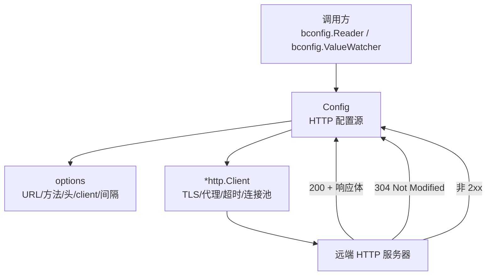
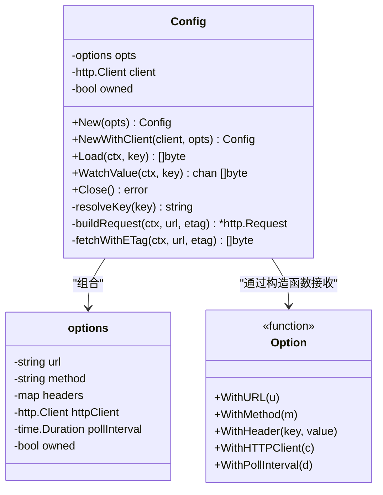
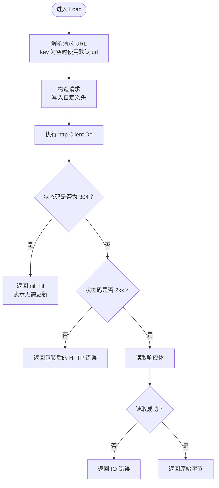
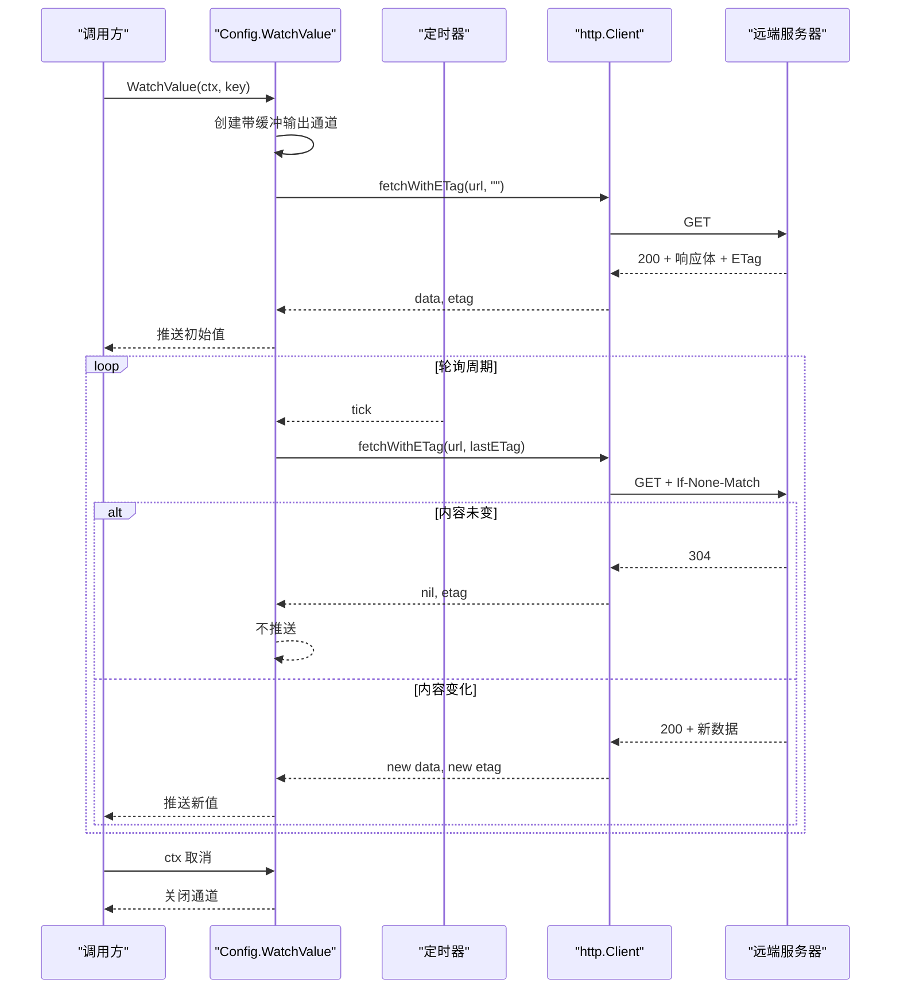
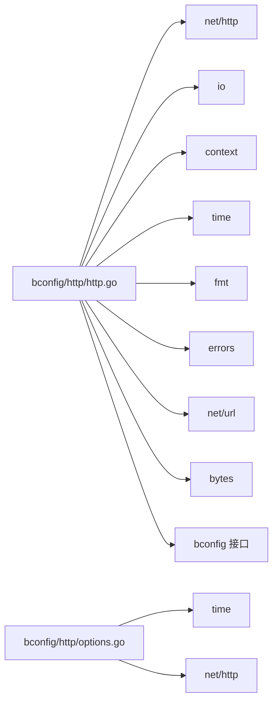

# HTTP 远端 Provider

<cite>
**本文引用的文件**   
- [bconfig/http/http.go](file://bconfig/http/http.go)
- [bconfig/http/options.go](file://bconfig/http/options.go)
- [bconfig/http/http_test.go](file://bconfig/http/http_test.go)
</cite>

## 目录
1. [简介](#简介)
2. [项目结构与定位](#项目结构与定位)
3. [核心组件与接口契约](#核心组件与接口契约)
4. [架构总览](#架构总览)
5. [详细组件分析](#详细组件分析)
6. [依赖关系分析](#依赖关系分析)
7. [性能与资源特性](#性能与资源特性)
8. [故障排查指南](#故障排查指南)
9. [结论](#结论)

## 简介
HTTP 远端 Provider 是 `bald` 配置体系中的 HTTP 配置源，负责从任意 HTTP 服务器拉取配置数据，并通过短轮询机制向调用方推送变更。它实现以下关键能力：

- 使用 GET（可配置）请求远端地址获取原始字节流。
- 通过 `ETag` + `If-None-Match` 进行条件轮询，减少无效网络往返和下游重合并。
- 支持通过自定义 `http.Client` 注入 TLS、代理、超时等传输层行为。
- 通过自定义请求头携带认证信息，例如 Bearer Token；Basic Auth 可通过相同方式设置。
- 不解析响应体具体格式，把完整字节交给上层配置解码器。
- 提供两种构造模式：自建 `http.Client` 并管理连接生命周期，或复用外部 client。

该 Provider 不是网关出站、服务发现或 Broker 订阅者，而是“配置加载器”，通常由 `bconf`/`bconfig` 启动阶段消费，为应用装配初始配置并提供后续热更新通道。

## 项目结构与定位
HTTP Provider 位于 `bconfig/http` 包中，由三个文件组成：

| 文件 | 职责 |
| --- | --- |
| [bconfig/http/http.go](file://bconfig/http/http.go) | Provider 主逻辑：构造、GET 请求、ETag 轮询、错误处理、连接关闭 |
| [bconfig/http/options.go](file://bconfig/http/options.go) | 选项构建器：URL、方法、请求头、`http.Client`、轮询间隔 |
| [bconfig/http/http_test.go](file://bconfig/http/http_test.go) | 单元测试：参数校验、基本拉取、方法/头部透传、非 2xx 错误、ETag 轮询 |

**图表来源**
- [bconfig/http/http.go:26-88](file://bconfig/http/http.go#L26-L88)
- [bconfig/http/options.go:1-58](file://bconfig/http/options.go#L1-L58)

**章节来源**
- [bconfig/http/http.go:1-236](file://bconfig/http/http.go#L1-L236)
- [bconfig/http/options.go:1-58](file://bconfig/http/options.go#L1-L58)
- [bconfig/http/http_test.go:1-136](file://bconfig/http/http_test.go#L1-L136)

## 核心组件与接口契约
Provider 的核心类型是 `Config`，同时实现三个接口：

| 接口 | 用途 | Provider 行为 |
| --- | --- | --- |
| `bconfig.Reader` | 一次性读取配置 | `Load(ctx, key)` 返回原始字节；304 返回空值而非错误 |
| `bconfig.ValueWatcher` | 监听配置变化 | `WatchValue(ctx, key)` 返回只读通道，按轮询间隔推送新配置 |
| `bconfig.Closer` | 资源清理 | 自建 client 时关闭空闲连接；注入 client 时空操作 |

**图表来源**
- [bconfig/http/http.go:26-88](file://bconfig/http/http.go#L26-L88)
- [bconfig/http/options.go:1-58](file://bconfig/http/options.go#L1-L58)

**章节来源**
- [bconfig/http/http.go:26-88](file://bconfig/http/http.go#L26-L88)
- [bconfig/http/options.go:1-58](file://bconfig/http/options.go#L1-L58)

## 架构总览
HTTP Provider 的工作流程分为两条路径：**单次拉取**和**长轮询监听**。

### 单次拉取流程
`Load` 用于初始化配置或主动刷新：

**图表来源**
- [bconfig/http/http.go:88-130](file://bconfig/http/http.go#L88-L130)

### WatchValue 轮询流程
`WatchValue` 是短轮询实现，不是真正的服务端推送：

**图表来源**
- [bconfig/http/http.go:130-200](file://bconfig/http/http.go#L130-L200)

**章节来源**
- [bconfig/http/http.go:88-200](file://bconfig/http/http.go#L88-L200)

## 详细组件分析

### 构造与生命周期
Provider 提供两个入口：

| 构造方式 | 行为 | 适用场景 |
| --- | --- | --- |
| `New(...Option)` | 若未传入 `http.Client`，则用默认 10 秒超时创建客户端；`Close()` 会关闭空闲连接 | 大多数独立配置源用法 |
| `NewWithClient(*http.Client, ...Option)` | 复用已有客户端；`Close()` 不关闭该 client | 共享连接池、需要统一 TLS/代理/追踪策略 |

关键约束：

- URL 必填。
- 注入的 `http.Client` 不能为 `nil`。
- `owned` 标志决定 `Close()` 是否调用 `CloseIdleConnections()`。

**章节来源**
- [bconfig/http/http.go:40-88](file://bconfig/http/http.go#L40-L88)
- [bconfig/http/http.go:224-236](file://bconfig/http/http.go#L224-L236)

### 请求构造与认证机制
Provider 的请求构造逻辑如下：

1. 使用 `context` 创建请求。
2. 写入所有自定义请求头。
3. 如果有上一次 ETag，附加 `If-None-Match`。
4. 通过 `http.Client.Do` 发送请求。

认证方面，Provider **不内置 Basic Auth 或 Bearer Token 封装**，但允许通过 `WithHeader("Authorization", "...")` 直接设置认证头。因此：

| 认证方式 | 是否支持 | 说明 |
| --- | ---: | --- |
| Bearer Token | 是 | 通过 `WithHeader("Authorization", "Bearer <token>")` |
| Basic Auth | 是 | 通过 `WithHeader("Authorization", "Basic <base64(user:pass)>")` |
| Cookie 认证 | 是 | 通过 `WithHeader("Cookie", "...")` |
| 自定义鉴权头 | 是 | 通过任意 `WithHeader` |
| 自动签名、OAuth 流程 | 否 | 需要在上层组装 Authorization 头后传入 |

测试覆盖了 POST 方法与 Bearer Token 透传，说明任何 HTTP 方法和任意请求头均可工作。

**章节来源**
- [bconfig/http/http.go:70-88](file://bconfig/http/http.go#L70-L88)
- [bconfig/http/http_test.go:43-74](file://bconfig/http/http_test.go#L43-L74)

### GET 请求、响应体解码与错误处理
Provider 的行为是“二进制透明”：

- 不指定请求体。
- 不指定 `Content-Type`。
- 不解析 JSON、YAML、Proto 等格式。
- 返回原始字节，由上层配置解码器处理。

错误分类：

| 场景 | 行为 |
| --- | --- |
| 创建请求失败 | 返回包装错误 |
| 网络或底层传输错误 | 返回包装错误 |
| 304 Not Modified | `Load` 返回 `nil, nil`；`WatchValue` 跳过推送 |
| 非 2xx | 返回包含脱敏 URL 和状态文本的错误 |
| 读取响应体失败 | 返回 IO 错误 |
| URL 中包含凭据 | 日志中用户名和密码会被替换为 `REDACTED` |

注意：Provider 不会重试。HTTP 错误会立即上抛，由调用方决定是否重试。

**章节来源**
- [bconfig/http/http.go:88-130](file://bconfig/http/http.go#L88-L130)
- [bconfig/http/http.go:201-223](file://bconfig/http/http.go#L201-L223)
- [bconfig/http/http_test.go:76-110](file://bconfig/http/http_test.go#L76-L110)

### ETag 轮询与缓存策略
`WatchValue` 使用固定间隔轮询，并在内部维护两份轻量缓存：

| 内部状态 | 含义 |
| --- | --- |
| `lastETag` | 上次成功响应的 ETag，下次请求作为 `If-None-Match` |
| `lastBody` | 上次成功拉取的响应体字节，用于判断内容是否真正变化 |

缓存语义：

- 首次拉取后立即推送初始值。
- 304 表示无变化，不推送。
- 如果服务器不返回 ETag，仍会比较两次响应体字节；相等时不重复推送。
- 上下文取消后通道关闭。
- 单次拉取失败时静默跳过，等待下一个轮询周期重试。

这使 Provider 避免“频繁触发空合并或 `OnChange` 回调”。

**章节来源**
- [bconfig/http/http.go:130-200](file://bconfig/http/http.go#L130-L200)

### 刷新策略选择：短轮询 vs 长轮询
当前实现是**短轮询**：

- 使用 `time.Ticker`。
- 默认间隔 30 秒。
- 可通过 `WithPollInterval` 调整。
- 不适合毫秒级实时性要求。

| 刷新策略 | 特点 | 适用场景 |
| --- | --- | --- |
| 短轮询（当前实现） | 简单、稳定、对服务端压力可控；有延迟等于轮询间隔 | 配置类低频变更 |
| 长轮询 | 客户端挂起请求直到变更或超时；更接近实时；实现更复杂 | 低延迟配置同步 |
| WebSocket/SSE 推送 | 真正双向或单向流式推送；实现复杂度最高 | 高实时、高吞吐事件 |

对于本仓库的 HTTP Provider，应选择短轮询，并根据配置变更频率调整 `WithPollInterval`。若需要更低延迟，应更换为支持推送的配置后端，或在调用方封装长轮询。

**章节来源**
- [bconfig/http/http.go:20-26](file://bconfig/http/http.go#L20-L26)
- [bconfig/http/http.go:130-200](file://bconfig/http/http.go#L130-L200)
- [bconfig/http/options.go:48-58](file://bconfig/http/options.go#L48-L58)

### 连接参数、超时、重试与 SSL/TLS 配置
HTTP Provider 本身不暴露独立的连接参数字段，而是委托给 `http.Client`：

| 配置项 | Provider 暴露方式 | 说明 |
| --- | --- | --- |
| 基础 URL | `WithURL` | 必填 |
| HTTP 方法 | `WithMethod` | 默认 GET，可改为 POST 等 |
| 自定义头 | `WithHeader` | 用于认证、租户标识等 |
| 请求超时 | 通过 `WithHTTPClient` 设置 `http.Client.Timeout` | 默认 10 秒 |
| 连接超时、KeepAlive | 通过 `WithHTTPClient` 自定义 `http.Transport` | Provider 不直接暴露 |
| TLS/证书 | 通过 `WithHTTPClient` 设置 `tls.Config` | Provider 不创建证书逻辑 |
| 代理 | 通过 `WithHTTPClient` 设置 `Proxy` | 由标准库处理 |
| 重试 | Provider 不重试 | 需调用方或外层重试中间件处理 |
| 轮询间隔 | `WithPollInterval` | 默认 30 秒 |

重要事实：

- 默认 `http.Client.Timeout` 是 10 秒。
- 若注入 `http.Client`，Provider 不再管理其生命周期。
- 错误信息中的 URL 会剥离用户信息，防止泄露 token。
- 重试必须由调用方实现，因为 Provider 会把网络错误直接返回。

**章节来源**
- [bconfig/http/http.go:26-58](file://bconfig/http/http.go#L26-L58)
- [bconfig/http/options.go:1-58](file://bconfig/http/options.go#L1-L58)
- [bconfig/http/http.go:201-236](file://bconfig/http/http.go#L201-L236)

## 依赖关系分析
HTTP Provider 的内部依赖很薄，主要依赖 Go 标准库和 `bconfig` 接口：

**图表来源**
- [bconfig/http/http.go:1-23](file://bconfig/http/http.go#L1-L23)
- [bconfig/http/options.go:1-5](file://bconfig/http/options.go#L1-L5)

耦合点：

- Provider 仅依赖 `bconfig` 接口，不依赖具体配置格式。
- 传输层完全由 `http.Client` 抽象，便于替换 TLS、代理、连接池。
- 没有业务后端耦合，也没有注册中心或 Broker 依赖。

**章节来源**
- [bconfig/http/http.go:1-23](file://bconfig/http/http.go#L1-L23)
- [bconfig/http/options.go:1-5](file://bconfig/http/options.go#L1-L5)

## 性能与资源特性
- **网络开销**：每次轮询发起一次 HTTP 请求；304 可减少响应体传输。
- **内存占用**：仅在通道缓冲区保留一个配置快照；内部还缓存最后一次 ETag 和响应体。
- **并发安全**：`Config` 实例由单个 goroutine 持有；多个 goroutine 应分别调用 `WatchValue`。
- **goroutine 数量**：每个 `WatchValue` 启动一个后台 goroutine。
- **通道容量**：输出通道容量为 1，避免积压。
- **连接回收**：自建 client 在 `Close()` 时关闭空闲连接。
- **CPU 消耗**：主要由轮询间隔和下游合并逻辑决定；Provider 自身只做浅比较。

优化建议：

1. 合理设置 `WithPollInterval`，避免过短导致频繁网络请求。
2. 确保远端服务器正确支持 ETag，否则无法利用 304 优化。
3. 在高 QPS 场景中，共享 `http.Client` 以复用连接池。
4. 不要把配置值过大放入 HTTP 配置源；大对象会增加带宽和内存压力。
5. 对不可靠网络环境，在外层增加重试和熔断，而不是在 Provider 内硬编码重试。

**章节来源**
- [bconfig/http/http.go:130-200](file://bconfig/http/http.go#L130-L200)
- [bconfig/http/http.go:224-236](file://bconfig/http/http.go#L224-L236)

## 故障排查指南

### 常见问题与定位
| 现象 | 可能原因 | 排查动作 |
| --- | --- | --- |
| 构造时报错 | URL 为空 | 检查 `WithURL` |
| 注入 client 时报错 | `http.Client` 为 `nil` | 检查传入 client |
| 首次拉取失败 | 远端不可达、认证失败、非 2xx | 查看错误消息中的脱敏 URL 和状态码 |
| WatchValue 一直不推送 | 远端始终返回 304 | 检查 ETag 是否变化 |
| WatchValue 频繁推送 | 服务器未返回 ETag 且每次响应体不同 | 确认服务端 ETag 稳定性或增加去重 |
| 认证失败 | Authorization 头未设置或过期 | 检查 `WithHeader` |
| 超时 | 默认 10 秒不够或网络慢 | 通过 `WithHTTPClient` 调整 `Timeout` |
| 连接泄漏 | 使用了自建 client 但未 `Close()` | 调用 `Close()` |

### 错误传播规则
- `Load` 遇到非 2xx 或非 IO 错误会直接返回错误。
- `WatchValue` 的轮询失败只会跳过本次，不会关闭通道。
- 上下文取消会关闭输出通道。
- URL 中的用户名和密码不会出现在错误消息中。

### 推荐调试步骤
1. 先用 `Load` 验证单次拉取是否能拿到预期字节。
2. 检查远端响应是否返回 ETag。
3. 检查 `Authorization` 头是否正确。
4. 调整 `WithPollInterval`，观察推送频率。
5. 如果需要 TLS、代理或自定义超时，改用 `WithHTTPClient`。
6. 如果需要在失败后重试，将调用逻辑提升到调用方。

**章节来源**
- [bconfig/http/http.go:88-130](file://bconfig/http/http.go#L88-L130)
- [bconfig/http/http.go:130-200](file://bconfig/http/http.go#L130-L200)
- [bconfig/http/http.go:201-236](file://bconfig/http/http.go#L201-L236)
- [bconfig/http/http_test.go:1-136](file://bconfig/http/http_test.go#L1-L136)

## 结论
HTTP 远端 Provider 是一个简洁、可插拔的配置拉取组件。它不负责解析配置格式，也不内置重试、Basic Auth 或 OAuth 流程，而是把传输细节交给标准库 `http.Client`，把认证细节交给调用方设置的请求头。它的核心价值在于：

- 用最小实现提供 HTTP 配置源。
- 用 ETag 条件轮询降低无效推送。
- 用 `Reader`/`Watcher`/`Closer` 三个接口融入 `bald` 配置生态。
- 通过选项模式支持方法、头部、client、轮询间隔等常见需求。

生产使用时，应重点关注远端服务器的 ETag 语义、HTTP 状态码、认证头、超时和连接池复用。对于强实时推送需求，应考虑使用支持 SSE、WebSocket 或专用配置中心的后端。