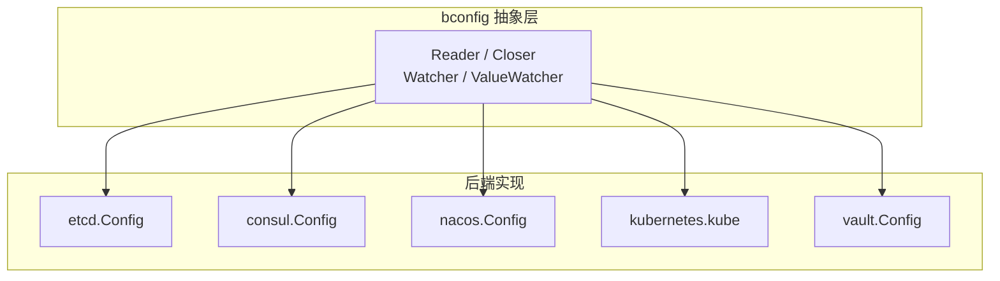
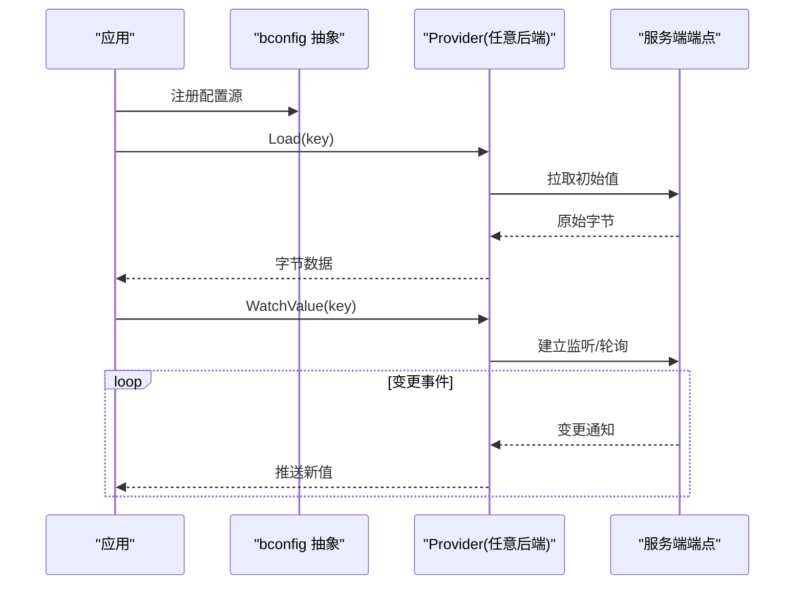
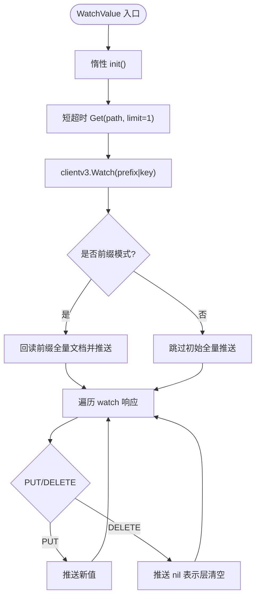
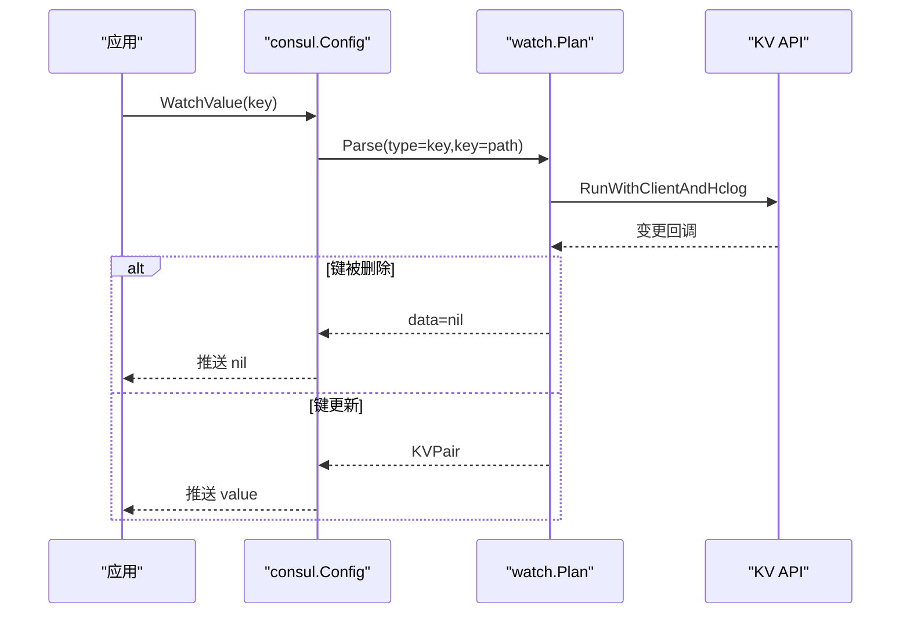
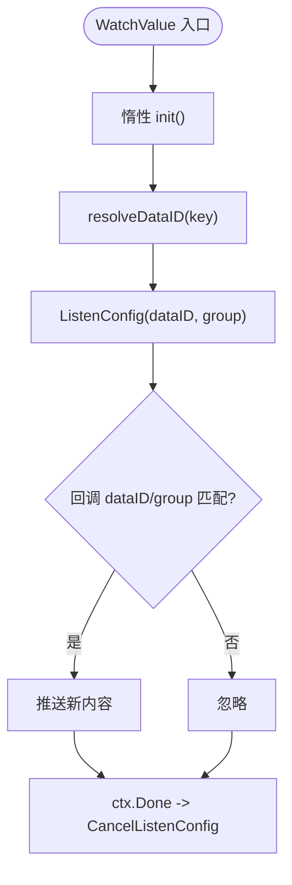
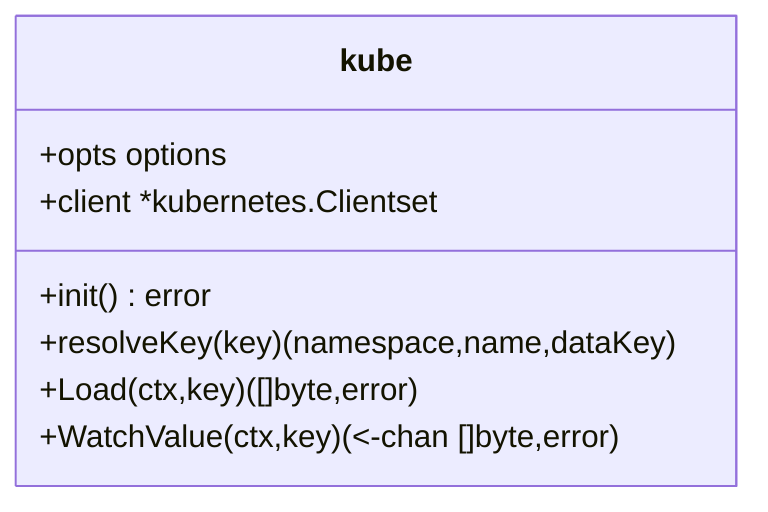
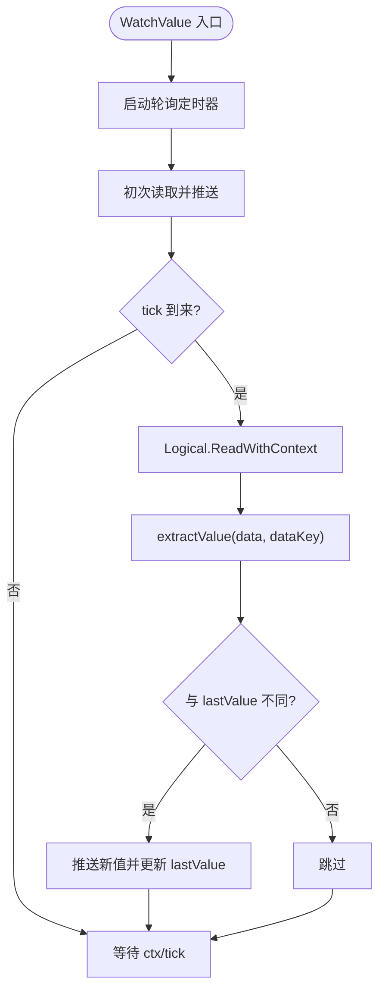
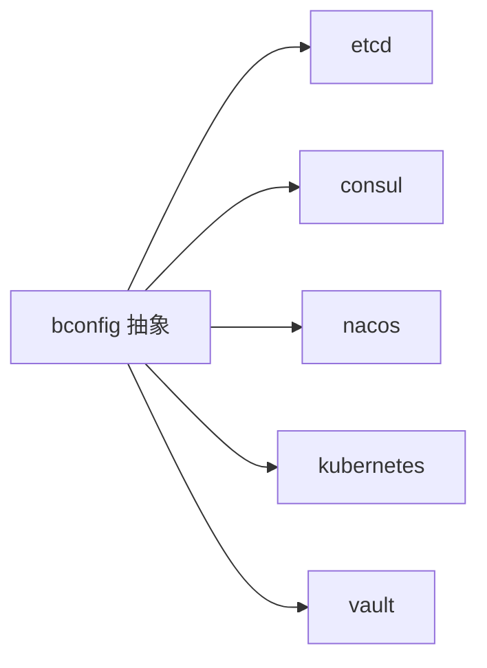

# 分布式配置中心 Provider

<cite>
**本文引用的文件**   
- [bconfig/bconfig.go](file://bconfig/bconfig.go)
- [bconfig/etcd/config.go](file://bconfig/etcd/config.go)
- [bconfig/etcd/options.go](file://bconfig/etcd/options.go)
- [bconfig/consul/config.go](file://bconfig/consul/config.go)
- [bconfig/consul/options.go](file://bconfig/consul/options.go)
- [bconfig/nacos/config.go](file://bconfig/nacos/config.go)
- [bconfig/nacos/options.go](file://bconfig/nacos/options.go)
- [bconfig/kubernetes/config.go](file://bconfig/kubernetes/config.go)
- [bconfig/kubernetes/options.go](file://bconfig/kubernetes/options.go)
- [bconfig/vault/config.go](file://bconfig/vault/config.go)
- [bconfig/vault/options.go](file://bconfig/vault/options.go)
</cite>

## 目录
1. [引言](#引言)
2. [项目结构](#项目结构)
3. [核心组件](#核心组件)
4. [架构总览](#架构总览)
5. [详细组件分析](#详细组件分析)
6. [依赖关系分析](#依赖关系分析)
7. [性能与一致性](#性能与一致性)
8. [故障排查指南](#故障排查指南)
9. [结论](#结论)

## 引言
本技术文档聚焦于 `bconfig` 包下的五种分布式配置后端：etcd、Consul、Nacos、Kubernetes ConfigMap 与 HashiCorp Vault。它们共同实现统一的配置读取与变更通知契约，但连接初始化、认证方式、命名空间模型和密钥路径映射存在显著差异。本文先说明抽象接口与统一语义，再逐项对比五种后端的初始化流程、鉴权、命名空间、路径解析、Watcher 模式及最终一致性保证，并给出高可用集群、TLS、限流/熔断/重试策略的实践建议。

## 项目结构
`bconfig` 包定义配置源抽象层，具体后端以独立子包实现：
- `bconfig`：Reader / Closer / ReadCloser / Watcher / ValueWatcher / Decoder 等接口
- `bconfig/etcd`：etcd KV + 原生 watch
- `bconfig/consul`：Consul KV + watch plan
- `bconfig/nacos`：Nacos ConfigClient + ListenConfig
- `bconfig/kubernetes`：Kubernetes Clientset + ConfigMap watch
- `bconfig/vault`：Vault Logical KV v1/v2 + 轮询模拟推送

**图示来源**
- [bconfig/bconfig.go:1-81](file://bconfig/bconfig.go#L1-L81)
- [bconfig/etcd/config.go:1-40](file://bconfig/etcd/config.go#L1-L40)
- [bconfig/consul/config.go:1-40](file://bconfig/consul/config.go#L1-L40)
- [bconfig/nacos/config.go:1-40](file://bconfig/nacos/config.go#L1-L40)
- [bconfig/kubernetes/config.go:1-40](file://bconfig/kubernetes/config.go#L1-L40)
- [bconfig/vault/config.go:1-40](file://bconfig/vault/config.go#L1-L40)

**章节来源**
- [bconfig/bconfig.go:1-81](file://bconfig/bconfig.go#L1-L81)

## 核心组件
### 抽象接口与语义
- `Reader.Load(ctx, key)`：一次性加载原始字节；键不存在时返回 `nil, nil`（etcd/consul/vault），或返回错误（Kubernetes 未找到 dataKey）。
- `ValueWatcher.WatchValue(ctx, key)`：推送新值通道；上下文取消或监听结束时关闭通道。
- `Watcher.Watch(ctx, key)`：仅推送“已变更”信号，不包含新值；组合器 `FallbackReader` 不识别该接口，因此能直接推值的后端应实现 `ValueWatcher`。
- `ReadCloser.Close()`：释放自建连接；注入已有 client 的 Close 为空操作或无实际资源可释放。

关键设计要点：
- 单键模式下，删除事件通常等价于清空当前层（推送空值或关闭通道），让上层回退到更低优先级配置。
- 前缀/多键聚合语义由具体后端决定：etcd 支持前缀聚合为嵌套 JSON；Kubernetes 在 dataKey 为空时拼接所有 data 值；Consul/Nacos/Vault 主要面向单键。

**章节来源**
- [bconfig/bconfig.go:1-81](file://bconfig/bconfig.go#L1-L81)

## 架构总览
五种后端均遵循以下通用流程：
1. 通过构造函数接收选项，完成参数校验。
2. 惰性建立底层客户端连接（除 Kubernetes 使用 Clientset 外，其余多为首次 Load/Watch 时建连）。
3. `Load` 根据 key 解析出后端真实键/路径，执行读取。
4. `WatchValue` 启动订阅，将变更后原始字节推送到通道。
5. `Close` 释放自建资源；注入 client 时不负责关闭。

**图示来源**
- [bconfig/etcd/config.go:41-110](file://bconfig/etcd/config.go#L41-L110)
- [bconfig/consul/config.go:41-110](file://bconfig/consul/config.go#L41-L110)
- [bconfig/nacos/config.go:41-160](file://bconfig/nacos/config.go#L41-L160)
- [bconfig/kubernetes/config.go:41-181](file://bconfig/kubernetes/config.go#L41-L181)
- [bconfig/vault/config.go:41-196](file://bconfig/vault/config.go#L41-L196)

## 详细组件分析

### etcd 配置源
#### 连接初始化与认证
- 双构造：`New(opts...)` 自建 `clientv3.Client`；`NewWithClient(client, opts...)` 复用已有连接。
- 建连参数：endpoints、username/password、dialTimeout、基础 context。
- 惰性建连：`init()` 仅在首次调用 Load/WatchValue 时创建 client。

#### 命名空间与路径
- 无原生命名空间字段；通过 `path` 前缀隔离逻辑命名空间。
- `resolveKey`：若传入 key 非空则覆盖默认 path。
- 前缀模式：`prefix=true` 时聚合 `/path/*` 下全部 KV 为嵌套 JSON，键按 `.` 展开，`/` 归一化为 `.`。

#### 读取与监听
- `Load`：单键 GET；键不存在返回 `nil, nil`；前缀模式走 `loadPrefix` 聚合。
- `WatchValue`：短超时探测可达性后启动 watch；单键 PUT 推送新值，DELETE 推送 nil；前缀模式任一 KV 变更都回读全量前缀文档再推送。

**图示来源**
- [bconfig/etcd/config.go:41-110](file://bconfig/etcd/config.go#L41-L110)
- [bconfig/etcd/config.go:111-200](file://bconfig/etcd/config.go#L111-L200)

**章节来源**
- [bconfig/etcd/config.go:1-200](file://bconfig/etcd/config.go#L1-L200)
- [bconfig/etcd/options.go:1-70](file://bconfig/etcd/options.go#L1-L70)

### Consul 配置源
#### 连接初始化与认证
- 双构造：`New` 基于 `api.DefaultConfig()` 构建 client；`NewWithClient` 复用已有 client。
- 参数：address、token、scheme（http/https）、path。
- 无显式 Close 资源释放；owned 语义用于区分是否由本源创建。

#### 命名空间与路径
- 无命名空间概念；通过 KV 路径隔离。
- `resolveKey`：key 非空覆盖默认 path。

#### 读取与监听
- `Load`：使用带 context 的 QueryOptions，避免 Store 层级超时失效。
- `WatchValue`：基于 `watch.Parse` 的 key watcher；键删除回调为 nil，此时推送空文档使层清空；上下文取消时停止 watch plan。

**图示来源**
- [bconfig/consul/config.go:41-151](file://bconfig/consul/config.go#L41-L151)

**章节来源**
- [bconfig/consul/config.go:1-151](file://bconfig/consul/config.go#L1-L151)
- [bconfig/consul/options.go:1-39](file://bconfig/consul/options.go#L1-L39)

### Nacos 配置源
#### 连接初始化与认证
- 双构造：`New` 惰性建连；`NewWithClient` 复用已有 IConfigClient。
- 服务端地址：`serverAddrs`，自动解析 host:port；默认端口 8848。
- 认证：username/password；命名空间 `namespaceId`。
- 客户端默认日志级别 warn、超时 5000ms。

#### 命名空间与分组
- 命名空间：`namespace`，对应 Nacos 的 namespaceId。
- 分组：`group`，默认 `DEFAULT_GROUP`。
- 标识：`dataID`，必填；key 非空时覆盖默认 dataID。

#### 读取与监听
- `Load`：`GetConfig(dataID, group)`。
- `WatchValue`：`ListenConfig` 回调中过滤 dataID/group，匹配则推送新内容；上下文取消后 `CancelListenConfig`。

**图示来源**
- [bconfig/nacos/config.go:41-160](file://bconfig/nacos/config.go#L41-L160)

**章节来源**
- [bconfig/nacos/config.go:1-160](file://bconfig/nacos/config.go#L1-L160)
- [bconfig/nacos/options.go:1-56](file://bconfig/nacos/options.go#L1-L56)

### Kubernetes 配置源
#### 连接初始化
- 构造：`New(opts...)` 返回 `*kube`，不立即建连。
- 首次 Load/WatchValue 时 init：优先 `KubeConfig` 文件，否则 `InClusterConfig`。
- 使用 `kubernetes.NewForConfig` 构建 Clientset。

#### 命名空间与路径
- 支持三种 key 形式：
  - `namespace/name/dataKey`：精确读取某个 dataKey。
  - `namespace/name`：返回 ConfigMap 所有 data 拼接后的值。
  - 纯 name：使用 WithNamespace 配置的 namespace。
- 若未指定 namespace，直接报错。

#### 读取与监听
- `Load`：Get ConfigMap；dataKey 为空时拼接所有 data 值。
- `WatchValue`：watch ConfigMaps，过滤目标 name；Deleted 事件关闭通道；其他事件重新提取数据并推送。

**图示来源**
- [bconfig/kubernetes/config.go:1-181](file://bconfig/kubernetes/config.go#L1-L181)

**章节来源**
- [bconfig/kubernetes/config.go:1-181](file://bconfig/kubernetes/config.go#L1-L181)
- [bconfig/kubernetes/options.go:1-70](file://bconfig/kubernetes/options.go#L1-L70)

### Vault 配置源
#### 连接初始化与认证
- 双构造：`New` 基于 `DefaultConfig()` 自动读取 VAULT_ADDR/VAULT_TOKEN；`NewWithClient` 复用 client。
- 参数：address、token、path、dataKey、pollInterval。
- 无显式 Close；client 本身无可释放连接池。

#### 命名空间与路径
- 无原生命名空间；通过 secret path 隔离。
- `resolveKey`：key 非空覆盖默认 path。

#### 读取与监听
- `Load`：Logical.ReadWithContext；从 data 中提取 dataKey，缺失时整体序列化。
- `WatchValue`：无原生推送，采用 ticker 轮询；比较 lastValue，变化才推送；初始值失败静默等待下一周期。

**图示来源**
- [bconfig/vault/config.go:41-196](file://bconfig/vault/config.go#L41-L196)

**章节来源**
- [bconfig/vault/config.go:1-196](file://bconfig/vault/config.go#L1-L196)
- [bconfig/vault/options.go:1-64](file://bconfig/vault/options.go#L1-L64)

## 依赖关系分析
- 抽象层 `bconfig` 不被具体后端反向依赖，形成单向依赖：各 Provider 实现 Reader/ValueWatcher/Closer。
- 各后端依赖第三方 SDK：
  - etcd：`go.etcd.io/etcd/client/v3`
  - consul：`github.com/hashicorp/consul/api` 与 `watch`
  - nacos：`github.com/nacos-group/nacos-sdk-go/v2`
  - kubernetes：`k8s.io/client-go`
  - vault：`github.com/hashicorp/vault/api`

**图示来源**
- [bconfig/bconfig.go:1-81](file://bconfig/bconfig.go#L1-L81)
- [bconfig/etcd/config.go:1-40](file://bconfig/etcd/config.go#L1-L40)
- [bconfig/consul/config.go:1-40](file://bconfig/consul/config.go#L1-L40)
- [bconfig/nacos/config.go:1-40](file://bconfig/nacos/config.go#L1-L40)
- [bconfig/kubernetes/config.go:1-40](file://bconfig/kubernetes/config.go#L1-L40)
- [bconfig/vault/config.go:1-40](file://bconfig/vault/config.go#L1-L40)

## 性能与一致性
### 观察模式与最终一致性
- etcd：原生 watch，延迟低；前缀模式因需回读全量文档，成本更高。
- Consul：watch plan 原生推送；删除事件明确推送 nil，利于层清空。
- Nacos：SDK 内部长轮询/推送；回调中做 dataID/group 过滤，开销小。
- Kubernetes：watch ConfigMap，Deleted 关闭通道，适合进程级生命周期。
- Vault：轮询模拟推送，默认间隔 30 秒，延迟最高但兼容无推送能力场景。

### 限流、熔断与重试
- 各 Provider 本身未内置限流、熔断或重试封装；应在更高层（如调用方或框架装配层）结合 retry/circuitbreaker/ratelimit 模块进行治理。
- 实践建议：
  - 对 Load 加重试与熔断，防止瞬时不可用导致启动阻塞。
  - 对 WatchValue 通道消费增加背压保护，避免下游处理慢造成通道积压。
  - 对 Vault 轮询间隔调优，平衡实时性与服务端压力。

[本节为通用指导，不直接分析具体代码文件]

## 故障排查指南
### 常见初始化问题
- etcd：
  - endpoints/path 必填；新建 client 失败会包装错误。
  - 建议设置 dialTimeout，避免长时间阻塞。
- Consul：
  - path 必填；token/scheme 影响鉴权与协议。
  - Load 必须透传 ctx，否则 Store 层级超时可能失效。
- Nacos：
  - serverAddrs/dataID 必填；username/password 在服务端鉴权开启时必须提供。
  - namespace/group/dataID 三者共同定位配置。
- Kubernetes：
  - namespace 必须指定；未指定直接报错。
  - dataKey 不存在时报错；为空时合并全部 data。
- Vault：
  - path 必填；dataKey 默认 content；缺失时整体序列化。
  - 轮询失败静默重试，注意日志与指标暴露。

### 监听行为差异
- 删除语义：
  - etcd 单键 DELETE 推送 nil；前缀模式回读全量。
  - Consul 删除回调 data=nil，推送空文档。
  - Kubernetes Deleted 事件关闭通道，由上层感知。
  - Nacos 回调只推送更新，删除语义取决于服务端事件。
  - Vault 轮询检测不到删除，除非值被替换为空或约定字段。

### 高可用与 TLS 建议
- etcd：
  - 配置多个 endpoints 实现高可用；通过 TLS CA/cert/key 与用户名密码组合。
  - 建议在外部 client 层启用重试与连接池健康检查。
- Consul：
  - 多节点部署并通过 scheme=https 启用 TLS；ACL token 管理权限。
- Nacos：
  - 多 serverAddrs 实现负载均衡；命名空间隔离环境。
- Kubernetes：
  - 依赖集群 API Server 高可用；RBAC 控制访问权限。
- Vault：
  - 配合 HA 存储后端与自签名证书；Token 通过安全渠道注入。

[本节为通用指导，不直接分析具体代码文件]

## 结论
五种后端共享 `Reader`/`ValueWatcher`/`Closer` 抽象，但在连接模型、鉴权机制、命名空间与路径语义上各有特点：
- etcd 最贴近原生 KV/watch 语义，适合强一致、低延迟场景。
- Consul 提供稳定的 watch plan 与明确的删除语义。
- Nacos 通过 namespace/group/dataID 多维组织配置，适合微服务生态。
- Kubernetes 天然集成集群内 ConfigMap，适合容器化部署。
- Vault 以轮询补偿无推送能力，适合敏感信息集中管理。

在实际工程中，应在 Provider 之上叠加重试、熔断、限流与观测能力，并结合业务容错策略选择合适的后端与监听模式。