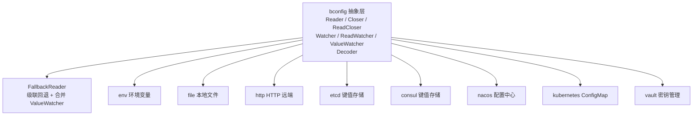
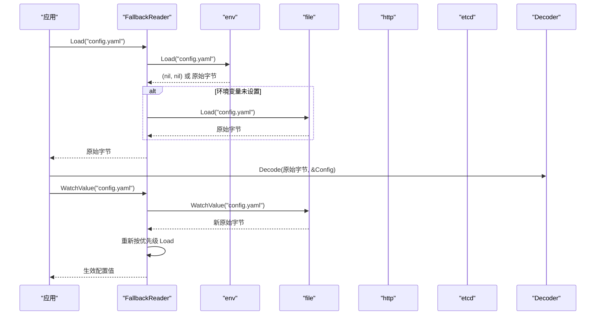
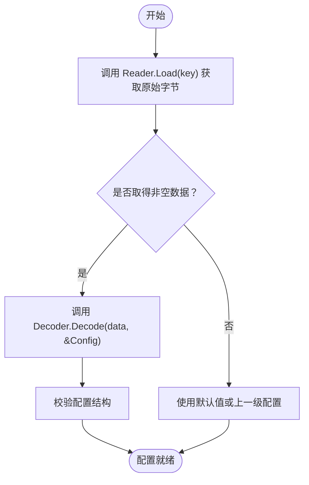

# 多源配置 Provider

<cite>
**本文引用的文件**   
- [bconfig/bconfig.go](file://bconfig/bconfig.go)
- [bconfig/fallback.go](file://bconfig/fallback.go)
- [bconfig/env/env.go](file://bconfig/env/env.go)
- [bconfig/env/options.go](file://bconfig/env/options.go)
- [bconfig/file/file.go](file://bconfig/file/file.go)
- [bconfig/file/options.go](file://bconfig/file/options.go)
- [bconfig/http/http.go](file://bconfig/http/http.go)
- [bconfig/http/options.go](file://bconfig/http/options.go)
- [bconfig/etcd/config.go](file://bconfig/etcd/config.go)
- [bconfig/etcd/options.go](file://bconfig/etcd/options.go)
- [bconfig/consul/config.go](file://bconfig/consul/config.go)
- [bconfig/consul/options.go](file://bconfig/consul/options.go)
- [bconfig/nacos/config.go](file://bconfig/nacos/config.go)
- [bconfig/nacos/options.go](file://bconfig/nacos/options.go)
- [bconfig/kubernetes/config.go](file://bconfig/kubernetes/config.go)
- [bconfig/kubernetes/options.go](file://bconfig/kubernetes/options.go)
- [bconfig/vault/config.go](file://bconfig/vault/config.go)
- [bconfig/vault/options.go](file://bconfig/vault/options.go)
- [bconfig/go.mod](file://bconfig/go.mod)
</cite>

## 目录
1. [简介](#简介)
2. [项目结构](#项目结构)
3. [核心抽象接口](#核心抽象接口)
4. [架构总览](#架构总览)
5. [详细组件分析](#详细组件分析)
6. [依赖与版本关系](#依赖与版本关系)
7. [性能与资源管理](#性能与资源管理)
8. [故障排查指南](#故障排查指南)
9. [结论](#结论)

## 简介
本仓库的 `bconfig` 包是 Bald 框架的多源配置抽象层。它定义了一组最小但可组合的接口，让环境变量、本地文件、HTTP 远端、etcd、Consul、Nacos、Kubernetes ConfigMap 以及 Vault 等后端以统一方式被读取和监听；并通过 `FallbackReader` 把多个提供者按优先级合并，形成“高优先级覆盖低优先级”的配置层级。

该文档聚焦以下主题：
- 抽象接口职责：`Reader`、`Closer`、`ReadCloser`、`Watcher`、`ReadWatcher`、`ValueWatcher`、`Decoder`。
- 各后端实现：env、file、http、etcd、consul、nacos、kubernetes、vault 的连接参数、认证机制与配置示例。
- `ValueWatcher` 与 `Watcher` 的区别，以及为什么组合层只识别 `ValueWatcher`。
- 连接池复用、资源清理、错误处理最佳实践。
- 扩展新配置格式时如何扩展 `Decoder`。

## 项目结构
`bconfig` 是一个独立的 Go module（模块路径 `github.com/kalandramo/bald/bconfig`），内部按「抽象 + 组合器 + 具体后端」划分：

**图表来源**
- [bconfig/bconfig.go:1-81](file://bconfig/bconfig.go#L1-L81)
- [bconfig/fallback.go:1-147](file://bconfig/fallback.go#L1-L147)

每个后端位于独立子包，提供构造函数、选项函数，并实现 `Reader` 及其可选增强接口。

**章节来源**
- [bconfig/go.mod:1-10](file://bconfig/go.mod#L1-L10)

## 核心抽象接口
`bconfig` 包定义了七种契约，它们构成整个多源配置的骨架：

| 接口 | 职责 | 典型使用场景 | 生命周期责任 |
|---|---|---|---|
| `Reader` | 根据键一次性加载原始字节数据 | 启动时拉取初始配置 | 不持有外部资源的生命周期；若需要连接或文件句柄，应升级为 `ReadCloser` |
| `Closer` | 释放所有已分配资源 | 关闭文件句柄、watcher、HTTP 客户端、etcd 客户端等 | 显式调用 `Close` |
| `ReadCloser` | 同时具备读取与关闭能力 | 文件、HTTP、etcd 等需要释放资源的后端 | 由调用方在进程退出或容器终止时关闭 |
| `Watcher` | 返回通道，仅在配置变更时发送空信号 | 只能拿到“已变更”事件、不能直接拿到新值的后端 | 取消上下文后通道关闭 |
| `ReadWatcher` | 同时支持读取和信号监听 | 类型便利组合；注意组合层不会自动识别其监听能力 | 同上 |
| `ValueWatcher` | 返回通道，每次变更后推送新的原始字节值 | etcd、Consul、Nacos、Kubernetes、Vault、HTTP（轮询模拟）、文件（fsnotify） | 取消上下文后通道关闭 |
| `Decoder` | 将原始字节反序列化为具体类型 | JSON、YAML、TOML、Protobuf 等格式转换 | 无外部资源，通常作为无状态服务注入 |

关键语义约束：
- `Reader.Load(ctx, key)` 返回 `(nil, nil)` 表示“当前源无法解析该键”，用于配合 `FallbackReader` 降级到下一个源。
- `Watcher.Watch` 仅传递“有变化”的信号，不包含新值；调用方必须再调用 `Reader.Load` 获取最新内容。
- `ValueWatcher.WatchValue` 直接推送新值；如果某个后端只有信号能力，应在 provider 内部完成“收到信号 → Load → 推值”的适配。
- `Decoder.Decode(data, out)` 与 `Reader` 解耦：先 `Load` 拿原始字节，再交给 `Decoder` 转成业务结构体。

**章节来源**
- [bconfig/bconfig.go:1-81](file://bconfig/bconfig.go#L1-L81)

## 架构总览
下图展示一次带优先级的配置加载与监听流程，其中 `FallbackReader` 负责合并多个 `Reader`，并只转发实现了 `ValueWatcher` 的子源通知：

**图表来源**
- [bconfig/fallback.go:1-147](file://bconfig/fallback.go#L1-L147)
- [bconfig/env/env.go:1-57](file://bconfig/env/env.go#L1-L57)
- [bconfig/file/file.go:1-166](file://bconfig/file/file.go#L1-L166)
- [bconfig/http/http.go:1-236](file://bconfig/http/http.go#L1-L236)
- [bconfig/etcd/config.go:1-285](file://bconfig/etcd/config.go#L1-L285)

### 为什么组合层只识别 `ValueWatcher`
`FallbackReader.WatchValue` 会遍历所有子源，筛选出实现 `ValueWatcher` 的对象；若没有任何子源实现该接口，直接返回错误。原因是：
1. 避免组合层对仅实现 `Watcher` 的后端做隐式适配——否则每次信号都会触发一次额外 `Load`，且容易让人误以为“信号源已被组合”。
2. 让“能高效推送值”的后端直接走推送通道；只能拿到信号的 provider 自行在内部完成 `Load` 后再以 `ValueWatcher` 暴露，这样调用方无需关心底层差异。

因此，`ReadWatcher` 只是类型便利组合，并不改变组合层的监听行为。

**章节来源**
- [bconfig/bconfig.go:35-75](file://bconfig/bconfig.go#L35-L75)
- [bconfig/fallback.go:85-147](file://bconfig/fallback.go#L85-L147)

## 详细组件分析

### env：环境变量提供者
- 读取方式：通过环境变量名取值；key 为空时使用默认 key，并可加前缀。
- 返回值语义：变量不存在时返回 `(nil, nil)`，使 `FallbackReader` 继续尝试下一个源。
- 监听能力：不实现 `Watcher` 或 `ValueWatcher`，因为进程内环境变量没有原生变更事件。
- 资源：无外部连接，不需要 `Close`。
- 适用场景：部署环境区分、开关、临时调试配置。

常用选项：
- `WithPrefix`：给所有环境变量名前加前缀，例如把 `DATABASE_URL` 变成 `APP_DATABASE_URL`。
- `WithKey`：设置默认环境变量名。

配置示例要点：
- 创建 env 源时传入 `WithPrefix("APP_")` 与 `WithKey("CONFIG_JSON")`。
- 把 env 放在 `FallbackReader` 最高优先级，用于覆盖其他源的字段。
- 由于环境变量不可变，不要期望它能热更新。

**章节来源**
- [bconfig/env/env.go:1-57](file://bconfig/env/env.go#L1-L57)
- [bconfig/env/options.go:1-25](file://bconfig/env/options.go#L1-L25)

### file：本地文件提供者
- 读取方式：`os.ReadFile` 读取整个文件。
- 监听方式：基于 `fsnotify` 监听父目录，捕获 `Write` 与 `Create` 事件；编辑器的原子写入（写临时文件再重命名）也能被捕捉。
- 资源管理：实现 `Closer`，关闭 `fsnotify.Watcher`。
- 懒初始化：即使构造时未启用 watch，首次调用 `WatchValue` 也会惰性创建 watcher。
- 错误处理：瞬时读取失败（编辑器删除目标文件瞬间）会被跳过，等待下一次事件重试。

常用选项：
- `WithPath`：指定配置文件绝对路径。
- `WithWatch`：构造时预创建 watcher。
- `WithContext`：保留给内部使用，实际读取不依赖该 context。

配置示例要点：
- 使用 `WithPath("/etc/app/config.yaml")`。
- 生产建议把文件源放在环境变量之后、远端之前，作为本地默认值。
- 开发时可开启 `WithWatch(true)` 获得热更新体验。

**章节来源**
- [bconfig/file/file.go:1-166](file://bconfig/file/file.go#L1-L166)
- [bconfig/file/options.go:1-35](file://bconfig/file/options.go#L1-L35)

### http：HTTP 远端提供者
- 读取方式：发起 HTTP 请求，成功响应体作为原始字节；`304 Not Modified` 视为“无新值”，返回 `(nil, nil)`。
- 监听方式：无原生推送，使用 `time.Ticker` 轮询，并用 `If-None-Match` 与服务器 `ETag` 协商减少带宽。
- 连接池：
  - `New`：自建 `*http.Client`，默认超时 `DefaultTimeout`，`Close` 时关闭空闲连接。
  - `NewWithClient`：注入已有 `*http.Client`，本源不负责关闭，便于复用全局连接池。
- 认证方式：通过 `WithHeader` 添加自定义请求头，例如 `Authorization`、`X-API-Key`。
- 重试策略：源码未内置指数退避重试；可在上层用重试库包装，或在 `http.Client.Transport` 中配置。

常用选项：
- `WithURL`：必填，配置端点 URL。
- `WithMethod`：默认 `GET`。
- `WithHeader`：追加请求头。
- `WithHTTPClient`：注入自定义 `http.Client`，可配置 TLS、代理、连接池。
- `WithPollInterval`：默认 `DefaultPollInterval`（30 秒）。

配置示例要点：
- 若已有网关或负载均衡，可将 URL 指向内部配置服务。
- 若需复用连接池，建议使用 `WithHTTPClient` 注入共享 client。
- 敏感凭证建议通过 header 注入，而不是拼接到 URL。

**章节来源**
- [bconfig/http/http.go:1-236](file://bconfig/http/http.go#L1-L236)
- [bconfig/http/options.go:1-58](file://bconfig/http/options.go#L1-L58)

### etcd：键值存储提供者
- 读取方式：
  - 单键模式：直接读取一个 key。
  - 前缀模式：聚合前缀下全部 KV，按点路径展开为嵌套 JSON 文档。
- 监听方式：原生 watch 推送；单键模式 PUT 推新值、DELETE 推 `nil`；前缀模式任一 KV 变更后回读全量文档。
- 连接管理：
  - `New`：惰性建连，首次 `Load` 或 `WatchValue` 才创建 `clientv3.Client`，`Close` 时释放。
  - `NewWithClient`：复用注册发现等场景已有的 etcd 客户端，本源不关闭。
- 认证方式：用户名和密码通过选项注入。
- 容错：`WatchValue` 先短超时探测路径可达，再建立 watch。

常用选项：
- `WithEndpoints`：必填，etcd 集群地址列表。
- `WithUsername`、`WithPassword`：认证凭据。
- `WithPath`：必填，默认读取路径。
- `WithPrefix`：启用前缀模式。
- `WithDialTimeout`：自建客户端建连超时，默认 5 秒。
- `WithContext`：基础 context，传给 `clientv3.Config`。

配置示例要点：
- 单键：`WithPath("/app/config.yaml")`。
- 前缀：`WithPath("/app/config")` 并 `WithPrefix(true)`，适合把 server、database、feature flag 拆成多个 key。
- 与注册中心共用 etcd 时，优先使用 `NewWithClient` 复用连接。

**章节来源**
- [bconfig/etcd/config.go:1-285](file://bconfig/etcd/config.go#L1-L285)
- [bconfig/etcd/options.go:1-70](file://bconfig/etcd/options.go#L1-L70)

### consul：HashiCorp Consul 提供者
- 读取方式：KV API 查询单个 key；不存在返回 `(nil, nil)`。
- 监听方式：使用 `watch.Plan` 监听 key 变更；删除时回调为 `nil`，provider 主动推送 `nil` 以清空当前层。
- 连接管理：
  - `New`：从 options 创建 `api.Client`。
  - `NewWithClient`：注入已有 client。
- 认证方式：ACL token、scheme（http/https）、address。
- 资源清理：`Close` 为空操作，因为 `api.Client` 本身无可释放连接池；`owned` 字段保持语义完整。

常用选项：
- `WithAddress`：默认 `127.0.0.1:8500`。
- `WithToken`：ACL token。
- `WithScheme`：http 或 https。
- `WithPath`：必填，KV 路径。

配置示例要点：
- 开发可直接用默认地址；生产建议显式配置 scheme 和 token。
- 与 etcd 相比，Consul KV 更偏轻量键值，适合较小配置；大文档可考虑 etcd 前缀模式。

**章节来源**
- [bconfig/consul/config.go:1-151](file://bconfig/consul/config.go#L1-L151)
- [bconfig/consul/options.go:1-39](file://bconfig/consul/options.go#L1-L39)

### nacos：Nacos 配置中心提供者
- 读取方式：按 `dataID` 与 `group` 获取配置内容。
- 监听方式：SDK 原生长连接回调；context 取消后反注册监听并关闭通道。
- 连接管理：
  - `New`：惰性建连，首次 `Load` 或 `WatchValue` 创建 `IConfigClient`。
  - `NewWithClient`：注入已有 client，不关闭。
- 认证方式：用户名与密码。
- 命名空间：通过 `namespace` 隔离不同环境配置。

常用选项：
- `WithServerAddrs`：必填，服务端地址列表，例如 `"nacos:8848"`。
- `WithNamespace`：命名空间。
- `WithGroup`：默认 `DEFAULT_GROUP`。
- `WithDataID`：必填，配置标识。
- `WithUsername`、`WithPassword`：服务端鉴权。

配置示例要点：
- Nacos 的 dataID 对应一个完整配置文档，不是键值路径。
- 多环境可用 namespace 隔离，group 可用于功能分组。
- 若与 SDK 其他能力共用 client，请使用 `NewWithClient`。

**章节来源**
- [bconfig/nacos/config.go:1-160](file://bconfig/nacos/config.go#L1-L160)
- [bconfig/nacos/options.go:1-56](file://bconfig/nacos/options.go#L1-L56)

### kubernetes：ConfigMap 提供者
- 读取方式：从 `CoreV1().ConfigMaps` 获取 ConfigMap；可按 data key 取单个字段，或合并全部 data 条目。
- 监听方式：使用 Kubernetes watch 流；删除事件时停止监听，不再推送。
- 连接管理：惰性建连，优先使用 `KubeConfig` 文件，否则 `InClusterConfig`。
- 过滤：支持 label selector 与 field selector。

常用选项：
- `WithNamespace`：必填，命名空间。
- `WithConfigMapName`：默认 ConfigMap 名称。
- `WithDataKey`：默认 data key；空则合并全部 data。
- `WithLabelSelector`、`WithFieldSelector`：Kubernetes 选择器。
- `WithKubeConfig`、`WithMaster`：集群外访问。

键约定：
- `"namespace/name/dataKey"`：精确读取某个 data key。
- `"namespace/name"`：读取整个 ConfigMap 并拼接 data 值。
- 空 key：回退到 `Namespace`、`ConfigMapName`、`DataKey`。

配置示例要点：
- 容器内运行时无需 `KubeConfig`，会自动使用服务账户。
- 对外部开发机可使用 `WithKubeConfig` 指向 kubeconfig。
- 删除 ConfigMap 或 data key 时，watch 会结束，不会继续推送空值；这与 etcd 的 DELETE→`nil` 语义略有不同。

**章节来源**
- [bconfig/kubernetes/config.go:1-181](file://bconfig/kubernetes/config.go#L1-L181)
- [bconfig/kubernetes/options.go:1-70](file://bconfig/kubernetes/options.go#L1-L70)

### vault：HashiCorp Vault 提供者
- 读取方式：从 secret 路径读取数据；默认提取 `content` 字段，也兼容 KV v2 的 `data` 包装层。
- 监听方式：无原生推送，使用定时器轮询；内容变化时推送新值。
- 认证方式：token；address 为空时回退 `VAULT_ADDR` 环境变量；token 为空时回退 `VAULT_TOKEN`。
- 连接管理：`New` 创建 `vaultapi.Client`；`NewWithClient` 注入已有 client。

常用选项：
- `WithAddress`：Vault 服务地址。
- `WithToken`：认证 token。
- `WithPath`：必填，secret 路径。
- `WithDataKey`：默认 `content`，可指向任意承载配置载荷的字段。
- `WithPollInterval`：默认 30 秒。

配置示例要点：
- 生产部署建议通过 CI 或安全工具注入 `VAULT_TOKEN`，而非硬编码。
- 复杂 secret 结构中可用 `WithDataKey` 指向包含业务配置的字段。
- 轮询间隔不宜过短，避免对 Vault 造成不必要压力。

**章节来源**
- [bconfig/vault/config.go:1-196](file://bconfig/vault/config.go#L1-L196)
- [bconfig/vault/options.go:1-64](file://bconfig/vault/options.go#L1-L64)

### Decoder：解码器扩展点
`Decoder` 把原始字节转换为业务结构体，屏蔽 JSON、YAML、TOML、Protobuf 等具体格式差异。典型用法：

扩展新格式的步骤：
1. 实现 `Decoder.Decode(data []byte, out any) error`。
2. 在应用装配处注入具体实现，例如 JSON、YAML、TOML。
3. 调用方先 `reader.Load`，再 `decoder.Decode`。

仓库中的 `bconf` 包另有 Protobuf 与 Bootstrap 相关反序列化能力，但 `bconfig.Decoder` 是通用扩展点，不应被实现细节绑定。

**章节来源**
- [bconfig/bconfig.go:68-81](file://bconfig/bconfig.go#L68-L81)

## 依赖与版本关系
`bconfig` 模块声明了 Go 版本与主要第三方依赖：

| 依赖 | 用途 | 版本 |
|---|---|---|
| `go.etcd.io/etcd/client/v3` | etcd 客户端 | `v3.7.1` |
| `github.com/hashicorp/consul/api` | Consul KV 与 watch plan | `v1.34.4` |
| `github.com/hashicorp/vault/api` | Vault 密钥读取 | `v1.23.0` |
| `github.com/nacos-group/nacos-sdk-go/v2` | Nacos 配置客户端 | `v2.3.5` |
| `k8s.io/client-go` | Kubernetes ConfigMap 客户端 | `v0.37.0` |
| `github.com/fsnotify/fsnotify` | 本地文件监听 | `v1.10.1` |
| `github.com/apolloconfig/agollo/v4` | Apollo（引入但未在本分析范围内实现） | `v4.4.0` |

模块根文件明确 Go 版本为 `1.27.1`，这与工具链事实一致。

**章节来源**
- [bconfig/go.mod:1-15](file://bconfig/go.mod#L1-L15)

## 性能与资源管理

### 连接池复用
- **HTTP**：优先通过 `WithHTTPClient` 注入共享 `*http.Client`，复用 TCP 连接、TLS 会话和连接池。
- **etcd**：优先通过 `NewWithClient` 复用注册发现等场景已有的客户端。
- **Consul**：通过 `NewWithClient` 复用已有 `api.Client`。
- **Vault**：通过 `NewWithClient` 复用已有 client。
- **Nacos**：通过 `NewWithClient` 复用已有 `IConfigClient`。
- **Kubernetes**：惰性构建 `clientset`，同一 provider 实例复用。
- **env / file**：无远程连接，不涉及连接池。

### 资源清理
- 实现 `Closer` 的后端必须被显式关闭：file（关闭 fsnotify）、HTTP（关闭 owned client）、etcd（关闭 owned client）。
- `FallbackReader.Close` 会遍历所有子源，调用其 `Close` 并聚合错误。
- 某些 SDK 不提供显式关闭接口（如 Consul、Vault、Nacos），provider 的 `Close` 可为空操作，但仍应保持 `owned` 语义清晰。

### 错误处理策略
- 单键缺失：多数后端返回 `(nil, nil)`，交由 `FallbackReader` 降级。
- 网络错误：
  - HTTP：记录状态码或请求错误，watch 轮询会持续重试。
  - etcd：watch 流结束时 goroutine 退出，输出通道关闭。
  - Consul：watch plan 停止后通道关闭。
  - Vault：轮询期间错误被静默忽略，下一周期重试。
  - Kubernetes：watch 流异常或对象无效时跳过，直到流结束。
- 监听通道：所有 `WatchValue` 实现都会在上下文取消或底层流结束时关闭输出通道，防止 goroutine 泄漏。

### 重试策略建议
仓库中的后端未统一内置指数退避重试。推荐做法：
- 对 HTTP、Vault 等轮询型 provider，在上层用重试库包裹 `Load`。
- 对 etcd、Consul、Kubernetes 等原生 watch provider，重点保证连接可用性与上下文传播，而不是盲目重试。
- 对 file 与 env，一般不需要网络重试。

### 复杂度说明
- `FallbackReader.Load`：线性扫描子源，时间复杂度 `O(n)`，n 为配置源数量。
- `FallbackReader.WatchValue`：为每个实现 `ValueWatcher` 的子源起一个协程；任意变更触发一次 `Load`，仍是 `O(n)`。
- etcd 前缀模式 `loadPrefix`：对前缀下所有 KV 做一次聚合，时间与 KV 数量线性相关。
- Kubernetes 合并 data：按 data 条目数线性拼接。

**章节来源**
- [bconfig/fallback.go:48-147](file://bconfig/fallback.go#L48-L147)
- [bconfig/file/file.go:130-166](file://bconfig/file/file.go#L130-L166)
- [bconfig/http/http.go:120-236](file://bconfig/http/http.go#L120-L236)
- [bconfig/etcd/config.go:120-285](file://bconfig/etcd/config.go#L120-L285)
- [bconfig/consul/config.go:100-151](file://bconfig/consul/config.go#L100-L151)
- [bconfig/vault/config.go:110-196](file://bconfig/vault/config.go#L110-L196)
- [bconfig/kubernetes/config.go:110-181](file://bconfig/kubernetes/config.go#L110-L181)

## 故障排查指南

| 现象 | 可能原因 | 排查建议 |
|---|---|---|
| `fallback: none of the sub-sources implement ValueWatcher` | 所有子源只实现 `Watcher`，未实现 `ValueWatcher` | 确认至少一个子源实现 `ValueWatcher`；或让仅信号 provider 内部 Load 后转为 `ValueWatcher` |
| `fallback: all sub-source WatchValue returned nil channels` | 子源 `WatchValue` 返回空通道 | 检查后端初始化是否失败或被提前取消 |
| 环境变量未生效 | key 为空或未设置 prefix | 检查 `WithKey`、`WithPrefix` 与实际环境变量名 |
| 文件热更新不触发 | 编辑器写入方式导致文件名变化 | 确认监听的是父目录，并检查事件是否为 Write/Create |
| HTTP 配置不更新 | 服务器未返回有效 ETag 或状态码非 2xx | 检查响应码、ETag、轮询间隔 |
| etcd 监听立即断开 | 路径不可达或权限不足 | 检查 endpoints、username/password、path 与前缀模式 |
| Consul 配置删除后仍保留旧值 | watch plan 回调未正确处理 nil | 确认 provider 是否推送 nil 以清空层级 |
| Kubernetes watch 结束后不再推送 | ConfigMap 被删除或流异常关闭 | 检查删除事件语义；该实现会在删除时停止监听 |
| Vault 频繁轮询导致负载上升 | `pollInterval` 过小 | 调大轮询间隔，或使用缓存层 |

**章节来源**
- [bconfig/fallback.go:85-147](file://bconfig/fallback.go#L85-L147)
- [bconfig/file/file.go:90-166](file://bconfig/file/file.go#L90-L166)
- [bconfig/http/http.go:120-236](file://bconfig/http/http.go#L120-L236)
- [bconfig/etcd/config.go:160-285](file://bconfig/etcd/config.go#L160-L285)
- [bconfig/consul/config.go:100-151](file://bconfig/consul/config.go#L100-L151)
- [bconfig/kubernetes/config.go:140-181](file://bconfig/kubernetes/config.go#L140-L181)
- [bconfig/vault/config.go:130-196](file://bconfig/vault/config.go#L130-L196)

## 结论
`bconfig` 通过一组小而清晰的接口，把多种异构配置源统一到相同的行为模型上：
- `Reader` 承担“读”的职责。
- `Closer` 承担“释放资源”的职责。
- `ValueWatcher` 承担“推送新值”的职责，并被 `FallbackReader` 唯一识别。
- `Decoder` 承担“格式转换”的职责，使配置加载与反序列化解耦。

在实际工程中，推荐采用以下组合：
1. 最高优先级：环境变量（部署注入、运行时覆盖）。
2. 中间优先级：本地文件（开发默认值、离线兜底）。
3. 最低优先级：远端配置中心（etcd、Consul、Nacos、Kubernetes、Vault、HTTP）。
4. 所有远端 provider 尽量复用连接池。
5. 应用启动时先 `Load`，再 `Decode`；监听 `WatchValue` 并在变更后重新加载与解码。
6. 进程退出前调用 `Close`，确保文件 watcher、HTTP client、etcd client 等资源被释放。