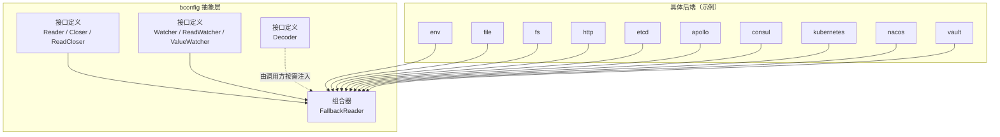
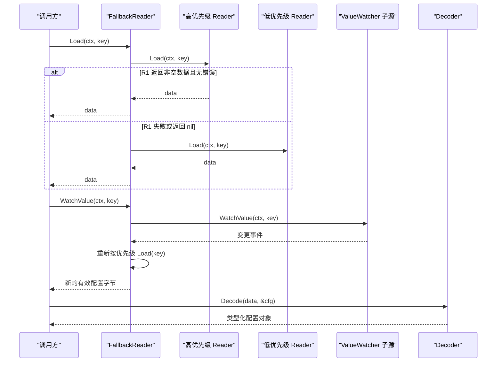
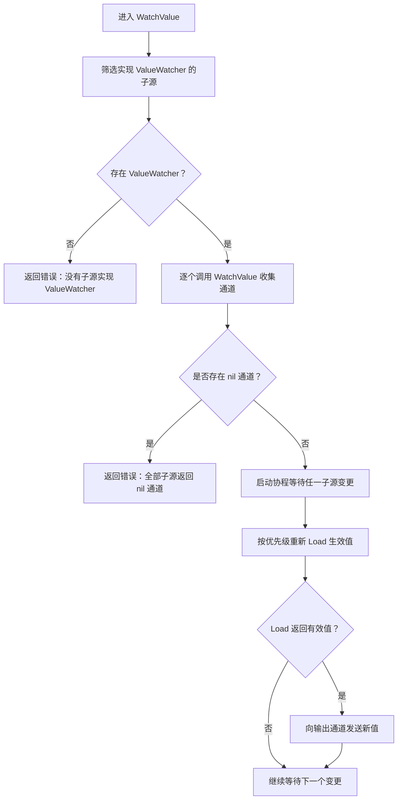

# 抽象接口与架构设计

<cite>
**本文引用的文件**   
- [bconfig.go](file://bconfig/bconfig.go)
- [fallback.go](file://bconfig/fallback.go)
- [bconfig_test.go](file://bconfig/bconfig_test.go)
- [fallback_test.go](file://bconfig/fallback_test.go)
</cite>

## 目录
1. [引言](#引言)
2. [项目结构](#项目结构)
3. [核心组件](#核心组件)
4. [架构总览](#架构总览)
5. [详细组件分析](#详细组件分析)
6. [依赖关系分析](#依赖关系分析)
7. [性能考量](#性能考量)
8. [故障排查指南](#故障排查指南)
9. [结论](#结论)
10. [附录：接口扩展与自定义 Provider 指南](#附录接口扩展与自定义-provider-指南)

## 引言
本文件面向 bconfig 包的抽象接口层，聚焦七个核心接口及其组合关系：**Reader、Closer、ReadCloser、Watcher、ReadWatcher、ValueWatcher、Decoder**。文档重点解释：
- 各接口的职责边界；
- 为什么 **ValueWatcher** 是组合层的唯一监听契约；
- fallback.go 中 FallbackReader 的优先级排序、错误恢复和配置回退逻辑；
- 如何正确实现自定义 Provider，使其既支持读取又支持监听。

## 项目结构
bconfig 包位于仓库根下的 `bconfig` 目录，其抽象接口集中在包根文件中，具体后端（env、file、fs、http、apollo、etcd、consul、kubernetes、nacos、vault）各自作为子包实现这些接口。组合器 `FallbackReader` 同样位于包根，负责把多个 Reader 按优先级串联起来，并合并 ValueWatcher 事件。



**图表来源**
- [bconfig.go:1-81](file://bconfig/bconfig.go#L1-L81)
- [fallback.go:1-147](file://bconfig/fallback.go#L1-L147)

**章节来源**
- [bconfig.go:1-81](file://bconfig/bconfig.go#L1-L81)

## 核心组件
bconfig 的核心不是某个具体服务，而是对“配置源”的统一抽象。所有后端都围绕以下能力建模：
- 一次性读取原始字节；
- 释放连接或文件句柄等资源；
- 以信号方式通知变更；
- 以值方式推送新配置；
- 将原始字节解码为类型化结构体。

| 接口 | 主要职责 | 是否组合 | 关键方法 | 典型使用者 |
|---|---|---|---|---|
| Reader | 一次性加载键对应的原始字节 | 否 | Load(ctx, key) | 所有配置源；FallbackReader |
| Closer | 释放持有资源 | 否 | Close() | 文件、网络型后端 |
| ReadCloser | 同时具备读取与关闭能力 | 是 | Reader + Closer | 资源型 Provider |
| Watcher | 信号式变更通知，不携带新值 | 否 | Watch(ctx, key) | 只能拿到“已变更”信号的后端 |
| ReadWatcher | 同时具备读取与信号监听 | 是 | Reader + Watcher | 便捷类型，但不被组合层识别为监听入口 |
| ValueWatcher | 推送式变更通知，直接携带新字节 | 否 | WatchValue(ctx, key) | 可高效推送值的后端；组合层唯一识别的监听契约 |
| Decoder | 把原始字节反序列化为 Go 值 | 否 | Decode(data, out) | JSON/YAML/TOML/Proto 等格式解析器 |

**章节来源**
- [bconfig.go:12-81](file://bconfig/bconfig.go#L12-L81)
- [bconfig_test.go:8-74](file://bconfig/bconfig_test.go#L8-L74)

## 架构总览
bconfig 的架构采用“接口 + 组合器”模式：
1. 每个后端实现 Reader，可选实现 Closer、Watcher、ValueWatcher。
2. FallbackReader 把多个 Reader 串成优先级链。
3. 当任意子源实现 ValueWatcher 时，FallbackReader 会合并其 WatchValue 通道，并在每次收到变更时重新执行优先级 Load，把生效值转发出去。
4. Decoder 独立于 Reader，由调用方在 Load 之后使用，避免耦合具体编码格式。



**图表来源**
- [fallback.go:33-147](file://bconfig/fallback.go#L33-L147)
- [bconfig.go:14-81](file://bconfig/bconfig.go#L14-L81)

**章节来源**
- [fallback.go:1-147](file://bconfig/fallback.go#L1-L147)

## 详细组件分析

### Reader：一次性读取抽象
Reader 只关注“根据 key 取原始字节”，不包含生命周期管理。这使文件、环境变量、HTTP、远程配置中心等差异实现可以共享同一读取语义。Load 返回的是原始字节，而不是具体结构体，从而把“存储格式”与“业务结构”解耦。

关键点：
- 成功条件：err 为 nil 且 data 不为 nil。
- nil 数据与 error 语义不同：nil data 表示“该源没有这个 key”，error 表示“读取失败”。
- FallbackReader.Load 正是基于这两者做优先级判断。

**章节来源**
- [bconfig.go:18-26](file://bconfig/bconfig.go#L18-L26)
- [fallback.go:33-55](file://bconfig/fallback.go#L33-L55)

### Closer 与 ReadCloser：资源生命周期
Closer 对标 io.Closer，用于释放文件、连接等资源。ReadCloser 是 Reader 与 Closer 的组合，适合需要显式释放资源的后端。FallbackReader.Close 会遍历子源，对实现 Closer 的子源逐个调用 Close，并把所有错误聚合返回。

行为特征：
- 未实现 Closer 的子源会被跳过；
- 多个 Close 错误通过 errors.Join 聚合；
- 即使部分 Close 失败，也会继续关闭其他子源。

**章节来源**
- [bconfig.go:28-40](file://bconfig/bconfig.go#L28-L40)
- [fallback.go:57-70](file://bconfig/fallback.go#L57-L70)

### Watcher 与 ReadWatcher：信号式监听
Watcher 提供“配置已变更”的信号通道，不携带新值。调用方需要自己再调用 Reader.Load 获取新值。这是给“只能拿到通知、拿不到值”的后端设计的接口。

重要边界：
- FallbackReader 的 WatchValue **不识别** Watcher；
- 仅实现 Watcher 的后端不会触发组合器的变更转发；
- ReadWatcher 只是 Reader + Watcher 的类型便利，不会被组合层当作监听入口。

因此，如果后端只能拿到信号，必须在 provider 内部收到信号后自行 Load，再以 ValueWatcher 形式向外推送值。

**章节来源**
- [bconfig.go:42-64](file://bconfig/bconfig.go#L42-L64)
- [bconfig_test.go:14-44](file://bconfig/bconfig_test.go#L14-L44)

### ValueWatcher：组合层唯一识别的监听接口
ValueWatcher 与 Watcher 的区别在于它直接推送新配置的原始字节。它是 FallbackReader.WatchValue 唯一识别的监听契约。这意味着：
- 能高效推送值的后端应实现 ValueWatcher；
- 只能推送信号的后端应在 provider 内完成“信号 → Load → 推值”的转换；
- 如果所有子源都没有实现 ValueWatcher，WatchValue 会直接返回错误，而不是静默忽略。



**图表来源**
- [fallback.go:72-147](file://bconfig/fallback.go#L72-L147)

**章节来源**
- [bconfig.go:66-75](file://bconfig/bconfig.go#L66-L75)
- [fallback.go:72-147](file://bconfig/fallback.go#L72-L147)

### Decoder：反序列化抽象
Decoder 把原始字节转换为任意 Go 类型。它与 Reader 相互独立：Reader 负责“从哪读”，Decoder 负责“怎么解析”。典型实现包括 JSON、YAML、TOML、Proto 等编码器/解码器包。调用方可以把 Reader 与 Decoder 组合使用，而不必让配置源关心业务结构体。

使用范式：
1. 通过 Reader.Load 获取原始字节；
2. 通过 Decoder.Decode 把字节写入目标变量；
3. 业务代码只依赖 Decoder 接口，不依赖具体格式实现。

**章节来源**
- [bconfig.go:77-81](file://bconfig/bconfig.go#L77-L81)
- [bconfig_test.go:46-74](file://bconfig/bconfig_test.go#L46-L74)

## 依赖关系分析
bconfig 包的依赖方向非常清晰：
- 抽象接口之间只有组合关系，没有反向依赖；
- FallbackReader 依赖 Reader、Closer、ValueWatcher；
- 具体后端依赖抽象接口，不依赖 FallbackReader；
- Decoder 是横向工具接口，不参与配置源组合。

```mermaid
classDiagram
    class Reader {
        +Load(ctx, key) []byte, error
    }
    class Closer {
        +Close() error
    }
    class ReadCloser
    class Watcher {
        +Watch(ctx, key) chan struct{}, error
    }
    class ReadWatcher
    class ValueWatcher {
        +WatchValue(ctx, key) chan []byte, error
    }
    class Decoder {
        +Decode(data, out) error
    }
    class FallbackReader {
        -readers : []Reader
        +NewFallbackReader(readers) *FallbackReader, error
        +Load(ctx, key) []byte, error
        +Close() error
        +WatchValue(ctx, key) chan []byte, error
    }

    ReadCloser --> Reader
    ReadCloser --> Closer
    ReadWatcher --> Reader
    ReadWatcher --> Watcher
    FallbackReader --> Reader
    FallbackReader --> Closer
    FallbackReader --> ValueWatcher
```

**图表来源**
- [bconfig.go:18-81](file://bconfig/bconfig.go#L18-L81)
- [fallback.go:12-147](file://bconfig/fallback.go#L12-L147)

**章节来源**
- [bconfig.go:18-81](file://bconfig/bconfig.go#L18-L81)
- [fallback.go:12-147](file://bconfig/fallback.go#L12-L147)

## 性能考量
- FallbackReader.Load 按顺序尝试子源，第一个满足“无错误且非空”即返回。因此高优先级源应尽量稳定、快速，以降低整体延迟。
- FallbackReader.WatchValue 在每次收到子源变更时会再次执行完整优先级 Load。若高优先级源频繁失败或返回 nil，可能触发多次低优先级读取，需在高优先级源设计上保证稳定性。
- WatchValue 的输出通道容量为 1，消费者应及时消费，否则上游 goroutine 可能在发送时阻塞等待上下文取消。
- Decoder 是独立组件，解析成本取决于具体格式；对于热更新场景，应避免在监听回调中重复解析未变化的配置。

[本节为通用性能建议，不直接分析具体文件]

## 故障排查指南

### 问题：WatchValue 返回“没有子源实现 ValueWatcher”
**原因**：传入的所有 Reader 都没有实现 ValueWatcher。  
**表现**：构造 WatchValue 时直接返回错误，而不是返回一个始终空的通道。  
**处理**：
- 若后端能直接推送值，实现 ValueWatcher；
- 若后端只能推送信号，在 provider 内部收到 Watch 信号后 Load 并转推到 ValueWatcher 通道。

**章节来源**
- [fallback.go:83-94](file://bconfig/fallback.go#L83-L94)

### 问题：WatchValue 返回“全部子源返回 nil 通道”
**原因**：至少有一个子源实现了 ValueWatcher，但所有 WatchValue 调用都返回了 nil 通道。  
**处理**：检查后端 WatchValue 实现，确保返回非 nil 通道；nil 通道会被视为无效监听器。

**章节来源**
- [fallback.go:96-105](file://bconfig/fallback.go#L96-L105)

### 问题：WatchValue 收到变更后未推送新值
**原因**：重新 Load 返回错误或 nil 数据。  
**表现**：goroutine 继续等待下一次变更，但输出通道没有值。  
**处理**：
- 确认至少有一个子源在当前 key 下能返回非空数据；
- 检查高优先级源是否暂时不可用导致整个 Load 失败；
- 注意：单个子源的变更不会强求所有源都可用，只要最终 Load 能拿到有效值即可。

**章节来源**
- [fallback.go:107-147](file://bconfig/fallback.go#L107-L147)

### 问题：Close 后仍有子源未关闭
**原因**：该子源未实现 Closer。  
**处理**：若后端持有文件、连接等资源，请实现 Closer；FallbackReader.Close 只会关闭实现 Closer 的子源。

**章节来源**
- [fallback.go:57-70](file://bconfig/fallback.go#L57-L70)

## 结论
bconfig 的抽象层通过一组最小接口把“配置来源”和“配置用途”解耦：
- Reader/Closer/ReadCloser 表达“如何读取和释放资源”；
- Watcher/ReadWatcher/ValueWatcher 表达“如何感知变更”；
- Decoder 表达“如何解析数据”；
- FallbackReader 表达“如何组合多个来源并选择生效值”。

其中，ValueWatcher 是组合层唯一识别的监听契约。这一设计避免了组合层替信号源做二次 Load，也避免了“只实现 Watcher 却被组合层静默忽略”的隐蔽问题。自定义 Provider 的正确姿势是：优先实现 ValueWatcher；如果只能拿到信号，则在 provider 内部完成信号到值的转换。

[本节为总结性内容，不直接分析具体文件]

## 附录：接口扩展与自定义 Provider 指南

### 自定义 Provider 的职责矩阵

| 你的后端能力 | 建议实现 | 说明 |
|---|---|---|
| 能按 key 读取原始字节 | Reader | 最基础能力 |
| 持有文件、连接等需释放的资源 | 额外实现 Closer | FallbackReader.Close 会调用 |
| 能直接推送变更后新值 | 额外实现 ValueWatcher | FallbackReader.WatchValue 唯一识别 |
| 只能收到“已变更”信号 | 实现 Watcher，并在内部 Load 后转推到 ValueWatcher | 不要期望组合层替你 Load |
| 同时支持读取与信号 | 实现 ReadWatcher | 仅提供类型便利，不改变组合层行为 |
| 需要支持 JSON/YAML/TOML 等格式 | 单独实现 Decoder | 与 Reader 解耦 |

### 推荐实现步骤
1. 实现 Reader.Load：key 不存在时返回 nil data 而非 error；真正异常才返回 error。
2. 如果后端有连接或文件句柄，实现 Closer.Close，并记录错误以便聚合。
3. 如果后端能推送新值，实现 ValueWatcher.WatchValue：
   - 返回非 nil 通道；
   - 上下文取消或监听结束时关闭通道；
   - 不要在 WatchValue 里直接阻塞读取，应异步推送。
4. 如果后端只能收到信号，实现 Watcher.Watch，并在回调中 Load 新值后通过 ValueWatcher 通道推送。
5. 如果需要支持多种格式，实现 Decoder.Decode，并在调用方把 Reader 与 Decoder 组合。

### 常见错误对照表

| 错误现象 | 可能原因 | 修复建议 |
|---|---|---|
| 调用 WatchValue 直接报错 | 所有子源都没实现 ValueWatcher | 在后端实现 ValueWatcher，或在 provider 内把 Watch 转为 ValueWatcher |
| 监听通道无输出 | 子源 WatchValue 返回 nil 通道 | 确保 WatchValue 返回非 nil 通道 |
| 变更后配置未更新 | Load 返回错误或 nil | 检查优先级链中是否有任何源能提供有效值 |
| Close 后资源泄漏 | 后端未实现 Closer | 为资源型后端实现 Closer |
| 解析结构体失败 | Decoder 与数据格式不匹配 | 使用与后端返回格式一致的 Decoder |

**章节来源**
- [bconfig.go:18-81](file://bconfig/bconfig.go#L18-L81)
- [bconfig_test.go:8-74](file://bconfig/bconfig_test.go#L8-L74)
- [fallback.go:12-147](file://bconfig/fallback.go#L12-L147)
- [fallback_test.go:1-200](file://bconfig/fallback_test.go#L1-L200)