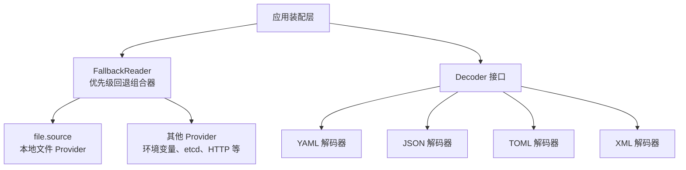
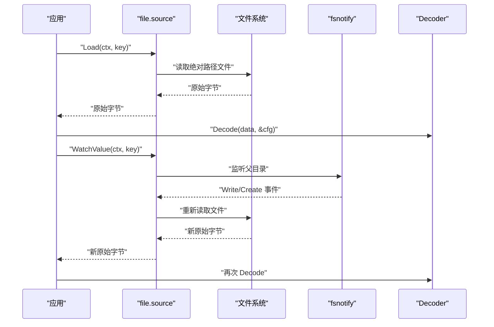
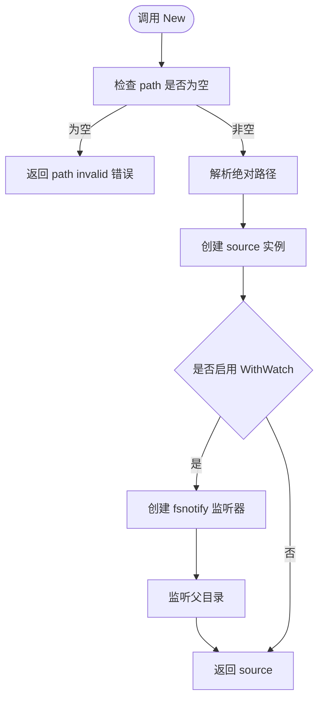
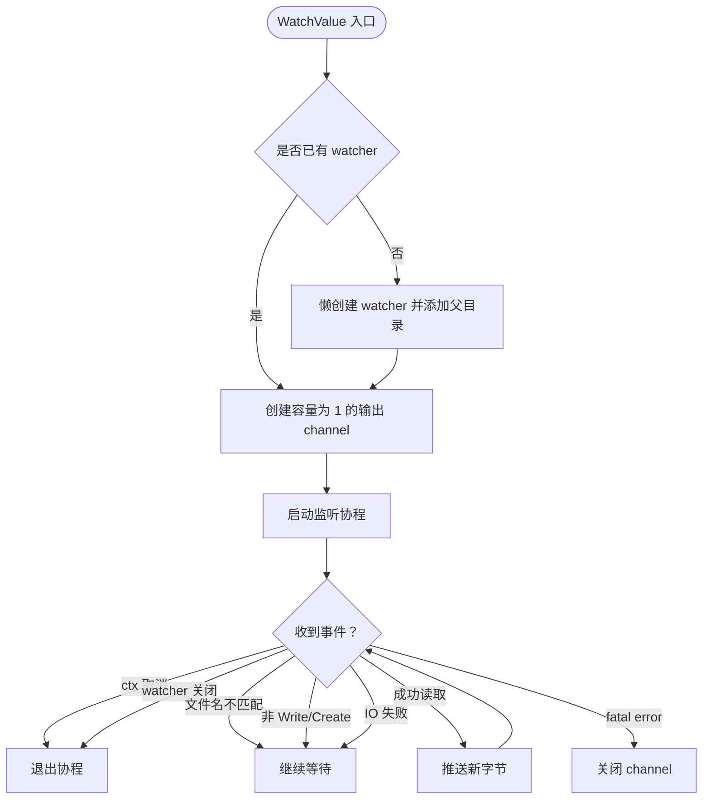
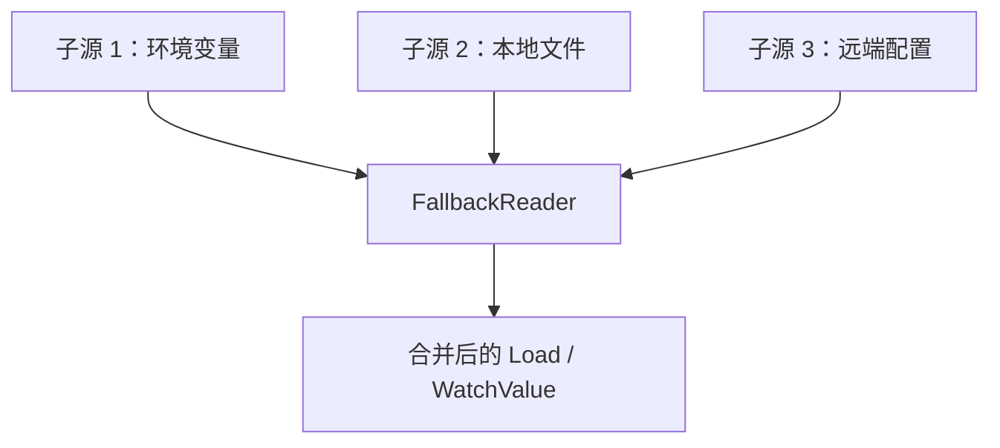
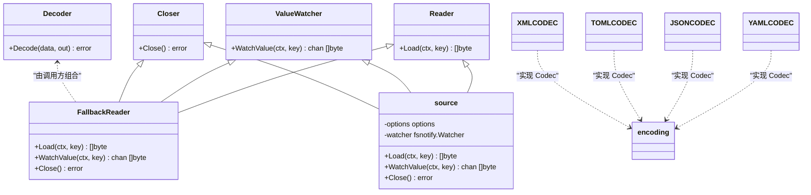

# 本地文件 Provider

<cite>
**本文引用的文件**   
- [bconfig/file/file.go](file://bconfig/file/file.go)
- [bconfig/file/options.go](file://bconfig/file/options.go)
- [bconfig/file/file_test.go](file://bconfig/file/file_test.go)
- [bconfig/bconfig.go](file://bconfig/bconfig.go)
- [bconfig/fallback.go](file://bconfig/fallback.go)
- [encoding/encoding.go](file://encoding/encoding.go)
- [encoding/yaml/yaml.go](file://encoding/yaml/yaml.go)
- [encoding/json/json.go](file://encoding/json/json.go)
- [encoding/toml/toml.go](file://encoding/toml/toml.go)
- [encoding/xml/xml.go](file://encoding/xml/xml.go)
- [_example/bald/configs/bald-demo-api.yaml](file://_example/bald/configs/bald-demo-api.yaml)
</cite>

## 目录
1. [简介](#简介)
2. [项目结构定位](#项目结构定位)
3. [核心组件](#核心组件)
4. [架构总览](#架构总览)
5. [详细组件分析](#详细组件分析)
6. [依赖关系分析](#依赖关系分析)
7. [性能与并发特性](#性能与并发特性)
8. [故障排查指南](#故障排查指南)
9. [结论](#结论)
10. [附录：配置文件示例与最佳实践](#附录配置文件示例与最佳实践)

## 简介
本文件面向 `bconfig/file` 包，即 Bald 框架中的「本地文件配置提供者」。它负责从磁盘读取原始配置字节，并通过 `fsnotify` 提供增量更新通知。文件格式解析不在该 Provider 中完成，而是通过 `bconfig.Decoder` 接口解耦；实际 YAML、JSON、TOML、XML 解码能力由 `encoding/*` 子包以统一 `Codec` 契约实现。

需要特别注意：**本地文件 Provider 本身不识别 YAML、JSON、TOML、XML 等格式**，只返回原始字节；具体反序列化由调用方注入的 Decoder 完成。

## 项目结构定位
`bconfig/file` 是 bconfig 抽象层下的一个具体 Provider 实现，位于仓库根目录下的 `bconfig/file` 子模块中。其职责边界如下：

| 层次 | 包或类型 | 职责 |
|---|---|---|
| 抽象层 | `bconfig.Reader` / `ValueWatcher` / `Decoder` | 定义一次性读取、推送式变更监听、字节到类型的转换契约 |
| 组合层 | `bconfig.FallbackReader` | 按优先级合并多个 Reader，并在任一 ValueWatcher 触发时重新 Load 生效值 |
| 本地 Provider | `bconfig/file.source` | 读取磁盘文件、监听目录事件、返回新字节流 |
| 编码层 | `encoding.Codec` 及各格式实现 | 将字节序列转换为 Go 值，供上层应用使用 |

**图表来源**
- [bconfig/file/file.go:1-166](file://bconfig/file/file.go#L1-L166)
- [bconfig/bconfig.go:1-81](file://bconfig/bconfig.go#L1-L81)
- [bconfig/fallback.go:1-147](file://bconfig/fallback.go#L1-L147)
- [encoding/encoding.go:1-69](file://encoding/encoding.go#L1-L69)
- [encoding/yaml/yaml.go:1-34](file://encoding/yaml/yaml.go#L1-L34)
- [encoding/json/json.go:1-35](file://encoding/json/json.go#L1-L35)
- [encoding/toml/toml.go:1-46](file://encoding/toml/toml.go#L1-L46)
- [encoding/xml/xml.go:1-39](file://encoding/xml/xml.go#L1-L39)

**章节来源**
- [bconfig/file/file.go:1-166](file://bconfig/file/file.go#L1-L166)
- [bconfig/bconfig.go:1-81](file://bconfig/bconfig.go#L1-L81)

## 核心组件
`bconfig/file` 暴露的核心构造与行为集中在以下文件：

| 文件 | 关键内容 |
|---|---|
| [bconfig/file/file.go](file://bconfig/file/file.go) | `New`、`source` 结构体、`Load`、`WatchValue`、`Close`、路径解析 |
| [bconfig/file/options.go](file://bconfig/file/options.go) | `Option`、`options`、`WithPath`、`WithWatch`、`WithContext` |
| [bconfig/file/file_test.go](file://bconfig/file/file_test.go) | 空路径校验、默认路径读取、键覆盖、文件监听、关闭 nil watcher |
| [bconfig/bconfig.go](file://bconfig/bconfig.go) | `Reader`、`Closer`、`ValueWatcher`、`Decoder` 等抽象接口 |
| [bconfig/fallback.go](file://bconfig/fallback.go) | `FallbackReader` 的多源回退与 WatchValue 合并逻辑 |
| [encoding/encoding.go](file://encoding/encoding.go) | 全局 Codec 注册表与名称查找 |
| [encoding/{yaml,json,toml,xml}/*.go](file://encoding/yaml/yaml.go) | 各格式 Codec 实现 |

**章节来源**
- [bconfig/file/file.go:1-166](file://bconfig/file/file.go#L1-L166)
- [bconfig/file/options.go:1-35](file://bconfig/file/options.go#L1-L35)
- [bconfig/file/file_test.go:1-118](file://bconfig/file/file_test.go#L1-L118)
- [bconfig/bconfig.go:1-81](file://bconfig/bconfig.go#L1-L81)
- [bconfig/fallback.go:1-147](file://bconfig/fallback.go#L1-L147)
- [encoding/encoding.go:1-69](file://encoding/encoding.go#L1-L69)

## 架构总览
文件 Provider 的整体调用链可以分成两条主线：

1. **初始加载**：应用调用 `reader.Load(ctx, key)` → `file.source.Load` 读文件 → 返回原始字节 → 上层 Decoder 反序列化为业务结构体。
2. **增量更新**：调用 `watcher.WatchValue(ctx, key)` → 启动 goroutine 监听 `fsnotify` → 匹配目标文件的 Write/Create 事件 → 重新读取文件 → 把新字节推送到通道。

**图表来源**
- [bconfig/file/file.go:54-166](file://bconfig/file/file.go#L54-L166)
- [bconfig/bconfig.go:1-81](file://bconfig/bconfig.go#L1-L81)

## 详细组件分析

### file.source：本地文件读取与监听
`file.source` 是 Provider 的内部实现，实现了三个接口：

| 接口 | 方法 | 行为 |
|---|---|---|
| `bconfig.Reader` | `Load(ctx, key)` | 根据 key 或默认 path 读取完整文件字节 |
| `bconfig.ValueWatcher` | `WatchValue(ctx, key)` | 返回带缓冲通道，推送新的原始字节 |
| `bconfig.Closer` | `Close()` | 释放底层 `fsnotify.Watcher` |

#### 构造与路径解析
`New` 接收可变选项，会做以下处理：

1. 填充默认上下文。
2. 校验 path 是否为空；为空直接返回错误。
3. 将相对路径转为绝对路径，避免编辑器原子写入导致的事件路径不一致。
4. 如果启用 watch，立即创建 `fsnotify.Watcher` 并监听**父目录**。
5. 否则保留 watcher 为 nil，等待 `WatchValue` 懒初始化。

**图表来源**
- [bconfig/file/file.go:28-53](file://bconfig/file/file.go#L28-L53)

**章节来源**
- [bconfig/file/file.go:28-53](file://bconfig/file/file.go#L28-L53)
- [bconfig/file/options.go:1-35](file://bconfig/file/options.go#L1-L35)

#### Load：一次性的原始字节读取
`Load` 的实现非常直白：

- 如果传入 key 为空，使用构造时的默认 path。
- 如果传入 key 非空，尝试将其解析为绝对路径；解析失败则原样使用。
- 调用 `os.ReadFile` 返回完整文件内容。
- 所有 IO 错误都包装成带路径信息的错误。

这里的关键语义是：**Provider 不关心文件格式，也不做增量 diff，只返回当前文件的全部内容。**

**章节来源**
- [bconfig/file/file.go:55-86](file://bconfig/file/file.go#L55-L86)

#### WatchValue：基于 fsnotify 的文件监听
`WatchValue` 的行为分三种情况：

1. **已启用 watch**：复用构造时创建的 watcher。
2. **未启用 watch**：在首次调用时懒创建 watcher，并监听目标文件所在目录。
3. **channel 关闭**：当上下文取消、watcher channel 关闭或 watcher 发生致命错误时，输出 channel 被关闭。

监听逻辑要点：

| 条件 | 行为 |
|---|---|
| 事件不是目标文件 | 忽略 |
| 事件不是 Write 或 Create | 忽略 |
| 重读文件失败 | 跳过本次事件，等待下一次事件 |
| 成功读到新数据 | 向缓冲 channel 推送新字节 |
| watcher.Errors 出现 | 视为致命错误，退出监听循环并关闭 channel |

**图表来源**
- [bconfig/file/file.go:88-166](file://bconfig/file/file.go#L88-L166)

**章节来源**
- [bconfig/file/file.go:88-166](file://bconfig/file/file.go#L88-L166)

#### Close：资源清理
`Close` 仅在存在 watcher 时调用 `Close`；nil watcher 不会报错。这是 `bconfig.Closer` 的最小实现。

**章节来源**
- [bconfig/file/file.go:164-166](file://bconfig/file/file.go#L164-L166)

### Decoder 接口：文件格式与 Provider 解耦
`bconfig.Decoder` 是一个独立于 `Reader` 的抽象：

| 概念 | 说明 |
|---|---|
| 输入 | 原始字节，通常来自 `Reader.Load` |
| 输出 | 任意 Go 值指针 |
| 责任 | 把字节反序列化成结构化配置 |
| 典型实现 | JSON、YAML、TOML、XML 解码器 |

注意：`bconfig.Decoder` 与 `encoding.Codec` 不是同一个接口。前者是配置层的反序列化契约；后者是传输层编解码器的统一契约。但两者在设计意图上相似——都是“字节 ↔ 对象”的可插拔转换。

**章节来源**
- [bconfig/bconfig.go:1-81](file://bconfig/bconfig.go#L1-L81)

### FallbackReader：多源回退与 WatchValue 合并
虽然不属于 `bconfig/file`，但它是本地文件 Provider 最常见的组合方式。`FallbackReader` 的语义是：

- `Load`：按传入顺序尝试多个 Reader，第一个成功且返回非空数据的作为结果。
- `Close`：逐个关闭实现了 `Closer` 的子源。
- `WatchValue`：只收集实现了 `ValueWatcher` 的子源，把它们的通知合并到一个输出 channel；任一子源触发时，重新执行 `Load` 获取符合优先级的生效值。

这对本地文件 Provider 的意义是：可以把“默认配置 + 环境覆盖 + 远程配置”组合起来，而 `file.source` 只需专注本地 IO。

**图表来源**
- [bconfig/fallback.go:1-147](file://bconfig/fallback.go#L1-L147)

**章节来源**
- [bconfig/fallback.go:1-147](file://bconfig/fallback.go#L1-L147)

### 配置文件格式支持：YAML、JSON、TOML、XML
`bconfig/file` 本身不判断扩展名，也不内置任何格式解析器。仓库中支持的四种格式由 `encoding/*` 包实现：

| 格式 | 包 | 解码实现 | 备注 |
|---|---|---|---|
| YAML | `encoding/yaml` | `gopkg.in/yaml.v3` | 常用于人类可读配置 |
| JSON | `encoding/json` | 标准库 `encoding/json` | 机器友好，嵌套结构清晰 |
| TOML | `encoding/toml` | `github.com/BurntSushi/toml` | 适合扁平化配置 |
| XML | `encoding/xml` | 标准库 `encoding/xml` | 兼容传统系统配置 |

这些实现都满足 `encoding.Codec` 契约，并通过 `Name()` 暴露字符串名称。应用可以在装配期显式注册所需格式。

**章节来源**
- [encoding/yaml/yaml.go:1-34](file://encoding/yaml/yaml.go#L1-L34)
- [encoding/json/json.go:1-35](file://encoding/json/json.go#L1-L35)
- [encoding/toml/toml.go:1-46](file://encoding/toml/toml.go#L1-L46)
- [encoding/xml/xml.go:1-39](file://encoding/xml/xml.go#L1-L39)
- [encoding/encoding.go:1-69](file://encoding/encoding.go#L1-L69)

## 依赖关系分析

**图表来源**
- [bconfig/bconfig.go:1-81](file://bconfig/bconfig.go#L1-L81)
- [bconfig/file/file.go:1-166](file://bconfig/file/file.go#L1-L166)
- [bconfig/fallback.go:1-147](file://bconfig/fallback.go#L1-L147)
- [encoding/encoding.go:1-69](file://encoding/encoding.go#L1-L69)

**章节来源**
- [bconfig/bconfig.go:1-81](file://bconfig/bconfig.go#L1-L81)
- [bconfig/file/file.go:1-166](file://bconfig/file/file.go#L1-L166)
- [bconfig/fallback.go:1-147](file://bconfig/fallback.go#L1-L147)
- [encoding/encoding.go:1-69](file://encoding/encoding.go#L1-L69)

## 性能与并发特性

| 维度 | 行为 | 影响 |
|---|---|---|
| 初始加载 | 全量读取文件 | 文件大小越大，内存和 IO 成本越高 |
| 增量更新 | 每次事件重新读取整个文件 | 没有增量 diff，属于“全量替换式”热更新 |
| 监听通道缓冲 | 输出 channel 容量为 1 | 快速连续事件可能丢中间状态，最终取到最新一次成功读取的内容 |
| 监听协程 | 每个 `WatchValue` 调用启动一个 goroutine | 长期持有 watcher 时应确保及时关闭 |
| 目录监听 | 监听父目录而非单文件 | 可容忍编辑器原子写入（临时文件 + rename），但会收到同目录下其他文件事件，需要过滤 |
| 多源回退 | 每次变更重新执行 `Load` | 回退链越长，变更延迟越高 |

**章节来源**
- [bconfig/file/file.go:88-166](file://bconfig/file/file.go#L88-L166)
- [bconfig/fallback.go:60-147](file://bconfig/fallback.go#L60-L147)

## 故障排查指南

### 常见错误及原因

| 现象 | 可能原因 | 排查建议 |
|---|---|---|
| 构造时报 `path invalid` | 未传 path 或 path 为空 | 确认使用了 `WithPath` |
| 监听不到文件变化 | 编辑器使用原子写入，事件发生在父目录 | 确认 Provider 监听的是父目录，而不是目标文件本身 |
| 监听通道无输出 | 事件不是 Write/Create，或重读失败被跳过 | 检查文件是否被删除后重建、权限是否允许读取 |
| 监听提前结束 | watcher.Errors 上报致命错误 | 查看系统级文件监控限制或磁盘异常 |
| 多源回退没有 WatchValue | 某些子源只实现 `Watcher` 而非 `ValueWatcher` | 确认组合层能识别 ValueWatcher，或 Provider 内部自行 Load 后转推 |
| 配置文件格式无法解析 | 未注册对应 Decoder 或 Codec | 检查应用装配阶段是否注册了 YAML/JSON/TOML/XML |

### 路径解析规则
- 构造时默认 path 会被解析为绝对路径。
- `Load` 中传入 key 时也会尝试解析绝对路径；解析失败则退回原 key。
- 这使相对路径在多数场景下可用，但建议在生产环境中使用绝对路径，减少歧义。

**章节来源**
- [bconfig/file/file.go:28-86](file://bconfig/file/file.go#L28-L86)
- [bconfig/file/file_test.go:12-70](file://bconfig/file/file_test.go#L12-L70)

### 错误恢复机制
文件 Provider 的错误恢复策略偏保守：

1. **监听事件中 IO 失败**：不抛出给调用方，而是跳过本次事件，等待下一次事件再重试。
2. **watcher 致命错误**：关闭输出 channel，让调用方感知监听已停止。
3. **上下文取消**：监听协程正常退出。
4. **构造阶段错误**：直接返回错误，不创建无效实例。

这种设计适合“编辑工具原子写入 + 短暂不可见”的场景，但不适合对实时性要求极高的系统；如果需要更严格的告警，应在调用层封装 WatchValue 的结果。

**章节来源**
- [bconfig/file/file.go:88-166](file://bconfig/file/file.go#L88-L166)

## 结论
`bconfig/file` 是一个简洁、低耦合的本地配置 Provider。它的优势在于：

- 明确区分“读取文件”和“解析格式”两个职责。
- 通过 `fsnotify` 提供轻量级热更新。
- 与 `FallbackReader` 组合后可形成多级配置回退。
- 通过 `Decoder` 和 `encoding.Codec` 保持格式可扩展。

它的不适合作为唯一配置源的场景包括：

- 大文件频繁热更新：每次事件都会全量重读。
- 强一致热更新：事件可能重复、可能丢失中间态。
- 复杂权限控制：Provider 直接使用系统文件 API，权限模型取决于运行用户。

## 附录：配置文件示例与最佳实践

### YAML 配置示例（嵌套结构与数组）
仓库示例中的 `bald-demo-api.yaml` 展示了典型的嵌套结构：应用信息、数据库、日志后端列表、注册中心、服务端地址等。其中 `logger.backends` 是数组，表示多个日志后端；`registry.nacos.server_addrs` 也是数组，表示多个服务地址。

| 配置段 | 用途 |
|---|---|
| `app` | 应用名称、版本、停止超时 |
| `database.sql` | SQL 驱动与连接源 |
| `logger.backends` | 日志后端数组 |
| `registry` | 服务注册中心类型与参数 |
| `server.grpc` / `server.http` | gRPC 与 HTTP 监听地址 |

**章节来源**
- [_example/bald/configs/bald-demo-api.yaml:1-29](file://_example/bald/configs/bald-demo-api.yaml#L1-L29)

### JSON、TOML、XML 配置示例
由于 Provider 只返回原始字节，JSON、TOML、XML 的配置结构与 YAML 类似，只是语法不同。推荐原则：

- JSON：适合机器生成、严格 schema 校验。
- YAML：适合人工维护、注释丰富。
- TOML：适合扁平化、层级较浅的配置。
- XML：适合遗留系统集成。

具体字段结构应与应用业务配置结构保持一致，并由 Decoder 的反序列化错误反馈问题。

### 文件权限处理
- Provider 使用系统调用读取文件，权限由操作系统决定。
- 运行用户必须对目标文件和父目录有至少读取权限。
- 若部署在容器或受限环境中，建议使用只读挂载卷并以最小权限运行进程。

### 路径解析最佳实践
- 生产环境优先使用绝对路径。
- 不要把敏感配置放在容易被普通用户枚举的路径。
- 如果使用相对路径，确保进程工作目录稳定。

### 文件轮转、备份与版本管理
`bconfig/file` 本身不提供文件轮转、备份或版本管理。这些应由外部运维流程保障：

| 需求 | 建议方案 |
|---|---|
| 文件轮转 | 使用外部工具（如 logrotate 思路）生成新文件，并确保旧文件不再被 Provider 监听 |
| 原子写入 | 编辑器或部署脚本应先写临时文件再 rename，Provider 已通过监听父目录容错 |
| 备份 | 在 CI/CD 或发布流程中保存历史配置快照 |
| 版本管理 | 将配置文件纳入 Git，结合变更审计 |
| 灰度更新 | 先推送新配置，再滚动重启；观察 WatchValue 通道是否正常推进 |

### 与 FallbackReader 的组合建议
- 将“默认配置”放在最低优先级，例如本地文件或镜像内嵌配置。
- 将“环境特定配置”放在更高优先级，例如环境变量、远端配置中心。
- 对本地文件 Provider 启用 `WithWatch(true)`，以便开发调试时直接热更新。
- 对不需要热更新的远端 Provider，确保其实现 `ValueWatcher`，否则 `FallbackReader.WatchValue` 会拒绝组合。

**章节来源**
- [bconfig/file/file.go:28-53](file://bconfig/file/file.go#L28-L53)
- [bconfig/file/file_test.go:72-118](file://bconfig/file/file_test.go#L72-L118)
- [bconfig/fallback.go:60-147](file://bconfig/fallback.go#L60-L147)