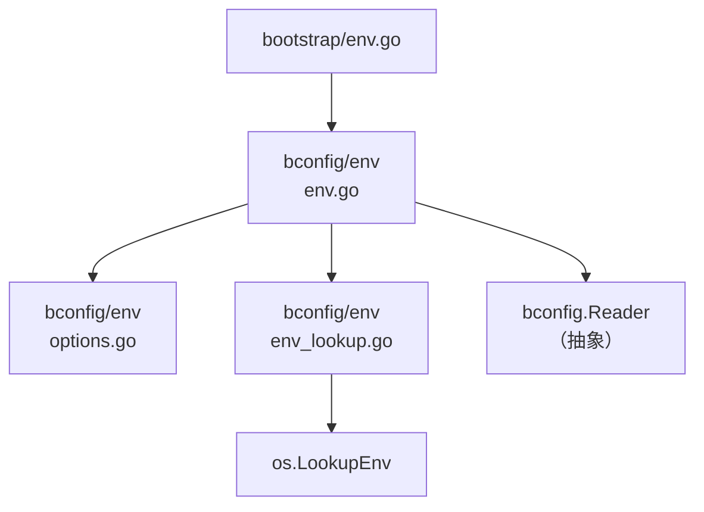
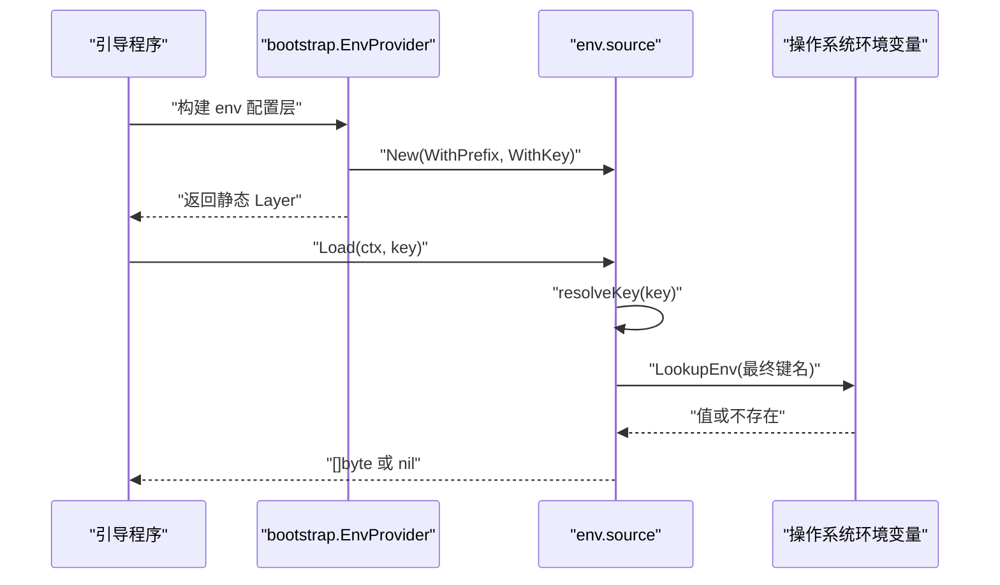
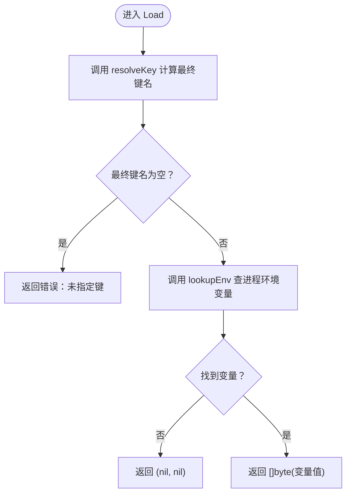
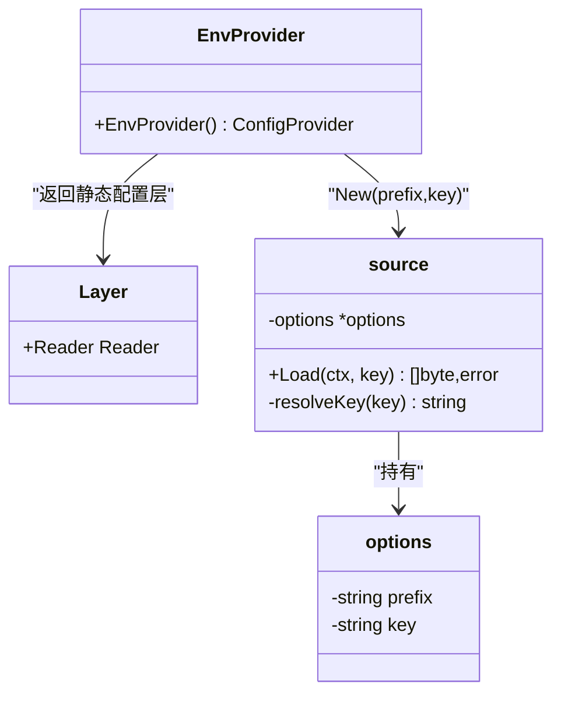
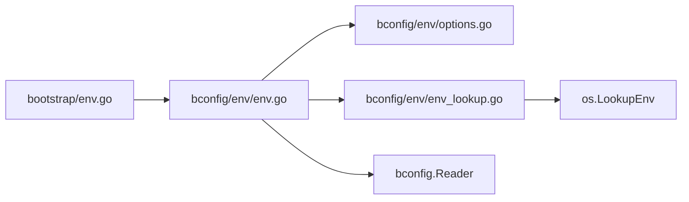

# 环境变量 Provider

<cite>
**本文引用的文件**   
- [env.go](file://bconfig/env/env.go)
- [env_lookup.go](file://bconfig/env/env_lookup.go)
- [options.go](file://bconfig/env/options.go)
- [env_test.go](file://bconfig/env/env_test.go)
- [env.go](file://bootstrap/env.go)
</cite>

## 目录
1. [简介](#简介)
2. [项目结构](#项目结构)
3. [核心组件](#核心组件)
4. [架构总览](#架构总览)
5. [详细组件分析](#详细组件分析)
6. [依赖关系分析](#依赖关系分析)
7. [性能考虑](#性能考虑)
8. [故障排查指南](#故障排查指南)
9. [结论](#结论)
10. [附录：配置示例与最佳实践](#附录配置示例与最佳实践)

## 简介
本技术文档聚焦 `bconfig/env` 包提供的环境变量配置源，即 **环境变量 Provider**。它把操作系统进程级环境变量当作一份“整文档”配置来源，并通过可选的键前缀过滤、默认键替换等机制，让上层 `bconfig` 层以统一 `Reader` 接口读取环境变量。

关键要点：
- 每个环境变量被视为一个完整配置文档（通常是 YAML/JSON）。
- 通过 `WithPrefix` 对键做前缀过滤和拼接。
- 通过 `WithKey` 设置默认环境变量名，供空键调用时使用。
- 当前实现不支持“环境变量变更自动监听”，属于静态配置源。
- 底层查找走 `os.LookupEnv`；嵌套环境变量引用由系统环境解析语义决定，而非由该 Provider 自行递归展开。

## 项目结构
`bconfig/env` 是一个小型独立模块，只暴露三个文件：

**图表来源**
- [env.go:1-57](file://bconfig/env/env.go#L1-L57)
- [env_lookup.go:1-9](file://bconfig/env/env_lookup.go#L1-L9)
- [options.go:1-25](file://bconfig/env/options.go#L1-L25)
- [env.go](file://bootstrap/env.go)

**章节来源**
- [env.go:1-57](file://bconfig/env/env.go#L1-L57)
- [env_lookup.go:1-9](file://bconfig/env/env_lookup.go#L1-L9)
- [options.go:1-25](file://bconfig/env/options.go#L1-L25)
- [env.go](file://bootstrap/env.go)

## 核心组件
- `source`：实现 `bconfig.Reader` 的环境变量配置源。
- `options`：保存 `prefix` 与 `key` 两个构造参数。
- `Option`：函数式选项类型，用于构造 `source`。
- `New`：创建配置源实例。
- `resolveKey`：根据显式键、默认键和前缀计算最终环境变量名。
- `Load`：按最终键从进程环境变量中读取字节值。
- `lookupEnv`：对 `os.LookupEnv` 的薄封装，便于测试替换。

**章节来源**
- [env.go:1-57](file://bconfig/env/env.go#L1-L57)
- [options.go:1-25](file://bconfig/env/options.go#L1-L25)
- [env_lookup.go:1-9](file://bconfig/env/env_lookup.go#L1-L9)

## 架构总览
环境变量 Provider 在引导阶段被 `bootstrap.EnvProvider` 装配为 `bconfig.Layer`，并作为静态配置层参与多源合并。

**图表来源**
- [env.go](file://bootstrap/env.go)
- [env.go:1-57](file://bconfig/env/env.go#L1-L57)
- [env_lookup.go:1-9](file://bconfig/env/env_lookup.go#L1-L9)

**章节来源**
- [env.go](file://bootstrap/env.go)
- [env.go:1-57](file://bconfig/env/env.go#L1-L57)

## 详细组件分析

### 环境变量键解析与取值流程
`env.source.Load` 的执行路径如下：

**图表来源**
- [env.go:20-57](file://bconfig/env/env.go#L20-L57)
- [env_lookup.go:1-9](file://bconfig/env/env_lookup.go#L1-L9)

#### 键解析规则
`resolveKey` 的优先级和行为可概括为：

| 输入场景 | 最终环境变量键 |
|---|---|
| 传入非空显式键 | 直接使用显式键 |
| 传入空键且设置了 `WithKey` | 使用默认键 |
| 传入空键且未设置 `WithKey` | 空字符串，随后 `Load` 报错 |
| 设置了 `WithPrefix` 且最终键非空 | 前缀拼接到键前面 |
| 前缀为空串 | 不改变键 |

这意味着：**显式键优先于默认键，前缀只在最终键非空时追加。**

**章节来源**
- [env.go:20-57](file://bconfig/env/env.go#L20-L57)
- [env_test.go:27-53](file://bconfig/env/env_test.go#L27-L53)

#### 取值语义
- 未设置环境变量：返回 `(nil, nil)`，表示“没有该配置项”。
- 设置为空字符串：返回长度为 0 的非 `nil` 字节切片，表示“已显式置空”。
- 有值：返回原始字节值，由上层解码器按 YAML/JSON 解析。

**章节来源**
- [env.go:37-57](file://bconfig/env/env.go#L37-L57)
- [env_test.go:55-152](file://bconfig/env/env_test.go#L55-L152)

### 选项与配置模型
`options` 只有两个字段：

| 选项 | 作用 | 默认行为 |
|---|---|---|
| `prefix` | 所有环境变量名前加之前缀 | 空串 |
| `key` | 当 `Load` 传入空键时的默认环境变量名 | 空串 |

常用选项：

| 选项函数 | 含义 |
|---|---|
| `WithPrefix(p string)` | 设置环境变量前缀，例如 `APP_` |
| `WithKey(k string)` | 设置默认环境变量名 |

**章节来源**
- [options.go:1-25](file://bconfig/env/options.go#L1-L25)

### 与引导层的集成
`bootstrap.EnvProvider` 的职责是把引导配置中的 `Config.GetEnv()` 映射到 `env.New` 的选项：

- 若配置中没有 env 源，直接跳过。
- 将 `prefix` 映射为 `WithPrefix`。
- 将 `key` 映射为 `WithKey`。
- 返回一个无资源释放回调的静态 `Layer`，因为环境变量源本身没有 Watcher。

**图表来源**
- [env.go](file://bootstrap/env.go)
- [env.go:1-57](file://bconfig/env/env.go#L1-L57)
- [options.go:1-25](file://bconfig/env/options.go#L1-L25)

**章节来源**
- [env.go](file://bootstrap/env.go)

### 关于 `env.Lookup` 的实现说明
在当前仓库快照中，`bconfig/env` 包没有导出名为 `Lookup` 的函数。对外暴露的读取入口是 `source.Load`，内部查找通过 `lookupEnv` 包装 `os.LookupEnv`。因此，不应假设存在独立的 `env.Lookup` API；如果需要扩展嵌套环境变量解析能力，应基于现有 `lookupEnv` 封装扩展，而不是改写 `Load` 主流程。

**章节来源**
- [env.go:1-57](file://bconfig/env/env.go#L1-L57)
- [env_lookup.go:1-9](file://bconfig/env/env_lookup.go#L1-L9)

## 依赖关系分析
`bconfig/env` 的依赖非常轻量：

- 直接依赖 `bconfig.Reader` 抽象接口，实现统一配置源协议。
- 运行时仅依赖标准库 `os` 提供的进程环境变量。
- 不被根 module 直接依赖适配器，也不引入外部注册中心后端。
- 由 `bootstrap/env.go` 在引导阶段装配进配置层。

**图表来源**
- [env.go](file://bootstrap/env.go)
- [env.go:1-57](file://bconfig/env/env.go#L1-L57)
- [options.go:1-25](file://bconfig/env/options.go#L1-L25)
- [env_lookup.go:1-9](file://bconfig/env/env_lookup.go#L1-L9)

**章节来源**
- [env.go:1-57](file://bconfig/env/env.go#L1-L57)
- [env_lookup.go:1-9](file://bconfig/env/env_lookup.go#L1-L9)
- [env.go](file://bootstrap/env.go)

## 性能考虑
- `Load` 每次都会调用一次 `os.LookupEnv`，时间复杂度近似 O(1)。
- 键解析 `resolveKey` 只做字符串拼接与长度判断，开销极低。
- 该实现不会缓存环境变量表，也不会维护订阅通道。
- 如果同一环境变量在启动阶段被多次读取，应考虑在上层缓存结果，避免重复解析。
- 由于是“整文档”源，单个环境变量可能包含大段 YAML/JSON，实际成本主要取决于上层解码器的解析成本，而不是 `env` 包自身。

[本节为通用性能建议，不直接分析具体代码行]

## 故障排查指南

### 常见问题一：`Load` 报“未指定键”
**现象**：调用 `Load` 时传入空键，且没有通过 `WithKey` 设置默认键。  
**原因**：`resolveKey` 返回空串，`Load` 主动返回错误。  
**处理**：
- 明确传入环境变量键；或
- 使用 `WithKey` 设置默认键；或
- 在引导配置中设置 `key` 字段。

**章节来源**
- [env.go:37-43](file://bconfig/env/env.go#L37-L43)
- [env_test.go:55-63](file://bconfig/env/env_test.go#L55-L63)

### 常见问题二：环境变量“未设置”与“设置为空”混用
**现象**：认为未设置和空字符串都是 `nil`。  
**事实**：
- 未设置：`(nil, nil)`。
- 设置为空字符串：返回长度为 0 的非 `nil` 字节切片。  
**影响**：上层解码器会把空字符串解析为空文档，而不是忽略该项。

**章节来源**
- [env_test.go:65-77](file://bconfig/env/env_test.go#L65-L77)
- [env_test.go:79-95](file://bconfig/env/env_test.go#L79-L95)

### 常见问题三：前缀导致找不到变量
**现象**：设置了 `WithPrefix("APP_")`，但环境变量名忘记加前缀。  
**原因**：`resolveKey` 会把前缀拼到最终键上。  
**处理**：确保环境变量名与 `prefix` + `key` 一致。

**章节来源**
- [env_test.go:97-107](file://bconfig/env/env_test.go#L97-L107)
- [env_test.go:109-152](file://bconfig/env/env_test.go#L109-L152)

### 常见问题四：误以为环境变量变更会触发重读
**现象**：期望修改进程环境变量后，配置自动刷新。  
**事实**：`env.source` 没有 Watcher，也没有状态缓存；它只是每次 `Load` 实时查 `os.LookupEnv`。  
**限制**：
- 无法检测环境变量变化事件。
- 不适合热更新长生命周期服务配置。
- 推荐替代方案：使用支持动态监听的后端（如 etcd、Nacos、Apollo、Consul、Kubernetes ConfigMap），并结合应用自身的重加载逻辑。

**章节来源**
- [env.go](file://bootstrap/env.go)

## 结论
`bconfig/env` 环境变量 Provider 是一个简洁、低耦合的配置读取实现：
- 通过 `WithPrefix` 控制环境变量命名空间。
- 通过 `WithKey` 提供默认键。
- 通过 `Load` 暴露统一的 `bconfig.Reader` 接口。
- 以“整文档环境变量”的方式工作，适合容器化部署、Kubernetes Secret/ConfigMap 摘要注入等场景。
- 不具备动态监听能力，应配合支持热更新的配置后端完成运行时配置刷新。

[本节为总结性内容，不直接分析具体代码行]

## 附录：配置示例与最佳实践

### 环境变量命名约定
推荐采用“前缀 + 业务域 + 配置项”的形式，例如：

| 环境变量名 | 含义 | 对应 Provider 配置 |
|---|---|---|
| `APP_LOG_LEVEL=debug` | 日志级别 | `WithPrefix("APP_")`，读取键 `LOG_LEVEL` |
| `APP_DB_URL=postgres://...` | 数据库连接串 | `WithPrefix("APP_")`，读取键 `DB_URL` |
| `APP_CONFIG` | 整份 YAML/JSON 配置 | `WithKey("APP_CONFIG")`，直接传空键 |

**章节来源**
- [options.go:1-25](file://bconfig/env/options.go#L1-L25)
- [env_test.go:97-152](file://bconfig/env/env_test.go#L97-L152)

### 不同环境下的设置方式
- 开发环境：可直接在本地 shell 中导出带前缀的环境变量。
- 容器环境：通过容器编排平台注入环境变量。
- Kubernetes：通过 Secret 或 ConfigMap 注入单个或多个环境变量，并由 `WithPrefix` / `WithKey` 匹配。

注意：`env` 源只读取“整变量名”的值，不要把多个配置项拆成多个变量再期望该 Provider 自动聚合；如需聚合，应由上层 `bconfig` 的多层合并机制完成。

**章节来源**
- [env.go](file://bootstrap/env.go)
- [env_test.go:97-152](file://bconfig/env/env_test.go#L97-L152)

### 嵌套环境变量引用注意事项
当前实现没有专用的嵌套变量解析逻辑，底层调用的是 `os.LookupEnv`。是否支持 `${VAR}` 或 `$VAR` 这类语法，取决于运行环境的 `os.LookupEnv` 语义；不应假定该 Provider 会递归展开所有嵌套引用。若需要可控的嵌套解析：
- 应在 `lookupEnv` 外层增加一层解析器；
- 或在应用启动阶段显式展开后再写入环境变量；
- 对于敏感信息，优先使用专门密钥管理后端，而不是把密码放在环境变量里。

**章节来源**
- [env_lookup.go:1-9](file://bconfig/env/env_lookup.go#L1-L9)

### 最佳实践清单
1. 始终为环境变量设置明确前缀，避免污染全局命名空间。
2. 对必须存在的配置，在应用启动时校验；不要依赖“未设置就静默忽略”来掩盖缺失。
3. 区分“未设置”和“显式空值”的业务语义。
4. 不要在环境变量里存放超长配置；必要时拆分为多个环境变量，由上层合并。
5. 对需要热更新的配置，使用支持 Watch 的后端，而不是依赖环境变量。
6. 在测试中通过 `t.Setenv` 覆盖环境变量，避免真实进程环境干扰。
7. 保持环境变量值格式稳定，尤其是作为整文档 YAML/JSON 注入时。

[本节为通用最佳实践，不直接分析具体代码行]