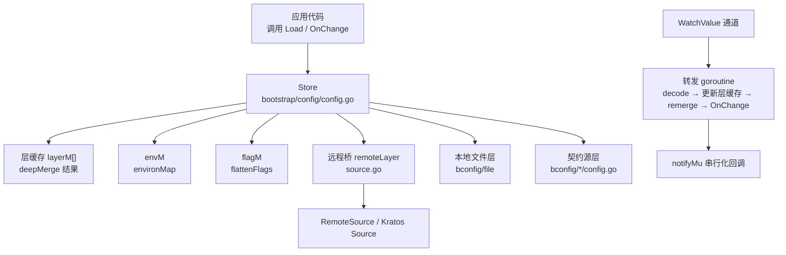
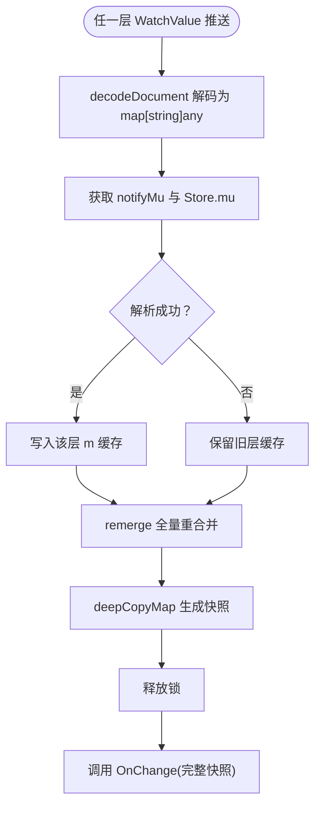
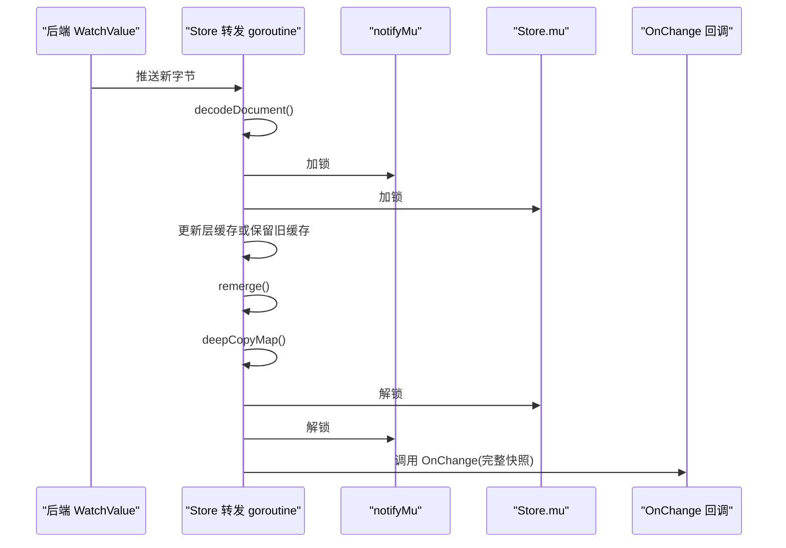
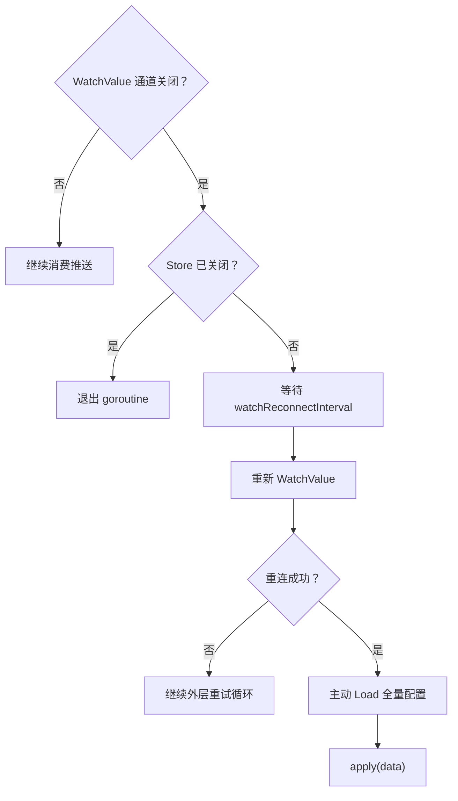
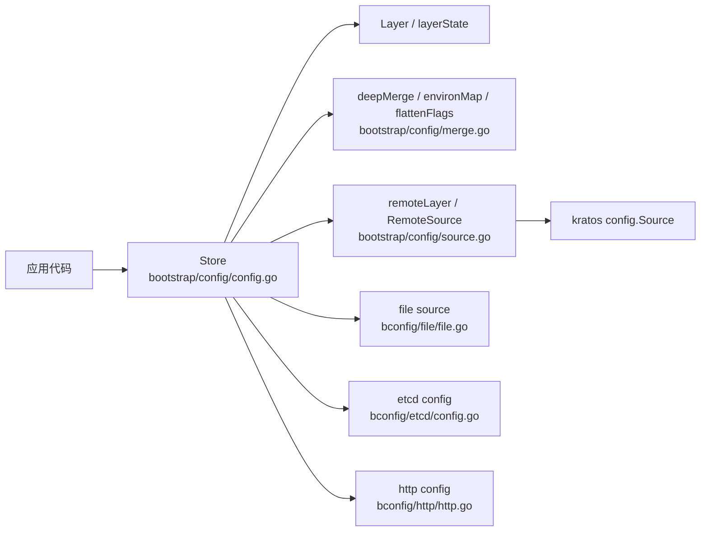

# 热更新机制

<cite>
**本文引用的文件**   
- [bconfig/bconfig.go](file://bconfig/bconfig.go)
- [bconfig/fallback.go](file://bconfig/fallback.go)
- [bootstrap/config/config.go](file://bootstrap/config/config.go)
- [bootstrap/config/merge.go](file://bootstrap/config/merge.go)
- [bootstrap/config/source.go](file://bootstrap/config/source.go)
- [bconfig/file/file.go](file://bconfig/file/file.go)
- [bconfig/http/http.go](file://bconfig/http/http.go)
- [bconfig/etcd/config.go](file://bconfig/etcd/config.go)
</cite>

## 目录
1. [引言](#引言)
2. [项目结构](#项目结构)
3. [核心组件](#核心组件)
4. [架构总览](#架构总览)
5. [详细组件分析](#详细组件分析)
6. [依赖关系分析](#依赖关系分析)
7. [性能考量](#性能考量)
8. [故障排查指南](#故障排查指南)
9. [结论](#结论)
10. [附录：监控与调试建议](#附录监控与调试建议)

## 引言
本文聚焦 Bald 配置系统的“热更新”能力，覆盖以下关键问题：
- `ValueWatcher` 推送模式与 `Watcher` 信号模式的差异；
- `FallbackReader` 如何合并多个源并触发全量重合并；
- Store 层缓存与“某层变更 → 全量重合并”的原子性保证；
- `watchReconnectInterval` 退避重连策略；
- 动态环境变量获取时机及与 `DeferEnv`、`MountEnv` 的关系；
- 监控、调试方法以及常见问题的排查思路。

本仓库是 93 个 Go module 的多模块工程，配置热更新主要位于 `bconfig`（配置源抽象）和 `bootstrap/config`（Store 装载器、层合并、watch 生命周期）。

## 项目结构
与热更新直接相关的代码分布在两个层次：

| 层次 | 职责 | 关键文件 |
|---|---|---|
| 配置源抽象层 | 定义 Reader / Watcher / ValueWatcher / Decoder 等接口，以及 FallbackReader | `bconfig/bconfig.go`、`bconfig/fallback.go` |
| 配置装载内核 | 命名层装配、深合并、Store 快照、watch 转发、重连、环境变量枚举 | `bootstrap/config/config.go`、`bootstrap/config/merge.go`、`bootstrap/config/source.go` |
| 具体后端适配 | etcd、http、file 等后端实现 ValueWatcher | `bconfig/etcd/config.go`、`bconfig/http/http.go`、`bconfig/file/file.go` |

**图示来源**
- [bootstrap/config/config.go:120-200](file://bootstrap/config/config.go#L120-L200)
- [bootstrap/config/config.go:330-430](file://bootstrap/config/config.go#L330-L430)
- [bootstrap/config/source.go:1-80](file://bootstrap/config/source.go#L1-L80)
- [bconfig/fallback.go:1-147](file://bconfig/fallback.go#L1-L147)

**章节来源**
- [bootstrap/config/config.go:1-120](file://bootstrap/config/config.go#L1-L120)
- [bconfig/bconfig.go:1-81](file://bconfig/bconfig.go#L1-L81)

## 核心组件
### 1. 两种 Watcher 语义
| 类型 | 传递内容 | 组合层是否识别 | 推荐场景 |
|---|---|---:|---|
| `Watcher` | 只发信号，不携带新值 | 否 | 只能拿到“已变更”事件的后端（例如文件系统原始 watcher） |
| `ValueWatcher` | 直接推送新的原始字节 | 是 | 能高效返回变更后值的后端（etcd watch、Nacos/Apollo/Consul 推送、HTTP ETag 轮询） |

关键点：
- `bconfig` 包注释明确说明：组合层 `FallbackReader` 只合并 `ValueWatcher`，不会把仅实现 `Watcher` 的后端纳入热更新。
- 如果某个后端只能提供信号，应在 provider 内部收到信号后执行 `Load`，再以 `ValueWatcher` 形式暴露给框架。
- Store 的 `setupWatch` 同样只订阅实现 `bconfig.ValueWatcher` 且 `Watch=true` 的层。

**章节来源**
- [bconfig/bconfig.go:38-78](file://bconfig/bconfig.go#L38-L78)
- [bootstrap/config/config.go:337-365](file://bootstrap/config/config.go#L337-L365)

### 2. FallbackReader 与多源回退
`FallbackReader` 按传入顺序尝试多个 `Reader`，第一个成功且非空的结果即为生效值。它同时实现 `ValueWatcher`：
- 筛选子源中实现 `ValueWatcher` 的项；
- 任意子源推送变更后，重新执行优先级 `Load`，得到“当前生效配置”，再转发到输出通道；
- 所有子源通道关闭或上下文取消后，输出通道关闭。

注意：
- 若所有子源都不实现 `ValueWatcher`，会返回错误，而不是静默忽略。
- 这是刻意设计：避免每次变更多一次无谓读取，也避免“信号源在组合层被静默忽略”的误导。

**章节来源**
- [bconfig/fallback.go:12-147](file://bconfig/fallback.go#L12-L147)

## 架构总览
Bald 的配置热更新不是“增量 patch”，而是“层缓存 + 全量重合并 + 深拷贝快照”。

**图示来源**
- [bootstrap/config/config.go:346-412](file://bootstrap/config/config.go#L346-L412)
- [bootstrap/config/config.go:316-330](file://bootstrap/config/config.go#L316-L330)
- [bootstrap/config/merge.go:12-40](file://bootstrap/config/merge.go#L12-L40)

## 详细组件分析

### 1. 层缓存与全量重合并
#### 数据结构
- `Store.merged`：当前合并后的配置树；
- `Store.layerM`：动态源层列表，每个元素是 `layerState{spec, m}`；
- `Store.envM`：环境变量枚举结果；
- `Store.flagM`：命令行 flag 展开结果。

#### 初始加载流程
1. 构建最低优先级的远程基准层（`remote`）；
2. 逆序遍历 `Layers`，使列表首元素成为最高优先级层；
3. 发现并加载本地配置文件；
4. 枚举环境变量（除非 `DeferEnv`）；
5. 展开用户显式传入的 flag；
6. 首次 `remerge()`；
7. 可选严格契约校验；
8. 启动 watch。

#### 重合并规则
`remerge()` 从低到高叠加：
1. 所有 `layerM[i].m`；
2. `envM`；
3. `flagM`。

这意味着：
- 高优先级层始终覆盖低优先级层；
- 任一层的 `m` 被替换时，其他层不变，但 `merged` 必须重建；
- `deepMerge` 采用 copy-on-write，旧快照不受后续重合并影响。

**章节来源**
- [bootstrap/config/config.go:120-200](file://bootstrap/config/config.go#L120-L200)
- [bootstrap/config/config.go:316-330](file://bootstrap/config/config.go#L316-L330)
- [bootstrap/config/merge.go:12-40](file://bootstrap/config/merge.go#L12-L40)

### 2. WatchValue 推送模式 vs Watcher 信号模式
| 维度 | `ValueWatcher` | `Watcher` |
|---|---|---|
| 推送内容 | 新字节 | 仅通知“已变更” |
| 组合层参与 | 是 | 否 |
| Store 参与 | 是 | 否 |
| 典型实现 | etcd、http、file、远程桥 | 可用作后端内部转换 |
| 风险 | 需要正确构造通道并处理关闭 | 易被组合层忽略 |

实际行为：
- `FallbackReader.WatchValue` 只收集实现 `ValueWatcher` 的子源；
- `Store.setupWatch` 只订阅 `ls.spec.Reader.(bconfig.ValueWatcher)`；
- 因此，“仅实现 `Watcher` 的配置源不会触发热更新”。

**章节来源**
- [bconfig/bconfig.go:38-78](file://bconfig/bconfig.go#L38-L78)
- [bconfig/fallback.go:76-147](file://bconfig/fallback.go#L76-L147)
- [bootstrap/config/config.go:337-365](file://bootstrap/config/config.go#L337-L365)

### 3. Store 热更新与原子性保证
#### 并发模型
- `notifyMu`：串行化“重合并 → 快照 → OnChange”；
- `Store.mu`：保护 `layerM`、`envM`、`flagM`、`merged`；
- 每个 watch 转发 goroutine 独立运行，但通过 `notifyMu` 防止 `OnChange` 重入；
- `watchWG` 等待所有转发 goroutine 退出；
- `watchCancel` 由 `Close` 统一取消。

#### 原子性保障
- 解析失败时保留旧层缓存，但仍触发重合并与 `OnChange`，便于观测半写状态；
- 只有 `remerge()` 完成后才释放 `Store.mu`；
- `Settings()` 返回 `deepCopyMap(s.merged)`，调用方拿到的快照不会被后续热更新污染；
- 任意层变更都走同一 `remerge()`，不存在“上层覆盖不生效、底层重置冲掉覆盖”的问题。

**图示来源**
- [bootstrap/config/config.go:346-412](file://bootstrap/config/config.go#L346-L412)

**章节来源**
- [bootstrap/config/config.go:140-160](file://bootstrap/config/config.go#L140-L160)
- [bootstrap/config/config.go:337-412](file://bootstrap/config/config.go#L337-L412)

### 4. watchReconnectInterval 退避重连策略
当某一层的 `WatchValue` 通道被关闭时，Store 认为监听器致命断开：
1. 若 Store 自身已被取消，则直接退出；
2. 等待固定间隔 `watchReconnectInterval = time.Second`；
3. 重新调用 `vw.WatchValue(ctx, "")`；
4. 若重连失败，继续外层循环重试；
5. 重连成功后主动拉一次全量配置，补偿断连期间可能丢失的变更；
6. 用新的 channel 继续消费。

重要细节：
- 退避间隔是固定值，不是指数退避；
- 重连发生在“单个层”的转发 goroutine 内，不影响其他层；
- 重连后拉取失败不会阻断后续 watch 循环；
- 这保证了即使远端临时不可达，也不会让热更新永久停止。

**图示来源**
- [bootstrap/config/config.go:376-412](file://bootstrap/config/config.go#L376-L412)
- [bootstrap/config/config.go:61-62](file://bootstrap/config/config.go#L61-L62)

**章节来源**
- [bootstrap/config/config.go:61-62](file://bootstrap/config/config.go#L61-L62)
- [bootstrap/config/config.go:376-412](file://bootstrap/config/config.go#L376-L412)

### 5. 各后端如何实现 ValueWatcher
| 后端 | 实现方式 | 注意事项 |
|---|---|---|
| etcd | 原生 watch 流 | 键变化时推送字节；连接失败由客户端库处理 |
| http | ETag 条件轮询 | 无推送能力，通过 HTTP 条件请求模拟变更 |
| file | fsnotify | 监听 Write/Create 事件；Watcher 致命错误时关闭通道 |
| 远程桥 | `RemoteSource.Watch` 回调转 channel | 支持动态格式，Kratos 适配器自带一秒退避 |

**章节来源**
- [bconfig/etcd/config.go:160-177](file://bconfig/etcd/config.go#L160-L177)
- [bconfig/http/http.go:126-129](file://bconfig/http/http.go#L126-L129)
- [bconfig/file/file.go:93-160](file://bconfig/file/file.go#L93-L160)
- [bootstrap/config/source.go:60-80](file://bootstrap/config/source.go#L60-L80)
- [bootstrap/config/source.go:116-157](file://bootstrap/config/source.go#L116-L157)

### 6. 环境变量的交互与获取时机
#### 普通模式
- `Load` 时调用 `environMap(opts.Name)`，扫描进程环境变量；
- 前缀规则：应用名转为大写，连字符换下划线，再拼接 `_`；
- 变量名去前缀后小写，下划线和连字符都映射为点路径分隔符；
- 例如 `BALD_DEMO_SERVER_HTTP_ADDR` → `server.http.addr`。

#### 延迟模式（`DeferEnv`）
- 首次 `Load` 不构建 env 层，`merged` 只含声明层；
- 适合“先由文件层解析配置名，再派生 env 前缀”的场景；
- 之后通过 `MountEnv(name)` 挂载 env 层并重合并；
- 之后任一层 watch 触发的重合并仍正常叠加 env 层。

#### 关键限制
- 契约字段名大量含下划线，而 `environMap` 把下划线解释为路径分隔符；
- 框架靠 `bconf.lookupField` 的折叠匹配弥合，但业务键含下划线仍可能被误切；
- 业务键应使用点路径或避免下划线命名。

**章节来源**
- [bootstrap/config/config.go:180-200](file://bootstrap/config/config.go#L180-L200)
- [bootstrap/config/config.go:308-316](file://bootstrap/config/config.go#L308-L316)
- [bootstrap/config/merge.go:68-110](file://bootstrap/config/merge.go#L68-L110)

## 依赖关系分析

**图示来源**
- [bootstrap/config/config.go:120-200](file://bootstrap/config/config.go#L120-L200)
- [bootstrap/config/merge.go:12-110](file://bootstrap/config/merge.go#L12-L110)
- [bootstrap/config/source.go:1-80](file://bootstrap/config/source.go#L1-L80)

**章节来源**
- [bootstrap/config/config.go:120-200](file://bootstrap/config/config.go#L120-L200)
- [bootstrap/config/merge.go:12-110](file://bootstrap/config/merge.go#L12-L110)
- [bootstrap/config/source.go:1-80](file://bootstrap/config/source.go#L1-L80)

## 性能考量
### 时间复杂度
- `deepMerge(dst, src)`：近似 `O(|dst| + |src|)`，递归复制嵌套 map；
- `remerge()`：对每层依次调用 `deepMerge`，整体近似 `O(Σ 层大小)`；
- 每个 watch 事件触发一次 `remerge()` + 一次 `deepCopyMap()`。

### 空间复杂度
- 每层维护自己的 `map[string]any` 缓存；
- 每次热更新生成一个新的 `merged` 副本；
- 已发布的快照通过 `deepCopyMap` 隔离，不会随后续重合并变化。

### 优化机会
- 如果配置树很大且变更频繁，应评估 `OnChange` 中的反序列化成本；
- 避免在 `OnChange` 中做昂贵 IO；
- 对静态层（如 flag）无需启用 watch；
- 对只读探测场景，可使用 `Settings()` 而非订阅 watch。

[本节为通用性能讨论，不直接分析具体代码行]

## 故障排查指南

### 1. 配置不生效
**现象**：修改了某个后端配置，但 `OnChange` 未触发或值未覆盖。

**检查清单**：
- 该层是否设置了 `Watch=true`；
- 该层 `Reader` 是否实现 `bconfig.ValueWatcher`；
- 如果是 `fallback` 组合源，确认子源实现了 `ValueWatcher`；
- 检查优先级：高优先级层是否覆盖了预期值；
- 检查环境变量前缀是否与 `Name` 一致；
- 检查 flag 是否显式传入（仅 Changed flag 参与合并）。

**相关实现位置**：
- [bootstrap/config/config.go:201-240](file://bootstrap/config/config.go#L201-L240)
- [bootstrap/config/config.go:337-365](file://bootstrap/config/config.go#L337-L365)
- [bootstrap/config/merge.go:42-66](file://bootstrap/config/merge.go#L42-L66)

### 2. 循环依赖或启动阻塞
**现象**：远程配置中心不可达导致启动卡住。

**原因**：
- 单层初始装配带默认超时 `DefaultLoadTimeout`；
- 若设置负值，则信任源自身超时控制；
- 远程桥适配器在监听出错时有 1 秒退避；
- Store 层重连也是固定间隔。

**处理建议**：
- 合理设置 `LoadTimeout`；
- 确保后端 SDK 有连接超时；
- 在集成测试中先 TCP 探活，再跑套件。

**相关实现位置**：
- [bootstrap/config/config.go:56-62](file://bootstrap/config/config.go#L56-L62)
- [bootstrap/config/config.go:175-190](file://bootstrap/config/config.go#L175-L190)
- [bootstrap/config/source.go:130-157](file://bootstrap/config/source.go#L130-L157)

### 3. 内存泄漏
**现象**：进程长时间运行后 goroutine 或内存持续增长。

**可能原因**：
- `Store.Close()` 未调用，watch goroutine 不退出；
- 自定义后端未正确处理 ctx 取消；
- 在 `OnChange` 中长期持有大对象引用；
- 多次创建 Store 但未 Close。

**防护机制**：
- `watchCancel` 在 Close 中取消；
- `watchWG.Wait()` 等待转发 goroutine 退出；
- Store 自建资源（如本地文件 watcher）在 Close 中释放；
- 契约源 reader 的生命周期由 Registry.Build 返回的 cleanup 管理。

**相关实现位置**：
- [bootstrap/config/config.go:414-440](file://bootstrap/config/config.go#L414-L440)

### 4. 热更新重复触发或顺序错乱
**现象**：多个层同时变更，`OnChange` 看起来乱序或重入。

**机制**：
- `notifyMu` 串行化“重合并 → 快照 → OnChange”；
- 多个层的 watch goroutine 并发运行，但回调执行是串行的；
- 发布顺序与合并顺序一致。

**排查建议**：
- 在 `OnChange` 中记录时间戳和配置版本号；
- 避免在回调中阻塞过久。

**相关实现位置**：
- [bootstrap/config/config.go:140-160](file://bootstrap/config/config.go#L140-L160)
- [bootstrap/config/config.go:346-412](file://bootstrap/config/config.go#L346-L412)

### 5. 环境变量未生效
**现象**：设置了环境变量，但配置未覆盖。

**常见原因**：
- 环境变量前缀与 `Name` 不一致；
- 变量名包含下划线，被误解释为路径分隔符；
- 使用了 `DeferEnv` 但没有调用 `MountEnv`；
- flag 未显式传入，零值 flag 不参与合并。

**相关实现位置**：
- [bootstrap/config/merge.go:68-110](file://bootstrap/config/merge.go#L68-L110)
- [bootstrap/config/config.go:308-316](file://bootstrap/config/config.go#L308-L316)

### 6. 本地文件热更新无效
**现象**：修改本地 YAML 后没有触发 `OnChange`。

**检查**：
- 是否开启 `WatchLocalFile`；
- 文件路径是否被 `discoverLocalFile` 找到；
- fsnotify 是否正常工作；
- 文件名扩展名是否为 yaml/yml/json。

**相关实现位置**：
- [bootstrap/config/config.go:240-270](file://bootstrap/config/config.go#L240-L270)
- [bconfig/file/file.go:93-160](file://bconfig/file/file.go#L93-L160)

## 结论
Bald 的热更新机制以“命名层 + 值推送 + 全量重合并 + 深拷贝快照”为核心：
- `ValueWatcher` 是唯一被组合层和 Store 认可的变更通道；
- 任意层变更都会触发 `remerge()`，保证配置始终是完整、一致的合并结果；
- `notifyMu` 保证 `OnChange` 串行执行，避免回调重入；
- `watchReconnectInterval` 提供简单可靠的退避重连；
- 环境变量支持延迟挂载，适配自指配置场景；
- 性能上以 copy-on-write 和快照隔离换取一致性，适合大多数服务配置规模。

## 附录：监控与调试建议

### 变更记录
- 在 `OnChange` 中记录触发来源层名、时间戳、快照哈希；
- 区分“解析成功”和“解析失败但保留旧缓存”两类事件；
- 对重连事件单独计数，观察后端稳定性。

### 性能观测
- 统计 `OnChange` 平均耗时与 P99；
- 统计每次 `remerge()` 涉及的层数与配置树大小；
- 关注 `OnChange` 中的反序列化与下游重启开销。

### 日志关键字
- “load layer”：初始装配；
- “decode layer”：文档解码；
- “watch layer”：watch 启动；
- “unknown contract keys”：严格契约校验失败；
- “sub-source WatchValue failed”：FallbackReader 子源 watch 失败。

### 调试命令
- 使用 `Settings()` 或 `Get("...")` 打印当前合并快照；
- 对 flag 层，检查 pflag 的 Changed 标记；
- 对 env 层，核对 `Name` 与前缀一致性；
- 对远程桥，检查 Kratos Source 的 Read/Watch 返回值。

[本节为通用调试建议，不直接分析具体代码行]