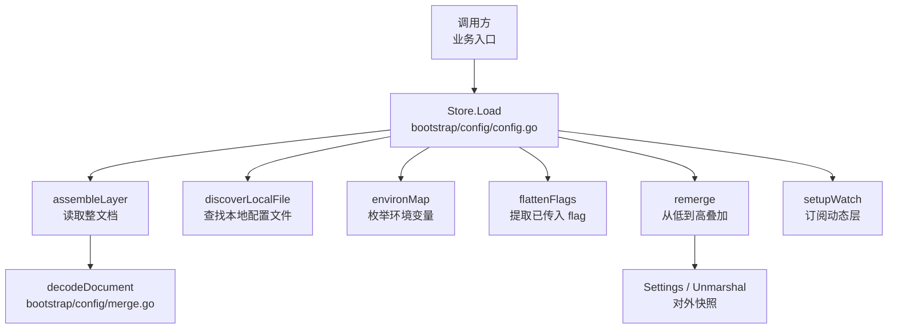
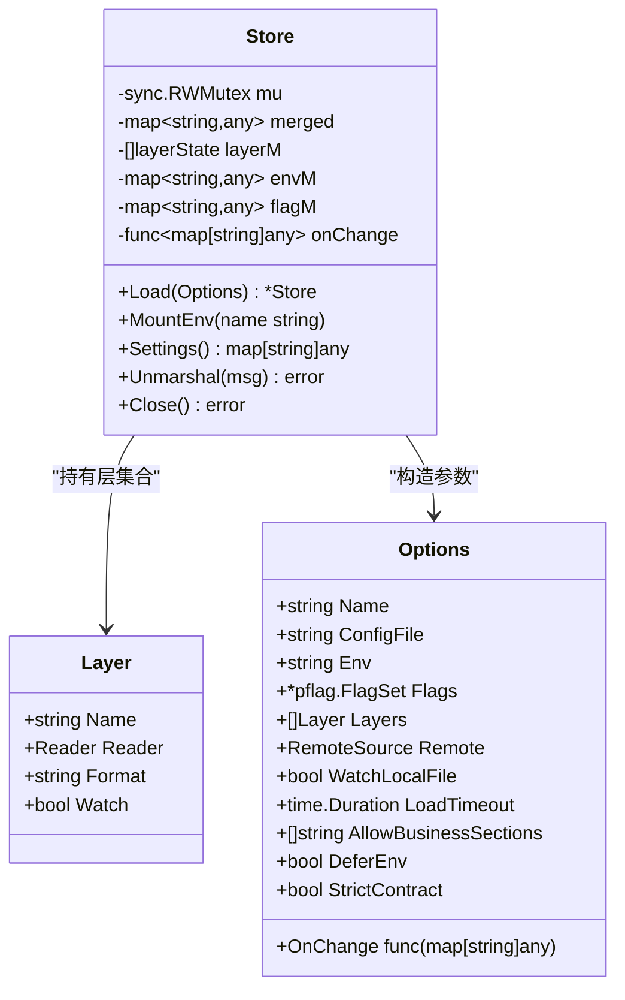
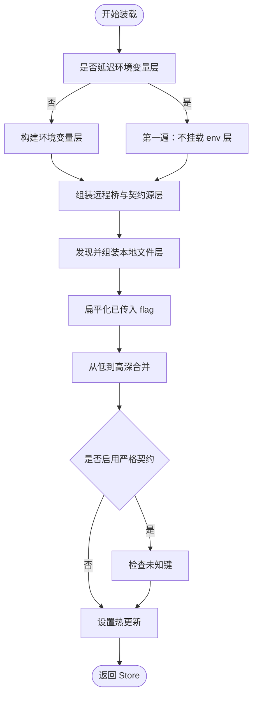
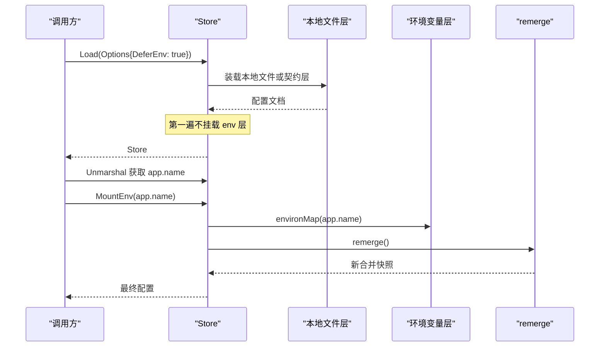
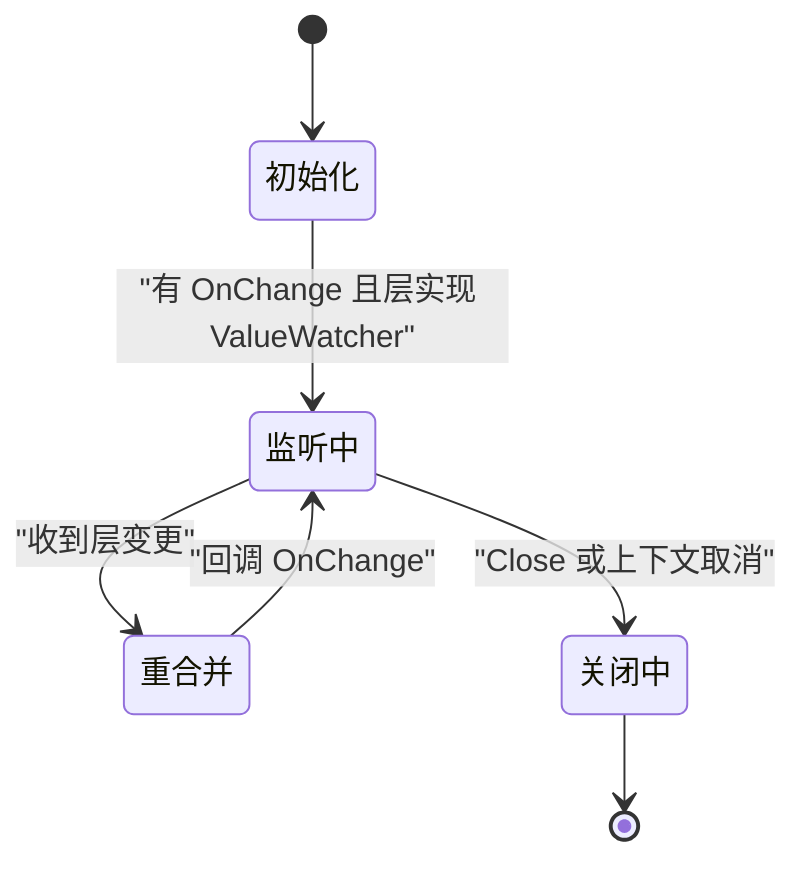
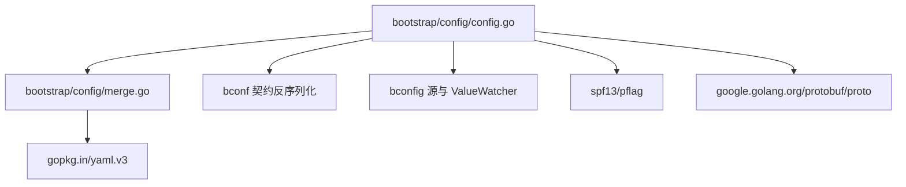

# 配置层模型与装载流程

<cite>
**本文引用的文件**   
- [bootstrap/config/config.go](file://bootstrap/config/config.go)
- [bootstrap/config/merge.go](file://bootstrap/config/merge.go)
- [bootstrap/config/env_twopass_test.go](file://bootstrap/config/env_twopass_test.go)
- [bootstrap/config/layer_test.go](file://bootstrap/config/layer_test.go)
</cite>

## 目录
1. [简介](#简介)
2. [项目结构](#项目结构)
3. [核心组件](#核心组件)
4. [架构总览](#架构总览)
5. [详细组件分析](#详细组件分析)
6. [依赖关系分析](#依赖关系分析)
7. [性能考虑](#性能考虑)
8. [故障排查指南](#故障排查指南)
9. [结论](#结论)

## 简介
本文件聚焦 Bald 配置系统的核心装载机制，围绕两段式两遍装载、Layer 层模型、优先级链、Options 参数语义以及错误处理与性能特征进行系统化说明。目标是让不熟悉内部实现的读者也能准确理解：

- 为什么需要「先解析 app.name，再按该名称挂载环境变量前缀」的两遍装载；
- Layer 的 Name、Reader、Format、Watch 字段如何协作；
- flag、环境变量、本地文件、契约源层、远程桥之间的覆盖顺序；
- 如何通过 Options 组合不同来源并验证覆盖结果；
- 热更新、严格契约校验、超时控制等运行时行为。

## 项目结构
配置装载逻辑集中在 `bootstrap/config` 包内，由两个核心文件构成：

| 文件 | 职责 |
| --- | --- |
| [config.go](file://bootstrap/config/config.go) | Store、Layer、Options 定义；Load、MountEnv、remerge、watch、Close、Settings、Unmarshal 等主流程；本地文件发现与路径读取工具函数 |
| [merge.go](file://bootstrap/config/merge.go) | 深合并、flag 扁平化、环境变量枚举、文档解码、格式推断、快照拷贝等通用工具 |

测试文件用于钉住关键语义：

| 文件 | 验证重点 |
| --- | --- |
| [env_twopass_test.go](file://bootstrap/config/env_twopass_test.go) | DeferEnv + MountEnv 的两遍装载；延迟挂载后热更新仍保留 env 覆盖 |
| [layer_test.go](file://bootstrap/config/layer_test.go) | 列表首层优先级最高；字段级合并；空文档；Watch 不实现 ValueWatcher 报错；契约层低于 env/flag |



**图表来源**
- [bootstrap/config/config.go:100-260](file://bootstrap/config/config.go#L100-L260)
- [bootstrap/config/merge.go:10-120](file://bootstrap/config/merge.go#L10-L120)

**章节来源**
- [bootstrap/config/config.go:1-120](file://bootstrap/config/config.go#L1-L120)
- [bootstrap/config/merge.go:1-40](file://bootstrap/config/merge.go#L1-L40)

## 核心组件
### Layer：命名配置源层
Layer 是配置装载的基本单位，代表一个可加载、可选可观察的配置源：

| 字段 | 含义 | 行为约束 |
| --- | --- | --- |
| Name | 层标识，用于日志和错误信息 | 未显式设置时可能退化为序号名；不应为空 |
| Reader | 返回整份配置文档字节 | 必须非 nil；key 固定传空串 |
| Format | 文档格式 yaml/yml/json | 为空时优先走 formatAware 接口，否则回退 yaml |
| Watch | 是否订阅热更新 | 为 true 时 Reader 必须实现 bconfig.ValueWatcher，否则 Load 直接报错 |



**图表来源**
- [bootstrap/config/config.go:24-115](file://bootstrap/config/config.go#L24-L115)
- [bootstrap/config/config.go:140-260](file://bootstrap/config/config.go#L140-L260)

**章节来源**
- [bootstrap/config/config.go:24-115](file://bootstrap/config/config.go#L24-L115)
- [bootstrap/config/layer_test.go:12-100](file://bootstrap/config/layer_test.go#L12-L100)

### Store：合并后的配置仓库
Store 维护当前合并树、各层缓存、环境变量层、flag 层以及热更新生命周期。其关键特性包括：

- 并发安全：读操作使用 RWMutex；写重合并时使用互斥锁。
- 快照语义：Settings 返回深拷贝，已发布的快照不受后续热更新影响。
- 热更新：任一启用了 Watch 的动态层推送变更时，触发全量重合并，并回调 OnChange。
- 两遍装载支持：DeferEnv 时不自动挂载 env 层，留给调用方在解析出 app.name 后通过 MountEnv 完成第二遍。

**章节来源**
- [bootstrap/config/config.go:116-170](file://bootstrap/config/config.go#L116-L170)
- [bootstrap/config/config.go:380-470](file://bootstrap/config/config.go#L380-L470)

### Options：装载参数总入口
Options 控制装载行为的所有外部开关：

| 选项 | 类型 | 作用 |
| --- | --- | --- |
| Name | string | 应用配置名；决定环境变量前缀和本地文件发现 |
| ConfigFile | string | 显式指定本地配置文件路径 |
| Env | string | 运行环境名；参与本地文件候选名拼接 |
| Flags | pflag.FlagSet | 最高优先级输入；仅 Changed 的 flag 参与合并 |
| Layers | []Layer | 契约源层；列表首优先级最高，内部逆序追加到层数组尾部 |
| Remote | RemoteSource | 远程配置源；被适配为最低优先级基准层 |
| WatchLocalFile | bool | 是否监听本地文件变化 |
| OnChange | func(map[string]any) | 任一层变更后回调最新合并快照 |
| LoadTimeout | time.Duration | 单层初始装配超时；默认 10 秒，负值禁用 |
| AllowBusinessSections | []string | 允许的业务自持顶层段；配合 StrictContract 使用 |
| DeferEnv | bool | 延迟环境变量层装载，用于两遍装载 |
| StrictContract | bool | 开启后检查未知键，捕获拼写错误 |

**章节来源**
- [bootstrap/config/config.go:60-115](file://bootstrap/config/config.go#L60-L115)

## 架构总览
Bald 配置装载不是简单地把多个文件叠在一起，而是把「远端基准 → 声明式契约层 → 本地运维覆盖 → 环境变量 → 命令行 flag」组织成一条明确的优先级链，并通过 Layer 抽象统一接入。



**图表来源**
- [bootstrap/config/config.go:170-260](file://bootstrap/config/config.go#L170-L260)
- [bootstrap/config/merge.go:10-80](file://bootstrap/config/merge.go#L10-L80)

**章节来源**
- [bootstrap/config/config.go:170-260](file://bootstrap/config/config.go#L170-L260)
- [bootstrap/config/merge.go:10-80](file://bootstrap/config/merge.go#L10-L80)

## 详细组件分析

### 两段式两遍装载原理
两段式装载解决的是「环境变量前缀依赖配置名」的问题：如果环境变量名来自 app.name，而 app.name 本身又写在配置文件里，就不能在第一遍直接枚举环境变量。

#### 第一遍：只装载除 env 层之外的源
当 Options.DeferEnv 为 true 时，Load 不会调用 environMap 构建 env 层，merged 中只有：

- 远程桥（基准）
- 契约源层
- 本地文件层

此时可以安全地从配置树中解析 app.name。

#### 第二遍：派生前缀并挂载 env 层
调用方拿到 Store 后，解析出 app.name，然后调用 MountEnv(app.name)。MountEnv 会：

1. 根据 name 生成环境变量前缀；
2. 重新枚举环境变量；
3. 调用 remerge 全量重合并；
4. 发布新的合并快照。

之后任何层的 watch 触发的重合并都会继续叠加 env 层，不会出现「热更新回到旧状态」的问题。



**图表来源**
- [bootstrap/config/config.go:240-320](file://bootstrap/config/config.go#L240-L320)
- [bootstrap/config/env_twopass_test.go:18-111](file://bootstrap/config/env_twopass_test.go#L18-L111)

#### 用例语义
env_twopass_test 钉住两条红线：

1. 第一遍解析出的 app.name 必须能作为环境变量前缀，使同名环境变量覆盖文件值；
2. 延迟挂载 env 后，本地文件热更新触发的全量重合并仍保留 env 覆盖。

**章节来源**
- [bootstrap/config/config.go:240-320](file://bootstrap/config/config.go#L240-L320)
- [bootstrap/config/env_twopass_test.go:18-111](file://bootstrap/config/env_twopass_test.go#L18-L111)

### Layer 结构体设计
Layer 把「配置源是什么」和「怎么装载」解耦：

- Name 是诊断标识；
- Reader 负责整文档读取；
- Format 决定解码器；
- Watch 决定是否参与热更新。

对于远程桥适配器，Reader 通常还实现 formatAware 接口，以便每次 Read/Watch 动态声明格式；若未声明且 Format 为空，则回退为 yaml，因为 yaml.v3 能解析 JSON。

```mermaid
flowchart TD
    LStart["进入 assembleLayer"] --> ReadDoc["Reader.Load(ctx, \"\")"]
    ReadDoc --> HasFormat{"Format 是否为空？"}
    HasFormat -->|否| Decode["decodeDocument(data, Format)"]
    HasFormat -->|是| CheckAware{"Reader 是否实现 formatAware？"}
    CheckAware -->|是| DynamicFormat["currentFormat()"]
    CheckAware -->|否| DefaultYaml["回退 yaml"]
    DynamicFormat --> Decode
    DefaultYaml --> Decode
    Decode --> Cache["缓存为 layerState.m"]
```

**图表来源**
- [bootstrap/config/config.go:260-310](file://bootstrap/config/config.go#L260-L310)
- [bootstrap/config/merge.go:100-140](file://bootstrap/config/merge.go#L100-L140)

**章节来源**
- [bootstrap/config/config.go:24-60](file://bootstrap/config/config.go#L24-L60)
- [bootstrap/config/config.go:260-310](file://bootstrap/config/config.go#L260-L310)
- [bootstrap/config/layer_test.go:120-160](file://bootstrap/config/layer_test.go#L120-L160)

### 配置优先级链与合并规则
优先级从高到低为：

1. flag
2. 环境变量
3. 本地文件
4. 契约源层（Layers 列表首元素优先级最高）
5. 远程桥（基准）

实现上，Store.layerM 的索引 0 是最低优先级层；合并时从 i=0 向尾遍历，依次 deepMerge。因此：

- 远程桥最先被放入；
- 契约源层按 Options.Layers 逆序追加，使列表首层成为最后合并的高优先级层；
- 本地文件层追加在其后；
- 环境变量层和 flag 层在最后两个位置。


**图表来源**
- [bootstrap/config/config.go:200-240](file://bootstrap/config/config.go#L200-L240)
- [bootstrap/config/config.go:330-360](file://bootstrap/config/config.go#L330-L360)
- [bootstrap/config/merge.go:10-40](file://bootstrap/config/merge.go#L10-L40)

#### 合并语义
deepMerge 是字段级递归合并，不是整文档替换：

- 重叠键由高优先级层覆盖；
- 低优先级层独有键保留；
- 嵌套 map 逐层合并；
- 叶子值直接覆盖。

这意味着契约源层可以提供默认值，本地文件和环境变量只覆盖需要的字段，而不必重复整棵子树。

**章节来源**
- [bootstrap/config/config.go:200-240](file://bootstrap/config/config.go#L200-L240)
- [bootstrap/config/config.go:330-360](file://bootstrap/config/config.go#L330-L360)
- [bootstrap/config/merge.go:10-40](file://bootstrap/config/merge.go#L10-L40)
- [bootstrap/config/layer_test.go:40-90](file://bootstrap/config/layer_test.go#L40-L90)

### 环境变量与前缀派生
环境变量通过 environMap 枚举：

- 前缀为 Name 的大写形式，并将连字符转为下划线；
- 去掉前缀后全部小写；
- 下划线和连字符都解释为点路径分隔符；
- 空路径跳过；
- 值保持字符串，类型规范化交给下游 bconf.UnmarshalMap。

例如，Name 为 demo-app 时，前缀为 BALD_DEMO_，BALD_DEMO_SERVER_HTTP_ADDR 会被映射到 server.http.addr。

注意：契约字段名大量包含下划线，与本函数「下划线即分隔符」的规则存在冲突；框架通过 bconf.lookupField 的折叠匹配弥合这一差异，但业务自定义键若含下划线仍可能被误切。

**章节来源**
- [bootstrap/config/merge.go:60-100](file://bootstrap/config/merge.go#L60-L100)
- [bootstrap/config/env_twopass_test.go:18-70](file://bootstrap/config/env_twopass_test.go#L18-L70)

### 本地文件发现规则
discoverLocalFile 的查找顺序是：

1. 显式 ConfigFile；
2. Name-Env.yaml/json；
3. Name.yaml/json；

搜索目录包括：

- 当前目录；
- ./configs；
- $HOME/.config/Name。

找不到文件不会报错，因为纯远程或纯 flag 配置也是合法场景。

**章节来源**
- [bootstrap/config/config.go:420-470](file://bootstrap/config/config.go#L420-L470)

### 热更新与快照语义
setupWatch 对每个 Watch 且实现 ValueWatcher 的层启动转发 goroutine：

- 收到变更后 decode 为新 map；
- 更新对应层的缓存；
- 全量重合并；
- 深拷贝 merged 作为快照；
- 串行执行 OnChange，避免并发回调导致状态竞争。

通道关闭表示底层监听致命错误，goroutine 会退避并重连；Store.Close 取消上下文并等待所有 watcher goroutine 退出。

Settings 返回深拷贝，保证已发布的快照不被后续热更新修改。



**图表来源**
- [bootstrap/config/config.go:360-420](file://bootstrap/config/config.go#L360-L420)

**章节来源**
- [bootstrap/config/config.go:360-420](file://bootstrap/config/config.go#L360-L420)
- [bootstrap/config/layer_test.go:100-160](file://bootstrap/config/layer_test.go#L100-L160)

### 严格契约校验
StrictContract 开启后，Load 在合并完成后用 bconf.FindUnknownKeys 扫描整个合并树。这能捕获环境变量和 flag 中的拼写错误，而不只是配置文件中的笔误。

AllowBusinessSections 声明业务自持的顶层段，使其在严格校验下被放行。但契约段内部的业务键仍会被判为未知——这是有意为之，要求将业务键放到独立顶层段。

**章节来源**
- [bootstrap/config/config.go:115-170](file://bootstrap/config/config.go#L115-L170)
- [bootstrap/config/config.go:230-260](file://bootstrap/config/config.go#L230-L260)

## 依赖关系分析
配置装载的核心依赖如下：



**图表来源**
- [bootstrap/config/config.go:1-40](file://bootstrap/config/config.go#L1-L40)
- [bootstrap/config/merge.go:1-20](file://bootstrap/config/merge.go#L1-L20)

**章节来源**
- [bootstrap/config/config.go:1-40](file://bootstrap/config/config.go#L1-L40)
- [bootstrap/config/merge.go:1-20](file://bootstrap/config/merge.go#L1-L20)

## 性能考虑
- 深合并 copy-on-write：deepMerge 每层新建 map，避免修改底层缓存，已发布快照稳定。
- 全量重合并：热更新时不是增量 patch，而是从各层缓存重新 deepMerge；优点是语义简单、上层覆盖不污染底层基准，代价是每次变更都要重建整棵树。
- 单层超时：DefaultLoadTimeout 为 10 秒，远端不可达时快速失败；负值信任源自身超时。
- 无回调时跳过 watch：如果没有 OnChange，setupWatch 直接返回，避免空转 goroutine。
- 重连退避：watch 通道断开后以固定间隔重试，防止频繁重建。
- 路径查询 O(n)：getAtPath 按点路径逐段查找，适合配置树的典型规模。

**章节来源**
- [bootstrap/config/merge.go:10-40](file://bootstrap/config/merge.go#L10-L40)
- [bootstrap/config/config.go:40-60](file://bootstrap/config/config.go#L40-L60)
- [bootstrap/config/config.go:360-420](file://bootstrap/config/config.go#L360-L420)

## 故障排查指南

| 现象 | 可能原因 | 定位建议 |
| --- | --- | --- |
| Load 报 Name 必填 | 未设置 Name 且未启用 DeferEnv | 检查 Options.Name 或改为 DeferEnv=true |
| 某层报 Reader 必需 | Layer.Reader 为 nil | 检查 Layers 构造 |
| Watch=true 时报错 | Reader 未实现 ValueWatcher | 检查契约源或自定义 Reader |
| 环境变量没有生效 | 环境变量前缀与 Name 不一致 | 确认 Name 大写前缀及下划线/连字符转换规则 |
| 契约层值被环境变量覆盖 | 这是预期行为 | 环境变量优先级高于契约层 |
| flag 值被环境变量覆盖 | 这是预期行为 | flag 优先级最高，但 flag 仅取 Changed 项 |
| 热更新丢失覆盖 | 应检查是否错误地重置了底层层缓存 | 正确实现是更新单层层缓存并全量重合并 |
| 严格契约报未知键 | 键名拼写错误或业务键未声明 | 使用 AllowBusinessSections 或修正键名 |
| 启动卡住 | 远端配置中心不可达且 LoadTimeout 未调整 | 调小 LoadTimeout 或设为负值 |

**章节来源**
- [bootstrap/config/config.go:170-260](file://bootstrap/config/config.go#L170-L260)
- [bootstrap/config/config.go:260-320](file://bootstrap/config/config.go#L260-L320)
- [bootstrap/config/config.go:360-420](file://bootstrap/config/config.go#L360-L420)

## 结论
Bald 配置系统通过 Layer 抽象把远端、契约、本地、环境变量和命令行输入统一为可组合、可观察、可重载的配置层模型。两段式装载确保「配置名驱动环境变量前缀」的自指消解成立；优先级链遵循容器部署常见预期：命令行最高，环境变量次之，本地文件再次，契约源层随后，远程桥作为基准。Store 的快照语义和全量重合并保证了热更新的稳定性，而 StrictContract 和 AllowBusinessSections 则为契约一致性提供了可控的 fail-fast 能力。