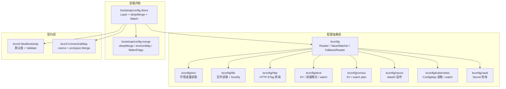
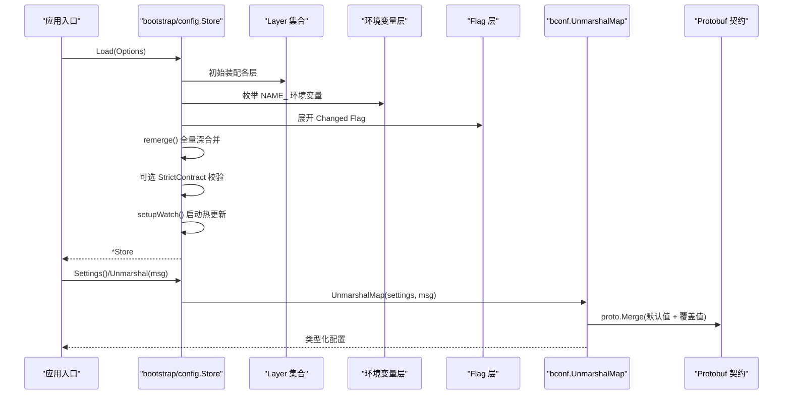
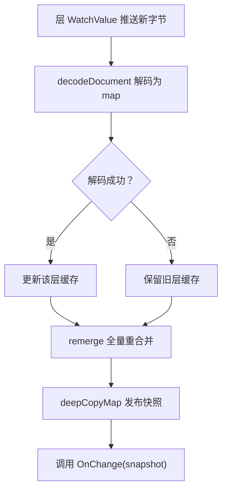
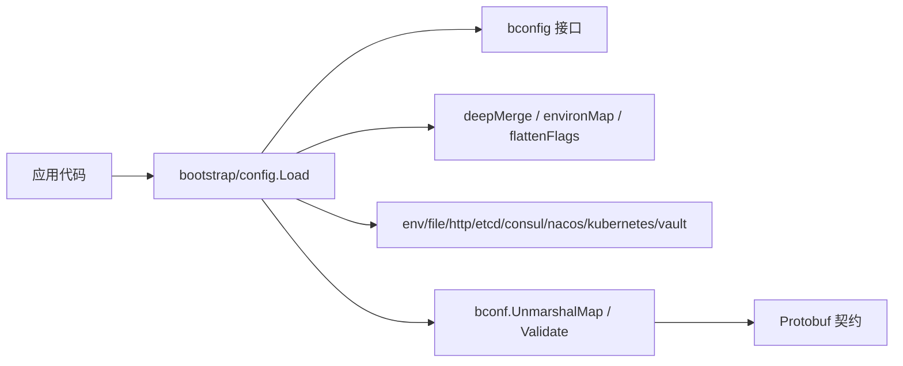

# 配置系统

<cite>
**本文引用的文件**   
- [bconfig.go](file://bconfig/bconfig.go)
- [fallback.go](file://bconfig/fallback.go)
- [env/env.go](file://bconfig/env/env.go)
- [file/file.go](file://bconfig/file/file.go)
- [http/http.go](file://bconfig/http/http.go)
- [etcd/config.go](file://bconfig/etcd/config.go)
- [consul/config.go](file://bconfig/consul/config.go)
- [nacos/config.go](file://bconfig/nacos/config.go)
- [kubernetes/config.go](file://bconfig/kubernetes/config.go)
- [vault/config.go](file://bconfig/vault/config.go)
- [config.go](file://bootstrap/config/config.go)
- [merge.go](file://bootstrap/config/merge.go)
- [env_contract_test.go](file://bootstrap/config/env_contract_test.go)
- [env_twopass_test.go](file://bootstrap/config/env_twopass_test.go)
- [layer_test.go](file://bootstrap/config/layer_test.go)
- [bootstrap.go](file://bconf/bootstrap.go)
- [unmarshal.go](file://bconf/unmarshal.go)
</cite>

## 目录
1. [引言](#引言)
2. [项目结构](#项目结构)
3. [核心组件](#核心组件)
4. [架构总览](#架构总览)
5. [详细组件分析](#详细组件分析)
6. [依赖关系分析](#依赖关系分析)
7. [性能与并发特性](#性能与并发特性)
8. [故障排查指南](#故障排查指南)
9. [结论](#结论)

## 引言
本仓库不是单一 Go module，而是由多个模块通过相对 replace 组合而成的多模块工程；本文聚焦其中与配置相关的三个包：

- `bconfig`：配置源抽象层，定义 Reader、ValueWatcher、Decoder 等接口及优先级回退器。
- `bootstrap/config`：Bald 框架的配置装载内核，实现「命名层 + map 深合并 + 热更新」的 Store。
- `bconf`：基于 Protobuf 契约的配置反序列化、校验与默认值装配层。

文档围绕以下目标展开：两段式配置装载（`app.name` 自指消解）、配置层模型与优先级、多源 Provider 与热更新机制、环境插值与协议缓冲合约加载、配置验证与错误处理、以及性能优化要点。

## 项目结构
与配置直接相关的路径如下：

**图示来源**
- [bconfig.go:1-81](file://bconfig/bconfig.go#L1-L81)
- [config.go:1-200](file://bootstrap/config/config.go#L1-L200)
- [bootstrap.go:1-120](file://bconf/bootstrap.go#L1-L120)
- [unmarshal.go:1-120](file://bconf/unmarshal.go#L1-L120)

**章节来源**
- [bconfig.go:1-81](file://bconfig/bconfig.go#L1-L81)
- [config.go:1-200](file://bootstrap/config/config.go#L1-L200)

## 核心组件
### 配置源抽象层 `bconfig`
`bconfig` 提供统一配置源接口：

| 接口 | 职责 | 关键语义 |
|---|---|---|
| `Reader` | 一次性读取键对应的原始字节 | `Load(ctx, key)` |
| `Closer` | 释放持有资源 | `Close()` |
| `ReadCloser` | 组合 Reader 与 Closer | 用于文件、网络型源 |
| `Watcher` | 信号模式通知（仅“已变更”） | `Watch(ctx, key)` |
| `ReadWatcher` | 组合 Reader 与 Watcher | 类型便利 |
| `ValueWatcher` | 推送模式通知（直接传新字节） | `WatchValue(ctx, key)` |
| `Decoder` | 原始字节到类型化值 | `Decode(data, out)` |

组合器 `FallbackReader` 按传入顺序尝试多个 Reader，第一个返回非空数据且无错误的即为结果；同时合并所有实现了 `ValueWatcher` 的子源，任意子源推送变更后重新按优先级 `Load` 并转发有效值。**注意**：`FallbackReader` 不识别只实现 `Watcher` 的后端——这是刻意为之，避免在组合层做无意义的 Load 回读并把信号源静默忽略。

**章节来源**
- [bconfig.go:1-81](file://bconfig/bconfig.go#L1-L81)
- [fallback.go:1-147](file://bconfig/fallback.go#L1-L147)

### 装载内核 `bootstrap/config`
`Store` 是配置装载的事实入口，维护：

- `merged`：当前合并树（低→高：层序 → env → flag）。
- `layerM`：动态源层列表，索引 0 为最低优先级（远程桥 → 契约层逆序 → 本地文件）。
- `envM`：环境变量映射缓存。
- `flagM`：命令行 Flag 映射缓存（进程运行期静态）。
- `onChange`：任一层变更触发的回调，参数是合并后的最新快照。

加载优先级从高到低：

1. Flag（用户显式传入）。
2. 环境变量（`NAME_` 前缀枚举）。
3. 本地文件（自动发现或显式指定）。
4. 契约源层（`Layers` 列表首元素优先级最高）。
5. 远程桥（基准层，最低优先级）。

**章节来源**
- [config.go:1-200](file://bootstrap/config/config.go#L1-L200)
- [config.go:201-633](file://bootstrap/config/config.go#L201-L633)

### 契约层 `bconf`
`bconf` 把合并后的 `map[string]any` 反序列化为 Protobuf 消息：

- `NewBootstrap()` 提供默认配置。
- `Validate()` 启动期 fail-fast 校验。
- `UnmarshalMap()` 完成 coerce → json.Marshal → protojson.Unmarshal → clearPresentLists → proto.Merge。
- `FindUnknownKeys()` 在严格模式下检测未知键。

**章节来源**
- [bootstrap.go:1-120](file://bconf/bootstrap.go#L1-L120)
- [bootstrap.go:201-302](file://bconf/bootstrap.go#L201-L302)
- [unmarshal.go:1-200](file://bconf/unmarshal.go#L1-L200)
- [unmarshal.go:201-652](file://bconf/unmarshal.go#L201-L652)

## 架构总览
配置装载的整体流程如下：

**图示来源**
- [config.go:1-200](file://bootstrap/config/config.go#L1-L200)
- [config.go:201-633](file://bootstrap/config/config.go#L201-L633)
- [unmarshal.go:1-200](file://bconf/unmarshal.go#L1-L200)

## 详细组件分析

### 两段式配置装载与 `app.name` 自指消解
框架支持「延迟挂载环境变量层」的两遍装载模式：

- **第一遍**：调用 `Load(Options{DeferEnv: true})`，此时不构建 env 层，`merged` 仅包含远程桥、契约层和本地文件。调用方可对快照执行 `Unmarshal`，解析出 `app.name`。
- **第二遍**：以解析出的 `app.name` 调用 `MountEnv(name)`，按该名称派生 `NAME_` 前缀，挂载 env 层并重合并。

两条红线由测试钉住：

1. 现有用户的 `NAME_` 前缀必须原样生效，能覆盖文件值。
2. 延迟挂载 env 后，热更新仍叠加 env 层，watch 语义不回归。

典型用法：

1. 用文件名或 `Name` 定位配置文件。
2. `Load` 时设置 `DeferEnv: true`。
3. `Unmarshal(&cfg)` 取 `cfg.App.Name`。
4. `s.MountEnv(cfg.App.Name)` 完成最终合并。
5. 后续业务从 `Settings()` 或 `Unmarshal` 获取最终配置。

**章节来源**
- [config.go:1-200](file://bootstrap/config/config.go#L1-L200)
- [config.go:201-633](file://bootstrap/config/config.go#L201-L633)
- [env_twopass_test.go:1-111](file://bootstrap/config/env_twopass_test.go#L1-L111)

### 配置层模型与合并规则
`Layer` 表示一个命名的整文档配置源：

| 字段 | 含义 |
|---|---|
| `Name` | 层名，用于日志和错误信息 |
| `Reader` | 整文档源，`Load(ctx, "")` 返回整份配置字节 |
| `Format` | `yaml` / `yml` / `json`；为空时优先走 `formatAware`，否则回退 `yaml` |
| `Watch` | 是否订阅热更新；为真时 Reader 必须实现 `ValueWatcher` |

合并算法 `deepMerge` 是递归深合并：

- 同层同名键，高优先级覆盖低优先级。
- 嵌套 `map[string]any` 逐层合并。
- 每层都新建 map（copy-on-write），已发布的快照不受后续重合并影响。
- 列表字段不会跨层追加，而是被高优先级层整体替换——这一语义在 `bconf.UnmarshalMap` 的 `clearPresentLists` 中进一步保证。

优先级顺序（低→高）：

1. 远程桥（基准）。
2. 契约源层（`Layers` 逆序 append，列表首优先级最高）。
3. 本地文件。
4. 环境变量。
5. Flag。

**章节来源**
- [config.go:1-200](file://bootstrap/config/config.go#L1-L200)
- [merge.go:1-168](file://bootstrap/config/merge.go#L1-L168)
- [layer_test.go:1-200](file://bootstrap/config/layer_test.go#L1-L200)

### 环境变量命名规范与环境插值
环境变量层使用枚举驱动而非查询驱动：

- 前缀规则：应用名转大写，连字符替换为下划线，再加 `_`。例如 `bald-demo` → `BALD_DEMO_`。
- 路径规则：去掉前缀后全部小写，下划线和连字符都解释为点路径分隔符。
- 示例：`BALD_DEMO_SERVER_HTTP_ADDR` → `server.http.addr`。

重要限制：契约字段大量使用下划线（如 `server_addrs`、`max_open_connections`），而环境变量层的下划线是路径分隔符。两者冲突由 `bconf.lookupField` 的折叠匹配解决：平级匹配失败后，把候选名的下划线段当作嵌套路径逐层下钻，命中后将值搬移到平级键并清理残留嵌套链。

这意味着：

- 普通点路径环境变量正常工作。
- 含下划线的契约字段可通过折叠匹配生效。
- 业务键若含下划线仍可能被误切，应优先使用 YAML/Flag 覆盖，或避免下划线命名。
- 严格模式下，折叠后残留的非契约键会被判为未知键。

**章节来源**
- [merge.go:1-168](file://bootstrap/config/merge.go#L1-L168)
- [unmarshal.go:201-652](file://bconf/unmarshal.go#L201-L652)
- [env_contract_test.go:1-180](file://bootstrap/config/env_contract_test.go#L1-L180)

### 协议缓冲合约加载与类型规范化
`bconf.UnmarshalMap` 的流程：

1. 深拷贝输入 map，避免热更新回调中对同一快照多次反序列化互相破坏。
2. `coerceMessage` 按字段描述符把 map 中的值转换为 protojson 可接受形态。
3. `json.Marshal` 转为 JSON。
4. 解析到同类型的空消息，再 `proto.Merge` 进带默认值的消息。
5. `clearPresentLists` 清除重复 list/map 的旧值，使 repeated 字段表现为「替换」而非「追加」。

类型规范化覆盖：

- 字符串：bool、整数、浮点数均可转字符串。
- 布尔：字符串按 `strconv.ParseBool` 解析。
- 整数：int/uint 系列、float（须为整数值）、string、`time.Duration`。
- 浮点数：int/uint、string、float。
- 枚举：枚举名或数字。
- `google.protobuf.Duration`：`"10s"`、`time.Duration`、纳秒整数均支持。
- bytes：base64 字符串。

**章节来源**
- [unmarshal.go:1-200](file://bconf/unmarshal.go#L1-L200)
- [unmarshal.go:201-652](file://bconf/unmarshal.go#L201-L652)

### 配置验证与错误处理
`bconf.Validate` 校验范围：

- `app.id`、`app.name` 非空。
- `server.http.addr`、`server.grpc.addr` 为合法地址。
- `logger.backends` 至少一项；逐项校验后端 type 与段级规则。

`bootstrap/config` 还可选启用严格契约校验：

- `StrictContract: true` 会在合并完成后扫描 `bconf.FindUnknownKeys`。
- 发现契约未声明的键即返回错误。
- 业务自持顶层段可通过 `AllowBusinessSections` 白名单放行整棵子树。

常见错误场景：

- 写错键名：`server.htpp` 替代 `server.http`。
- 业务键放在契约段内部：需要拆到独立顶层段或用白名单。
- repeated 字段漏配：`logger.backends` 是新元素替换语义，配置中出现就须写全该项。

**章节来源**
- [bootstrap.go:1-120](file://bconf/bootstrap.go#L1-L120)
- [bootstrap.go:201-302](file://bconf/bootstrap.go#L201-L302)
- [env_contract_test.go:1-180](file://bootstrap/config/env_contract_test.go#L1-L180)

### 热更新机制
热更新由 `setupWatch` 启动：

- 只对 `Watch: true` 且实现 `ValueWatcher` 的层生效。
- 每个层一个转发 goroutine，收到新字节后 decode → 更新层缓存 → 全量重合并 → 发布 `OnChange` 快照。
- 解析失败（如编辑中途半写状态）保留旧层缓存，仍触发重合并与回调，便于观测。
- 通道关闭（watch 流断开、fsnotify 致命错误）后按固定间隔重试重连，并重拉一次全量补偿丢失变更。
- `Store.Close()` 取消上下文并等待所有转发 goroutine 退出。

需要注意：

- 如果未设置 `OnChange`，watch 装配会直接跳过，避免空转 goroutine。
- 本地文件层是否监听受 `WatchLocalFile` 控制。
- 契约层默认开启监听；远程桥也作为最低优先级层参与热更新。
- `MountEnv` 只在两遍装载的第二遍显式调用；之后任何层的热更新都会照常叠加 env 层。

**图示来源**
- [config.go:201-633](file://bootstrap/config/config.go#L201-L633)

**章节来源**
- [config.go:201-633](file://bootstrap/config/config.go#L201-L633)
- [layer_test.go:1-200](file://bootstrap/config/layer_test.go#L1-L200)

### 多源 Provider 一览
| Provider | 读取方式 | 热更新方式 | 备注 |
|---|---|---|---|
| `bconfig/env` | 单键环境变量 | 无 | 通常不由 Store 直接挂载，而是由 `environMap` 枚举 |
| `bconfig/file` | 读取完整文件 | `fsnotify` 文件事件 | 监听父目录以兼容编辑器原子写入 |
| `bconfig/http` | HTTP GET | ETag 条件轮询 | 304 视为无变化 |
| `bconfig/etcd` | KV 或 prefix 聚合 | 原生 watch | prefix 模式每次增量后回读全量 |
| `bconfig/consul` | KV 读取 | watch plan | 删除键推送 nil 让层清空 |
| `bconfig/nacos` | dataID 读取 | SDK ListenConfig | 惰性建连 |
| `bconfig/kubernetes` | ConfigMap dataKey 或全量 | Kubernetes watch | 删除事件直接关闭通道 |
| `bconfig/vault` | Secret dataKey | 轮询 | 支持 KV v1/v2，默认 dataKey 为 `content` |

**章节来源**
- [env/env.go:1-57](file://bconfig/env/env.go#L1-L57)
- [file/file.go:1-166](file://bconfig/file/file.go#L1-L166)
- [http/http.go:1-200](file://bconfig/http/http.go#L1-L200)
- [etcd/config.go:1-200](file://bconfig/etcd/config.go#L1-L200)
- [consul/config.go:1-151](file://bconfig/consul/config.go#L1-L151)
- [nacos/config.go:1-160](file://bconfig/nacos/config.go#L1-L160)
- [kubernetes/config.go:1-181](file://bconfig/kubernetes/config.go#L1-L181)
- [vault/config.go:1-196](file://bconfig/vault/config.go#L1-L196)

### 远程配置中心集成指南
远程配置中心对应 `bconfig` 下的 etcd、consul、nacos、kubernetes、vault 实现。它们共同遵循：

- 构造函数区分「自建 client」与「注入已有 client」两种模式。
- `Load(ctx, key)` 透传 context，以便 Store 的超时/取消生效。
- `WatchValue(ctx, key)` 在 ctx 取消或后端连接异常时关闭输出通道。
- 部分后端（http、vault）因没有原生推送能力，使用轮询模拟。

实际接入建议：

1. 在 `Registry.Build` 阶段装配具体 provider 为 `bconfig.Reader` / `ValueWatcher`。
2. 将 provider 包装成 `Layer` 加入 `Options.Layers`。
3. 若后端支持 push，设置 `Watch: true`。
4. 若后端只支持 signal（只实现 `Watcher`），应在 provider 内部收到信号后 `Load` 回读并以 `ValueWatcher` 形式暴露。
5. 远端不可达时，Store 的 `LoadTimeout` 会快速失败；源自身已有超时的（如 etcd dial timeout）不受此限。

**章节来源**
- [config.go:1-200](file://bootstrap/config/config.go#L1-L200)
- [etcd/config.go:1-200](file://bconfig/etcd/config.go#L1-L200)
- [consul/config.go:1-151](file://bconfig/consul/config.go#L1-L151)
- [nacos/config.go:1-160](file://bconfig/nacos/config.go#L1-L160)
- [kubernetes/config.go:1-181](file://bconfig/kubernetes/config.go#L1-L181)
- [vault/config.go:1-196](file://bconfig/vault/config.go#L1-L196)

## 依赖关系分析
配置系统的依赖方向清晰：

约束：

- `bootstrap/config` 依赖 `bconfig` 抽象层和 `bconf` 契约工具。
- `bconfig` 的各 Provider 实现彼此独立，互不 import。
- 配置装载内核不直接依赖具体后端，后端通过 Registry 装配为 Layer。
- `bconf` 不依赖装载层，只提供契约工具。

**图示来源**
- [bconfig.go:1-81](file://bconfig/bconfig.go#L1-L81)
- [config.go:1-200](file://bootstrap/config/config.go#L1-L200)
- [unmarshal.go:1-120](file://bconf/unmarshal.go#L1-L120)

**章节来源**
- [bconfig.go:1-81](file://bconfig/bconfig.go#L1-L81)
- [config.go:1-200](file://bootstrap/config/config.go#L1-L200)

## 性能与并发特性
### 深合并与快照隔离
`deepMerge` 每次重合并都创建新的 map 层，`Settings()` 返回深拷贝。这样已发布的快照不会被后续热更新修改，避免下游 goroutine 读到不一致树。

### 层缓存
Store 缓存每层的 decoded map 和 env/flag map。热更新只更新触发层，然后全量重合并，而不是重建所有底层。

### 观察锁串行化
`notifyMu` 串行化「重合并 → 快照 → OnChange」，防止多个层 watcher 并发触发时在回调中修改契约、Logger 或计划产生竞态。

### 类型规范化缓存
`fieldLookupCache` 按 message 描述符缓存字段查找表，避免每次热更重扫契约字段元信息。

### 远端快速失败
`DefaultLoadTimeout` 默认 10 秒；可设为负值信任源自身超时。这避免配置中心不可达时启动无限阻塞。

**章节来源**
- [merge.go:1-168](file://bootstrap/config/merge.go#L1-L168)
- [config.go:201-633](file://bootstrap/config/config.go#L201-L633)
- [unmarshal.go:1-120](file://bconf/unmarshal.go#L1-L120)

## 故障排查指南

### 环境变量未生效
可能原因：

- 应用名拼写错误导致前缀不匹配。
- 契约字段含下划线，但折叠匹配未能命中。
- 业务键含下划线，被误当路径分隔符。
- 严格模式下，折叠残留的非契约键被报未知键。

排查步骤：

1. 确认 `Name` 生成的前缀与 `os.Environ` 一致。
2. 检查契约字段是否含下划线。
3. 打开 `StrictContract` 看是否出现未知键提示。
4. 对业务键改用 YAML/Flag 覆盖或避免下划线。

**章节来源**
- [merge.go:1-168](file://bootstrap/config/merge.go#L1-L168)
- [env_contract_test.go:1-180](file://bootstrap/config/env_contract_test.go#L1-L180)

### 热更新不触发
可能原因：

- 层未设置 `Watch: true`。
- 层 Reader 未实现 `ValueWatcher`。
- 未设置 `OnChange`，watch 装配直接跳过。
- 后端只实现 `Watcher`，组合层不识别该接口。
- 通道已关闭但未重连。

排查步骤：

1. 确认 Layer 的 `Watch` 为真。
2. 确认 Reader 实现 `ValueWatcher`。
3. 确认设置了 `OnChange`。
4. 如果是信号型后端，在 provider 内部 Load 回读后以 `ValueWatcher` 暴露。
5. 查看 Store 是否 Close，watch 通道关闭后需重连。

**章节来源**
- [config.go:201-633](file://bootstrap/config/config.go#L201-L633)
- [bconfig.go:1-81](file://bconfig/bconfig.go#L1-L81)

### 配置项被静默丢弃
可能原因：

- 键名拼写错误。
- 业务键放在契约段内，被 `DiscardUnknown` 丢弃。
- 未启用 `StrictContract`。
- repeated 字段只写了部分项，其余默认项被替换。

排查步骤：

1. 启用 `StrictContract`。
2. 业务自定义段放入独立顶层段。
3. 通过 `AllowBusinessSections` 白名单放行业务段。
4. repeated 字段写全所需项。

**章节来源**
- [config.go:1-200](file://bootstrap/config/config.go#L1-L200)
- [bootstrap.go:1-120](file://bconf/bootstrap.go#L1-L120)
- [env_contract_test.go:1-180](file://bootstrap/config/env_contract_test.go#L1-L180)

### 两段式装载无法拿到 `app.name`
可能原因：

- 忘记设置 `DeferEnv: true`。
- 第一遍 `Unmarshal` 后没有调用 `MountEnv`。
- 第二次使用的 name 与文件里 `app.name` 不一致。

排查步骤：

1. 第一遍 `Load` 时设置 `DeferEnv: true`。
2. 第一遍 `Unmarshal` 取出 `app.name`。
3. 用相同 name 调用 `MountEnv`。
4. 再次 `Unmarshal` 拿最终配置。

**章节来源**
- [env_twopass_test.go:1-111](file://bootstrap/config/env_twopass_test.go#L1-L111)

## 结论
Bald 配置系统以三层协作构成：

- `bconfig` 抽象出统一的配置源与热更新契约。
- `bootstrap/config` 实现命名层、深合并、环境插值、Flag 覆盖、两遍装载和热更新。
- `bconf` 把 map 配置安全反序列化为 Protobuf 契约，并提供默认值、类型规范和严格校验。

它适合的场景是：

- 需要多源配置（文件、环境变量、远程配置中心）。
- 需要运行时热更新且不丢失高层覆盖。
- 配置形状由 Protobuf 契约约束，希望写错键名尽早暴露。
- 需要通过 `app.name` 派生环境变量前缀，实现自指消解。

需要注意的限制：

- 环境变量下划线与契约下划线字段存在语义冲突，依赖折叠匹配兜底。
- 只实现 `Watcher` 的后端不会自动进入 `FallbackReader` 的热更新合并，必须自行适配为 `ValueWatcher`。
- 业务段不应塞进契约段内部，除非使用白名单。
- repeated 字段是替换语义，不是追加语义。
- 严格契约校验需要调用方显式开启，并用白名单声明业务段。