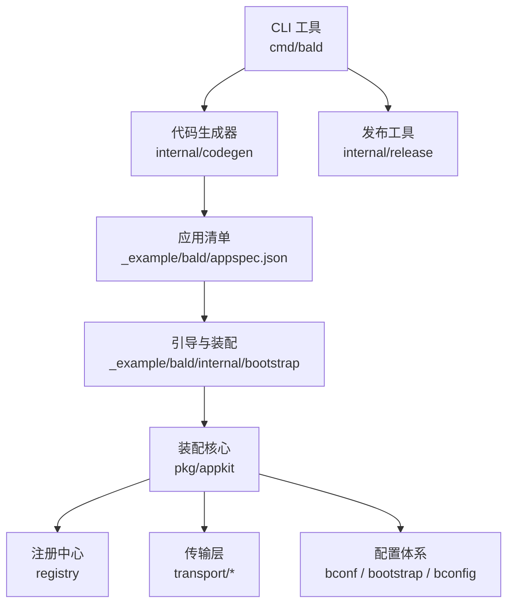
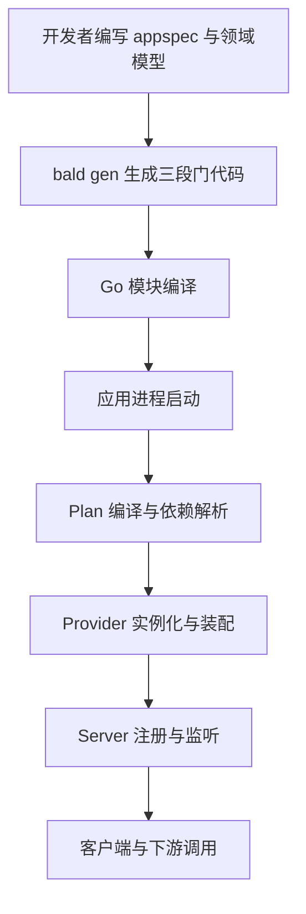
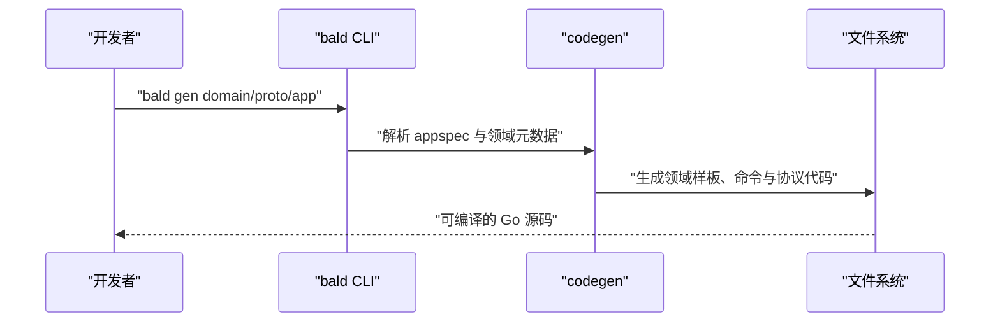
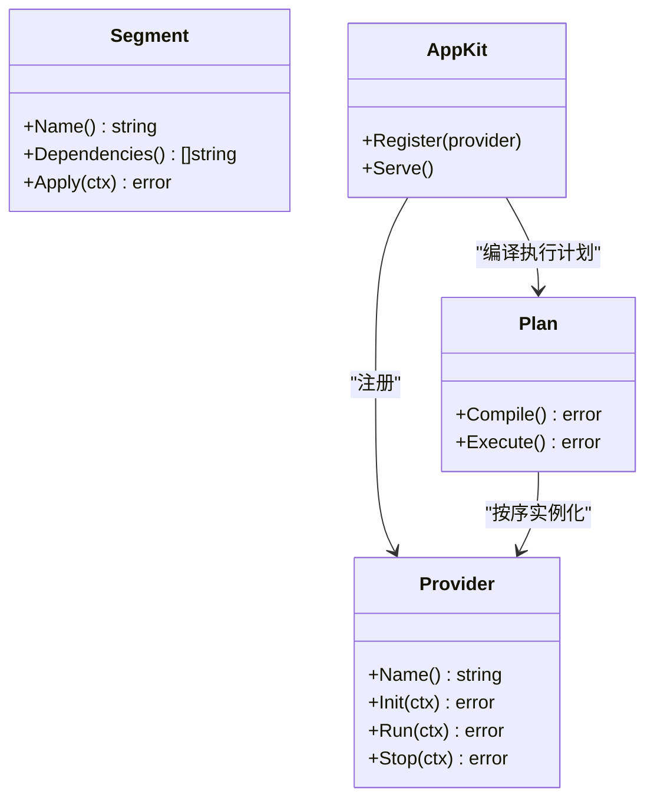
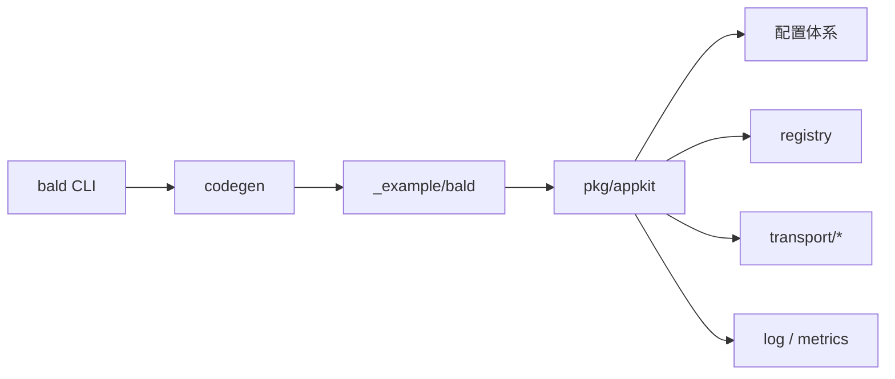

# 项目概览

<cite>
**本文引用的文件**   
- [go.mod](file://go.mod)
- [scripts/list-modules.sh](file://scripts/list-modules.sh)
- [cmd/bald/main.go](file://cmd/bald/main.go)
- [_example/bald/go.mod](file://_example/bald/go.mod)
- [_example/bald/appspec.json](file://_example/bald/appspec.json)
- [_example/bald/greetv1/domain.go](file://_example/bald/greetv1/domain.go)
- [_example/bald/user/provider_mem.go](file://_example/bald/user/provider_mem.go)
- [_example/bald/internal/bootstrap/bootstrap.go](file://_example/bald/internal/bootstrap/bootstrap.go)
- [_example/bald/internal/apiserver/server.go](file://_example/bald/internal/apiserver/server.go)
- [pkg/appkit/plan_compile.go](file://pkg/appkit/plan_compile.go)
- [pkg/appkit/serve.go](file://pkg/appkit/serve.go)
- [pkg/appkit/provider.go](file://pkg/appkit/provider.go)
- [pkg/appkit/types.go](file://pkg/appkit/types.go)
- [pkg/appkit/segment_biz.go](file://pkg/appkit/segment_biz.go)
- [internal/codegen/gen_domain.go](file://internal/codegen/gen_domain.go)
- [internal/codegen/gen_domain_cmd.go](file://internal/codegen/gen_domain_cmd.go)
- [internal/codegen/gen_domain_proto.go](file://internal/codegen/gen_domain_proto.go)
- [internal/codegen/appspec_build.go](file://internal/codegen/appspec_build.go)
- [internal/release/command.go](file://internal/release/command.go)
</cite>

## 目录
1. [简介](#简介)
2. [项目结构](#项目结构)
3. [核心组件](#核心组件)
4. [架构总览](#架构总览)
5. [详细组件分析](#详细组件分析)
6. [依赖关系分析](#依赖关系分析)
7. [性能与可观测性](#性能与可观测性)
8. [故障排查指南](#故障排查指南)
9. [结论](#结论)
10. [附录：快速开始](#附录快速开始)

## 简介
Bald 是一个面向 Go 的声明式微服务装配框架。它把“定义服务、装配依赖、启动运行时”拆成三段：领域模型与契约由三段门代码生成器产出，业务段通过 Provider 机制声明式装配基础设施，应用段负责拉起 gRPC/HTTP/Gateway 等传输层并对外暴露能力。与传统 Go 框架相比，Bald 不强调手写 `main` 组装逻辑，而是以 `appspec` 清单、段驱动 Provider、以及 CLI 工具链共同驱动可重复、可审计的服务构建过程。

仓库采用 93 个 `go.mod` 的多模块组织方式，根 module 只保留顶层版本与替换规则，各功能域（配置、注册中心、缓存、断流限流、消息 Broker、传输层、可观测性等）各自独立维护依赖，并通过相对 replace 组成可编译闭包。CLI 工具链中的 `bald gen proto/store/app/domain/release` 分别对应协议生成、存储适配、应用骨架、领域模板与发布流程，是连接源码、清单与运行时装配的关键桥梁。

## 项目结构
仓库按主题划分为若干子模块，常见分组包括：
- 配置与引导：`bconf`、`bootstrap`、`bconfig`
- 服务发现与网关：`registry`、`transport/gateway`
- 数据访问：`cache`、`contrib/store-*`、`contrib/database/*`
- 可靠性：`circuitbreaker`、`ratelimit`、`retry`
- 异步通信：`broker`、`transport/{kafka,rabbitmq,rocketmq,tcp,webrtc}`
- 可观测性：`log`、`metrics`、`observability/metricshttp`
- 应用装配核心：`pkg/appkit`
- 代码生成与发布：`internal/codegen`、`internal/release`
- 示例应用：`_example/bald`

**图表来源**
- [cmd/bald/main.go:1-200](file://cmd/bald/main.go#L1-L200)
- [internal/codegen/appspec_build.go:1-200](file://internal/codegen/appspec_build.go#L1-L200)
- [_example/bald/internal/bootstrap/bootstrap.go:1-200](file://_example/bald/internal/bootstrap/bootstrap.go#L1-L200)
- [pkg/appkit/plan_compile.go:1-200](file://pkg/appkit/plan_compile.go#L1-L200)

**章节来源**
- [go.mod:1-200](file://go.mod#L1-L200)
- [scripts/list-modules.sh:1-200](file://scripts/list-modules.sh#L1-L200)

## 核心组件
- **CLI 工具链**：`bald` 命令入口位于 `cmd/bald/main.go`，内部委托给 Cobra 子命令；`gen` 系列子命令驱动代码生成，`release` 子命令负责版本与变更日志发布。
- **应用装配核心**：`pkg/appkit` 实现段驱动装配、Provider 注入、计划编译、生命周期调度与服务器注册。
- **三段门代码生成**：`internal/codegen` 根据 `appspec.json` 与领域元数据生成领域样板、命令、协议与绑定代码，减少样板工程差异。
- **配置与引导**：`bconf` 提供基于 protobuf 的配置模型，`bootstrap` 将配置加载、日志、gRPC/HTTP 服务统一纳入引导流程，`bconfig` 支持多后端配置源。
- **注册中心与网关**：`registry` 抽象服务发现，`transport/gateway` 提供面向外部流量的 HTTP/gRPC 网关。
- **可观测性与可靠性**：日志、指标、追踪、熔断、限流、重试构成横切能力，通过 Provider 注入到各段。

**章节来源**
- [cmd/bald/main.go:1-200](file://cmd/bald/main.go#L1-L200)
- [pkg/appkit/provider.go:1-200](file://pkg/appkit/provider.go#L1-L200)
- [pkg/appkit/plan_compile.go:1-200](file://pkg/appkit/plan_compile.go#L1-L200)
- [internal/codegen/gen_domain.go:1-200](file://internal/codegen/gen_domain.go#L1-L200)

## 架构总览
Bald 的声明式装配可以理解为以下流水线：

**图表来源**
- [internal/codegen/appspec_build.go:1-200](file://internal/codegen/appspec_build.go#L1-L200)
- [pkg/appkit/plan_compile.go:1-200](file://pkg/appkit/plan_compile.go#L1-L200)
- [pkg/appkit/serve.go:1-200](file://pkg/appkit/serve.go#L1-L200)

该图展示的是 Bald 从源码到运行时的整体流向，并非某个单一函数的调用序列。实际细节会在后续“详细组件分析”中展开。

## 详细组件分析

### CLI 工具链与代码生成
`bald` 是仓库的命令行入口，其职责是把开发者的声明式描述转化为可编译的 Go 工程。`gen` 子命令主要覆盖：
- `proto`：根据领域接口与 Proto 定义生成 gRPC 代码。
- `store`：为领域实体生成 CRUD 或存储适配所需的样板。
- `app`：生成应用骨架、配置结构与启动引导。
- `domain`：生成领域段的声明代码，如领域模型、路由、权限与命令。
- `release`：用于发布流程，处理版本标签、变更日志与仓库同步。

**图表来源**
- [cmd/bald/main.go:1-200](file://cmd/bald/main.go#L1-L200)
- [internal/codegen/gen_domain.go:1-200](file://internal/codegen/gen_domain.go#L1-L200)
- [internal/codegen/gen_domain_cmd.go:1-200](file://internal/codegen/gen_domain_cmd.go#L1-L200)
- [internal/codegen/gen_domain_proto.go:1-200](file://internal/codegen/gen_domain_proto.go#L1-L200)

**章节来源**
- [cmd/bald/main.go:1-200](file://cmd/bald/main.go#L1-L200)
- [internal/codegen/gen_domain.go:1-200](file://internal/codegen/gen_domain.go#L1-L200)
- [internal/codegen/gen_domain_cmd.go:1-200](file://internal/codegen/gen_domain_cmd.go#L1-L200)
- [internal/codegen/gen_domain_proto.go:1-200](file://internal/codegen/gen_domain_proto.go#L1-L200)
- [internal/codegen/appspec_build.go:1-200](file://internal/codegen/appspec_build.go#L1-L200)
- [internal/release/command.go:1-200](file://internal/release/command.go#L1-L200)

### 应用装配核心与 Provider 机制
`pkg/appkit` 是 Bald 的运行时装配引擎。它以“段”为单位组织能力：
- 段驱动：每个业务或基础设施能力被组织为一个段，段之间通过类型安全的键进行依赖注入。
- Provider：Provider 负责构造和返回段所需资源，例如数据库连接、缓存、注册中心客户端、中间件等。
- Plan 编译：在启动阶段把 Provider 与依赖关系编译为执行计划，避免循环依赖并保证启动顺序。
- Serve：最终把 gRPC、HTTP、Gateway 等 Server 注册到运行时并进入监听状态。

**图表来源**
- [pkg/appkit/provider.go:1-200](file://pkg/appkit/provider.go#L1-L200)
- [pkg/appkit/types.go:1-200](file://pkg/appkit/types.go#L1-L200)
- [pkg/appkit/plan_compile.go:1-200](file://pkg/appkit/plan_compile.go#L1-L200)
- [pkg/appkit/serve.go:1-200](file://pkg/appkit/serve.go#L1-L200)

**章节来源**
- [pkg/appkit/provider.go:1-200](file://pkg/appkit/provider.go#L1-L200)
- [pkg/appkit/types.go:1-200](file://pkg/appkit/types.go#L1-L200)
- [pkg/appkit/plan_compile.go:1-200](file://pkg/appkit/plan_compile.go#L1-L200)
- [pkg/appkit/serve.go:1-200](file://pkg/appkit/serve.go#L1-L200)

### 三段门代码生成与应用骨架
三段门是 Bald 对代码分层的约定：
- 契约层：由 Proto 生成的 API 契约，供上游调用方与服务端共享。
- 领域层：业务语义、实体、领域服务、命令与权限模型。
- 适配层：具体实现，如 HTTP/gRPC Handler、存储实现、外部系统客户端。

示例应用中，`_example/bald/greetv1/domain.go` 体现领域声明，`_example/bald/user/provider_mem.go` 体现内存适配 Provider，而 `internal/bootstrap/bootstrap.go` 与 `internal/apiserver/server.go` 则承载应用引导与 API 服务装配。

**图表来源**
- [_example/bald/greetv1/domain.go:1-200](file://_example/bald/greetv1/domain.go#L1-L200)
- [_example/bald/user/provider_mem.go:1-200](file://_example/bald/user/provider_mem.go#L1-L200)
- [_example/bald/internal/bootstrap/bootstrap.go:1-200](file://_example/bald/internal/bootstrap/bootstrap.go#L1-L200)
- [_example/bald/internal/apiserver/server.go:1-200](file://_example/bald/internal/apiserver/server.go#L1-L200)

**章节来源**
- [_example/bald/appspec.json:1-200](file://_example/bald/appspec.json#L1-L200)
- [_example/bald/greetv1/domain.go:1-200](file://_example/bald/greetv1/domain.go#L1-L200)
- [_example/bald/user/provider_mem.go:1-200](file://_example/bald/user/provider_mem.go#L1-L200)
- [_example/bald/internal/bootstrap/bootstrap.go:1-200](file://_example/bald/internal/bootstrap/bootstrap.go#L1-L200)
- [_example/bald/internal/apiserver/server.go:1-200](file://_example/bald/internal/apiserver/server.go#L1-L200)

### 配置层模型与多后端
Bald 使用 `bconf` 的 protobuf 配置模型作为配置层基座，`bootstrap` 将其与日志、gRPC/HTTP 服务结合，`bconfig` 提供文件、环境变量、etcd、Consul、Nacos、Kubernetes、Vault 等多后端读取能力。这种设计让配置加载成为 Provider 的一个典型装配项，便于在测试中替换为内存配置。

**章节来源**
- [bconf/bootstrap.go:1-200](file://bconf/bootstrap.go#L1-L200)
- [bootstrap/config/config.go:1-200](file://bootstrap/config/config.go#L1-L200)
- [bconfig/bconfig.go:1-200](file://bconfig/bconfig.go#L1-L200)

## 依赖关系分析
Bald 的核心依赖方向是：
- CLI 与代码生成器依赖应用清单与领域元数据。
- 应用引导依赖 `pkg/appkit` 装配核心。
- `pkg/appkit` 依赖配置、注册中心、传输层、可观测性与可靠性组件。
- 适配器包（如 store、database、registry 后端）由具体业务模块引入，根 module 不得反向依赖适配器以避免模块环。

**图表来源**
- [cmd/bald/main.go:1-200](file://cmd/bald/main.go#L1-L200)
- [internal/codegen/appspec_build.go:1-200](file://internal/codegen/appspec_build.go#L1-L200)
- [_example/bald/go.mod:1-200](file://_example/bald/go.mod#L1-L200)
- [pkg/appkit/plan_compile.go:1-200](file://pkg/appkit/plan_compile.go#L1-L200)

**章节来源**
- [go.mod:1-200](file://go.mod#L1-L200)
- [scripts/list-modules.sh:1-200](file://scripts/list-modules.sh#L1-L200)
- [_example/bald/go.mod:1-200](file://_example/bald/go.mod#L1-L200)

## 性能与可观测性
- 模块化减少了不必要的依赖膨胀，每个子模块只引入自身需要的第三方库。
- 通过 Provider 模式，关键路径上的组件（连接池、缓存、追踪、指标）可以被有界复用，避免每次请求重新创建。
- 可观测性组件集中在 `log`、`metrics`、`observability/metricshttp`，配合中间件对 HTTP/gRPC 请求做链路追踪与指标采集。
- 可靠性组件（熔断、限流、重试）应在 Provider 中初始化并按需挂载到传输层，以减少热路径开销。

[本节为通用指导，不直接分析具体文件]

## 故障排查指南
- 如果 `bald gen` 未生成预期代码，优先检查 `appspec.json` 与领域元数据是否完整，确认 CLI 是否指向正确的模块与工作目录。
- 如果启动时报 Provider 依赖缺失或循环依赖，查看 `pkg/appkit` 的 Plan 编译输出，确认 Provider 名称、依赖声明与段命名一致。
- 如果配置未生效，检查 `bootstrap` 与 `bconfig` 的后端选择与环境变量是否正确，必要时用内存配置替代远程后端进行隔离测试。
- 如果服务未对外暴露，确认 Server 注册是否发生在 Provider 初始化之后，并在 `serve.go` 的生命周期中验证监听端口与 TLS 配置。

**章节来源**
- [pkg/appkit/plan_compile.go:1-200](file://pkg/appkit/plan_compile.go#L1-L200)
- [pkg/appkit/serve.go:1-200](file://pkg/appkit/serve.go#L1-L200)
- [bootstrap/config/config.go:1-200](file://bootstrap/config/config.go#L1-L200)
- [bconfig/bconfig.go:1-200](file://bconfig/bconfig.go#L1-L200)

## 结论
Bald 的价值在于用声明式清单、三段门代码生成与段驱动 Provider 把微服务的“定义—装配—运行”统一到可重复的工程流程中。93 个 go.mod 的多模块架构让不同能力的演进互不干扰，CLI 与代码生成器降低样板成本，`pkg/appkit` 则承担运行时装配与生命周期管理。对于初学者，可以从 `_example/bald` 入手理解概念；对于有经验的开发者，应重点关注 Provider 边界、Plan 编译顺序与传输层集成点。

[本节为总结性内容，不直接分析具体文件]

## 附录：快速开始
以下快速开始步骤帮助初学者搭建第一个 Bald 示例服务：

1. 安装 CLI：从仓库根目录编译并安装 `cmd/bald/main.go` 提供的 `bald` 命令。
2. 准备示例工程：进入 `_example/bald`，阅读 `appspec.json` 与 `go.mod`，了解示例应用的模块组织。
3. 生成代码：运行 `bald gen` 相关子命令，生成领域样板、协议与命令代码。
4. 启动服务：在示例工程的引导入口中执行应用装配与服务器启动流程，参考 `internal/bootstrap/bootstrap.go` 与 `internal/apiserver/server.go`。
5. 扩展 Provider：在 `user/provider_mem.go` 基础上增加新的基础设施 Provider，并在引导中注册。
6. 验证装配：观察 Plan 编译结果与服务监听端口，确认 gRPC/HTTP 端点可用。

**章节来源**
- [_example/bald/go.mod:1-200](file://_example/bald/go.mod#L1-L200)
- [_example/bald/appspec.json:1-200](file://_example/bald/appspec.json#L1-L200)
- [_example/bald/internal/bootstrap/bootstrap.go:1-200](file://_example/bald/internal/bootstrap/bootstrap.go#L1-L200)
- [_example/bald/internal/apiserver/server.go:1-200](file://_example/bald/internal/apiserver/server.go#L1-L200)
- [_example/bald/user/provider_mem.go:1-200](file://_example/bald/user/provider_mem.go#L1-L200)