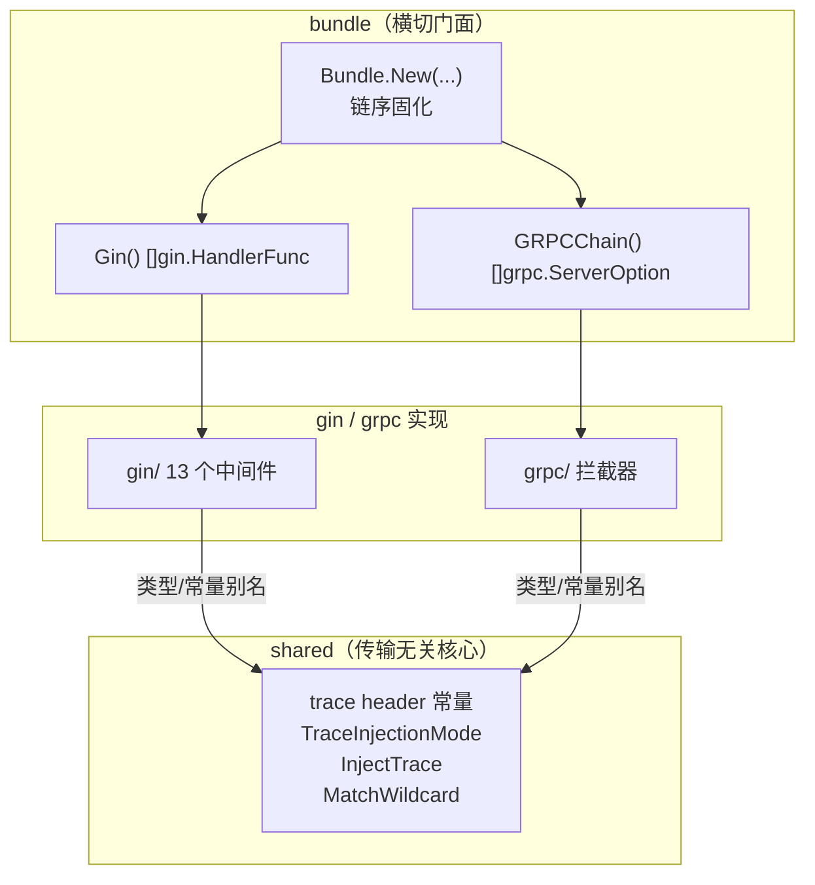

# Bald 中间件设计

> Title: 中间件——横切关注点的双传输装配（gin/gRPC）与链序固化
>
> 适用包：`pkg/middleware`（含 `gin` / `grpc` / `bundle` / `shared` 四子包）
>
> Author(s): bald 团队
>
> Status: Accepted（链序由 bundle 的顺序/位置判据固化；shared 收敛已完成）

## 摘要

`pkg/middleware` 提供 HTTP（gin）与 gRPC 两条传输链的中间件/拦截器，并把**横切关注点的正确链序**从「文档里的纪律」固化成「代码里的构造」——这是 `bundle` 子包存在的理由。

四个子包分工：

| 子包 | 行数 | 职责 |
|---|---|---|
| `gin/` | 1495 | gin 中间件实现（14 个文件） |
| `grpc/` | 1267 | gRPC 拦截器实现（unary + stream） |
| `bundle/` | 996 | **门面**：一次构造、双传输产出、链序固化，外加契约段的两侧翻译（`FromMiddleware`/`FromGRPCMiddleware`） |
| `shared/` | 104 | **传输无关核心**：trace header 常量、注入模式、通配匹配 |
| 顶层 `tracing.go` | 35 | `LogTraceIDs`（跨协议日志关联） |

合计 3897 行、**158 个测试**（bundle 62 / grpc 53 / gin 37 / shared 4 / 顶层 2）。契约钩子的装配侧判据不在本包，见「契约段谁来读」一节（`pkg/appkit/contract_faces_test.go` 14 个 + `_example` 的 10 个端到端）。

> 本文是 `pkg/middleware` 的权威设计文档；认证/授权抽象见《认证与授权抽象设计》。

## 背景与动机

### 隐性知识税：链序只活在纪律里

`pkg/middleware/gin` 的 13 个中间件与 grpc 的对应拦截器此前**全部散装手挂**，正确链序只写在文档与坑清单里——「正确链序只活在文档里」本身就是最大的「隐性知识税」。

链序为什么重要：**顺序错了不会报错，只会静默失效**。例如审计若注册在认证外侧，就永远读不到认证注入的 subject；错误收口若不在最外层，`*berrors.Error` 会被 `status.Convert` 兜底成空 `Unknown`。

### 两处真实故障驱动

1. **重复税**：gin 与 grpc 两份 `observability.go` 曾逐行重复——trace header 常量、`TraceInjectionMode`、`matchWildcard`、`injectTrace` 各一份。同一处修复要改两遍，合并后才消除这份维护成本。
2. **双命名空间**：REST 与 gRPC 的 RBAC 用不同 object/action 命名（HTTP 用 path、gRPC 用 FullMethod），同一份策略无法通用。

## 设计

### 总览：三层结构



### Bundle：链序由构造固化

`bundle.New(opts...)` 一次构造，`Gin()` 与 `GRPCChain()` 双传输产出。**依赖经构造器注入**（`bundle.Authn(a)`/`Authz`/`Audit`/`Metrics`），未注入的层直接省略（零开销）。契约段由 `bundle.FromMiddleware`（`server.http.middleware` 八段）与 `bundle.FromGRPCMiddleware`（`server.grpc.middleware` 有字段的三段：rate_limit/circuit_breaker/timeout）翻译成 Option。`bundle.RateLimit`/`bundle.CircuitBreaker`/`bundle.Timeout` 这一组**同时驱动两条链**（同一个 limiter/熔断器实例、同一份超时配置）；`bundle.GRPCRateLimit`/`bundle.GRPCCircuitBreaker`/`bundle.GRPCTimeout` 只作用于 gRPC，给了就替换 gRPC 面上的那一份——两个段都给就是两个独立的桶/熔断器。

**gin 链序（注册序即外→内）**：

```
Recovery → RequestID → Logging → CORS → Secure → Authn → Audit → Authz → RateLimit → CircuitBreaker → Timeout
```

**gRPC 链序（slice 序即外→内）**：

```
Error → Recovery → RequestID → Observability → Authn → Audit → Authz → RateLimit → CircuitBreaker → Timeout
```

**gRPC stream 链（`GRPCStreamInterceptors()`，只在 gRPC 面有限流器时才产出——`RateLimit` 或 `GRPCRateLimit` 任一）**：

```
Error → RateLimit
```

stream 面只有这两层，四条都是口径而非疏漏：
- **Error 必须在最外**：`*berrors.Error` 没实现 `GRPCStatus()`，流返回的 error 交给 grpc-go 的 `status.Convert` 会把 Code/Reason 丢成 `Unknown`——被拒的调用方分不清「我被限流」还是「服务坏了」。
- **没有 Timeout**：流 handler 的生命周期就是整条流，把 unary 的 `default_timeout_ms` 套上去等于把它静默改成「流的最大存活时长」，长订阅到点被砍且没有可区分的错误。契约的 `server.grpc.middleware.timeout` 同口径——`FromGRPCMiddleware` 译出的 `GRPCTimeout` 只挂 unary。要流上超时自己挂统一件（`middleware.StreamServerInterceptor(middleware.Timeout(d))`——批次 4 后协议耦合实现已物理移除）。
- **没有 CircuitBreaker**：一条流的「失败」没有一致答案——按建流算则开窗与真实退化无关，按流终态算则一条长流会长期占住半开探针、把其它流全拒。契约的 `server.grpc.middleware.circuit_breaker` 同口径，只挂 unary。
- **没有 Authn/Authz/Audit**：本包这三层只有 unary 形态（stream 版拦截器至今不存在）。这是既有边界——此前 stream 面整条链为空，同样没有认证。

两条链的五个**关键位置**及其理由（bundle.go 注释原文）：

- **Audit 夹在 Authn 与 Authz 之间**：在 Authn 内侧（注册序靠后）才能从 ctx 读到 Authn 注入的 subject/tenant；在 Authz 外侧（注册序靠前）才能在 `c.Next()`/handler 返回后捕获 deny 的最终 result。**两个约束夹出一个位置**——这是链序里最不显然的一条。
- **Error 必须 gRPC 最外层**：handler/内层拦截器返回的 `*berrors.Error` 若不经 `grpcerr.ToStatus` 收口，会被 `status.Convert` 兜底成空 `Unknown`。同一条收口也负责 ctx 错误：`context.DeadlineExceeded`/`context.Canceled` 不是 gRPC status，`ToStatus` 一度把它们兜成 `Unknown`——装了收口拦截器反而让「超时看起来不像超时」，比不装更差。现在两条 ctx 语义显式映射成 `DEADLINE_EXCEEDED`/`CANCELLED`，已是 `status` 的错误原样透传，只有裸 error 仍落 `Unknown`（判据 `berrors/grpcerr` 的 `TestToStatusContextErrors`）。
- **Recovery 紧随 Error（第二外层）**：panic 被捕获并转为 `*berrors.Internal`，再由最外层 Error 收口为 gRPC status——与 gin 链首道 Recovery 对称（决策 D5）。
- **RateLimit 在授权之后、Timeout 在最内层（两面同序）**：限流要看得见 subject，代价是不保护认证层自身（详见《Bald 限流设计》「链序与两侧口径」）。Timeout 放最内是只计业务处理耗时，不把上层开销算进预算。
- **CircuitBreaker 夹在 RateLimit 与 Timeout 之间（两面同序）**：三条判据少一条都会让这一层失真——更外（认证之前）则匿名流量就能把失败率打满、替所有人开窗；更内（限流之前）则被限流拒掉的请求先进熔断，两层的拒绝互相喂养；更内（超时之内）则内层 Timeout 写出的 503 落在这一层之下，熔断只看见「handler 都成功返回」——而「handler 总是超时」正是熔断该抓的形状。端到端判据把超时改成 504、熔断留默认 503，于是第三发的 503 同时证明接线与顺序（见《Bald 熔断设计》「接线」）。

两面同序但**语义不同**，别当同一个东西：gin 的 Timeout 硬性提前返回 `503`（响应按时结束，工作不一定停止），gRPC 的只给 handler 一个会到期的 ctx（不缩短调用方已给的 deadline）；gin 的限流拒绝是 `429`，gRPC 的是 `RESOURCE_EXHAUSTED` + `Reason=RATE_LIMITED`；gin 的熔断拒绝是 `503`（`circuit_breaker.status_code` 可改，必须是 5xx），gRPC 的是 `UNAVAILABLE` + `Reason=CIRCUIT_OPEN`（这一面没有状态码字段——HTTP 专属概念，与 timeout 段不带 status_code 同一个理由）。`DefaultTimeoutMs <= 0` 时两面既有行为也不同：gin 照旧挂一个立即 503 的层，gRPC 省略该层。

**写链序判据时要把两面的拒绝码分开**：熔断的默认拒绝码（503）与 timeout 的默认拒绝码（503）撞车，那第三发读不出是「熔断拒了」还是「超时又响了一次」。端到端用例因此把超时改成 504、熔断留默认 503——503 才唯一地指向熔断器，而它发生在 Timeout 之前。

这条不对称有两个可测的后果，写断言时必须知道：

- **gin 侧要测响应头时间，不是读完 body 的时间**。`ginmw.Timeout` 在提前返回前显式 Flush 头，之后仍等 handler goroutine；`net/http` 要到整条链返回才结束 chunked 响应。所以「50ms 预算」实测的是**首字节**（`http.Post` 返回即头已到），把 body 读完再计时会得到 handler 的真实耗时（示例里是 603ms 而不是 50ms）——那是在测别的东西。
- **gRPC 侧的超时依赖 handler 配合**。`TimeoutInterceptor` 只换 ctx，不提前返回；handler 不检查 `ctx.Done()` 就照旧在 delay 满后返回 `OK`。因此 gRPC 的 `DEADLINE_EXCEEDED` 断言同时是「链装了」「handler 尊重 ctx」两件事的证据——删任一条都转红（示例的 `sayHello` 显式 `select` 在 `<-ctx.Done()` 上，注释写明理由：不傻等到点再回一份迟到但成功的响应）。

**零破坏**：散装手挂路径完整保留，Bundle 只是预组装。业务可继续手动 `router.Use(...)`。

### 契约段谁来读：两面装配钩子

两座桥只负责「段 → Option」，它们本身不是装配环节——**框架侧此前没有读段的那一步**。`server.http.middleware` / `server.grpc.middleware` 长期是 write-only 配置：YAML 写了、契约解出来了、没有任何组件在启动时把段交给桥。「配置文件里写了限流」与「限流生效」之间缺一次调用，两面同病，所以两面同时补，形态对称：

```go
appkit.WithHTTPContract(fn)
//   fn(mw *bootstrapv1.Server_Http_Middleware)  (http.Handler, func() error, error)
appkit.WithGRPCOptionsContract(fn)
//   fn(mw *bootstrapv1.Server_Grpc_Middleware)  ([]grpc.ServerOption, func() error, error)
```

五个设计点（实现只有一处：`pkg/appkit/contract_faces.go` 的 `resolveContractFaces`）：

- **求值点 = 装配期**：契约已装载、变体与域接线之前。HTTP 必须在此定型——域接线（`Domain.Routes` 把路由挂到 handler）在 `BeforeStart` 链末尾、迟后阶段（server 构造）之前，那个窗口要求 handler 已存在；gRPC 与它同点求值，为了让「两面的链由同一份契约段驱动」只有一个实现点，而不是各挂各的钩子。
- **`close` 是链的一部分**：钩子造出的限流器一类的资源由框架在停机 Effect 里释放，启动失败回滚时同样释放。只在成功路径归还等于把泄漏留给失败路径。
- **计划与执行同源**：面存在性判据是 `hasHTTPFace`/`hasGRPCChain`（`WithHTTP` 或契约钩子任一即算），且钩子声明字段求值后**不清空**。`--plan` 不执行用户代码——契约钩子形态在计划期只有声明、还没有 handler，直接读 `Decl.HTTPHandler` 会让 `--plan` 漏掉域的路由节点而真实启动装上它，两份计划不一致比缺一面更难查。
- **认证姿态不进契约**：钩子拿到的是 middleware 段，链上公开还是认证仍由业务在钩子里显式写 `bundle.Public()` / `bundle.Authn(…)`（§「显式注入，不吃全局兜底」与风险 §6.1）。契约没有 `authn` 段，框架不代替业务宣布「本服务公开」。
- **变体不能偷偷改链**：钩子求值后若 build variant 再 patch 这两个段，深拷贝快照核验直接报错「链已由补丁前的段构建」——那是「配置变了却不改变链」的静默形态，比报错糟。未声明钩子时不建快照、不核验（零开销不变）。

生成脚手架把这两处写成用户自持的 seeded 文件（`bald gen app` 生成一次，之后归业务）：

```go
// internal/apiserver/apiserver.go —— HTTP 面
func NewRouter(mw *bootstrapv1.Server_Http_Middleware) (http.Handler, func() error, error) {
	opts, closeChain, err := bundle.FromMiddleware(mw)
	if err != nil {
		return nil, nil, err
	}
	router := gin.New()
	router.Use(bundle.New(append([]bundle.Option{
		bundle.Public(), // 认证姿态是业务显式声明的一行
	}, opts...)...).Gin()...)
	return router, closeChain, nil
}

// internal/bootstrap/custom.go —— gRPC 面（示例工程把函数另拆进 grpc.go，落点归业务）
func newGRPCChain(mw *bootstrapv1.Server_Grpc_Middleware) ([]grpc.ServerOption, func() error, error) {
	opts, closeChain, err := bundle.FromGRPCMiddleware(mw)
	...
}
```

owned 的 `assemble.gen.go` 登记 `appkit.WithHTTPContract(apiserver.NewRouter)`，`custom.go` 登记 `appkit.WithGRPCOptionsContract(newGRPCChain)`。角色的 `configs/<app>-<role>.yaml` 从 `AppSpec.bootstrap.server` 继承两段 middleware（codegen `inheritMiddleware`）——此前只继承地址段，角色文件里写限流没有任何路径到链上，是同一个缺陷在配置侧的形状。接管 `server.http` 的网关角色不挂 gin 链，因此**不**登记 HTTP 钩子、也不继承 http 段。

**存量工程迁移（本轮是 breaking）**：旧的 `func NewRouter() *gin.Engine` 与新 `assemble.gen.go` 不兼容，重跑 `bald gen app` 后直接编译失败——有意如此，让「配置写了不生效」必须经过一次显式改写而不是静默降级。改法：签名收 `mw`、链改走 `bundle.FromMiddleware(mw)`、返回 `(http.Handler, func() error, error)`；gRPC 侧把原来的 `WithGRPCOptions(自建链)` 搬进 `newGRPCChain(mw)`，段用 `bundle.FromGRPCMiddleware(mw)` 译。

**生效的实证**：`_example/bald/internal/bootstrap/middleware_e2e_test.go` 起真进程（`appkit.Serve` + 真 gin + 真 `grpc.NewServer`），从契约 YAML 断到 `429` / `RESOURCE_EXHAUSTED`（含 `Reason=RATE_LIMITED` 跨边界还原）/ 提前 `503` / `DEADLINE_EXCEEDED`；删任一处接线（appkit 注册、codegen 脚手架、bundle 桥、handler 尊重 ctx）都让对应面的断言转红，另两面保持绿。极值注入有两条等价路径：文件面用临时契约 YAML（不改 owned 的 `configs/*.yaml`），env 面用 `BALD_DEMO_SERVER_HTTP_MIDDLEWARE_RATE_LIMIT_*`——多词键在 env 里被 `_` 切成的嵌套链由 `bconf.FoldEnvKeys` 在合树前折回规范键（机制见[Bald 配置系统](../../guide/zh-CN/Bald%20配置系统.md)）。

### 显式注入，不吃全局兜底

Bundle 的审计层有一个刻意的语义：**auditor 未注入时显式接 `audit.NopAuditor()`**，不读取任何进程级隐式 sink（审计不存在全局句柄）。

理由：「Bundle 语义是完全显式注入，不吃全局兜底，避免测试间全局污染」。代价是若业务只设了 `Metrics` 没设 `Audit`，审计事件进 Nop——但**指标仍 emit**（审计中间件是指标埋点的载体，两者同源）——故 `auditor != nil || recorder != nil` 才挂审计层。

### 认证失败的审计盲区（D3）

链序中 Audit 在 Authn 内侧，意味着**认证失败 abort 后审计层不再执行**。这不是遗漏，而是被显式补偿：`ginAuthn()`/`grpcAuthn()` 把 bundle 的 auditor 注入 authn 层（`AuthnWithAuditor`），**authn abort 路径的审计事件由 authn 层自己发出**——与请求审计同一后端。

即：审计有两个发送点（authn 层的失败路径 + audit 层的成功/拒绝路径），合起来覆盖全路径。这是「审计不丢事件」的结构保证。

### shared：传输无关核心的收敛

R1 合并把两份 `observability.go` 的共性抽到 `shared`：

| `shared` 导出 | 用途 |
|---|---|
| 4 个 header 常量（`traceparent`/`X-Trace-Id`/`X-Request-Id`/`tracestate`） | trace 注入的 header 名 |
| `TraceInjectionMode`（4 模式：W3C / TraceIDOnly / Both / None） | 注入策略 |
| `InjectTrace(mode, customHeader, spanCtx, set)` | header 计算 + 经 `set` 回调写出 |
| `MatchWildcard(text, pattern)` | gin 路径跳过与 gRPC 方法跳过共用 |

**`InjectTrace` 的 `set func(key, value string)` 回调设计**是收敛的关键：gin 侧直接传 `c.Header`（签名恰好匹配），gRPC 侧传 `md.Set` 的单值闭包。**一份计算逻辑，两种写出方式**——这是传输无关核心的正确抽象线。

**收敛后的 API 稳定策略**：gin/grpc 两侧以**类型别名 + 常量别名**维持既有导出 API（`type TraceInjectionMode = shared.TraceInjectionMode`），零 breaking。

**什么留在各侧**（刻意不共享）：span 起法、日志结构、跳过语义（gin 用 method 前缀 pattern + 路径前缀匹配，grpc 用 `matchMethod`）；`Option`/`WithLogger`/`resolveLogger` 因选项结构体字段差异（`SkipPaths` vs `SkipMethods`）保持各侧——共享需引入泛型体操，收益不抵复杂度。

### 中间件清单

**gin（13 个）**：

| 文件 | 导出 |
|---|---|
| `recovery.go` | `Recovery` |
| `requestid.go` | `RequestIDMiddleware` |
| `logging.go` | `Logging` |
| `cors.go` | `CORS`、`DefaultCORS` |
| `secure.go` | `Secure` |
| `context.go` | `TraceContext` |
| `observability.go` | `Observability`、`WithLogger`、`WithSkipMetrics` |
| `authn.go` | `AuthnMiddleware`、`AuthnWithAuditor` |
| `authz.go` | `AuthzMiddleware`、`With{Object,Action,Subject}Resolver` |
| `audit.go` | `AuditMiddleware`、`AuditWith{Object,Action,Subject}Resolver`、`AuditWithAuditor`、`AuditWithMetrics` |
| `ratelimit.go` | `RateLimitConfig`、`RateLimiter`、`NewRateLimit`、`RateLimit` |
| `circuitbreaker.go`（gin 侧） | `CircuitBreakerConfig`、`CircuitBreaker`、`NewCircuitBreaker`、`CircuitBreakerMiddleware`、`DefaultCircuitBreakerStatusCode` |
| `timeout.go` | `TimeoutConfig`、`Timeout`、`DefaultTimeoutStatusCode` |
| `tracing.go` | `Tracing` |

**grpc**：`ErrorInterceptor`、`RecoveryInterceptor`、`RequestIDInterceptor`、`UnaryObservability`/`StreamObservability`、`AuthnInterceptor`、`AuthzInterceptor`、`AuditInterceptor`、`DefaulterInterceptor`、`ValidatorInterceptor`、`RateLimitInterceptor`、`CircuitBreakerInterceptor`、`TimeoutInterceptor`，各带 `With*` Option；熔断另有 `IsFailureStatus`（两面共用的失败口径）与 `ReasonCircuitOpen`。流式对偶：`ErrorStreamInterceptor`、`RateLimitStreamInterceptor`、`TimeoutStreamInterceptor`，外加替换流 ctx 的 `ServerStreamWithContext`。

`bundle.GRPCChain()` 现在同时产出 unary 与 stream 两条链（`ChainUnaryInterceptor` + 条件性的 `ChainStreamInterceptor`）。限流两面**共用同一个桶**，按「每条流建立消耗一个令牌」计费——流内后续消息不再扣，所以它挡建流洪水，不挡一条流里狂发。stream 面的超时不在 bundle 默认链上（理由见上），要挂得业务自己组。

### 顶层 tracing：零配置也有可关联日志

`LogTraceIDs(ctx) (traceID, spanID)` 从 ctx 取 SpanContext；**无效时（no-op tracer 未装配全局 TracerProvider，SpanContext 恒全零）生成随机 ID 兜底**。

动机：no-op 下 `trace_id`/`span_id` 固定为 32/16 个 0，无法按请求关联日志；随机 ID 让「零配置也有可关联的日志链路」。

边界诚实：`crypto/rand` 失败时**返回空串而非全零**——注释写「全零会被误读为有效占位」。

## 理由与取舍

### 为什么 Bundle 用构造器注入而非全局句柄

**被放弃方案**：读取进程级全局句柄（auditor/logger 等）。放弃理由：全局句柄在测试间互相污染（一个测试设了全局 auditor，另一个测试意外继承），且「谁注入了什么」在调用点不可见——框架因此不再提供这类全局句柄。显式注入的代价是调用方多传几个 Option，收益是测试隔离与依赖可见。

### 为什么 shared 只收敛传输无关部分

见上文「什么留在各侧」。判据是：**能否用同一签名表达**。`InjectTrace` 的回调 `set func(key, value string)` 能同时表达 gin 与 gRPC 的写出方式，故可共享；`Option` 的字段差异（`SkipPaths` vs `SkipMethods`）无法用同一结构体表达，故不共享。硬共享需泛型体操，**复杂度不抵收益**。

### 为什么保留散装手挂路径

Bundle 覆盖常见链序，但不强制。理由：①渐进迁移（存量部署可先不动）；②特殊场景需要自定义链序时不被门面挡住。Bundle 注释明写「零破坏：散装手挂路径完整保留」。

### 为什么归一化默认开启（D7）

`bundle.New()` 的 `normalized` **默认 true**——而 `Normalized()` Option 保留为显式声明（幂等），`Raw()` 供 opt-out。

理由（注释原文）：「根治 REST/gRPC 双命名空间 RBAC 的核心收益，不应依赖调用方记得 opt-in」。这是**安全相关的默认值选择**：默认正确（归一化）优于默认兼容（原始双命名空间）。

## 兼容性

### D7 归一化默认开启（行为变更）

D7 之前归一化需显式 `Normalized()`；D7 起默认开启。依赖旧双命名空间语义（HTTP object=path、gRPC object=FullMethod）的存量部署需显式 `Raw()` opt-out。

### shared 收敛保 API 稳定

gin/grpc 的共享收口通过类型别名 + 常量别名实现，两侧既有导出 API 零 breaking。

### 两个 audit 发送点的语义

认证失败的审计事件由 authn 层发（非 audit 层）——这是 D3 的补偿设计。审计后端实现需能处理来自两个发送点的事件（同一 `audit.Auditor` 接口，无差异）。

## 实现与验证

### 测试覆盖（158 个，按顶层测试函数计）

| 包 | 测试数 | 覆盖重点 |
|---|---|---|
| `bundle` | 62 | **链序契约**（allow/deny 双路径）、Authn→Authz subject 传递、审计对 deny/error 的捕获、Error 最外层 berrors→status 收口、未开归一化时的原始语义兼容、`FromMiddleware` 八段翻译与 `FromGRPCMiddleware` 三段翻译（gRPC 段只作用 gRPC、覆盖关系、fail-fast）、限流/熔断/超时在两条链上的挂载与零开销省略、stream 面的每流一令牌与真 `grpc.NewServer` 端到端 |
| `grpc` | 53 | 各拦截器 + Error 收口 + Observability SpanKind + Validator 不绑库 + `RateLimitInterceptor`（拒绝码/Reason/排队 ctx）+ `CircuitBreakerInterceptor`（失败口径两类错误形状、拒绝形状、panic 上报配对、真 hystrix 开窗）+ `TimeoutInterceptor`（补 deadline、绝不缩短调用方预算、非正值放过、cancel 不泄漏）+ 三个 stream 对偶（每流一令牌、与 unary 同桶、流 ctx 替换与取消不泄漏） |
| `gin` | 37 | 各中间件 + authz deny + `RateLimit`（429、wait 模式）+ `CircuitBreaker`（上报配对、被拒不回报、开态状态码、客户端错误不喂窗、panic 不锁死半开、内层 Timeout 的 503 计入失败）+ `Timeout`（缓冲 writer、超时后写入静默丢弃） |
| `shared` | 4 | `InjectTrace` 四模式 × 采样位 × 自定义 header × 无效 spanCtx；`MatchWildcard` 通配矩阵 |
| 顶层 | 2 | `LogTraceIDs` |

### 与其他文档的分工

| 文档 | 关系 |
|---|---|
| [设计判据](./设计判据.md) J2 | shared 收敛遵循「重复税」判据 |
| [认证与授权抽象设计](./认证与授权抽象设计.md) | `Authn*`/`Authz*` 中间件依赖的认证/授权抽象 |
| [Bald 审计设计](./Bald%20审计设计.md) | 审计中间件的后端契约与 D3 盲区 |
| [Bald 指标设计](./Bald%20指标设计.md) | 审计中间件同源 emit 的指标 |
| [框架契约总览](./框架契约总览.md) | §9 中间件速查表（§9.1 符号名已对齐） |

### FAQ

**Q：为什么 gin 链与 gRPC 链的层数不同？**
gin 有 CORS/Secure（HTTP 特有），gRPC 有 Error/Defaulter（协议特有）；共有的 Recovery/RequestID/Logging/Authn/Audit/Authz 两层结构对称，RateLimit/CircuitBreaker/Timeout 也已两面同序。契约来源同样对称：`server.http.middleware` 有 `rate_limit`/`circuit_breaker`/`timeout` 三段带字段，`server.grpc.middleware` 少 `status_code` 一个字段（gRPC 的拒绝码固定 `UNAVAILABLE`）。剩下的不对称在**覆盖面**：gRPC 的限流吃 unary + stream 两面，超时与熔断只吃 unary；而 Authn/Authz/Audit 至今只有 unary 形态，stream 链上没有认证层。

**Q：`DefaulterInterceptor` 与 `ValidatorInterceptor` 为何不在 Bundle 链里？**
它们是**业务参数处理**（默认值填充、消息校验），与链序无关——业务在自己的 handler 前按需挂载，不属于横切关注点门面的范围。

**Q：`LogTraceIDs` 与 `Observability` 中间件的关系？**
`Observability` 起 span 并把 SpanContext 注入 ctx；`LogTraceIDs` 消费它。**没有 Observability 时 `LogTraceIDs` 仍有值**（随机兜底）——这是两者解耦的设计：日志关联不依赖 trace 后端是否装配。
