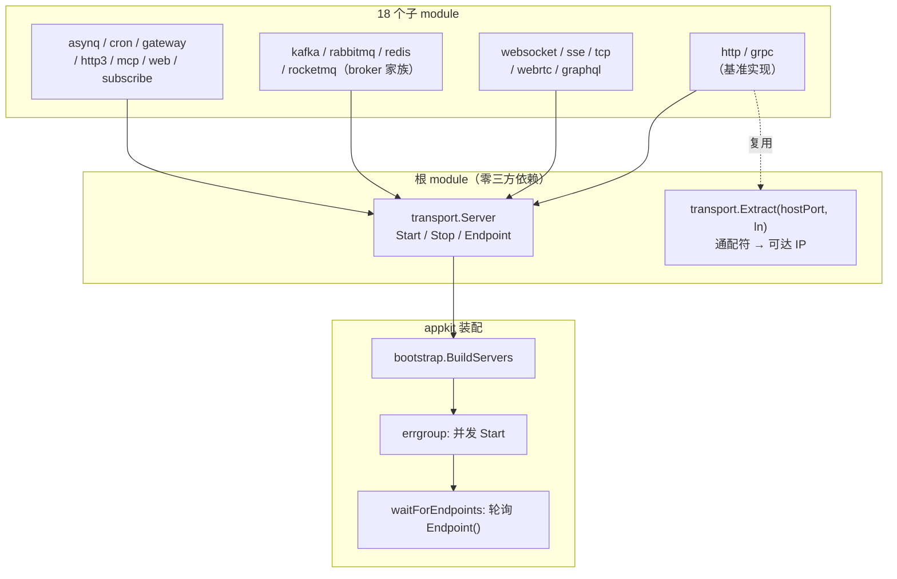

# Bald 传输层设计：统一 Server 契约，18 个后端各自独立 module

> Author(s): bald 团队
>
> Last updated: 2026-09-18
>
> Discussion at: 源码 `transport/{server,endpoint}.go` 与 18 个子 module；装配面 `pkg/appkit/bootstrap.go`（servers 启动 + Endpoint 轮询）、`bootstrap/server.go`；契约 `bconf/proto/bootstrap/v1/server.proto`
>
> Status: Accepted（契约与 18 后端已落地；Endpoint 语义统一待单独设计，见「边界与已知缺口」第 1 条）

## 摘要

`transport` 是 bald 的传输层，**19 个 module**（根 + 18 子）：根 module 只定义一条契约 `transport.Server`（三个方法），18 个子 module 是具体协议后端。

设计上做了三个取舍：

1. **契约极窄**。`transport.Server` 只有 `Start(ctx) error` / `Stop(ctx) error` / `Endpoint() string`。任何带生命周期的服务器都能满足它——`appkit` 只依赖这一条契约（`servers []transport.Server`）。
2. **一个后端一个 module**。19 个 `go.mod` 各自维护依赖，用哪个引哪个。代价是本地 `task verify` 必须逐个显式列出（CI 用 `find go.mod` 自动发现）。
3. **可替换既有实现**。Start/Stop 两方法是最小交集，任何带生命周期的服务器都能直接接入；契约在此之上**扩展** `Endpoint()`，以支持动态端口（`:0`）的服务注册。

## 背景与动机

### 为什么 `Endpoint()` 是必需的扩展

只有 Start/Stop 的生命周期契约不足以支撑服务注册。bald 加上 `Endpoint()` 是为了解决**服务注册**问题：服务绑定 `:0`（动态端口）时，必须能从 listener 取回真实端口，否则注册到服务发现的地址是 `:0`——其他节点无法直连。

`transport/endpoint.go` 的注释明确写着：

> 该逻辑是服务注册可达性的关键修复点，请勿退回为裸 `s.ln.Addr().String()`。

## 设计

### 契约与装配



### 后端矩阵

| module | 协议 | `transport.Server` 断言 | Endpoint 实现 | 备注 |
|--------|------|------------------------|---------------|------|
| `http` | net/http | ❌ | `transport.Extract` ✅ | **基准实现**（持锁写 ln、快照后 Extract） |
| `grpc` | gRPC | ❌ | `transport.Extract` ✅ | **基准实现** |
| `websocket` | WebSocket | ✅ | 手工 SplitHostPort → localhost | 有 SessionManager |
| `sse` | SSE | ✅ | 手工 SplitHostPort → localhost | |
| `tcp` | 原生 TCP | ✅ | 手工 SplitHostPort → localhost | 有 SessionManager |
| `webrtc` | WebRTC | ❌ | 预解析 `s.endpoint` | 有 SessionManager（含锁） |
| `graphql` | GraphQL | ✅ | 手工 SplitHostPort → localhost | |
| `mcp` | MCP | ❌ | 预解析 `s.endpoint` | 复用 `bald/transport/mcp` |
| `http3` | HTTP/3 | ❌ | 原样返回 `s.Addr` ⚠️ | 连 `:0` 都不解析 |
| `gateway` | gRPC-Gateway | ❌ | — | |
| `asynq` | Asynq 任务队列 | ✅ | — | 需 Redis |
| `cron` | 定时任务 | ✅ | — | |
| `kafka` | Kafka | ❌ | 返回 `""` | broker 家族 |
| `rabbitmq` | RabbitMQ | ❌ | 返回 `""` | broker 家族 |
| `redis` | Redis | ❌ | 返回 `""` | broker 家族 |
| `rocketmq` | RocketMQ | ❌ | 返回 `""` | broker 家族 |
| `web` | gin 请求流水线 | — | — | **非 Server**，是 handler 层 |
| `subscribe` | 订阅类型 | — | — | **非 Server**，是纯类型 |

> **断言缺口**：18 个后端中仅 6 个有 `var _ transport.Server` 编译期断言。缺断言的 12 个（含 http/grpc 两个基准实现、整个 broker 家族）靠结构化满足，编译器不保证。这是已知缺口，见「实现与验证」。

### `Extract` 语义

```go
func Extract(hostPort string, ln net.Listener) (string, error)
```

| 输入 | 输出 |
|------|------|
| `":8080"`（通配符） | `<首个可达 IP>:8080` |
| `"0.0.0.0:8080"` | `<首个可达 IP>:8080` |
| `"[::]:0"`（动态端口） | `<首个可达 IP>:<listener 实际端口>` |
| `"10.0.0.5:8080"` | 原样（尊重用户指定的发布 IP） |

内部枚举网卡取首个全局单播 IP（优先 IPv4），无任何可达 IP 时返回空字符串。

## 理由与取舍

### 为什么 broker 家族（kafka/rabbitmq/redis/rocketmq）`Endpoint()` 返回 `""`

它们不是网络**监听**服务——是消息中间件的**客户端**。没有"本进程监听的地址"这个概念。返回 `""` 是诚实的表达，`appkit.waitForEndpoints` 会跳过空 endpoint。

### 为什么 SessionManager 有三份

`tcp`/`websocket`/`webrtc` 各有一份 `SessionManager`。表面同名，但**语义已分叉**：

| | tcp | websocket | webrtc |
|---|---|---|---|
| 方法可见性 | 未导出（`addSession`） | 全导出（`AddSession`） | 未导出 + `snapshot`/`closeAllAndWait` |
| observer 锁 | ✅ | ✅ | ✅ |
| add/remove 幂等 | ✅（`LoadOrStore`/`LoadAndDelete`） | ✅（`LoadOrStore`/`LoadAndDelete`） | ✅（`LoadOrStore`） |

三者不构成可共享 API（方法集与可见性都不同）。**取舍**：接受三份，换取模块独立（与 oss 的 `isNilReader` 复制同理）。

## 边界与已知缺口

### 1. Endpoint 语义不统一 —— 待设计

6 个后端（`tcp`/`websocket`/`graphql`/`sse`/`webrtc`/`mcp`）各自把通配符 host 映射为 **`localhost`**，未复用 `transport.Extract`；`http3` 更是原样返回 `s.Addr`（连 `:0` 都不解析）。

两种语义服务不同场景：

- `localhost` 映射：适合**本地开发**（本机客户端连得上）
- `Extract` 的可达 IP：适合**跨节点服务注册**（其他节点连得上）

`endpoint.go` 的注释倾向后者，但 `http`/`grpc` 之外的 6 个后端显然选择了前者。统一会改变既有部署的注册地址，是需要产品决策的行为变更，不是清理——建议单独设计。

`http3` 的 `Endpoint()` 返回配置地址（不解析动态端口）则是明确缺陷：它连 `localhost` 映射都没做，`:0` 场景下注册地址是 `:0`。

### 2. broker 家族的同构复制与守卫不一致

- `kafka`/`rocketmq`/`redis` 的 `server.go` 逐函数同构；`logger.go` 四份复制（仅 `logKey` 常量不同）。
- **ctx nil 守卫不一致**：`rocketmq`/`rabbitmq` 在 `RegisterSubscriber` 内做 nil 判断并回落 `baseCtx`，`kafka`/`redis` 无此守卫。
- `doRegisterSubscriberMap` 在 `Start` 中无条件清空 deferred 订阅队列后返回 `errors.Join`——部分注册失败会导致订阅者永久丢失（非 fail-closed）。

这是同构复制的系统性风险。下沉共享基座是独立的重构主线。

### 3. 死 API 与死字段

- `HTTPServer.Options()` / `GRPCServer.Options()`：全仓零调用。
- `http3` 的 `s.err` 字段：`Stop` 中赋 nil 后 return，无写入失败路径的赋值点。
- `sse` 的 `Start` 在 ctx.Done 分支用 `context.Background()` 调 `Shutdown`，丢弃了 Stop 超时 ctx（与 `server.go` 契约注释不符）。

## 实现与验证

`transport.Server` 三方法契约（Start/Stop/Endpoint，Endpoint 为扩展）、`transport.Extract`、18 个后端全部落地。同一 `SessionManager` 在三处独立实现，但都满足三条不变量：`observer` 读写有锁、add/remove 幂等、`rangeSessions` 以 **true = 继续** 为语义。

编译期断言 18 个后端中仅 6 个具备（`var _ transport.Server = ...`）；补齐属零风险改动。

### 建议的后续动作（按优先级）

1. **补编译期断言**（零风险）：12 个缺断言的后端各加一行 `var _ transport.Server = ...`。
2. **`http3.Endpoint()` 解析动态端口**（低风险）：至少对齐 `Extract`，消除 `:0` 场景的明确缺陷。
3. **Endpoint 语义统一**（需设计）：决策"本地开发 vs 跨节点注册"哪个是默认，再统一 6 个后端。
4. **broker 家族下沉共享基座**（独立重构主线）。
5. **死 API/死字段清理**（低风险）。

## 附录

### 与姊妹文档的关系

| 文档 | 关系 |
|------|------|
| [框架契约总览](./框架契约总览.md) | `transport.Server` 的契约登记 |
| [Bald 消息代理设计](./Bald%20消息代理设计.md) | broker 家族四个后端（kafka/rabbitmq/redis/rocketmq）的详细设计 |
| [Bald 编解码设计](./Bald%20编解码设计.md) | transport 各后端的 `WithCodec` 消费面 |
| [Bald 健康检查设计](./Bald%20健康检查设计.md) §探针与就绪的归属 | transport 的 `NewHTTPServer`/`NewGRPCServer` 签名 |
| [设计判据](./设计判据.md) J6 | 「协议实现只承诺协议形状」的判据来源 |
