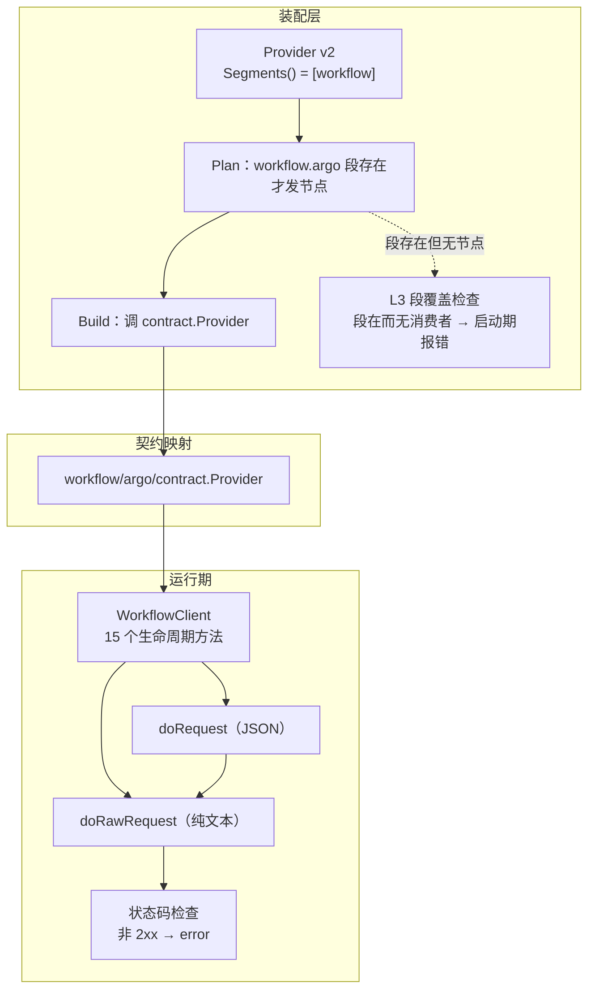

# Bald 工作流设计：手写 REST 客户端 + 契约段映射

> Author(s): bald 团队
>
> 关联：[Bald 声明式装配设计](./Bald%20声明式装配设计.md)、[Provider 接入](../../guide/zh-CN/Provider%20接入%20-%20contract.AppProvider%20与段%20Provider.md)、[框架契约总览](./框架契约总览.md)、[设计判据](./设计判据.md)

## 摘要

`workflow` 是 bald 的工作流引擎接入域，当前只有一个后端：`workflow/argo`——Argo Workflows 的 **REST 客户端**，不是 SDK 封装。

它回答一件事：**工作流怎么提交、查询、控制**。15 个公开方法覆盖全生命周期：`SubmitWorkflow`、`GetWorkflow`、`ListWorkflows`、`DeleteWorkflow`、`SuspendWorkflow`、`ResumeWorkflow`、`TerminateWorkflow`、`ResubmitWorkflow`、`RetryWorkflow`、`StopWorkflow`、`GetWorkflowLogs`。

三个设计取舍：

1. **REST 而非 SDK**。Argo 官方 Go 客户端会拉入整套 k8s 依赖；bald 只需要 HTTP 调用，因此手写 REST 客户端并自行维护类型定义。
2. **契约声明 4 段、实现 1 段**。proto 预留 `temporal`/`conductor`/`goworkflows`，当前只实现 `argo`。未实现的段不能静默跳过——由 L3 段覆盖检查在启动期兜住。
3. **`doRequest`/`doRawRequest` 双通道**。JSON 响应走前者（自动 unmarshal），纯文本响应（日志）走后者；二者共享同一套状态码检查。

## 背景与动机

### 为什么不用 Argo 官方 SDK

Argo Workflows 的官方 Go 客户端依赖 k8s 生态（client-go、apimachinery）。bald 的 `workflow` 段只需要「通过 REST API 提交/查询工作流」，引入整套 k8s 客户端不成比例。

取舍：手写 REST 客户端 + 手维护类型。代价是 Argo API 升级时要手动跟进字段；收益是 `workflow/argo/go.mod` 保持精简（无 k8s 依赖）。

## 设计

### 数据流



### 客户端构造与超时

`argo.NewClient(ClientOptions{ServerURL, Namespace, Token, InsecureSkipVerify})`。

两个默认值：

- `ServerURL` 为空时回退 `defaultServerURL`（`https://localhost:2746`）——本地开发可零配置连上。
- `http.Client` 带 30s 默认单请求超时。无默认超时的 `http.Client` 会随调用方 ctx 永久挂起，漏传 ctx 的调用点即挂死（见 [设计判据](./设计判据.md) J3）。

### 双请求通道

| 通道 | 用途 | 行为 |
|------|------|------|
| `doRequest(req, result)` | JSON 响应 | 复用 `doRawRequest` → `json.Unmarshal` 到 result |
| `doRawRequest(req) ([]byte, error)` | 任意响应体 | 状态码检查 → 返回原始字节 |

两者**共用同一套状态码检查**（`StatusCode < 200 || >= 300` → 含状态码与响应体的 error）。`doRequest` 内部复用 `doRawRequest`，因此不存在「JSON 路径查状态码、文本路径不查」的分叉——`GetWorkflowLogs` 这类返回纯文本的端点也走同一契约。

### 契约段与装配

bconf 的 `Workflow` 消息声明 4 段：`argo`、`temporal`、`conductor`、`goworkflows`。只有 `argo` 有实现。

契约映射单独成 `workflow/argo/contract` 子包，使 `workflow/argo` 本体保持零契约依赖：

```go
// contract.Provider：workflow.argo 段 → argo.ClientOptions → *WorkflowClient
func Provider(ctx context.Context, cfg *bootstrapv1.Workflow) (any, func(), error)
```

装配走通用 Provider v2（框架不提供 workflow 专用 Registry）：

```go
// 用户侧 Provider（示意）
func WorkflowProvider() appkit.Provider {
    return workflowProvider{} // Segments() []string{"workflow"}
}
// Plan：cfg.GetWorkflow().GetArgo() != nil 时发节点 key="workflow.argo"
// Build：return contract.Provider(ctx, scope.Config.GetWorkflow())
```

取实例用资源键：

```go
cli, ok := appkit.NewKey[*argo.WorkflowClient]("workflow.argo").Resource(app)
```

未实现段不会静默跳过。配置里写了 `workflow.temporal` 而没有任何节点消费 `workflow` 段时，L3 段覆盖检查在启动期报错并点名段名；确需保留占位可用 `appkit.WithUnimplementedSegments("workflow")` 显式豁免。这比在每个后端里手写「未实现段清单」更省——新增后端只需实现 Provider，段名自动纳入检查。

### 命名空间覆盖

`GetWorkflow(ctx, name, optsNamespace)` 这类方法的 `optsNamespace` 为空时回退 `wc.options.Namespace`。这比在每个方法签名里多塞一个 `namespace string` 更灵活：默认来自配置，个别调用可临时覆盖。

## 理由与取舍

### 为什么契约声明 4 段却只实现 1 段

proto 的 4 段是**契约设计**（表达「工作流引擎可多后端」的意图），实现按需跟进。这是「契约超前、实现滞后」的正常演进——前提是让用户感知到差距。差距由装配期兜住，而不是靠文档提醒：

- 配置中出现的未实现段没有任何消费者 → L3 覆盖检查启动期报错（fail-closed）。
- 想留占位 → 显式 `WithUnimplementedSegments` 豁免，意图进入计划可见。

### 为什么类型定义放在 `workflow/argo` 而不是 contract 包

`Workflow`/`WorkflowSpec`/`Template` 等类型是 Argo REST 面的一部分，任何直接使用客户端的代码都需要它们。放进 contract 包会让「不用配置装配、直接 `argo.NewClient`」的用户也必须 import bconf。契约映射只做字段搬运，不持有领域类型。

## 已知限制

现状如实记录，均不影响主路径：

- **假连接日志**：`NewClient` 未发起任何连接即打印 `connected to Argo Server at %s`——措辞误导，建议改为「configured for」或加轻量探测。
- **`running` 死字段**：仅被赋值（构造时 true、`Close` 时 false），无读取点。
- **日志函数冗余**：`logger.go` 定义 10 个 `Log*`，实际只用到 `LogInfo`/`LogInfof`。
- **`ServerURL` 空值静默回退**：`contract.Provider` 透传空值，由 `NewClient` 回退本地地址；与「配置缺省即 fail-closed」的一般取向不一致，但本地开发场景下该默认值有实际意义。
- **无生产调用方**：示例应用未接线 workflow 段，接线责任在下游。

## 实现与验证

模块布局：`workflow/argo`（REST 客户端，零契约依赖）+ `workflow/argo/contract`（bconf 段映射）。

测试：

- `workflow/argo/client_test.go`：生命周期方法、鉴权头、错误传播、阶段终态判定、`GetWorkflowLogs` 对非 2xx 拒绝与 2xx 正向。
- `workflow/argo/contract/contract_test.go`：段缺失报错、段存在构造成功。

```bash
go test ./workflow/argo/...
```

## 附录

### API 速览

| 类别 | 方法 |
|------|------|
| 提交与查询 | `SubmitWorkflow`、`GetWorkflow`、`ListWorkflows` |
| 删除 | `DeleteWorkflow` |
| 状态控制 | `SuspendWorkflow`、`ResumeWorkflow`、`TerminateWorkflow`、`StopWorkflow` |
| 重跑 | `ResubmitWorkflow`、`RetryWorkflow` |
| 日志 | `GetWorkflowLogs` |
| 生命周期 | `NewClient`、`Close` |

### 与姊妹文档的关系

| 文档 | 关系 |
|------|------|
| [框架契约总览](./框架契约总览.md) | 本域在契约总览中的登记 |
| [Bald 对象存储设计](./Bald%20对象存储设计.md) | 同为「独立 module + `contract/` 子包 + 段驱动 Provider」模式 |
| [Bald 智能模型设计](./Bald%20智能模型设计.md) | 同为「契约段超前、实现按需跟进」的域 |
| [Bald 消息代理设计](./Bald%20消息代理设计.md) | 同为「契约段 → Provider 装配」，broker 是 13 段声明 / 4 段实现的更大规模 |
