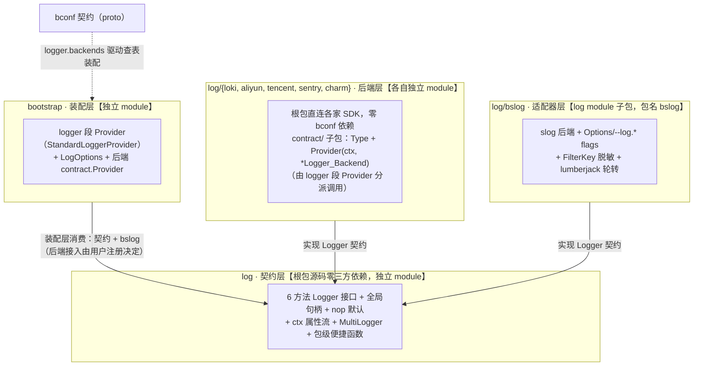

# Bald 日志设计：一个瘦契约、nop 默认、装配期注入后端的日志体系

> Author(s): bald 团队
>
> Last updated: 2026-10-30
>
> Discussion at: 源码 `log/`、`log/bslog/`、`log/*/contract/`
>
> Status: Accepted（已实现）

## 摘要

`bald/log` 为整个框架提供**唯一的日志抽象**：6 方法的 `Logger` 接口、并发安全的全局句柄、零成本的 nop 默认。契约层根包源码零第三方依赖（bslog 子包的 pflag/lumberjack/errgroup 收敛在 module 内，不进契约使用方依赖树）；标准库 `log/slog` 适配器（`log/bslog` 子包，包名 `bslog`）开箱即用；五个远端/终端后端（loki / aliyun / tencent / sentry / charm）各自独立成 module，经 `contract` 子包由 logger 段 Provider 装配；契约只有一个多值配置项 `logger.backends`——多项即多后端广播（本地 + 远程双写），单项即单后端。本文回答三个问题：为什么契约这么瘦、为什么后端独立成 module、为什么装配保持显式声明（反 init 纪律）而默认路径零依赖零代码。最重要的承诺：**框架核心永远不 import 任何具体日志库，新后端接入对框架零改动、不进默认依赖树。**

> 本文按当前代码整理。

---

## 背景与动机

bald 的需求一句话定性：**日志后端的选择是横切关注点，归进程入口（bootstrap）管，不归框架核心管。** 框架核心要打日志，但不能绑死任何日志库。

---

## 设计

### 三层架构与 module 布局



依赖方向单一向上：后端 → 契约；装配 → 契约 + bconf + bslog；框架核心 → 仅契约。远端后端独立 module 是有意的——阿里云 SLS SDK 一个 import 就拖进 prometheus 全家桶（见 `log/aliyun/go.mod` 的 indirect 列表），module 边界让这份代价只由真正使用该后端的项目承担；装配层只 import bslog（默认路径依赖增量为零），启用哪个后端由 logger 段 Provider 的 import 决定。

### 契约层：`Logger` 接口（log/log.go）

```go
type Level int // LevelDebug=0 .. LevelError=3，值越大越严重

type Logger interface {
	Debug(ctx context.Context, msg string, args ...any)
	Info(ctx context.Context, msg string, args ...any)
	Warn(ctx context.Context, msg string, args ...any)
	Error(ctx context.Context, msg string, args ...any)

	// Enabled 报告后端是否会输出给定级别，用于守卫昂贵参数构造。
	Enabled(level Level) bool

	// With 返回携带给定 key-value 的新 Logger，不可变语义。
	With(args ...any) Logger
}
```

```go
log.Info(ctx, "server started", "addr", ":8080")          // key-value 结构化输出

if log.Enabled(log.LevelDebug) {                          // 昂贵参数守卫
	log.Debug(ctx, "dump", "payload", expensiveRender())
}

moduleLog := log.With("module", "registry")               // 可长期持有的子 Logger
```

边界：无 Fatal/Panic（4 级对齐 slog，业务用 `Error` + `os.Exit`）、无 `f`/`w` 变体、不内嵌任何外部接口。

### 全局句柄与包级函数

- `SetLogger(l)`：注入后端，nil 回退 nop，RWMutex 保护并发安全；`GetLogger()`：取当前后端。
- 包级函数 `Debug/Info/Warn/Error/Enabled/With`（global_helpers.go）转发到当前全局后端。**框架内一律用包级函数，`log.GetLogger().Xxx` 链式写法已全量替换并禁止**。
- 语义差异注意：`log.With(...)` 每次基于**当前**全局后端派生，热更新后自然切到新后端；先 `GetLogger()` 捕获的旧实例不会切换。

### nop 默认与 ctx 属性流

- 未注入时全局句柄为 `nopLogger{}`：全部空实现、`Enabled` 恒 false。`import log` 零副作用，bald-crud 这类库可放心引用契约而不强迫宿主初始化日志。nop 是内部实现不导出构造。
- `ContextWithAttrs(ctx, attrs...)` / `ContextAttrs(ctx)`（context.go）：中间件在请求入口挂 `trace_id` 等字段，请求范围内日志自动携带。契约层只挂载/读取（私有 key，重复挂载合并），**不解释属性**——slog 适配器在落盘前合并进参数列表。observability 中间件经此路让每条请求日志带 `trace_id`；SpanContext 无效时 `middleware.LogTraceIDs` 生成随机兜底 ID，零配置也有可关联的日志链路。

### MultiLogger：多源广播（log/multi.go）

`NewMultiLogger(loggers ...Logger) Logger`——每条日志广播到全部子 Logger（本地 + 远程并存）。四级方法顺序广播、单个失败不影响其余；`Enabled` 任一子启用即启用（保守放行，多投的代价是带宽、漏投的代价是排障缺失证据）；`With` 对每个子 Logger 派生后重新组合；nil 构造期过滤，零参数等价 nop。它是纯 `Logger` 装饰器，故放契约层顶层。

契约装配已接入：`logger.backends` 是契约里唯一的后端配置项——每项自带 `type` 与参数段，多项即广播（装配层逐项构造后经 MultiLogger 合并，任一项失败 fail-fast 并回滚已构造项），**单项直通不包广播层**（出口零多余包装）；`Enabled` 语义即 MultiLogger 的保守放行（任一后端启用该级别即写）。热更新/停机链路同样生效：重建时逐项重造并合并 cleanup，停机顺序释放全部后端。

### 默认后端：slog 适配器（log/bslog，包名 bslog）

包名 `bslog` 取 bald+slog 之意，目录=包名，既避标准库冲突又免别名。pflag / lumberjack / errgroup 收敛在此子包，契约使用者二进制不受影响。

```go
type Options struct {
	Level       string         // debug|info|warn|error，默认 info
	Format      string         // console|json，默认 console
	OutputPaths []string       // "stdout"/"stderr"/文件路径，默认 ["stdout"]
	Rotate      *RotateOptions // lumberjack：MaxSize=100MB, MaxBackups=7, MaxAge=30d, Compress=true
}
// NewOptions / AddFlags(--log.level 等全套) / Validate
// New(o *Options, opts ...Option) log.Logger            // 丢弃 cleanup（进程退出 OS 兜底）
// NewWithCleanup(o *Options, opts ...) (log.Logger, func()) // 关闭文件/轮转句柄（装配层用）
```

四条行为边界，均为实测踩坑后确定：

1. **配置非法回退 info，不 panic**——级别写错不值得崩进程；
2. **文件路径先自动创建缺失父目录，打开仍失败才回退 stdout**——直写与轮转两路径行为对称；可观测性不因一个路径问题全丢；
3. **多目标 errgroup 并发写**，但为**复制分流**（每个目标收全量日志），不支持按级别分流到不同文件；
4. **文件与 lumberjack 句柄经 `NewWithCleanup` 返回的 cleanup 释放**（`New` 丢弃它）——lumberjack 缓冲需 Close 触发落盘，不关则停机丢尾批、热更新重建后端泄漏句柄；`logger` 段 Provider（内置与自定义）均走 `NewWithCleanup`（Windows 上 `t.TempDir` 对未关句柄删除失败，是该缺陷的暴露面）。

扩展点分两层。**bslog 的 `Option`**：`WithFilter(FilterKey("password"))` 精细脱敏（任意 `slog.Attr→slog.Attr` 变换函数）、`WithAttrs` 固定属性、`WithHandler`/`WithOTelHandler` 换底层 handler——均为 bslog 特有，其余五后端无对应（条目结构由各家 SDK 决定，无中间 handler 层可插）。**契约层 `NewFilterLogger(l, keys...)`**：全后端通用的脱敏装饰器，命中 key 的值统一掩码为 `***`（属性保留不丢弃），覆盖**位置参数 kv 对**（`Info(ctx,msg,"password",v)`）、**`With` 派生 kv 对**、**ctx 属性流**三类来源；配置驱动（契约 `logger.filter_keys`，单选与 backends 全部后端统一生效，宁全勿漏——远端可检索平台恰是外泄风险最高处），留空零开销直通。**不覆盖 `slog.Attr` 形式**（`slog.String("password", v)`）——脱敏按「偶数下标是 key」匹配 kv 对，Attr 会原样透传；该形式只能由后端 handler 层覆盖（bslog 的 `WithFilter`）。故两套**互补**而非可替代：配置驱动全后端用 filter_keys，需覆盖 Attr 时 bslog 另挂 `WithFilter`。bslog 脱敏的实现细节：slog 把 `WithAttrs` 固化的属性交给内层 handler 在 `Handle` 阶段直接合并，会绕过外层装饰器——`filterHandler.WithAttrs` 必须**先过滤再下沉**，否则 `logger.With("password", ...)` 的脱敏静默失效。

OTel 桥接刻意零依赖：核心不 import otel，`WithOTelHandler` 只是 `WithHandler` 的语义别名，调用方自带 `otelslog.NewHandler` 注入，otel 依赖树谁用谁背。**OTel 不下沉到五后端**（有意裁定）：OTel Logs 与五后端是"后端选择"互斥关系而非叠加——要 OTel 管道用 bslog+`WithOTelHandler` 即可；选了 loki/SLS/sentry 已选定日志平台，双管道冗余；要经 collector 转发的场景由 collector 完成，后端无需感知。同理 **`WithHandler` 也不下沉**：它抽象的是 slog 的 handler 层，五后端条目构造即各家 SDK API 调用（SLS `LogContent`、CLS `Log_Content`、sentry Event、loki JSON、charm 原生），强行抽象等于重造一层适配器。

### 远端/终端后端 ×5 与 contract 子包模式

`log/{loki,aliyun,tencent,sentry,charm}` 各自独立 module，统一两包模式——根包直连 SDK 零 bconf 依赖（只实现 Logger 契约，不感知配置形状）；`contract/` 子包是唯一 import bconf 处，导出 `Type` 常量 + `Provider(ctx, *bootstrapv1.Logger_Backend) (log.Logger, func(), error)`（吃后端声明项，多后端合并由装配层负责，provider 恒见单后端视图）。

| 后端 | 定位 | 关键语义 |
| --- | --- | --- |
| `loki` | Grafana Loki 直推 | HTTP Push API；内存缓冲 batchSize=100 触发冲刷；`Close` 冲刷剩余缓冲；`With` 派生实例共享缓冲（任一 `Close` 全量冲刷）；必填 endpoint；`flush_interval` 是推送请求超时（非定时冲刷间隔） |
| `aliyun` | 阿里云 SLS | 官方 producer 异步聚合；`Close(5000ms)` 关停 |
| `tencent` | 腾讯云 CLS | 官方 AsyncProducerClient；`Close(5000ms)` |
| `sentry` | 错误追踪 | `Error` 上报事件（带堆栈），其余级别记 breadcrumb；必填 DSN |
| `charm` | 本地开发终端 | Charmbracelet 彩色输出，默认 stderr + Info + 时间戳 |

诚实记录一个限制：**loki 无后台定时冲刷**，缓冲未满且不 `Close` 时日志停留在内存——停机 Effect 链对带缓冲的后端是必须兑现的。

**ctx 属性流的跨后端能力（六后端语义一致）**：请求入口经 `ContextWithAttrs` 挂载的属性（如 `trace_id`），由全部六后端在**构造日志条目时同步合并**——bslog 在 handler 层合并，其余五后端经契约 helper `ContextAttrsToArgs(ctx)`（拍平为 kv 序列，无属性返回 nil）在入队/构建事件时提取；同步提取不受异步 flush 的 ctx 失效影响。合并顺序统一为 `With 属性 → ctx 属性 → 调用参数`，同名 key 后者覆盖前者（与 slog 语义一致）。设计边界：**取值用 ctx、IO 不绑 ctx**——日志发送不随请求 ctx 取消而丢弃（loki flush 自建 `Background+timeout`，producer 型后端由 SDK 管理重试）。

### 装配层：logger 段 Provider + contract 子包

日志装配只有一个入口：**`logger` 段 Provider**（`Segments() = []string{"logger"}`）。它读契约的 `logger.backends`，逐项构造后端，合并出口，并持有 cleanup。框架内置 `StandardLoggerProvider`（`std.Standard()` 成员），覆盖 `type: slog`；其余 type fail-fast 教学报错——远端后端必须自持 Provider，这是「不 import 就不进依赖树」的代价，也是收益。

每个后端 `contract/` 子包导出 `Type` 常量与 `Provider(ctx, *bootstrapv1.Logger_Backend) (log.Logger, func(), error)`：只负责把**一个**后端项构造出来，不负责挑选，也不负责合并；多后端合并与出口脱敏都归 logger 段 Provider。没有 `init()` 自注册（blank import 是 no-op，bald 全框架反 init 纪律），也没有单独的后端注册表——Provider 里写到的 import 就是依赖清单。

自定义 logger Provider 的最小骨架（段路径末者胜，整体覆盖内置实现）：

```go
type myLoggerProvider struct{}

func (myLoggerProvider) Segments() []string { return []string{"logger"} }

func (myLoggerProvider) Plan(context.Context, appkit.PlanScope) ([]appkit.Node, error) {
	return []appkit.Node{{
		Key:        "logger",
		Kind:       "logger",
		Segments:   []string{"logger"},
		Phase:      appkit.PhaseBootstrap,
		Priority:   appkit.PriorityLogger,
		Reload:     appkit.ReloadReconcile,
		EffectName: "appkit:bootstrap-logger",
	}}, nil
}

func (myLoggerProvider) Build(ctx context.Context, s appkit.ApplyScope, _ appkit.Node) (any, appkit.Cleanup, error) {
	l := s.Config.GetLogger()
	if l == nil { // 阶段 A：契约尚未装载
		return bslog.New(baldbootstrap.LogOptions(nil)), nil, nil
	}
	bs := l.GetBackends()
	if len(bs) == 0 {
		return nil, nil, fmt.Errorf("logger.backends is empty")
	}
	var (
		loggers  []log.Logger
		cleanups []func()
	)
	fail := func(err error) (any, appkit.Cleanup, error) {
		for _, c := range cleanups { // 已构造项先回滚
			c()
		}
		return nil, nil, err
	}
	for _, b := range bs {
		var (
			lg log.Logger
			c  func()
		)
		switch b.GetType() {
		case "slog":
			lg, c = bslog.NewWithCleanup(baldbootstrap.LogOptions(b))
		case lokicontract.Type:
			var err error
			if lg, c, err = lokicontract.Provider(ctx, b); err != nil {
				return fail(err)
			}
		default:
			return fail(fmt.Errorf("unsupported logger backend %q", b.GetType()))
		}
		loggers = append(loggers, lg)
		cleanups = append(cleanups, c)
	}
	out := loggers[0]
	if len(loggers) > 1 {
		out = log.NewMultiLogger(loggers...)
	}
	// 单项直通 / 多项合并之后，出口统一包一次脱敏装饰器。
	return log.NewFilterLogger(out, l.GetFilterKeys()...), func(context.Context) error {
		for _, c := range cleanups {
			c()
		}
		return nil
	}, nil
}
```

两条实现纪律：失败路径必须回滚已构造的后端（否则半成品句柄泄漏）；`log.NewFilterLogger` 只在出口包一次（逐项包会重复掩码，也容易漏掉某个后端）。

生命周期论证（阶段 A/B、热更新原子换槽、并发约束）见 **`AppKit 日志装配设计.md`**。

### 内置 Provider 的分派语义

| 条件 | 行为 |
|---|---|
| 阶段 A（`Config == nil`，契约未装载） | 回退引导 bslog，保证启动日志可见 |
| `logger` 段存在但 `backends` 为空 | fail-fast |
| `slog` 项 | `LogOptions` 映射后直构；多项经 `MultiLogger` 合并，单项直通 |
| 其它 type | fail-fast 教学报错，给出自定义 Provider 的接入片段 |

**绝不静默降级**：配置写 `type: loki` 却没有对应 Provider 时启动期报错，而不是产出 slog 假装成功。

两阶段语义解决「契约装载过程的日志往哪打」：阶段 A 回退引导 bslog；阶段 B 装载校验后按 `logger.backends` 重建。契约热更新时重建后端并原子替换 cleanup 钩子，失败只记错误不中断（换后端失败不应杀死正在服务的进程）。换后端时先切全局句柄再冲刷旧后端——带缓冲后端（loki 尾批）不因热切换丢日志；停机 Effect 链释放最新钩子。该通道对内置与自定义 Provider 一视同仁：两者都经同一 `loggerSource`，实现差异只在自己 `Build` 里。

### 业务接入示例：零代码装配

操作手册（启用各后端的三步、五后端字段速查、报错解读）独立成篇见 **`docs/guide/zh-CN/Bald 日志使用.md`**，本节保留设计视角的示例。

业务 `main.go` 不写任何日志代码——默认路径开箱即用（slog），默认配置即 `backends` 单 slog 项：

```go
// main.go 全部日志相关代码：没有。
appkit.MustServe(ctx, std.Standard(), appkit.WithHTTP(handler))
```

本地多输出 + 轮转（`configs/app.yaml`，flag > env > 本地文件 > 远程四源同构）：

```yaml
logger:
  backends:
    - type: slog
      slog:
        level: info
        format: json
        output_paths: ["stdout", "/var/log/myapp/app.log"] # 控制台 + 文件双写（复制分流）
        rotate:          # 仅对文件目标生效（lumberjack）
          enabled: true
          max_size: 100  # MB；只写关心的字段，缺省回退默认（100/7/30/gzip）
          max_backups: 7
          max_age: 30    # 天
          compress: true
```

切远端 Loki：`backends` 换 loki 项 + 自持 logger Provider（按上节骨架分派到 `lokicontract.Provider`）：

```yaml
logger:
  backends:
    - type: loki
      loki:
        endpoint: http://loki:3100/loki/api/v1/push
        labels: { app: myapp }
```

本地 + 远程双写即列表加项（逐项独立 level/format）：

```yaml
logger:
  filter_keys: ["password", "access_token"]   # 全局脱敏：全部后端统一掩码 ***
  backends:
    - type: slog          # 本地：stdout 全量排障
      slog: { level: debug, format: console, output_path: stdout }
    - type: loki          # 远程：生产级采集（level 独立过滤）
      loki: { endpoint: http://loki:3100/loki/api/v1/push, labels: { app: myapp } }
```

`filter_keys` 是 Logger 顶层全局字段（与 `backends` 清单正交）：对全部后端生效，Provider 在最终 Logger（单项直通或合并后的 MultiLogger）出口统一包装 `log.NewFilterLogger`——覆盖位置参数 kv 对、`With` 派生 kv 对、ctx 属性流三类来源（**不含 `slog.Attr` 形式**，见下文局限），全部后端共享同一份过滤。

热更新：`WatchConfigFile(true)` 下改 yaml 即重建后端（副本试装载 + 校验 + 原子替换），改坏只记错不杀进程。装饰器（脱敏/固定属性）由自定义 Provider 自持——框架不再导出 `WithLogDecorators`。

契约形状差异已收口：`Slog` 段补齐 `output_paths`（多输出，优先于单值 `output_path`）与 `rotate` 段（enabled / max_size / max_backups / max_age / compress，零值字段回退 bslog 默认 100MB/7 份/30 天/gzip），`LogOptions` 全量映射——契约装配与 CLI/Options 直构路径能力对齐，多目标复制分流 + lumberjack 轮转纯配置声明即生效。单值 `output_path` 保留（`output_paths` 的便捷简写，回退序固定），既有配置零迁移。

---

## 理由与取舍

**为什么 6 方法瘦接口？** 接口越胖，用户自带后端的适配成本越高。十几个方法的接口实际只有作者自家的封装能实现，"可插拔"名存实亡。6 方法是打日志的最小完备集：四级是事实标准，`Enabled` 守卫昂贵参数，`With` 支持模块化标签——少了哪个都有场景卡住，多了哪个都开始绑定实现。

**为什么默认 slog 而非 zap？** 标准库零依赖、`slog.Record` 可直接转 OTel（桥接天然）。zap 的性能优势对默认后端非刚需；真有极端吞吐需求的项目本来就会换后端，这正是接口存在的意义。**我们不选 zap，但保留你用 zap 的权利。**

**为什么 nop 默认而非 panic？** 库不该强迫宿主先初始化日志，更不该因此崩溃。忘记注入的最坏结果是没日志，不是进程死掉。这与"配置非法回退 info"是同一条原则：**日志系统的问题用日志系统的方式兜底，不用崩溃解决。**

**为什么远端后端独立 module 而 slog 是子包？** slog 的依赖轻且人人要用；云端 SDK 重且仅特定部署形态用。Go module 是依赖隔离的唯一硬边界（同 module 子包的依赖仍进 go.mod），用 module 边界把依赖代价精确到"用的人付"。Provider 形态下此边界最彻底：只 import 契约层或 slog 的库零新增依赖，装配层只 import bslog——后端 module 完全不进 bootstrap 依赖树，写进哪个 Provider 就付哪份依赖，与 bconfig 捆绑全部配置源 SDK 形成对照（介意者自持 Provider 精选配置源）。

**为什么 contract 子包模式？** 后端根包保持纯 Logger 实现，不 import bconf 就能被直构/测试场景单独使用；把 proto 契约耦合压缩到几十行的 `contract` 包，后端实现与契约演进互不拖累。与全框架 registry 家族纪律一致。

**为什么显式声明而非 init() 自注册？** init 自注册让依赖关系不可见、重名冲突在运行期随机爆发；Provider 声明把"支持哪些后端"变成可 grep 的代码——名单就在 logger 段 Provider 里（import 了什么，依赖树里就有什么）。

**被放弃的方案：**

| 方案 | 放弃原因 |
| --- | --- |
| 配置非法 panic | 启动期崩溃换不来正确性 |
| 搬运 gookit/slog 自研日志栈 | 与"slog 适配层"定位冲突，拖入 color/goutil/rotatefile 全家桶；轮转/脱敏/多输出用 lumberjack + Filter + multiWriter 等价实现 |
| OTel 依赖进核心 | 依赖树庞大，语义别名已足够表达意图 |
| zap 默认后端 | 性能非默认后端刚需 |
| 单 type + backends 双写法并存 | 同填静默忽略违反反静默哲学；两套形状让校验/文档/教学永远多一个分支 |

---

## 兼容性

契约层 API（接口 / 全局句柄 / 包级函数 / MultiLogger / `NewFilterLogger`）签名稳定；`backends`、`filter_keys`、`output_paths`、`rotate` 均为纯增量字段，既有配置零迁移。契约不为未实现的后端承诺形状：没有 `type: nop` 选值、没有按顶层 `type` 单选（唯一选择方式是 `backends` 列表），配置残留会在启动期 fail-fast。内部风格约定「包级函数取代 `GetLogger().Xxx` 链式」。

跨 module 使用者注意（非破坏但易踩）：`bald/log` 是独立 module，外部引用须 require + replace 它本身；远端后端 contract 包同时依赖 `bconf` 与 `log` 两个 module，replace 要配齐；gopls 对嵌套 module 常报 BrokenImport 假阳性，以命令行 build/test 为准。

---

## 实现与验证

全部落地：

- 契约层：接口 / 全局句柄 / nop / ctx 属性流 / MultiLogger / 包级函数（含并发与广播语义单测）。
- slog 适配器：Options + flags + Validate、console/json、lumberjack 按大小轮转、FilterKey 脱敏（含 `WithAttrs` 预过滤）、多目标并发写、OTel 别名。
- 远端/终端后端 ×5：独立 module + `contract/` 子包，契约各后端段全部有消费者。
- ctx 属性流六后端全量：契约 `ContextAttrsToArgs` helper + aliyun/tencent/loki/sentry/charm 入队时同步合并，含 key 覆盖顺序与 nil ctx 单测。
- loki 派生实例共享：`shared` 状态结构体，派生实例写入同一缓冲、任一实例 `Close` 全量冲刷（httptest 端到端回归）。
- 装配层：内置 `StandardLoggerProvider`（logger 段，slog 后端）+ `LogOptions` + 各后端 `contract.Provider`——显式声明、fail-fast、cleanup 恒非 nil。无后端注册表、无全量内置：五后端 SDK 依赖不进 bootstrap。
- nop 默认：全局默认用内部 `nopLogger{}`；无导出的 nop 构造、无 `type: nop` 契约值。
- AppKit 集成：`logger` 段 Provider 通道（内置 Provider 只支持 slog，其余 fail-fast 教学报错）、两阶段装载、热更新 `rebuildLogger` 原子换后端。
- 多输出 + 轮转：proto `output_paths` + `Rotate` 段，`LogOptions` 全量映射（output_paths 优先 / 零值回退默认），bconf 校验（空串项 / 负值 fail-fast）。
- 多后端广播：proto `Logger.backends` 逐项构造（MultiLogger 合并、单项直通、失败回滚）——本地 + 远程双写纯配置声明。
- 契约唯一化：provider 签名吃 `*Logger_Backend`，恒见单后端项，无需视图层归一化；契约只为已实现的后端承诺形状。
- 文件路径父目录自动创建：对齐 lumberjack 轮转路径的首写 MkdirAll。
- 全后端脱敏 `NewFilterLogger` + `logger.filter_keys`：契约层通用装饰器（位置参数 kv 对 / `With` 派生 kv 对 / ctx 属性流三级来源覆盖、空清单零开销直通；**`slog.Attr` 形式不在覆盖内**，需 bslog `WithFilter` 补足）+ proto `filter_keys`（bconf 空串项 fail-fast）+ appkit 出口统一包装（单选、backends、type=slog 特例三路径一致）——远端可检索平台（loki/SLS/CLS/sentry）纯配置声明即脱敏；WithHandler/OTel 明确不下沉五后端（互斥后端选择 + 无统一 handler 层可抽象）。
- trace 关联闭环：observability 中间件经 `ContextWithAttrs` 挂 `trace_id`，零 TracerProvider 时随机 ID 兜底。

验证：`log` module 及各后端、`bootstrap` 均随 bald CI（build + vet + test -short）全绿；backends 多后端广播另经 `_example/bald` e2e 冒烟（双后端独立 level/format、坏值 fail-fast 带 `backends[i]` 定位、文件路径父目录自动创建）。

---

## 附录：演进决策记录

### AppKit 为什么不持有日志

日志是横切关注点，后端选择属于进程入口（装配声明）职责，AppKit 只消费全局句柄、不做全局副作用。若由 AppKit 注入并临时改动全局句柄：① 编排层带全局副作用；② 与 AppKit 字段边界分叉；③ 多个 AppKit 实例互相干扰。（`MustServe` 路径是「进程入口委托」形态——main 把装配权交给框架，副作用归属入口而非编排层，边界仍成立。）

### gookit/slog 能力评估

它与 bald「标准库 `log/slog` 适配层」的定位是替代 vs 适配关系，且拖入 `gookit/color`/`goutil`/`rotatefile` 全家桶。取其**能力意图**，用已有依赖等价实现：

| gookit/slog 能力 | 落地状态 | 方式 |
|---|---|---|
| 文件轮转（按大小 + 清理 + gzip） | 已落地 | **lumberjack** + `Options.Rotate` |
| 文件轮转（按**时间**切割） | 未迁移 | lumberjack 不支持；确需时引 `gookit/rotatefile` 或系统 logrotate |
| 彩色 / 模板化控制台 | 可选（阶段 2） | 引入 `tint`（仅标准库依赖）；charm 后端已覆盖彩色终端场景 |
| Processor（字段注入） | 已有等价 | `ContextWithAttrs` / `WithAttrs` |
| Filter / 脱敏 | 已有等价 | `FilterKey` |
| 多 Handler 同时输出 | 已有等价 | `multiWriter`（复制分流） |
| Fatal/Panic 8 级 | 不迁移 | slog 4 级；业务用 `Error` + `os.Exit` |
| 整套自研 Handler/Formatter/Record | 不引入 | 违背「标准库 slog 适配层」定位 |

能力边界（诚实记录）：lumberjack 仅按 `MaxSize` 触发切割，`MaxAge`/`MaxBackups` 只控制历史备份保留，**不是**按天/小时切割；多目标输出是**复制分流**，不是按级别分流——确需按级别落不同文件时，用 `logger.backends` 声明多个不同 level 的后端。

### 桥接适配器预留（未实现，按需新建子包，不污染核心契约）

| 预留位置 | 作用 |
|---|---|
| `log/zap/zap.go` | `NewZapAdapter(*zap.Logger) log.Logger`（对齐后端独立 module 模式） |
| `log/gorm/gorm.go` | `NewGormAdapter(log.Logger) gormlogger.Interface`（gorm 日志接入） |

### 关联文档

`AppKit 日志装配设计.md`（两阶段引导与 logger 段 Provider——本文装配策略的展开篇）、`Bald 配置源层设计.md`（配置源层：能力轴与 provider）、`应用框架设计.md`（AppKit 生命周期）、`Bald 声明式装配设计.md`（Provider 模型全景）、`Bald 指标设计.md`（可观测性闭环）。
