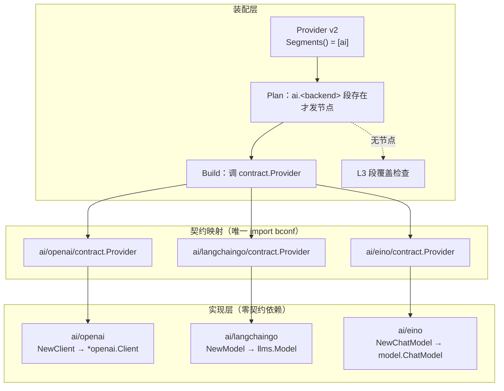

# Bald 智能模型设计：三后端各自独立 module，能力面刻意不统一

> Author(s): bald 团队
>
> 关联：[Bald 声明式装配设计](./Bald%20声明式装配设计.md)、[Provider 接入](../../guide/zh-CN/Provider%20接入%20-%20contract.AppProvider%20与段%20Provider.md)、[框架契约总览](./框架契约总览.md)、[Bald 工作流设计](./Bald%20工作流设计.md)

## 摘要

`ai` 是 bald 的智能模型接入域，**3 个独立 module**：`ai/openai`、`ai/langchaingo`、`ai/eino`。它们回答一件事：**模型怎么调**。

三个设计取舍：

1. **能力面刻意不统一**。三者不是「同一接口的三种实现」——`openai` 只有 client+config（约 146 行、2 个直接依赖、1 个传递依赖），`eino` 有完整编排（chain/compose/prompt/tool，约 564 行、4 个直接依赖、30 个传递依赖），`langchaingo` 有 agent/embedding/memory/vectorstore（约 492 行、2 个直接依赖、28 个传递依赖）。抽公共接口会把最轻的拖到最重的依赖面。
2. **契约段与实现 1:1 对齐**。proto 声明 3 段（`openai`/`langchaingo`/`eino`），三段均有实现——**无未实现段**（与 workflow 域 4 声明 / 1 实现形成对比）。
3. **`organization` 字段的不对称会 fail-fast**。eino-ext 无 organization 概念，故 eino 段配置该字段时启动期报错，而不是静默失效。

## 背景与动机

### 为什么三个后端不抽公共接口

对象存储域（oss）不抽公共接口是因为**语义真实冲突**（bucket 语义）。ai 域不抽，是因为**能力面真实不重叠**：

| 能力 | openai | langchaingo | eino |
|------|--------|-------------|------|
| ChatModel 客户端 | ✅ | ✅ | ✅ |
| Chain 编排 | ❌ | ✅ | ✅ |
| Prompt 模板 | ❌ | ❌ | ✅ |
| Tool 调用 | ❌ | ❌ | ✅ |
| Agent | ❌ | ✅ | ❌ |
| Embedding | ❌ | ✅ | ❌ |
| Memory | ❌ | ✅ | ❌ |
| VectorStore | ❌ | ✅ | ❌ |
| 直接依赖 | 2 | 2 | 4 |
| 传递依赖 | 1 | 28 | 30 |

三者**唯一的交集是「能创建 ChatModel」**，而那一层的返回类型就不同：`*openai.Client` / `llms.Model` / `model.ChatModel`。抽公共接口只能覆盖最薄的一层，收益极低。

代价：业务换后端要改调用点；跨后端统一调用需自己适配。

## 设计

### 数据流



### 契约段字段 → Config 映射（三后端同形）

三个 `contract.buildConfig` 是**同形实现**，不是复用——三者分属独立 module，抽公共 helper 需要引入新的共享包，与「实现零契约依赖」的取舍冲突。逻辑一致：

```go
switch modelType {
case 1:  // ModelTypeLocal — 须 local.host
    if local == nil || local.GetHost() == "" { return error }
case 2:  // ModelTypeCloud — 须 cloud.api_key
    if cloud == nil || cloud.GetApiKey() == "" { return error }
default: // fail-fast
    return fmt.Errorf("model_type=%d invalid (1=local, 2=cloud)", modelType)
}
```

修改映射语义时必须三处同步改——这是同形复制的代价，代码注释已写明。

### 本地/云端模型的端点构造

| 后端 | 本地（Ollama）端点 | 云端 |
|------|-------------------|------|
| openai | `http://{host}:{port}/v1` | `Cloud.BaseUrl` 或 SDK 默认 |
| langchaingo | `http://{host}:{port}`（无 `/v1`） | 同上 |
| eino | `http://{host}:{port}/v1` | 同上 |

三者默认值一致（`host` 空 → `localhost`、`port` 0 → `11434`），但 **langchaingo 的 URL 不带 `/v1` 后缀**——这是 langchaingo 的 Ollama 适配器约定，非缺陷。

### 默认超时

三后端在未配置 `timeout_seconds` 时统一回退 **30s**：

| 后端 | 默认 |
|------|------|
| `openai` | 30s |
| `langchaingo` | 30s |
| `eino` | 30s（`resolveTimeout`：正值用指定值，`<=0` 回退 `defaultTimeout`） |

无默认超时的 `http.Client` 会随调用方 ctx 永久挂起，服务端无响应即挂死——与 workflow 域同一判据（[设计判据](./设计判据.md) J3）。eino 侧把映射抽成纯函数 `newCloudChatModelConfig`/`newLocalChatModelConfig`，使超时值可被单测直接断言（`ChatModel` 的内部 `cli` 不导出）。

### 装配

契约映射单独成 `contract/` 子包，后端实现包不 import bconf：

```go
func Provider(ctx context.Context, cfg *bootstrapv1.Ai) (any, func(), error)
```

装配走通用 Provider v2（框架不提供 ai 专用 Registry）：

```go
// 用户侧 Provider（示意）：Segments() []string{"ai"}
// Plan：cfg.GetAi().GetOpenai() != nil 时发节点 key="ai.openai"
// Build：return openaicontract.Provider(ctx, scope.Config.GetAi())
```

取实例用资源键：

```go
cli, ok := appkit.NewKey[*openai.Client]("ai.openai").Resource(app)
```

三段的 proto 与实现 1:1 对齐，所以不会出现「配了却没实现」的段；`ai` 顶层段若存在而无任何 Provider 消费，由 L3 段覆盖检查在启动期报错。

## 理由与取舍

### 为什么 eino 的 `CloudConfig` 没有 `Organization`

eino 底层是 `cloudwego/eino-ext/components/model/openai`，其 `ChatModelConfig` 没有 organization 概念（go-openai 有 `OrgID`，eino-ext 没有）。

保持契约字段统一（三段 proto 都有 `organization`），由各后端决定是否消费——但 eino 段配置该字段时 **fail-fast**：

```
ai: eino does not support cloud.organization (eino-ext has no organization
concept); remove the field or use the openai/langchaingo backend
```

为什么不是 warn 日志：contract 层零日志依赖（实现零契约依赖的一部分），打日志会引入 `bald/log` 依赖；且 organization 常承载访问隔离/计费域语义，静默失效是安全风险。fail-fast 符合 fail-closed 原则。

代价：eino 段中「能配但无效」的字段会导致启动失败——这是有意为之，暴露错误好过静默失效。处理方式是删掉该字段或改用 openai/langchaingo 后端。

### 为什么 openai 后端这么薄

`ai/openai` 只有最小依赖（`go-openai` + `bconf`）。它的价值是**最小依赖的 OpenAI 兼容客户端**——业务只需要「调 OpenAI 兼容 API」时，不必被 langchaingo（28 个传递依赖）或 eino（30 个传递依赖）拖累。

取舍：它不提供编排能力，需要编排就换后端。

## 已知限制

- **无生产调用方**：三个 `contract/` 的 Provider 仅被各自 `contract_test.go` 引用，示例应用未接线 ai 段。装配链完整，接线责任在下游业务。
- **实现层无编译期断言**：三个 contract 子包有 `var _ func(...) = Provider` 签名守卫，但实现层（`NewClient`/`NewModel`/`NewChatModel`）的返回类型本就不同，无法用统一接口断言。这是能力面不统一的必然结果，非缺陷。

## 实现与验证

模块布局：三个后端各自独立 module，`<backend>/contract/` 子包只做 bconf 段 → 后端 Config 的映射；根 module 依赖图不因增加后端而增长。

测试：`ai/eino/client_test.go`（超时归一四例 + 云端/本地配置携带超时）、三个 `contract/*_test.go`（段缺失、构造成功、eino organization 拒绝与不误伤反例）。

```bash
go test ./ai/...
```

## 附录

### 与姊妹文档的关系

| 文档 | 关系 |
|------|------|
| [框架契约总览](./框架契约总览.md) | ai 域的契约登记 |
| [Bald 对象存储设计](./Bald%20对象存储设计.md) | 同为「独立 module + `contract/` 子包」，但 oss 不抽接口的理由是语义冲突，ai 是能力不重叠 |
| [Bald 工作流设计](./Bald%20工作流设计.md) | 同为「契约段 → Provider 装配」；对比点：workflow 4 声明 / 1 实现（未实现段靠 L3 兜住），ai 3 声明 / 3 实现 |
