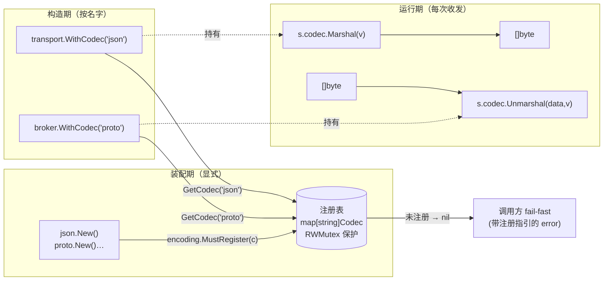

# Bald 编解码设计：名字取用、代码装配，13 个 module 各自独立

> Author(s): bald 团队
>
> Last updated: 2026-09-18
>
> Discussion at: 源码 `encoding/{encoding,encoding_test}.go`、12 个格式子包 `encoding/{json,xml,yaml,toml,proto,msgpack,bson,cbor,gob,thrift,avro,flatbuffers}/`；消费面 `transport/{tcp,websocket,sse,asynq,webrtc,redis,kafka,rabbitmq,rocketmq}/`、`broker/`；姊妹篇 [Bald 消息代理设计](./Bald%20消息代理设计.md)
>
> Status: Accepted（契约与 12 格式已落地，13/13 module 有测试）

## 摘要

`encoding` 是 bald 的编解码契约层。它只定义一件事：**字节和值怎么互相转**。`Codec` 接口三个方法（`Marshal`/`Unmarshal`/`Name`，`encoding.go`），加一个全局注册表（`MustRegister`/`GetCodec`/`Names`）。所有传输面——HTTP、gRPC、TCP、WebSocket、SSE、以及 broker 的四个后端——都通过**名字**取用编解码器，格式切换不改业务代码。

我们做了三个承诺：

1. **名字取用，代码装配**。传输层写 `WithCodec("json")`，但「json 是什么」由装配期显式 `encoding.MustRegister(jsoncodec.New())` 决定——注册表不猜、不默认、不自动。
2. **注册期 fail-fast，取用期 fail-closed**。nil / 空名 / 重名注册一律 `panic`（`encoding.go`）；未注册格式 `GetCodec` 返回 `nil`，由调用方报错——**已明确废除「静默回落 gob」的旧行为**（`broker/encoding.go` 的注释记录了这次废除）。
3. **一个格式一个 module**。根包零三方依赖（`encoding/go.mod` 只有 `module` 与 `go` 两行）；12 个格式各住独立 module，用哪个引哪个，不引入的不进二进制、不进依赖图。

这个 module 是随三域（transport / broker / 各格式）分批落地的。落地时**没有独立设计文档**——它与 [Bald 消息代理设计](./Bald%20消息代理设计.md) 是姊妹关系：broker 那篇的「codec 静默降级 gob」章节讲的是消费侧的疤，本篇讲的是契约本身。本文补齐这块。

## 背景与动机

### 为什么要抽一层编解码契约

没有这层时，每个传输面各带一套序列化：

- HTTP 用 `encoding/json`，gRPC 用 protobuf，WebSocket 用 json，broker 用 gob——**同一份业务结构在不同面上被不同的库读**，字段 tag 语义、时间格式、数字精度各自为政；
- 想给某个面换格式（如 WebSocket 换 MessagePack 省带宽），得改传输层内部代码，业务侧跟着动；
- 测试要 mock 序列化时，没有统一接缝。

`encoding` 把所有面收敛到「按名字取一个 `Codec`」。代价是**多一次间接**（接口调用 vs 直接调库）和**一个全局注册表**（框架一贯警惕的全局状态）；换来的是格式可拔插、装配点唯一、测试有接缝。

### 为什么是「显式注册」而不是 `init()` 自注册

框架的对手续一致性有一条硬纪律：**不用 `init()` + blank import 自注册**。理由有三：

1. **装配顺序可预测**。`init()` 的执行时机由 import 图决定，业务无法控制；显式 `MustRegister` 让"谁在什么时候注册了什么"是装配代码里读得出来的事实。
2. **重名冲突可检测**。`init()` 自注册时重复注册要么 panic（进程起不来且难定位）要么静默覆盖（更糟）；显式注册把冲突暴露在装配期的一个确定位置。
3. **未引入的格式真的不在二进制里**。`init()` 自注册依赖 blank import 把包链进来，引了就进；显式注册下，不调用构造器、不 import 格式包，编解码器代码根本不参与链接。

这条纪律的直接后果是一条**使用约束**：`MustRegister` 必须先于任何 `GetCodec`，也就是**必须先于构造任何消费它的 transport / broker**。这个约束有代价，见「边界与约束」§1。

## 设计

### Codec 契约

```go
// encoding/encoding.go
type Codec interface {
    Marshal(v any) ([]byte, error)
    Unmarshal(data []byte, v any) error
    Name() string
}
```

三个方法刻意保持最小：没有 `MarshalString`、没有 `ContentType()`、没有流式接口。原因见「理由与取舍」。

### 注册表语义

| 操作 | 行为 | 锚点 |
|------|------|------|
| `MustRegister(c)` — `c == nil` | `panic` | `encoding.go` |
| `MustRegister(c)` — `c.Name() == ""` | `panic` | `encoding.go` |
| `MustRegister(c)` — 名字已存在 | `panic` | `encoding.go` |
| `MustRegister(c)` — 正常 | 以**小写**名字存入 map | `encoding.go` |
| `GetCodec("")` | 返回 `nil`（不 panic） | `encoding.go` |
| `GetCodec(name)` — 未注册 | 返回 `nil` | `encoding.go` |
| `GetCodec(name)` — 已注册 | 大小写无关命中 | `encoding.go` |
| `Names()` | 升序名称切片，仅诊断用 | `encoding.go` |

注册表用 `sync.RWMutex` 保护（`encoding.go`），`MustRegister` 持写锁、`GetCodec`/`Names` 持读锁。**注册是并发安全的，但语义上预期发生在装配期**——运行期注册会让已构造的消费者看不到（见「边界与约束」§1）。

### 数据流



图里两个刻意的断层：**装配期到构造期是「按名字」的间接**（消费者不认识具体格式），**构造期到运行期是「持有实例」的直连**（不每次查表）。后一个断层正是「边界与约束」§1的根因。

### 13 个 module 的依赖面

| module | 三方依赖 | 测试 |
|--------|----------|------|
| `encoding`（根） | **无**（零三方依赖） | ✅ |
| `json` | 无（标准库） | ✅ |
| `xml` | 无（标准库） | ✅ |
| `gob` | 无（标准库） | ✅ |
| `yaml` | `gopkg.in/yaml.v3` | ✅ |
| `toml` | `github.com/BurntSushi/toml` | ✅ |
| `proto` | `google.golang.org/protobuf` | ✅ |
| `msgpack` | `github.com/vmihailenco/msgpack/v5` | ✅ |
| `bson` | `go.mongodb.org/mongo-driver` | ✅ |
| `cbor` | `github.com/fxamacker/cbor/v2` | ✅ |
| `avro` | `github.com/linkedin/goavro/v2` | ✅ |
| `thrift` | `github.com/apache/thrift` | ❌ 无测试 |
| `flatbuffers` | `github.com/google/flatbuffers` | ❌ 无测试 |

根 module 的零依赖是刻意的：契约层不该把任何具体格式的依赖传染给消费者。每个格式 module 都 `require bald/encoding v0.0.0` + `replace => ..`，本地开发直接连源码。

### 三个「非通用签名」格式的桥接方式

12 个格式里，9 个是「直接转发底层库」（`json`/`xml`/`yaml`/`toml`/`gob`/`msgpack`/`bson`/`cbor` 一行转发，`proto` 多一层 `proto.Message` 断言）。剩下 3 个的底层 API 与 `Codec` 的 `any` 签名对不上，各用一种桥接：

**proto**——`Marshal`/`Unmarshal` 前做 `v.(proto.Message)` 断言，不符返回 `error`。参数必须是通过 protoc 生成的结构体。

**thrift**——同上，断言 `thrift.TStruct`。Thrift 的序列化是流式的（`TSerializer.Write(ctx, t)`），codec 每次都 `thrift.NewTSerializer()` 现场建。

**flatbuffers**——FlatBuffers 没有通用 `Marshal/Unmarshal`，只有生成的 Builder 和 FlatBuffer 类型。本包约定：值实现 `FlatBufferMarshaler`（`PackFlatBuffer() ([]byte, error)`）才能 Marshal，目标实现 `fb.FlatBuffer` 才能 Unmarshal。

**avro**——唯一有「双构造器」的格式：`New()` 返回的默认 codec 无 schema（用于名字注册占位），`NewCodec(schema)` 才接受真实 Avro schema。默认 codec 内部用 `goavro.NewCodec("\"null\"")` 兜底。

## 理由与取舍

### 为什么 `Codec` 只有三个方法

曾经考虑过加 `ContentType() string`（给 HTTP `Content-Type` 用）和 `MarshalString`（省一次 `[]byte`↔`string` 转换）。都没加：

- `ContentType` 是传输层的事，不是编解码的事。同一个 `json` codec 在 HTTP 上是 `application/json`、在 WebSocket 帧里根本不需要——把它塞进契约会让编解码器知道自己的传输上下文，破坏分层。
- `MarshalString` 是性能优化，不是语义需求。9/12 的格式底层就是 `[]byte` API，为少数场景给所有实现加一个方法，收益不抵契约膨胀。

**代价**：调用方要自己做 `string(data)`；`ContentType` 各传输自己映射。

### 为什么注册表是全局的

备选是「每个消费者持有自己的注册表实例」（依赖注入式）。选了全局，因为：

- 传输层的 `WithCodec("json")` 签名里只有**一个字符串**，没有地方塞注册表实例。要改成注入式，得给 12 个 `WithCodec` 全部加一个注册表参数——`transport` 12 处定义点（`tcp/client_options.go`、`websocket/options.go`、`sse/options.go`、`asynq/options.go` 等）。
- 「同一个名字在所有面上指同一个东西」是符合直觉的默认，注入式下每个面的注册表可能不同，反而要解释。

**代价**：全局可变状态（框架一贯警惕的东西）。缓解是注册期 fail-fast + 注册后基本只读。但这仍是本文列出的最重的设计债，见「边界与约束」§1。

### 为什么 `Names()` 保留但只作诊断

`Names()` 全仓生产代码零调用（仅 `encoding_test.go` 的 `TestNames` 消费）。按《设计判据》J1（「框架能力零调用不是问题，缺测试才是」），它保留：有测试钉住行为、是合法的诊断/文档能力面。

### 为什么 12 个格式各建 module 而非 build tag

备选是「单 package + build tag」（`//go:build codec_msgpack`）。选了独立 module，因为：

- build tag 下所有格式的依赖都在同一个 `go.mod` 里——想用 json 却被拖进 `mongo-driver`（bson）和 `apache/thrift`；
- 独立 module 让「按需引入」是真的：`go.sum` 里没有没用的格式。

**代价**：13 个 `go.mod` 要各自维护，`go build ./...` 在根 module 覆盖不到子 module（与 `_example`、`cobramcp` 同一个坑，Taskfile 用 `find go.mod` 兜底）。

### 为什么 avro 要 `NewCodec(schema)`

Avro 是 schema 驱动格式——没有 schema 就不知道字节怎么切。`Codec` 接口的 `Marshal(v any)` 签名里**没有地方带 schema**，所以 avro 只能：要么让 `New()` 无参、默认 codec 退化（当前选择），要么破坏 `Codec` 接口。

`New()` 的默认 codec 因此只能占位。这带来一处**文档与实现的偏差**，见「边界与约束」§2。

## 边界与约束

### 1. `MustRegister` 必须先于构造

所有消费者（broker 的 `NewOptions()`、transport 的 `NewClient()` / server 构造等）都在**构造期** `GetCodec(name)` 并把结果缓存进字段。构造之后注册的编解码器，这些点永远看不到。

这是使用约束，不是缺陷：

- codec 为 `nil` 不必然是错误——asynq、tcp、broker 都支持无 codec 的 `[]byte`/`string` 原始字节透传，所以不能在 `Start`/`Connect` 期对 nil fail-fast；
- 正确的判空点在**真正需要 codec 的那一行**，错误文案带注册指引。

应用若在构造 transport 之后才 `MustRegister`，且随后走类型化编解码路径，错误会推迟到首次收发消息才暴露（位置远离根因）。`encoding/README.md`「快速开始」已写明该顺序约束。

### 2. avro 默认 codec 是 null-schema 占位

`New()` 的默认 codec 用 `goavro.NewCodec("\"null\"")`，只接受 Avro `null` 值，连 `string`/`int` 都不接受。它只用于名字注册占位；实际使用必须 `NewCodec(schema)`。这是 schema 驱动格式与无 schema 的 `Codec` 接口之间的必然妥协。

### 3. flatbuffers 校验根 buffer

`fb.GetRootAs` 本身不做边界校验。`Unmarshal` 在解码前校验 buffer 长度与根偏移，畸形数据返回 error，而不是「解成功」后读到垃圾值或触发后续访问 panic。其余格式的边界行为由各自 SDK 决定。

### 4. thrift 无状态

thrift 的 codec 不持有可复用的 `TSerializer`/`TDeserializer` 字段——每次 `Marshal`/`Unmarshal` 现场新建。`TSerializer` 不保证线程安全，持有共享实例反而会把值接收者的「天然并发安全」变成隐患。

### 5. 消费侧的 nil 守卫

transport 的编解码调用点在 `codec == nil` 时返回带注册指引的 error，而不是 nil interface 方法调用 panic。新接入 transport 时保持同一语义。

## 实现与验证

模块布局：`encoding` 根包（契约 + 注册表，零三方依赖）+ 12 个格式各自独立 module；每个格式包有编译期断言 `var _ encoding.Codec = codec{}` 与包内测试（13/13 module 有测试）。

**生产装配注册**：全仓生产代码没有 `encoding.MustRegister` 调用点，`_example/` 也没有——默认路径下各 transport 的 codec 兜底都落空。这不影响原始字节透传，但意味着「装配期先注册」的约束在仓库内没有活样本；照示例抄的人会撞上运行期 `codec is nil`。接入业务时在构造 transport 之前注册。

## 附录

### 与姊妹文档的关系

| 文档 | 讲什么 | 与本文关系 |
|------|--------|------------|
| [Bald 消息代理设计](./Bald%20消息代理设计.md) | broker 契约 + 四后端，含 `derefAnyPointer`、双装配路 | **消费侧**：broker 的 codec 失败语义依赖 encoding 的 `fail-fast + errNoCodec` |
| [应用框架设计](./应用框架设计.md) | appkit 装配层 | 装配时机的上游 |
| [设计判据](./设计判据.md) | 跨模块裁决原则 | J1「框架能力零调用不是删除依据」，本文 §Names 沿用 |
