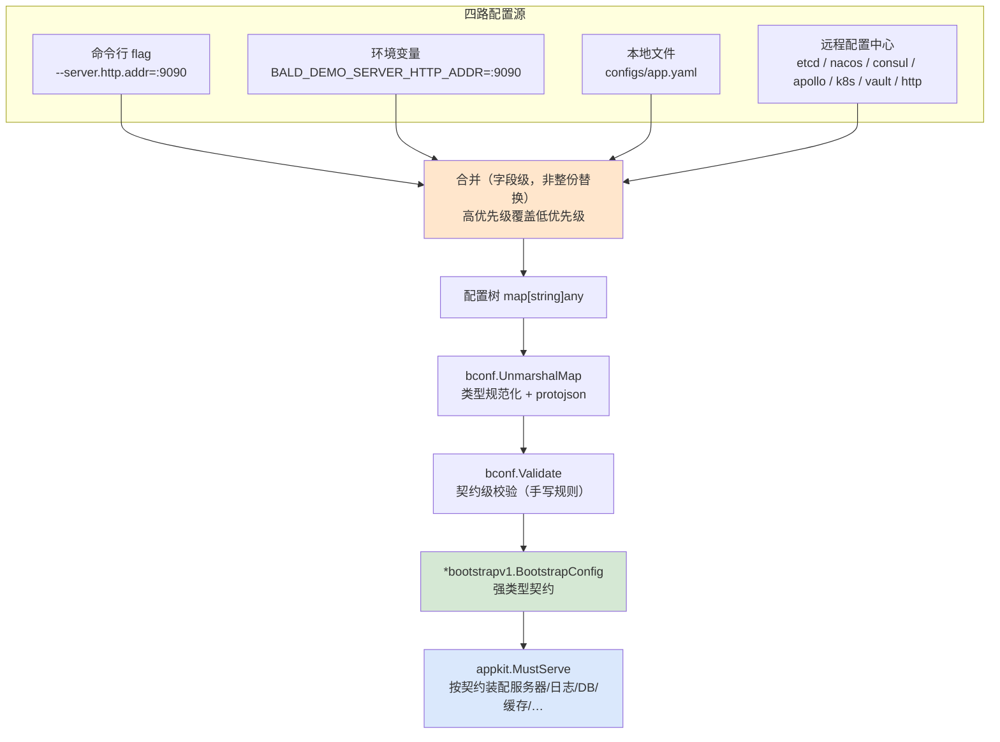

# Bald 配置系统

配置形状由 **proto 契约**声明（`bconf`），值可从 **flag / 环境变量 / 本地文件 / 远程配置中心**四路进入，
按固定优先级合并成一棵配置树，再由契约反序列化成强类型对象。改配置**不用改代码**，写错键名**启动即报**（§7）。

> 本文是使用指南：怎么配、怎么读、怎么排错。
> 设计动机与内部机制（为什么用 proto 而非 struct + mapstructure、`UnmarshalMap` 的三个坑、
> `FallbackReader` 的遮蔽语义）见 [Bald 配置系统设计](../../devel/zh-CN/Bald%20配置系统设计.md)、
> [Bald 配置源层设计](../../devel/zh-CN/Bald%20配置源层设计.md)、
> [Bald 配置契约设计](../../devel/zh-CN/Bald%20配置契约设计.md)。

## 0. 最小启动形态：默认行为

`main.go` 写一个 `MustServe`，配置文件只给 `app.name`：

```go
func main() {
    appkit.MustServe(context.Background(),
        appkit.ConfigFile("configs/app.yaml"), // 本地文件源（留空则按 Name 规则发现，见 §3.2）
        appkit.WithHTTP(router),               // 业务能力声明（配置表达不了的部分，见 §4.1）
    )
}
```

```yaml
# configs/app.yaml —— 唯一必填项是 app.name（配置命名空间来源，见 §3.1）
app:
  name: "my-app"
```

- 没写进文件的字段全部取 **proto 默认值**（`server.http.addr` 等），应用可直接跑起来。
- 没有环境变量、没有 flag、没有远程源——**一份最小 yaml 即可运行**，这是开发期的默认形态。
- 框架内化 `--config` flag（指定/覆盖本地配置文件路径），并内化 `Bind`
  `server.http` / `server.grpc` / `--log.*` 三组 flag（见 §4.1）。业务自定义配置段需自行
  `appkit.Bind`（见 §4.3）。

关键语义：**proto 默认值是基线，可被四源任意一路覆盖**。默认 `server.http.addr` 之后，
`--server.http.addr=:9090`、`MY_APP_SERVER_HTTP_ADDR=:9090`、配置文件里的 `server.http.addr`
都能改掉它——这正是「改配置不改代码」的实现方式。要调整业务默认基线，改配置文件即可
（契约在 `Serve` 内部装载，业务代码不持引用）。

## 1. 四源与优先级



**优先级（高 → 低）**：

```
flag  >  环境变量  >  本地文件  >  契约源层（列表首最高）  >  远程桥（基准）
```

三条容易踩的语义：

1. **flag 只取「用户显式传入」的**（`Changed==true`）。没传的 flag 不参与合并——
   否则 `--server.http.addr` 的零值会压掉配置文件里的值（这是 viper 时代的经典坑）。
2. **合并是字段级的**，不是整份替换。本地文件只写 `server.http.addr` 时，
   其余字段仍从低优先级层继承。
3. **任一层变更触发全量重合并**。所以底层更新不会冲掉上层覆盖，上层覆盖也不会污染底层基准。

## 2. 配置文件怎么写

键名即 **proto 契约的字段路径**（`bconf/proto/bootstrap/v1/*.proto`）。
同一套键路径同时适用于四源——这是「四源等价」的前提：

```yaml
# configs/app.yaml
server:
  http:
    addr: ":8080"
    driver: "grpc-gateway"   # 留空/其他值 = 业务 handler 直挂
  grpc:
    addr: ":9090"
    reflection: false        # grpcurl 等调试工具需要

logger:
  backends:
    - type: "slog"
      slog: {level: "info", format: "console", output_path: "stdout"}

registry:
  type: "nacos"
  nacos:
    server_addrs: ["127.0.0.1:8848"]
    namespace: "public"

cache:
  redis:
    addr: "localhost:6379"
    db: 0

database:
  sql:
    driver: "postgres"
    source: "host=db port=5432 user=app password=*** dbname=app sslmode=disable"
```

对应的四源写法（值等价）：

| 源 | 写法 |
|---|---|
| flag | `--server.http.addr=:8080` |
| 环境变量 | `BALD_DEMO_SERVER_HTTP_ADDR=:8080` |
| 本地文件 | `server.http.addr: ":8080"` |
| 契约源层 / 远程 | 同样的键路径（远程存同一份 yaml/json） |

> **只支持 yaml / json**。toml / hcl / ini 随 viper 退役，不再支持
> （`bootstrap/config/merge.go` 的 `decodeDocument` 会明确报错，不静默忽略）。

## 3. 环境变量与多环境

### 3.1 环境变量命名规则

规则在 `bootstrap/config/merge.go` 的 `environMap`：**应用名前缀 + 点路径**。

```
前缀 = 应用名大写、连字符转下划线，加尾下划线
负载 = 去前缀 → 全小写 → 下划线/连字符 一律视为点路径分隔符
```

配置命名空间**就是契约 `app.name`**（单一来源，B6）：它同时派生 env 前缀与多环境文件名前缀。
`app.name` 为 `bald-demo` 时：

```
BALD_DEMO_SERVER_HTTP_ADDR  →  server.http.addr
BALD_DEMO_LOGGER_BACKENDS   →  logger.backends
BALD_DEMO_CACHE_REDIS_ADDR  →  cache.redis.addr
```

命名空间按装配入口派生：

| 装配入口 | 命名空间来源 | 缺失时 |
|---|---|---|
| `appkit.MustServe` / `Serve` | 契约 `app.name`（两遍合并第一遍从文件/远程层解析） | **fail-fast**，报错见 §7 |
| `appkit.NewApp` | 回退 `Name` Option 的值 | — |

**为什么 Serve 不容许回退**：`app.name` 由配置文件供给，而 env 前缀又由它派生，构成自指——
若允许别的来源，用户改了 `app.name` 之后全部 `BALD_<旧前缀>_*` 覆盖会静默失效。所以 Serve
走**两遍合并**：第一遍只装载文件/远程层并解析 `app.name`（`DeferEnv`，env 层暂缺位），
第二遍 `Store.MountEnv(app.name)` 按派生前缀挂载 env 层、全量重合并
（`bootstrap/config/config.go` 的 `MountEnv`；端到端回归锁
`pkg/appkit/namespace_test.go` 的 `TestServe_NamespaceDerivedFromContractAndEnvWorks`）。

**env 名不变红线**：这套机制只改「前缀从哪来」，不改 `NAME_` 前缀的既有语义——
现有用户的 `BALD_DEMO_*` 变量照旧覆盖文件值，且延迟挂载后热更新触发的全量重合并
仍叠加 env 层（`bootstrap/config/env_twopass_test.go` 钉住的两条红线）。

两个必须知道的约束：

- **前缀不可省**。没有 `BALD_DEMO_` 前缀的变量根本不会被读（枚举驱动，非查询驱动）。
- **业务键别用下划线**。`_` 与 `-` 都被解释为路径分隔符，所以业务自定义键请用点路径命名，
  或干脆走 yaml / flag 覆盖——契约字段名都是单词，不受影响。

> **没有 `${VAR}` 插值与 `.env` 自动加载**。配置值不做变量替换，也不读 `.env` 文件——
> 环境变量经 `os.Environ()` 直接枚举（`merge.go` 的 `environMap`）。
> 需要给进程注入环境变量请用 shell、容器编排或 secret 挂载。

### 3.2 多环境配置

用「应用名 + 环境」组合选择默认配置文件，无需在代码里写死路径。

```go
appkit.MustServe(context.Background(),
    appkit.Name("my-app"),        // 文件发现名（configs/my-app*.yaml）
    appkit.Env("prod"),           // 多环境 → 优先找 my-app-prod.yaml
    appkit.ConfigFile(""),        // 留空 = 按 Name-Env 规则发现；非空 = 显式指定
    appkit.WatchConfigFile(true), // 本地文件热更新
)
```

两个字段各管一件事，同名最省心：代码层的 `Name` 决定**去哪找文件**；
yaml 里的契约 `app.name` 派生 **env 前缀与文件名前缀**（§3.1）。

**查找规则**（`discoverLocalFile`，`bootstrap/config/config.go`）：

| 优先级 | 目标文件名 |
|---|---|
| 1 | 显式指定的 `ConfigFile` / `--config` 路径 |
| 2 | `<Name>-<Env>.yaml`（或 `.yml` / `.json`） |
| 3 | `<Name>.yaml`（或 `.yml` / `.json`） |

搜索目录为 `.`、`./configs`、`$HOME/.config/<Name>`（依次尝试）；
扩展名尝试顺序为 `.yaml` → `.yml` → `.json`。
**扩展名是外层循环**：先把三个目录都试一遍找 `.yaml`，都没命中才换 `.yml`——
所以 `./configs/app.yml` 会**优先于** `$HOME/.config/app.yaml` 被选中。

**找不到不报错**——允许纯远程或纯 flag 配置（`discoverLocalFile` 返回空串即跳过本地层）。

因此典型布局是：

```
configs/
  my-app.yaml         # 公共基线（Env 为空时命中）
  my-app-dev.yaml     # Env=dev 时优先命中
  my-app-prod.yaml    # Env=prod 时优先命中
```

`Env` 非空时命中第 2 项，**不会**与第 3 项叠加——是「择一命中」而非「覆盖合并」
（`discoverLocalFile` 直接以 `<Name>-<Env>` 为文件名查找）。需要基线 + 覆盖的组合时，
用契约源层（§4.2）显式叠层。

> 契约 `app.env` 的作用是本地文件名拼接与 app 元数据；远程多环境请在后端连接参数里
> 自带区分，或经契约源层显式叠层。

## 4. 主程序怎么接

### 4.1 推荐入口：`appkit.MustServe` 约定装配

单一装配入口：`Serve` 内化了 `--config` 解析、契约两遍装载、四源合并、校验、热更新、
服务器构造与停机，业务只声明配置表达不了的能力：

```go
func main() {
    appkit.MustServe(context.Background(),
        appkit.ConfigFile("configs/app.yaml"),        // 本地文件源（也可省略，按 Name 规则发现）
        appkit.WatchConfigFile(true),                 // 监听文件变更（热更新）
        appkit.WithHTTP(router),                      // 声明 HTTP 能力
        appkit.WithGRPCOptions(newGRPCServerOptions), // gRPC 拦截器链
    )
}
```

flag 侧框架内化两件事：

- **`--config` 由 Serve 解析**（`pkg/appkit/serve.go` 的 `parseConfigFlag`）：扫描 `os.Args`
  取路径写回 `ConfigFile`，业务侧无需手写 pflag 扫描；未知/写错的 flag 不阻断启动，
  由各自的消费方负责报错。
- **`server.http` / `server.grpc` / `--log.*` 三组 flag 由 Serve 内化 `Bind`**
  （现行范本见 `_example/bald/internal/bootstrap/assemble.go` 的装配注释）——这三块的 flag 覆盖开箱即用。

**业务自己的 flag 经 `appkit.Bind` 声明**（§4.3）：`Bind` 把 proto 消息或 `PlainBinder`
注册进 App 的 FlagSet，装载时进入 flag 层参与四源合并。只注册进 `cobra` / 全局 flagset 的
flag 走的是平行解析路径，**不参与**配置合并。

### 4.2 远程配置与源层：`RemoteConfig` 桥 / `ConfigLayers` 显式叠层

本地文件 + env + flag 之外还有两路远端配置，按需选择：

**① `RemoteConfig` 远程桥（现行范本）**：把实现 `config.RemoteSource` 的后端接进来，
内部适配为**最低优先级的基准层**。kratos contrib 的 `config.Source` 经
`config.FromKratosSource` 一行桥接（见 `_example/bald/internal/bootstrap/register_nacos.go`，build tag `nacos`）：

```go
src := config.FromKratosSource(nacosconfig.NewConfigSource(cli))
appkit.MustServe(ctx, appkit.RemoteConfig(src), /* 其余 Option */)
```

**② `ConfigLayers` 契约源层**：手里已有层列表（如经 bootstrap Registry 的 `Build` 从契约
`config` 段产出）时显式传入：

```go
layers, cleanup, err := registry.Build(ctx, bootCfg) // 契约 config 段 → bconfig 源
if err != nil {
    log.Fatal(err)
}
defer cleanup()

app := appkit.NewApp(appkit.ConfigLayers(layers...))
```

**层序即优先级：列表首元素最高**，整体位于本地文件/env/flag 之下、`RemoteConfig` 远程桥之上
（`appkit.ConfigLayers` 文档注释）。任一层 reader 实现 `bconfig.ValueWatcher` 即参与热更新
（变更 → 全量重合并）。源在契约里没配、或返回空文档时按「无该层」处理——不是错误
（`assembleLayer` 把空文档视为该层无配置）。

契约 `config` 段共 9 类源可混合（§9）；`std.Standard()` 自带的 config Provider
覆盖本地 file + env 基线。

### 4.3 业务配置段：`appkit.Bind` 接入 flag 层

业务自己的配置要参与 flag 覆盖，必须经 `Bind` 注册进 App 的 FlagSet：

```go
appkit.Bind("mybiz", &bizCfg),  // proto.Message → bconf.BindFlags 按描述符生成 --mybiz.* 层级 flag
appkit.Bind("", logOpts),       // PlainBinder（自带 --log.* 前缀，prefix 须传空）
```

两种形态：`proto.Message` 走 `bconf.BindFlags` 按描述符生成层级 flag；
`PlainBinder`（实现 `AddFlags(fs)`）自注册无前缀 flag。生成脚手架对日志选项的接线
就是第二种（`appkit.Bind("", logOpts)`）。

> **不要**再自行 `AddFlags(pflag.CommandLine, ...)`。只注册到全局 flagset 的话
> flag 值进不了四源合并——`Bind` 正是为此缺口而生。
>
> 自持顶层段（如上例 `mybiz`）记得同步传给 `appkit.StrictContract("mybiz")`
> 做白名单（§7.1），否则严格契约校验会把它当未知键拦下。

### 4.4 配置相关 Option 一览

装配已收敛为**单一 Option 入口**：`MustServe` / `Serve` 与 `NewApp` 共用同一套 `Option`
（`mech` 包的机制类 Option 亦同型，可混用）。配置相关的全部 Option：

| Option | 签名 | 作用 |
|---|---|---|
| `appkit.ConfigFile` | `ConfigFile(path string)` | 本地配置文件路径；留空按 Name-Env 规则发现（§3.2） |
| `appkit.WatchConfigFile` | `WatchConfigFile(watch bool)` | 本地文件热更新（fsnotify） |
| `appkit.RemoteConfig` | `RemoteConfig(src config.RemoteSource)` | 远程配置中心桥，最低优先级基准层（§4.2） |
| `appkit.ConfigLayers` | `ConfigLayers(ls ...config.Layer)` | 契约源层，列表首优先级最高（§4.2） |
| `appkit.StrictContract` | `StrictContract(businessSections ...string)` | 未知契约键 fail-fast；参数即业务自持顶层段白名单（§7.1） |
| `appkit.OnConfigChange` | `OnConfigChange(fn func(map[string]any))` | 全量热更新回调（§6） |
| `appkit.Bind` | `Bind(prefix string, opt any)` | 业务 flag 接入 flag 层（§4.3） |

文件发现的 `Name` / `Env` 两个通用 Option 见 §3.2；单键订阅 `mech.OnKeyChange` 与
期望态协调 `mech.Reconcile` 见 §6。

## 5. 读配置

装配后业务侧读的是**强类型契约对象**，不是 `map[string]any`：

```go
addr := bootstrap.GetServer().GetHttp().GetAddr()   // proto getter，nil-safe
```

`bootstrap` 子消息**指针直通**：装配期构造的服务器在 `Start` 时实时读契约，
`BeforeStart` 阶段装载写回同一对象即生效，无需回填。

若需拿合并后的原始树（自定义段解析等）：`app.Settings()` 返回**深拷贝**快照——
已发布的快照不受后续热更新影响（copy-on-write，旧引用天然稳定）。

## 6. 热更新

三层粒度，按需选用（全在单一 Option 入口上，`mech` 两个与 `appkit` 三个可混用）：

| API | 粒度 | 说明 |
|---|---|---|
| `appkit.WatchConfigFile(true)` | 开关 | 监听本地文件变更（fsnotify）；远程源自身 watch |
| `appkit.OnConfigChange(fn)` | 全量 | `fn(map[string]any)`，整份重载（快照深拷贝，见 §5） |
| `mech.OnKeyChange("http.addr", fn)` | 单键 | `fn(old, new string)`，仅值变化才触发 |
| `mech.Reconcile("audit.backends", fn)` | 期望态 | K8s controller 式 diff：只增删变动部分 |

`mech.OnKeyChange` 语义（由 `pkg/appkit/keywatch_test.go` 固化）：

- 启动时以**首次加载值为基线**，首次变更前不触发；
- 仅当新值 ≠ 旧值才触发（同值刷新不触发）；
- 与全量回调共存时：**先跑全量回调，再分发 key 订阅，最后跑期望态协调**；
  其中「全量回调」= 框架契约热更新（试装载/校验/计划切换/Logger 重建）→ 用户
  `OnConfigChange`，两步同一槽位串行，框架热更失败（保留旧契约）不影响用户回调执行；
- 未开启 watch（本地 watch 与远程源都未配）时**永不触发**。

变更流程：任一层 watch 触发 → 全量重合并 → 重建配置树 → 回调解分发。
回调内应只做轻量操作（改状态、切引用、记日志），**不要**在回调里再触发配置重载或长时间阻塞。

**哪些段支持热更新**：**配置装载本身**（`config` 源层、本地文件）、`logger` 与
`audit.backends` 段，以及**域声明的可协调节点**（含业务配置段）。`logger` 走两阶段重建
（启动默认 → 按契约重建）；`audit.backends` 支持运行期热切（走 `mech.Reconcile` 期望态
协调器）；域节点声明 `ReloadReconcile` 后，其段（框架路径或业务配置 `biz.<path>`）一变就
按节点 Key 调 `Domain.Reconcile`（设计 Q8，`_example/bald` 的 greet 域即此形态）。

**其余能力段都不支持**（`database` / `cache` / `registry` / `broker` / `storage` / `ai` /
`workflow` / `tracer` / `metrics` / `script`）——这些段的 client 重建侵入性大，变更需重启生效。
设计上它们在阶段 B（`BeforeStart`）一次性装配，不参与热更新重合并。

## 7. 报错解读

配置系统的设计目标是**坏配置响亮失败**，不静默落到零值。

| 报错 | 含义 | 处置 |
|---|---|---|
| `config: unsupported format "toml"` | 文件格式不在 yaml/json 内 | 转 yaml 或 json |
| `appkit: bootstrap.app.name is required: the config namespace (env prefix NAME_* and multi-env file name) is derived from it; set app.name in the config file loaded via --config` | Serve 路径契约缺 `app.name`——env 前缀与多环境文件名都由它派生（§3.1） | 在 `--config` 装载的配置文件里设 `app.name` |
| `appkit: bootstrap config declares sections with no consumer:`（明细 `top-level sections with no consumer: <段名>`，或 `server.<x> is configured but has no implementation in this repo (remove the section, provide a Provider for "server.<x>", or whitelist it via appkit.WithUnimplementedSegments)`） | L3 段覆盖检查：契约声明了但装配无消费者——**段名拼错也落在这里**（拼错即无人覆盖） | 引入对应 Provider；或 `appkit.WithUnimplementedSegments("<段>")` 显式豁免；或删该段 |
| `config: unknown contract keys (typo? or declare in AllowBusinessSections): <keys>` | 开了 `StrictContract` 后出现契约未声明的键（§7.1） | 改键名；业务自持段加进 `StrictContract` 白名单 |
| `config: layer "nacos": Watch=true but Reader does not implement bconfig.ValueWatcher` | 层声明了 watch 但源不支持 | 去掉该层 `watch: true` |
| `bootstrap: no config source configured` | 契约 `config` 段一个源都没配，却走了 `Build` | 至少注册并配置一个源，或不用契约源层 |
| `bootstrap: provider <name>: layer Reader is nil` | provider 造了层但没给 Reader | provider 实现 bug |
| `appkit: Bind("x"): opt is nil` | `Bind` 传了 nil | 检查绑定对象 |
| `appkit: Bind("x"): opt registers its own flag prefix, prefix must be empty` | `PlainBinder` 配了非空 prefix | prefix 传 `""` |
| 校验失败（`bconf.Validate`） | 值违反契约级校验规则（地址格式、必填段等） | 按错误信息修正取值 |
| 键写错但**无报错**、值没生效 | 未开 `StrictContract` 的默认行为（`DiscardUnknown`，为业务自定义段放行） | 开 `appkit.StrictContract()`（§7.1）；或用 `bconf.Validate` + 契约 getter 核对键名拼写 |

「no consumer」一条值得展开：L3 段覆盖检查（`pkg/appkit/segment_coverage.go`）在启动期用
protobuf 反射枚举契约里**实际出现**的顶层段，减去本次装配真实被消费的段与白名单，
剩余即报错并列出段名——`script` 段曾是这条规则的第一个实例（全仓零消费者，
用户配置静默失效）。

### 7.1 未知键防护：`StrictContract` 让键名笔误响亮失败

proto 契约只约束**框架级**配置，业务自定义段允许自由键，所以配置装载默认**放行未知键**
（`DiscardUnknown`）——写错框架级键名时的表现是「值没生效」而非报错。这是最阴的一类故障：
照文档抄 `http.addr`，正确键是 `server.http.addr`，值静默回落默认值。

`appkit.StrictContract(businessSections ...string)` 把它翻转成 fail-fast（`Serve` 与
`NewApp` 双入口共用同一写入面）：装载完成后对**合并后的树**（文件 + env + flag 全部参与）
跑 `bconf.FindUnknownKeys`，契约未声明的键启动即报——只查文件会漏掉 env 的笔误，
所以校验点刻意放在合并之后。

- `businessSections` 是应用自持的**顶层段名白名单**（如业务自己的 `biz`/`mybiz` 段），
  命中者整棵子树放行；可多次调用追加。
- **代码生成脚手架的产物默认开启**（appspec 未显式关闭即 emit `StrictContract()`）；
  **手写应用建议显式加一行** `appkit.StrictContract()`——「键写错静默失效」正是
  批 1 复盘的直接教训：校验的门造好了，没接线等于没有。
- 未开 StrictContract 时，段级拼错由 L3 段覆盖检查兜底（键级拼错仍静默）。

## 8. 快速排错清单

值没生效时，按优先级从高到低逐层确认（高优先级会遮蔽低优先级）：

1. 有没有传 flag？`--server.http.addr` 传了就压过一切（`Changed==true` 才参与）。
2. 环境变量前缀对不对？必须是 `<APP_NAME>_`（`bald-demo` → `BALD_DEMO_`）。
3. 本地文件路径对不对？`ConfigFile("configs/app.yaml")` 是**相对运行目录**的路径。
4. 多环境文件名对不对？设了 `Env=prod` 就找 `<Name>-prod.yaml`，**不会**回退到 `<Name>.yaml`。
   搜索目录只有 `.`、`./configs`、`$HOME/.config/<Name>` 三处（见 §3.2）。
5. 键名是不是契约字段路径？下划线会被当路径分隔符。
6. 配置文件格式是不是 yaml/json？
7. 契约源层注册序对不对？先注册的优先级高。
8. 该段是否支持热更新？只有 `config` 源层/本地文件、`logger`、`audit.backends` 支持；
   `database`/`cache`/`registry`/`broker` 等能力段改动需重启。

## 9. 契约字段速查

顶层 `BootstrapConfig` 的 15 个域（`bconf/proto/bootstrap/v1/bootstrap.proto`）：

| 字段 | 内容 |
|---|---|
| `app` | 应用元数据（含 `stop_timeout`） |
| `server` | 传输层（http / grpc / 及 31 个协议段，可多选） |
| `config` | 配置中心来源（9 个源可混合） |
| `registry` | 服务注册发现 |
| `logger` | 日志（`backends` 清单，每项 type + 参数段） |
| `tracer` / `metrics` | 链路追踪 / 指标 |
| `broker` | 消息代理（kafka / rabbitmq / redis / rocketmq 等） |
| `storage` | 对象存储（minio / s3） |
| `ai` | AI 客户端（openai / langchaingo / eino） |
| `workflow` | 工作流引擎 |
| `cache` | 缓存（local / redis） |
| `script` | 脚本引擎 |
| `database` | 数据库（gorm / mongodb 等） |
| `audit` | 审计后端（log / store / stream） |

各段的具体启用方式见对应指南：[日志使用](./Bald%20日志使用.md)、[缓存使用](./Bald%20缓存使用.md)、
[指标埋点使用](./Bald%20指标埋点使用.md)、[审计使用](./Bald%20审计使用.md)、[健康检查](./Bald%20健康检查.md)。
